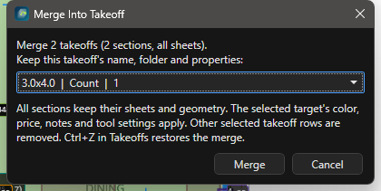
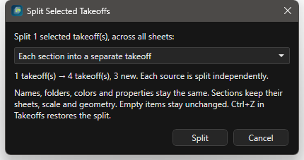
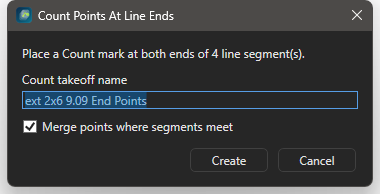

# Merge, Split, Break, Ends, Combine, Similar: step by step

Each editing operation is described here as a task: what to prepare, which steps, what to see in the status bar. The big picture (selection, vertices, Undo, the operations map, recipes that combine them) is on [Editing measurements and snaps](ourplancore-editing.md).

<figure markdown>
  
  <figcaption markdown="span">Tool strip: `Merge`, `Split` and the `Combine` list. `Break` and `Ends` sit further left, next to `P Line`.</figcaption>
</figure>

## Cheat sheet { #cheatsheet }

| Button | Key | What it does | Works with |
| --- | --- | --- | --- |
| `Merge` | ++ctrl+m++ | combines whole takeoffs (selection in the tree) or moves selected segments into another takeoff (selection on the sheet) | Takeoffs, sheet |
| `Split` | ++ctrl+shift+m++ | splits a takeoff by section or by sheet (tree); splits segments or marks off into a new takeoff (sheet) | Takeoffs, sheet |
| `Break` | ++ctrl+shift+b++ | each Line polyline falls apart into single-segment measurements | Line |
| `Break` with the H/V dot | ++ctrl+shift+v++ | segments go into `<name> - Horizontal` and `<name> - Vertical` | Line |
| `Ends` | none | Count marks at both ends of each Line segment | Line |
| `P Line` | none | Count marks along a Line at a set spacing | Line |
| `Cut` | ++x++, ++f9++ box | cutout in an Area, erasing a piece of a Line | Area, Line |
| `Combine` | none | Union, Subtract, Intersect, Remove Overlap, Divide for two or more Areas | Area |
| `Similar` | none | finds identical symbols on the sheet and on other sheets | Count |
| `Transform` | none | Flip H, Flip V, rotate, scale the selection | all |
| `Repeat Line`, `Repeat Beam` | none | a series of segments or beams without a dialog for each | Line, Beam |

All commands are in the palette ++ctrl+shift+p++: `Break Lines Into Segments`, `Break Lines Into Horizontal / Vertical`, `Count Points At Line Ends`, `Combine Areas: Union` and so on. Keys that have no binding are assigned in the [key editor](ourplancore-shortcuts.md#remap). `Merge`, `Split`, `Break`, `Ends`, `P Line`, `Combine` require the Advanced Takeoff Tools module (on by default, `Settings > Modules`).

## Two modes of Merge and Split { #modes }

- **Takeoff rows selected in the Takeoffs tree** (Ctrl or Shift on rows): whole takeoffs with all sections on all sheets are affected. This is how identical takeoffs from different floors are collected and a takeoff is split before Excel.
- **Measurements selected on the sheet** with the `Select` tool (or a section under a takeoff selected in the tree): segments and marks are affected. This is how a wrong piece is moved into another takeoff or split off into a new one.

The tree takes priority: if takeoff rows are selected there, the button and key work on whole takeoffs, even if something is still selected on the sheet. A click on a measurement on the sheet brings back segment mode.

Undo for the tree: ++ctrl+z++ with focus in the Takeoffs panel, or right-click **Undo Takeoff Merge / Split**. Undo on the sheet: ++ctrl+z++ in the viewport.

## How to merge whole takeoffs { #merge-takeoffs }

Why: one takeoff instead of several identical ones (2nd and 3rd floor walls with the same name).
You need: two or more takeoffs of the same type (Count with Count, Line with Line, Area with Area, J Area with J Area).

<figure markdown>
  
  <figcaption markdown="span">The `Merge Into Takeoff` dialog: pick which takeoff stays; the others move into it as sections.</figcaption>
</figure>

1. Select the takeoffs in Takeoffs: click the first one, ++ctrl++ or ++shift++ + click the others.
2. Click `Merge`, ++ctrl+m++ or right-click **Merge Selected Takeoffs...**.
3. In the list pick the takeoff that stays: its name, folder, color, price and properties are kept.
4. Click **Merge**.

Result: status `Merged 3 takeoffs into ext 2x6 9.09 (12 sections). Ctrl+Z in Takeoffs to undo.` Sections from all sheets moved into the chosen takeoff, the other rows disappeared. Geometry is not joined: lines stay separate segments, marks stay separate marks.

<figure markdown>
  <video class="kb-demo" loop muted playsinline preload="none" poster="../../assets/images/ourplancore/demo/d-merge.png"><source src="../../assets/images/ourplancore/demo/d-merge.mp4" type="video/mp4"></video>
  <figcaption markdown="span">Demo: a wall segment landed in the wrong takeoff; ++ctrl+m++ and `Merge Into Takeoff` move it into `ext 2x6 9.09`.</figcaption>
</figure>

!!! tip "Tips"
    - Takeoffs removed by a merge are kept in `AI_Context/takeoff-merge-trash` inside the job; ++ctrl+z++ in the tree brings them back while the session is open.
    - If the `Merge Into Takeoff` window shows only one row, the app merges without asking.

## How to move segments into another takeoff { #merge-sheet }

Why: a piece of wall was drawn in the wrong takeoff.
You need: the target takeoff already exists.

1. `Select` (++e++), click the segment, ++ctrl++ + click the other wrong ones.
2. Press ++ctrl+m++.
3. In the **Merge Into Takeoff** dialog pick the target takeoff, **Merge**.

Result: status `Merged 2 segment(s) into ext 2x6 9.09`, the segments took on the takeoff's color. Types do not mix: `Merge/Split needs one measurement type at a time`.

## How to split a takeoff by section or by sheet { #split-takeoffs }

Why: turn one takeoff on three sheets into three takeoffs for the DFL rows.
You need: a takeoff with several sections.

<figure markdown>
  
  <figcaption markdown="span">Two modes: `Each section into a separate takeoff` and `Separate takeoffs by sheet`; the preview shows how many takeoffs you will get.</figcaption>
</figure>

1. Select the takeoff (or several) in Takeoffs.
2. Click `Split`, ++ctrl+shift+m++ or right-click **Split Selected Takeoffs...**.
3. Pick the mode: `Each section into a separate takeoff` (default) or `Separate takeoffs by sheet`.
4. Check the preview `1 takeoff(s) ... 3 takeoff(s), 2 new` and click **Split**.

Result: status `Split 1 takeoff(s); created 2 new takeoff(s). Ctrl+Z in Takeoffs to undo.` The first group stayed in the original takeoff, the rest became neighboring takeoffs with the same name, folder and properties but a new color. Sections keep their sheet, scale and geometry; empty takeoffs do not change.

<figure markdown>
  <video class="kb-demo" loop muted playsinline preload="none" poster="../../assets/images/ourplancore/demo/d-split.png"><source src="../../assets/images/ourplancore/demo/d-split.mp4" type="video/mp4"></video>
  <figcaption markdown="span">Demo: doors on two sheets in one takeoff, ++ctrl+shift+m++, `Separate takeoffs by sheet`: two takeoffs, one per sheet.</figcaption>
</figure>

Sorting takeoffs by sheet for Excel in detail: [Split by sheets](ourplancore-split-by-sheets.md).

## How to split segments or marks off into a new takeoff { #split-sheet }

Why: part of the measurements should become a separate takeoff with a different name.
You need: measurements selected on the sheet.

1. `Select`, select the segments. For Count marks: ++alt++ + click or a box around the marks you need.
2. Press ++ctrl+shift+m++.
3. In the **Split Selected Measurements** dialog (for marks, **Split Selected Count Marks**) enter the name of the new takeoff, **OK**.

Result: status `Split 4 segment(s) into new takeoff ...` or `Split 3 Count marks into new takeoff ...`. The new takeoff sits next to the original one and gets its own color.

## How to break a polyline into segments { #break }

Why: move, recolor or place points on each segment separately.
You need: a Line of two or more segments.

<figure markdown>
  
  <figcaption markdown="span">`Break` with the small H/V dot (filled = mode on) and `Ends` to the right.</figcaption>
</figure>

1. Select the lines on the sheet or a Line takeoff in Takeoffs (several are fine).
2. Click `Break` or press ++ctrl+shift+b++ (right-click a line: **Break Line Into Segments**).
3. With 200 or more segments, confirm the `Break Lines Into Segments` prompt.

Result: status `Broke 2 line(s) into 9 separate segments. Ctrl+Z restores them.` The total length did not change, the number of sections under the takeoff grew. If all lines are already single-segment: `Nothing to break`.

## How to sort segments into horizontal and vertical { #break-hv }

Why: separate counts for horizontal and vertical members (bracing, trims).
You need: a Line drawn, even a single segment.

1. Select the lines or the takeoff.
2. Press ++ctrl+shift+v++. Or fill the H/V dot on the `Break` button (status `Break H/V is on`) and click `Break`.

Result: status `Broke 1 line(s) into 7 segments: 4 to bft - Horizontal, 3 to bft - Vertical. Ctrl+Z puts the lines back.` Next to the original takeoff appear `<name> - Horizontal` (the original color) and `<name> - Vertical` (a contrasting color). The original takeoff stays, even if empty, so that ++ctrl+z++ can bring back the polylines.

<figure markdown>
  <video class="kb-demo" loop muted playsinline preload="none" poster="../../assets/images/ourplancore/demo/d-break-ends.png"><source src="../../assets/images/ourplancore/demo/d-break-ends.mp4" type="video/mp4"></video>
  <figcaption markdown="span">Demo: ++ctrl+shift+v++ splits a wall into `Horizontal` and `Vertical`, then `Ends` places marks at the line ends.</figcaption>
</figure>

!!! tip "Tips"
    - Running it again adds segments to the same `- Horizontal` / `- Vertical` pair, no new pair is created.
    - In the Takeoffs tree ++ctrl+shift+v++ is Break H/V, while ++ctrl+v++ stays Paste.
    - Diagonal segments go to the axis they are closer to.

## How to place points at line ends { #ends }

Why: posts at beam ends, holdowns at shear wall ends.
You need: Lines selected on the sheet or a Line takeoff in the tree.

<figure markdown>
  
  <figcaption markdown="span">`Count Points At Line Ends`: name of the new Count, the `Merge points where segments meet` checkbox, the `Create` button.</figcaption>
</figure>

1. Select the lines.
2. Click `Ends` (right-click a line: **Count Points At Line Ends...**).
3. Set the name (default `<takeoff> End Points`), keep the `Merge points where segments meet` checkbox: one mark at a shared corner instead of two.
4. Click **Create**.

Result: status `End points created: 14 Count mark(s) in beam End Points. Merged 3 shared corner(s).` The new Count sits in the original takeoff's folder and becomes active; the tool switches to `Count`, so you can add marks by hand. Each source takeoff gives its own Count.

## How to place points along a line at a spacing { #pline }

Why: fence posts, hangers, anchors at a spacing.
You need: a Line selected.

1. Select one line or several.
2. Click `P Line` (right-click a line: **Create Count Points Along Line...**).
3. In the **Create Count Points Along Line(s)** dialog enter `Count takeoff name`, `Spacing, inches` (default is the line's spacing or 16), keep the `Include line end point` checkbox.
4. Click **Create**.

Result: a separate Count with marks along the line. The line stays and gives the LF. `No Count points were created` means the spacing is longer than the line.

<figure markdown>
  <video class="kb-demo" loop muted playsinline preload="none" poster="../../assets/images/ourplancore/demo/d-pline.png"><source src="../../assets/images/ourplancore/demo/d-pline.mp4" type="video/mp4"></video>
  <figcaption markdown="span">Demo: select the partitions, `P Line`, name `posts 2x4`, spacing 48: the marks line up along the lines.</figcaption>
</figure>

## How to cut an opening out of an area and erase a piece of a line { #cut }

Why: shafts, stairs and openings must not be in the area; a line must not run through a garage door.
You need: an Area or a Line on the sheet.

1. Click `Cut` (++x++). For a rectangle turn on `Box` (++f9++).
2. Click inside the area: it becomes the target (status `Cut: click inside the Area you want to cut` if you missed).
3. Outline the cutout point by point and finish with ++c++ or a double click; in `Box` mode click the second corner.
4. For a line: `Select`, pick the line, then `Cut` and outline the piece you are erasing.

Result: status `Cut (polygon): 1 area changed ...` or with the number of lines removed and added. A cutout can later be selected with a click inside it, moved, copied with the area or deleted with ++delete++ (the area stays).

<figure markdown>
  <video class="kb-demo" loop muted playsinline preload="none" poster="../../assets/images/ourplancore/demo/d-cut.png"><source src="../../assets/images/ourplancore/demo/d-cut.mp4" type="video/mp4"></video>
  <figcaption markdown="span">Demo: ++x++ with ++f9++ cuts a rectangle out of an area; the same move cuts a wall line at a door opening.</figcaption>
</figure>

!!! warning "Cut with no target"
    If the first click was outside every area and nothing is selected, `Cut` cuts all lines on the sheet that the outline touches. Select the target before cutting.

## How to unite, subtract or separate areas { #combine }

Why: overlapping areas, subtracting a balcony from a floor, splitting into parts.
You need: two or more Areas on one sheet; the first one selected is the main one.

1. `Select`, click the main area, ++ctrl++ + click the others.
2. Open the `Combine` list and pick the operation:

| Operation | Result |
| --- | --- |
| `Union` | one area from all selected |
| `Subtract` | subtract the others from the first selected; the others do not change |
| `Intersect` | only the common intersection remains |
| `Remove Overlap` | cut off the overlaps, the first selected stays whole; nothing is counted twice |
| `Divide` | split into non-overlapping parts plus a separate overlap area |

Result: status `Combine union: 2 area(s) merged into 1` and the like. `Combine: the selected areas do not overlap` means there is no intersection. For cutouts inside one Area, `Cut` is simpler.

<figure markdown>
  <video class="kb-demo" loop muted playsinline preload="none" poster="../../assets/images/ourplancore/demo/d-combine.png"><source src="../../assets/images/ourplancore/demo/d-combine.mp4" type="video/mp4"></video>
  <figcaption markdown="span">Demo: click `1st`, ++ctrl++ and click the balcony, `Combine > Subtract`: the floor area shrank by the overlap.</figcaption>
</figure>

## How to find identical symbols { #similar }

Why: count one symbol (holdown, post, hanger) across the whole sheet or job in one pass.
You need: a sheet open; an active Count or readiness to create a new one.

1. Click `Similar` and drag a box around one symbol.
2. Pick the threshold: `Strict`, `Default`, `Loose`; if needed, the `Match rotated copies (90° / 180° / 270°)` and `Match mirrored copies` checkboxes.
3. For the whole job tick `Search all sheets in this job`: matches verified against the raster are added automatically; text-only candidates are only shown. No more than 80 other sheets per search.
4. Check the marks: blue ones are added right away, orange weak ones are for review, gray check marks are already counted. `Include candidates` takes the weak ones too, `Strong only` takes only the reliable ones.
5. Click `Add N to <name>`.

Result: marks in the active Count or in a new `Similar Count`. The `Ask AI to identify the symbol` checkbox works online and only suggests a name (needs the AI module and a key, that is, the full version; in Lite the checkbox is visible but disabled). More on searching across sheets: [Similar across all sheets](ourplancore-extras-other.md#similar).

<figure markdown>
  <video class="kb-demo" loop muted playsinline preload="none" poster="../../assets/images/ourplancore/demo/d-similar.png"><source src="../../assets/images/ourplancore/demo/d-similar.mp4" type="video/mp4"></video>
  <figcaption markdown="span">Demo: `Similar`, a box around a window, the `Match rotated copies` and `Search all sheets` checkboxes, `Add`. The wait for the cross-sheet search is cut out.</figcaption>
</figure>

## How to mirror, rotate and scale the selection { #transform }

Why: a mirrored unit, a rotated building, measurements from a sheet at a different scale.
You need: measurements or markup selected on the sheet.

1. `Select`, select the measurements (together with cutouts and markup if needed).
2. Click `Flip H` or `Flip V` in row 2 of the strip: a mirror around the center of the selection.
3. Rotation: drag the orange rotate handle on the selection frame (++shift++ gives 15° steps) or move the `Rot` slider; the arrow button next to it resets the slider to zero for the next relative rotation.
4. Size: the orange corner handles scale from the center, the side handles stretch one side (++shift++ keeps the proportions); or use the `Scale` slider and the `1x` field (type `1.25x` or `125%`, ++enter++).

Result: status `Mirrored selection horizontal`, `Rotated selection 90 deg`, `Scaled selection 1.25x`. A slider move is undone with one ++ctrl+z++. The joist direction rotates together with a J Area. The keys `Mirror selected objects horizontally / vertically` are not bound by default.

<figure markdown>
  <video class="kb-demo" loop muted playsinline preload="none" poster="../../assets/images/ourplancore/demo/d-transform.png"><source src="../../assets/images/ourplancore/demo/d-transform.mp4" type="video/mp4"></video>
  <figcaption markdown="span">Demo: a box around the measurements, `Flip H`, `Flip V`, the `Rot` slider; three ++ctrl+z++ bring everything back.</figcaption>
</figure>

## How to repeat segments and beams { #repeat }

Why: a series of short segments or beams without picking the tool each time.
You need: a sheet with a scale.

1. Click the arrow button `Repeat Line` to the right of `Line` (or `Repeat Beam` to the right of `Beam`).
2. For a Line, set the name of the new takeoff once. Every two clicks create a separate two-point segment in it.
3. For a Beam, each pair of clicks measures the length, asks for the name and places a mark, then waits for the next beam.
4. Press ++esc++ or click the repeat button again to stop.

Result: status `Repeat drawing stopped`, a series of measurements in the tree.

<figure markdown>
  <video class="kb-demo" loop muted playsinline preload="none" poster="../../assets/images/ourplancore/demo/d-repeat.png"><source src="../../assets/images/ourplancore/demo/d-repeat.mp4" type="video/mp4"></video>
  <figcaption markdown="span">Demo: `Repeat Line`, name `blk 2x10`, segments with pairs of clicks without switching tools, ++esc++ finishes.</figcaption>
</figure>

## Traps { #traps }

- `Merge` does not join geometry: two walls end to end stay two segments with a combined total.
- `Split` on the sheet and `Split` in the tree are different commands; look at where the selection is.
- `Break H/V` creates a pair of takeoffs and adds to it on the next run.
- `Similar` finds similar pictures, not the same purpose: a window and a door of the same shape can end up in one count. Check the orange marks.
- Operations from the tree are undone with ++ctrl+z++ only with focus in the Takeoffs panel; operations on the sheet only with focus in the viewport.
- `Cut` with no selected target cuts all lines the outline touches.

## See also

- [Editing measurements and snaps: how it all works together](ourplancore-editing.md)
- [Snap and tracing](ourplancore-snap-trace.md)
- [Measuring tools](ourplancore-tools.md), [Takeoffs tree](ourplancore-takeoffs.md)
- [Hotkeys](ourplancore-shortcuts.md)
- [Common mistakes: sheets and tree](../start/common-mistakes.md#pages)
