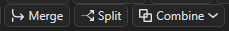
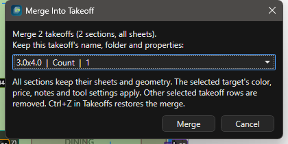
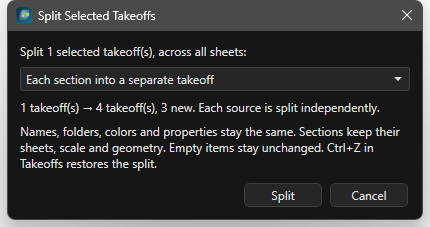
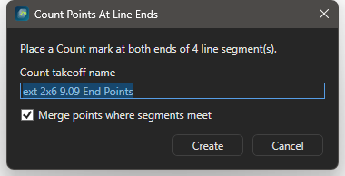

# Merge, Split, Break, Ends, Combine, Similar: пошагово

Здесь каждая операция правки описана задачей: что подготовить, какие шаги, что увидеть в статусе. Общая картина (выделение, вершины, Undo, карта операций, рецепты в связке) на странице [Правка замеров и привязки](ourplancore-editing.md).

<figure markdown>
  
  <figcaption markdown="span">Полоса инструментов: `Merge`, `Split` и список `Combine`. `Break` и `Ends` стоят левее, рядом с `P Line`.</figcaption>
</figure>

## Шпаргалка { #cheatsheet }

| Кнопка | Клавиша | Что делает | С чем работает |
| --- | --- | --- | --- |
| `Merge` | ++ctrl+m++ | объединяет целые позиции (выбор в дереве) или переносит выбранные сегменты в другую позицию (выбор на листе) | Takeoffs, лист |
| `Split` | ++ctrl+shift+m++ | делит позицию по секциям или по листам (дерево); отделяет сегменты или метки в новую позицию (лист) | Takeoffs, лист |
| `Break` | ++ctrl+shift+b++ | каждая ломаная Line распадается на односегментные замеры | Line |
| `Break` с точкой H/V | ++ctrl+shift+v++ | сегменты уходят в `<имя> - Horizontal` и `<имя> - Vertical` | Line |
| `Ends` | нет | Count-метки на обоих концах каждого сегмента Line | Line |
| `P Line` | нет | Count-метки вдоль Line с заданным шагом | Line |
| `Cut` | ++x++, ++f9++ бокс | вырез в Area, стирание куска Line | Area, Line |
| `Combine` | нет | Union, Subtract, Intersect, Remove Overlap, Divide для двух и больше Area | Area |
| `Similar` | нет | поиск одинаковых символов на листе и на других листах | Count |
| `Transform` | нет | Flip H, Flip V, поворот, масштаб выбранного | все |
| `Repeat Line`, `Repeat Beam` | нет | серия отрезков или балок без диалога на каждую | Line, Beam |

Все команды есть в палитре ++ctrl+shift+p++: `Break Lines Into Segments`, `Break Lines Into Horizontal / Vertical`, `Count Points At Line Ends`, `Combine Areas: Union` и так далее. Клавиши без назначения задаются в [редакторе клавиш](ourplancore-shortcuts.md#remap). `Merge`, `Split`, `Break`, `Ends`, `P Line`, `Combine` требуют модуль Advanced Takeoff Tools (включён по умолчанию, `Settings > Modules`).

## Два режима Merge и Split { #modes }

- **Строки позиций выделены в дереве Takeoffs** (Ctrl или Shift по строкам): работают целые позиции со всеми секциями на всех листах. Так собирают одинаковые позиции с разных этажей и делят позицию перед Excel.
- **Замеры выбраны на листе** инструментом `Select` (или выбрана секция под позицией в дереве): работают сегменты и метки. Так переносят ошибочный кусок в другую позицию или отделяют его в новую.

Приоритет у дерева: если там выделены строки позиций, кнопка и клавиша работают с целыми позициями, даже если на листе что-то осталось выбранным. Клик по замеру на листе возвращает режим сегментов.

Отмена для дерева: ++ctrl+z++ с фокусом в панели Takeoffs или ПКМ **Undo Takeoff Merge / Split**. Отмена на листе: ++ctrl+z++ во вьюпорте.

## Как слить целые позиции { #merge-takeoffs }

Зачем: одна позиция вместо нескольких одинаковых (стены 2-го и 3-го этажей с одним именем).
Нужно: две и больше позиции одного типа (Count с Count, Line с Line, Area с Area, J Area с J Area).

<figure markdown>
  
  <figcaption markdown="span">Диалог `Merge Into Takeoff`: выбрать, какая позиция остаётся; остальные переезжают в неё секциями.</figcaption>
</figure>

1. В Takeoffs выделите позиции: клик по первой, ++ctrl++ или ++shift++ + клик по остальным.
2. Нажмите `Merge`, ++ctrl+m++ или ПКМ **Merge Selected Takeoffs...**.
3. В списке выберите позицию, которая останется: её имя, папка, цвет, цена и свойства сохраняются.
4. Нажмите **Merge**.

Результат: статус `Merged 3 takeoffs into ext 2x6 9.09 (12 sections). Ctrl+Z in Takeoffs to undo.` Секции со всех листов переехали в выбранную позицию, остальные строки исчезли. Геометрия не склеивается: линии остаются отдельными сегментами, метки отдельными метками.

<figure markdown>
  <video class="kb-demo" loop muted playsinline preload="none" poster="../../assets/images/ourplancore/demo/d-merge.png"><source src="../../assets/images/ourplancore/demo/d-merge.mp4" type="video/mp4"></video>
  <figcaption markdown="span">Демонстрация: сегмент стены попал не в ту позицию; ++ctrl+m++ и `Merge Into Takeoff` переносят его в `ext 2x6 9.09`.</figcaption>
</figure>

!!! tip "Советы"
    - Удалённые при объединении позиции хранятся в `AI_Context/takeoff-merge-trash` внутри проекта; ++ctrl+z++ в дереве возвращает их, пока сессия открыта.
    - Если окно `Merge Into Takeoff` показывает одну строку, программа сольёт без вопроса.

## Как перенести сегменты в другую позицию { #merge-sheet }

Зачем: кусок стены нарисован не в той позиции.
Нужно: нужная позиция уже существует.

1. `Select` (++e++), кликните по сегменту, ++ctrl++ + клик по остальным ошибочным.
2. Нажмите ++ctrl+m++.
3. В диалоге **Merge Into Takeoff** выберите позицию назначения, **Merge**.

Результат: статус `Merged 2 segment(s) into ext 2x6 9.09`, сегменты перекрасились в цвет позиции. Типы не смешиваются: `Merge/Split needs one measurement type at a time`.

## Как разделить позицию по секциям или листам { #split-takeoffs }

Зачем: из одной позиции на трёх листах получить три позиции под строки DFL.
Нужно: позиция с несколькими секциями.

<figure markdown>
  
  <figcaption markdown="span">Два режима: `Each section into a separate takeoff` и `Separate takeoffs by sheet`; превью показывает, сколько позиций получится.</figcaption>
</figure>

1. Выделите позицию (или несколько) в Takeoffs.
2. Нажмите `Split`, ++ctrl+shift+m++ или ПКМ **Split Selected Takeoffs...**.
3. Выберите режим: `Each section into a separate takeoff` (по умолчанию) или `Separate takeoffs by sheet`.
4. Проверьте превью `1 takeoff(s) ... 3 takeoff(s), 2 new` и нажмите **Split**.

Результат: статус `Split 1 takeoff(s); created 2 new takeoff(s). Ctrl+Z in Takeoffs to undo.` Первая группа осталась в исходной позиции, остальные стали соседними позициями с тем же именем, папкой и свойствами, но новым цветом. Секции сохраняют лист, масштаб и геометрию; пустые позиции не меняются.

<figure markdown>
  <video class="kb-demo" loop muted playsinline preload="none" poster="../../assets/images/ourplancore/demo/d-split.png"><source src="../../assets/images/ourplancore/demo/d-split.mp4" type="video/mp4"></video>
  <figcaption markdown="span">Демонстрация: двери на двух листах в одной позиции, ++ctrl+shift+m++, `Separate takeoffs by sheet`: две позиции, по одной на лист.</figcaption>
</figure>

Раскладка позиций по листам для Excel подробно: [Split по листам](ourplancore-split-by-sheets.md).

## Как отделить сегменты или метки в новую позицию { #split-sheet }

Зачем: часть замеров должна стать отдельной позицией с другим именем.
Нужно: замеры выбраны на листе.

1. `Select`, выделите сегменты. Для меток Count: ++alt++ + клик или рамка по нужным меткам.
2. Нажмите ++ctrl+shift+m++.
3. В диалоге **Split Selected Measurements** (для меток **Split Selected Count Marks**) введите имя новой позиции, **OK**.

Результат: статус `Split 4 segment(s) into new takeoff ...` или `Split 3 Count marks into new takeoff ...`. Новая позиция лежит рядом с исходной и получает свой цвет.

## Как разбить ломаную на отрезки { #break }

Зачем: двигать, перекрашивать или ставить точки по каждому отрезку отдельно.
Нужно: Line из двух и больше сегментов.

<figure markdown>
  
  <figcaption markdown="span">`Break` с маленькой точкой H/V (закрашена = режим включён) и `Ends` справа.</figcaption>
</figure>

1. Выделите линии на листе или Line-позицию в Takeoffs (можно несколько).
2. Нажмите `Break` или ++ctrl+shift+b++ (ПКМ по линии: **Break Line Into Segments**).
3. При 200 и больше сегментах подтвердите вопрос `Break Lines Into Segments`.

Результат: статус `Broke 2 line(s) into 9 separate segments. Ctrl+Z restores them.` Сумма длин не изменилась, число секций под позицией выросло. Если все линии уже односегментные: `Nothing to break`.

## Как разнести отрезки по горизонтали и вертикали { #break-hv }

Зачем: раздельный счёт горизонтальных и вертикальных элементов (bracing, trims).
Нужно: Line нарисована, можно одним сегментом.

1. Выделите линии или позицию.
2. Нажмите ++ctrl+shift+v++. Или закрасьте точку H/V на кнопке `Break` (статус `Break H/V is on`) и нажмите `Break`.

Результат: статус `Broke 1 line(s) into 7 segments: 4 to bft - Horizontal, 3 to bft - Vertical. Ctrl+Z puts the lines back.` Рядом с исходной позицией появились `<имя> - Horizontal` (цвет исходной) и `<имя> - Vertical` (контрастный цвет). Исходная позиция остаётся, даже пустая, чтобы ++ctrl+z++ вернул ломаные.

<figure markdown>
  <video class="kb-demo" loop muted playsinline preload="none" poster="../../assets/images/ourplancore/demo/d-break-ends.png"><source src="../../assets/images/ourplancore/demo/d-break-ends.mp4" type="video/mp4"></video>
  <figcaption markdown="span">Демонстрация: ++ctrl+shift+v++ делит стену на `Horizontal` и `Vertical`, затем `Ends` ставит метки на концах линий.</figcaption>
</figure>

!!! tip "Советы"
    - Повторный запуск доливает сегменты в ту же пару `- Horizontal` / `- Vertical`, новая пара не создаётся.
    - В дереве Takeoffs ++ctrl+shift+v++ это Break H/V, а ++ctrl+v++ остаётся Paste.
    - Диагональные отрезки относятся к той оси, к которой ближе.

## Как поставить точки на концах линий { #ends }

Зачем: посты по концам балок, holdowns по концам shear walls.
Нужно: Line выбраны на листе или Line-позиция в дереве.

<figure markdown>
  
  <figcaption markdown="span">`Count Points At Line Ends`: имя нового Count, галка `Merge points where segments meet`, кнопка `Create`.</figcaption>
</figure>

1. Выделите линии.
2. Нажмите `Ends` (ПКМ по линии: **Count Points At Line Ends...**).
3. Задайте имя (по умолчанию `<позиция> End Points`), оставьте галку `Merge points where segments meet`: одна метка в общем углу вместо двух.
4. Нажмите **Create**.

Результат: статус `End points created: 14 Count mark(s) in beam End Points. Merged 3 shared corner(s).` Новый Count лежит в папке исходной позиции и становится активным; инструмент переключён на `Count`, можно добавить метки вручную. Каждая исходная позиция даёт свой Count.

## Как поставить точки вдоль линии с шагом { #pline }

Зачем: стойки забора, hangers, anchors по шагу.
Нужно: Line выбрана.

1. Выделите линию или несколько.
2. Нажмите `P Line` (ПКМ по линии: **Create Count Points Along Line...**).
3. В диалоге **Create Count Points Along Line(s)** введите `Count takeoff name`, `Spacing, inches` (по умолчанию шаг линии или 16), оставьте галку `Include line end point`.
4. Нажмите **Create**.

Результат: отдельный Count с метками вдоль линии. Линия остаётся и даёт погонаж. `No Count points were created` означает, что шаг больше длины линии.

<figure markdown>
  <video class="kb-demo" loop muted playsinline preload="none" poster="../../assets/images/ourplancore/demo/d-pline.png"><source src="../../assets/images/ourplancore/demo/d-pline.mp4" type="video/mp4"></video>
  <figcaption markdown="span">Демонстрация: выделить перегородки, `P Line`, имя `posts 2x4`, шаг 48: метки встают вдоль линий.</figcaption>
</figure>

## Как вырезать проём из площади и стереть кусок линии { #cut }

Зачем: шахты, лестницы и проёмы не должны входить в площадь; линия не должна идти через ворота.
Нужно: Area или Line на листе.

1. Нажмите `Cut` (++x++). Для прямоугольника включите `Box` (++f9++).
2. Кликните внутри площади: она становится целью (статус `Cut: click inside the Area you want to cut`, если промахнулись).
3. Обведите вырез точками и закончите ++c++ или двойным кликом; в режиме `Box` кликните второй угол.
4. Для линии: `Select`, выберите линию, затем `Cut` и обведите кусок, который стираете.

Результат: статус `Cut (polygon): 1 area changed ...` или с числом удалённых и добавленных линий. Вырез (cutout) потом можно выбрать кликом внутри него, подвинуть, скопировать с площадью или удалить ++delete++ (площадь остаётся).

<figure markdown>
  <video class="kb-demo" loop muted playsinline preload="none" poster="../../assets/images/ourplancore/demo/d-cut.png"><source src="../../assets/images/ourplancore/demo/d-cut.mp4" type="video/mp4"></video>
  <figcaption markdown="span">Демонстрация: ++x++ с ++f9++ вырезает прямоугольник из площади; тот же приём режет линию стены по проёму двери.</figcaption>
</figure>

!!! warning "Cut без цели"
    Если первый клик был вне любой площади и ничего не выбрано, `Cut` режет все линии листа, которых касается контур. Выделяйте цель до резки.

## Как объединить, вычесть или развести площади { #combine }

Зачем: площади внахлёст, вычет балкона из этажа, разбиение на части.
Нужно: две и больше Area на одном листе; первая выбранная главная.

1. `Select`, кликните главную площадь, ++ctrl++ + клик по остальным.
2. Откройте список `Combine` и выберите операцию:

| Операция | Результат |
| --- | --- |
| `Union` | одна площадь из всех выбранных |
| `Subtract` | из первой выбранной вычесть остальные; остальные не меняются |
| `Intersect` | остаётся только общее пересечение |
| `Remove Overlap` | срезать перекрытия, первая выбранная остаётся целой; ничего не считается дважды |
| `Divide` | разбить на непересекающиеся части плюс отдельная площадь перекрытия |

Результат: статус `Combine union: 2 area(s) merged into 1` и подобные. `Combine: the selected areas do not overlap` значит, что пересечения нет. Для вырезов внутри одной Area проще `Cut`.

<figure markdown>
  <video class="kb-demo" loop muted playsinline preload="none" poster="../../assets/images/ourplancore/demo/d-combine.png"><source src="../../assets/images/ourplancore/demo/d-combine.mp4" type="video/mp4"></video>
  <figcaption markdown="span">Демонстрация: щелчок по `1st`, ++ctrl++ и щелчок по балкону, `Combine > Subtract`: площадь этажа уменьшилась на нахлёст.</figcaption>
</figure>

## Как найти такие же символы { #similar }

Зачем: один символ (holdown, post, hanger) посчитать по всему листу или проекту за один проход.
Нужно: лист открыт; активный Count или готовность создать новый.

1. Нажмите `Similar` и обведите рамкой один символ.
2. Выберите порог: `Strict`, `Default`, `Loose`; при необходимости галки `Match rotated copies (90° / 180° / 270°)` и `Match mirrored copies`.
3. Для всего проекта поставьте `Search all sheets in this job`: совпадения, проверенные по растру, добавятся сами; кандидаты только по тексту лишь показываются. Не больше 80 других листов за поиск.
4. Проверьте метки: синие добавляются сразу, оранжевые слабые на проверку, серые галки уже посчитаны. `Include candidates` берёт и слабые, `Strong only` только надёжные.
5. Нажмите `Add N to <имя>`.

Результат: метки в активном Count или в новом `Similar Count`. Галка `Ask AI to identify the symbol` работает онлайн и только подсказывает имя (нужны модуль AI и ключ). Подробно про поиск по листам: [Similar по всем листам](ourplancore-extras-other.md#similar).

<figure markdown>
  <video class="kb-demo" loop muted playsinline preload="none" poster="../../assets/images/ourplancore/demo/d-similar.png"><source src="../../assets/images/ourplancore/demo/d-similar.mp4" type="video/mp4"></video>
  <figcaption markdown="span">Демонстрация: `Similar`, рамка вокруг окна, галки `Match rotated copies` и `Search all sheets`, `Add`. Ожидание поиска по листам вырезано.</figcaption>
</figure>

## Как отразить, повернуть и масштабировать выбранное { #transform }

Зачем: зеркальный юнит, повёрнутый корпус, замеры с листа другого масштаба.
Нужно: замеры или разметка выбраны на листе.

1. `Select`, выделите замеры (можно вместе с вырезами и разметкой).
2. Нажмите `Flip H` или `Flip V` в строке 2 полосы: зеркало вокруг центра выделения.
3. Поворот: перетащите оранжевую ручку поворота на рамке выделения (++shift++ даёт шаг 15°) или двигайте ползунок `Rot`; кнопка со стрелкой рядом возвращает ползунок в ноль для следующего относительного поворота.
4. Размер: угловые оранжевые ручки масштабируют от центра, боковые тянут одну сторону (++shift++ сохраняет пропорции); или ползунок `Scale` и поле `1x` (ввести `1.25x` или `125%`, ++enter++).

Результат: статус `Mirrored selection horizontal`, `Rotated selection 90 deg`, `Scaled selection 1.25x`. Движение ползунка отменяется одним ++ctrl+z++. Направление joists поворачивается вместе с J Area. Клавиши `Mirror selected objects horizontally / vertically` по умолчанию не назначены.

<figure markdown>
  <video class="kb-demo" loop muted playsinline preload="none" poster="../../assets/images/ourplancore/demo/d-transform.png"><source src="../../assets/images/ourplancore/demo/d-transform.mp4" type="video/mp4"></video>
  <figcaption markdown="span">Демонстрация: рамка по замерам, `Flip H`, `Flip V`, ползунок `Rot`; три ++ctrl+z++ возвращают всё назад.</figcaption>
</figure>

## Как повторять отрезки и балки { #repeat }

Зачем: серия коротких отрезков или балок без выбора инструмента каждый раз.
Нужно: лист с масштабом.

1. Нажмите кнопку со стрелкой `Repeat Line` справа от `Line` (или `Repeat Beam` справа от `Beam`).
2. Для Line задайте имя новой позиции один раз. Каждые два клика создают отдельный двухточечный отрезок в ней.
3. Для Beam каждая пара кликов меряет длину, спрашивает имя и ставит метку, затем ждёт следующую балку.
4. Нажмите ++esc++ или кнопку повтора ещё раз, чтобы остановиться.

Результат: статус `Repeat drawing stopped`, серия замеров в дереве.

<figure markdown>
  <video class="kb-demo" loop muted playsinline preload="none" poster="../../assets/images/ourplancore/demo/d-repeat.png"><source src="../../assets/images/ourplancore/demo/d-repeat.mp4" type="video/mp4"></video>
  <figcaption markdown="span">Демонстрация: `Repeat Line`, имя `blk 2x10`, отрезки парами щелчков без переключения инструмента, ++esc++ заканчивает.</figcaption>
</figure>

## Ловушки { #traps }

- `Merge` не склеивает геометрию: две стены встык остаются двумя сегментами с общей суммой.
- `Split` на листе и `Split` в дереве это разные команды; смотрите, где выделение.
- `Break H/V` заводит пару позиций и при следующем запуске доливает в неё.
- `Similar` находит похожие картинки, а не одинаковое назначение: окно и дверь одной формы могут попасть в один счёт. Проверяйте оранжевые метки.
- Операции из дерева откатываются ++ctrl+z++ только с фокусом в панели Takeoffs; операции на листе только с фокусом во вьюпорте.
- `Cut` без выбранной цели режет все линии, которых касается контур.

## См. также

- [Правка замеров и привязки: как всё работает вместе](ourplancore-editing.md)
- [Snap и трассировка](ourplancore-snap-trace.md)
- [Инструменты замера](ourplancore-tools.md), [Дерево Takeoffs](ourplancore-takeoffs.md)
- [Горячие клавиши](ourplancore-shortcuts.md)
- [Частые ошибки: листы и дерево](../start/common-mistakes.md#pages)
