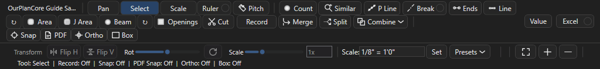
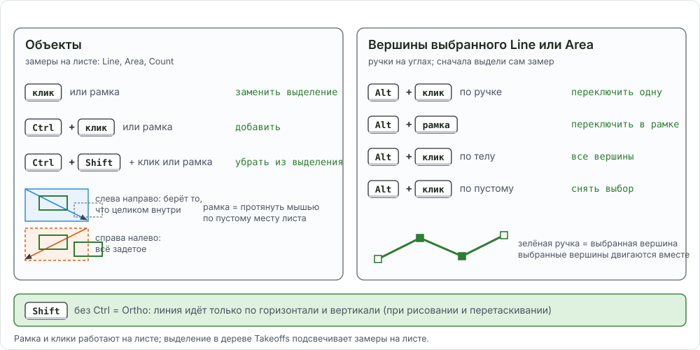
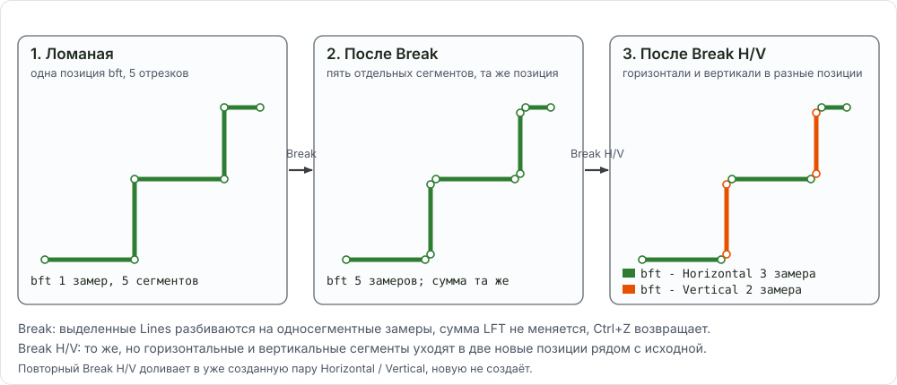

# Editing measurements and snaps: how it all works together

This page collects everything you do with a measurement that is already drawn: how to select an object or its vertex, how to move, cut, merge, cut out, mirror and undo. The tables answer which tool and where, the recipes at the bottom show the operations together, the right-click menu items (copy, rename, delete on the sheet, in Takeoffs, Pages and Estimating) are collected at the [end of the page](#context-menus), the detailed steps of each operation are on the [Merge, Split, Break, Ends, Combine, Similar page](ourplancore-edit-takeoffs.md), and snaps and tracing are on the [Snap and tracing page](ourplancore-snap-trace.md).

<figure markdown>
  
  <figcaption markdown="span">Row 1 of the tool strip: drawing, `Cut`, `Merge`, `Split`, `Combine`, the `Snap` / `PDF` / `Ortho` / `Box` toggles. Row 2: `Transform` (Flip H, Flip V, Rot, Scale).</figcaption>
</figure>

## Selection model { #selection }

The `Select` tool (++e++ key). There is one rule: **Ctrl works with objects, Alt with vertices**. Shift without Ctrl is reserved for Ortho (it holds a right angle temporarily).

<figure markdown>
  
  <figcaption markdown="span">Left: a click and a box with no keys replace the selection, with Ctrl they add an object, with Ctrl+Shift they remove it. Right: Alt toggles the blue handles of the selected object, Alt-click on the body takes all handles, Alt-click on empty space clears them.</figcaption>
</figure>

| What I want | Gesture | What the status bar shows |
| --- | --- | --- |
| select one measurement | click on a line, outline or mark | `Moving Line...` while dragging |
| select several with a box | a box left to right takes what is fully inside; a box right to left takes everything it touches | `Selected N measurement(s) and M enclosed cutout(s)` or `... touched cutout(s)` |
| add to the selection | ++ctrl++ + click or ++ctrl++ + box | `Selected N measurement(s) and M cutout(s)` |
| remove from the selection | ++ctrl+shift++ + click or box | `Removed N object(s)` |
| all measurements on the sheet | ++ctrl+a++ | |
| vertices of the selected Line or Area | ++alt++ + click on a handle toggles one, ++alt++ + box toggles all handles in the box, ++alt++ + click on the body takes all, ++alt++ + click on empty space clears | `N handle(s) selected` |
| one Count mark | click the mark and drag; no ++alt++ needed | |
| a cutout (hole) in an Area | click inside the cutout; ++ctrl++ adds to the selection | `... cutout(s)` |
| clear the selection | click on empty space or ++esc++ | |

What else selection on the sheet does: ++delete++ deletes the selected objects, the selected vertices or the selected cutouts (the parent Area stays); ++f2++ or a double click on a measurement renames its takeoff; ++ctrl+c++ / ++ctrl+v++ copy to another sheet ([copying](ourplancore-takeoffs.md#copy)); ++h++ hides the whole takeoff of the selected measurement on this sheet ([visibility](ourplancore-takeoffs.md#hide)).

**Sheet and tree.** The selection on the sheet and the selection in the Takeoffs tree live separately. On the sheet you select segments, marks and cutouts of one page. In the tree you select whole takeoffs (Ctrl or Shift on rows) or sections under a takeoff. `Merge`, `Split`, `Break` and `Ends` look at where the selection is: if takeoff rows are selected in the tree, they work on whole takeoffs on all sheets; otherwise on what is selected on the sheet. ++ctrl+enter++ in the tree selects the section's measurements on the sheet.

## Editing vertices { #vertices }

You need: the `Select` tool, a Line or Area measurement selected (blue handles visible).

### How to move a vertex { #move-vertex }

1. Hover over a blue handle of the selected measurement.
2. Drag it. ++shift++ while dragging keeps the move on one axis, `Snap` (++f3++) catches the vertex on the ends, midpoints and intersections of neighboring measurements.
3. Release the button.

Result: status `Editing Line vertex N`, the takeoff's length or area is recalculated in `Total`.

### How to move several vertices at once { #move-vertices }

1. Select the measurement (or several measurements with a box).
2. ++alt++ + box around the corners you need: the handles become selected.
3. Drag any selected handle; all selected ones move together. ++shift++ holds the axis.

Result: status `Editing N selected vertices`. This is how the shared corner of two walls is moved in one go.

### How to add and remove a vertex { #add-vertex }

1. Right-click the line or outline at the right spot: the **Insert Vertex Here** item inserts a vertex into the nearest segment. Status `Inserted Line vertex N`.
2. To remove an extra one: right-click next to it, **Remove Nearest Vertex**; or ++alt++ + click on the handle and ++delete++. A Line must keep at least two points, an Area three.
3. To delete Count marks: ++alt++ + click or a box around the marks, ++delete++. If all marks of a measurement are selected, the whole measurement is deleted.

Result: `Deleted N selected vertex/vertices`. ++ctrl+z++ brings it back.

<figure markdown>
  <video class="kb-demo" loop muted playsinline preload="none" poster="../../assets/images/ourplancore/demo/d-vertex-edit.png"><source src="../../assets/images/ourplancore/demo/d-vertex-edit.mp4" type="video/mp4"></video>
  <figcaption markdown="span">Demo: right-click a line, `Insert Vertex Here`, drag the vertex, then `Remove Nearest Vertex`.</figcaption>
</figure>

## Undo: which one where { #undo }

The app has several undos, each listens to its own focus.

| Where the focus is | Key | What it undoes |
| --- | --- | --- |
| sheet (viewport) | ++ctrl+z++ or ++backspace++ | the last geometry action on this sheet: drawing (point by point), move, vertices, `Cut`, `Combine`, `Break`, `Transform`, paste, delete, markup and the `Hide` mask, crops on the target sheet, overlay shift. Depth 80 steps; each sheet has its own stack, cleared when you switch sheets |
| Takeoffs tree | ++ctrl+z++ or right-click **Undo Takeoff Merge / Split** | deleting takeoffs and folders, `Merge` and `Split` of whole takeoffs, in reverse order |
| Pages tree | ++ctrl+z++ or right-click **Undo Last Page Delete** | only the last deletion of sheets and folders; another job or closing the app sends it to the Windows Recycle Bin |
| Main > Open / Import | **Undo Last Page Sort**, **Undo Last Page Operation** | sheet sorting, job import |

Not undone by Undo: renaming, moving a takeoff between folders, legend order and groups, placing a crop from the source sheet (delete it on the target sheet).

## Operations map { #map }

| What I want to do | Tool | Key | Where in the menu | Page |
| --- | --- | --- | --- | --- |
| select, move, delete | `Select` | ++e++, ++delete++ | tool strip | [above](#selection) |
| move or delete a vertex | handles, ++alt++ | ++delete++ | right-click **Insert Vertex Here**, **Remove Nearest Vertex** | [above](#vertices) |
| merge takeoffs or segments | `Merge` | ++ctrl+m++ | right-click in Takeoffs **Merge Selected Takeoffs...** | [Merge](ourplancore-edit-takeoffs.md#merge-takeoffs) |
| split a takeoff by sheet or section | `Split` | ++ctrl+shift+m++ | right-click in Takeoffs **Split Selected Takeoffs...** | [Split](ourplancore-edit-takeoffs.md#split-takeoffs) |
| split segments or marks off into a new takeoff | `Split` on the sheet | ++ctrl+shift+m++ | | [Split on the sheet](ourplancore-edit-takeoffs.md#split-sheet) |
| break a polyline into segments | `Break` | ++ctrl+shift+b++ | right-click a line **Break Line Into Segments** | [Break](ourplancore-edit-takeoffs.md#break) |
| sort into horizontal and vertical | `Break` with the H/V dot | ++ctrl+shift+v++ | | [Break H/V](ourplancore-edit-takeoffs.md#break-hv) |
| points at line ends | `Ends` | none | right-click a line **Count Points At Line Ends...** | [Ends](ourplancore-edit-takeoffs.md#ends) |
| points along a line at a spacing | `P Line` | none | right-click a line **Create Count Points Along Line...** | [P Line](ourplancore-edit-takeoffs.md#pline) |
| cutout in an area, erase a piece of a line | `Cut` | ++x++, ++f9++ box | tool strip | [Cut](ourplancore-edit-takeoffs.md#cut) |
| add, subtract, trim overlapping areas | `Combine` | none | `Combine` list | [Combine](ourplancore-edit-takeoffs.md#combine) |
| find identical symbols | `Similar` | none | tool strip | [Similar](ourplancore-edit-takeoffs.md#similar) |
| mirror, rotate, scale the selection | `Transform` | none (`Mirror` can be bound) | row 2 of the strip | [Transform](ourplancore-edit-takeoffs.md#transform) |
| linked copies of an assembly on several sheets | `Groups` | none | bottom strip after `Cut`, right-click on the sheet > `Groups` | [Groups](ourplancore-groups.md) |
| repeat segments or beams without a dialog | `Repeat Line`, `Repeat Beam` | none | arrow buttons next to `Line` and `Beam` | [Repeat](ourplancore-edit-takeoffs.md#repeat) |
| right angle, rectangle, snap to your own points | `Ortho`, `Box`, `Snap` | ++f8++, ++f9++, ++f3++ | tool strip | [Snap](ourplancore-snap-trace.md#snap) |
| take walls off a vector PDF | `Trace Walls Inside Area`, `Layer Trace` | none | right-click an Area, PDF Layers tab | [tracing](ourplancore-snap-trace.md#wall-trace) |

All commands are also in the palette ++ctrl+shift+p++ (`Break Lines Into Segments`, `Count Points At Line Ends`, `Combine Areas: Union`...). A key with no binding can be assigned in the [key editor](ourplancore-shortcuts.md#remap). `Merge`, `Split`, `Break`, `Ends`, `P Line`, `Combine`, `Similar` and wall tracing require the Advanced Takeoff Tools module (on by default, `Settings > Modules`).

## What works with what { #matrix }

| Operation | Line | Area | Count | J Area | Beam | Openings |
| --- | --- | --- | --- | --- | --- | --- |
| move, ++delete++, ++ctrl+c++ / ++ctrl+v++ | yes | yes | yes | yes | yes | yes |
| vertices (Alt, Insert, Remove) | yes | yes | marks | yes | mark | mark |
| `Merge` of whole takeoffs | yes | yes | yes | yes | like Count | like Count |
| `Merge` of segments on the sheet | yes | yes | yes | yes | like Count | like Count |
| `Split` of a takeoff by section or sheet | yes | yes | yes | yes | like Count | like Count |
| `Split` of segments or marks on the sheet | yes | yes | yes, selected marks | yes | marks | marks |
| `Break`, `Break H/V` | yes | no | no | no | no | no |
| `Ends`, `P Line` | yes | no | no | no | no | no |
| `Cut` | erases a piece | cutout | no | cutout | no | no |
| `Combine` | no | yes, 2 or more | no | yes, like Area | no | no |
| `Transform` | yes | yes | yes | yes | yes | yes |
| `Similar` | no | no | yes | no | no | no |

Beam and Openings are stored as a Count with a mark, so for editing they behave like a Count: the mark can be moved, merged, split; the beam length and the opening size sit in the name. `Merge` and `Split` do not mix types: Line only with Line, Area with Area, Count with Count, J Area with J Area.

## Recipes together { #recipes }

Each recipe runs from an estimator's task to a visible result. The `PDF` snap is not used in the recipes: it works unreliably ([why](ourplancore-snap-trace.md#pdf-snap)); accuracy comes from `Ortho`, `Box`, `Snap` to your own points, zoom and editing vertices afterwards.

### How to trace a wall with right angles and close the outline { #recipe-wall }

Why: a polyline along the wall centerline with no corners drifting by a fraction of a degree.
You need: a sheet with a scale, the W sheet dot set.

1. Click `Line` (++l++), give the takeoff a name (`ext 2x6 9.09`), **OK**.
2. Turn on `Ortho` (++f8++) and `Snap` (++f3++).
3. Zoom in on the first corner and click on the wall centerline.
4. Move the cursor to the next corner: `Ortho` holds horizontal or vertical. On a diagonal run release `Ortho` with one press of ++f8++ and turn it back on afterwards.
5. To close, bring the cursor to the first point: the `Snap` highlight shows `end`; click. For an Area a click near the first point is enough, the outline closes by itself.
6. Press ++c++ or double-click to finish the polyline.
7. Check the corners: `Select`, drag the handles where the centerline drifted.

Result: a takeoff in `walls/<floor> floor walls`, `Total` shows the length. An extra point while drawing is removed with ++backspace++.

<figure markdown>
  <video class="kb-demo" loop muted playsinline preload="none" poster="../../assets/images/ourplancore/demo/d-line-walls.png"><source src="../../assets/images/ourplancore/demo/d-line-walls.mp4" type="video/mp4"></video>
  <figcaption markdown="span">Demo: ++l++, name `ext 2x6 9.09`, the route line `walls/1st floor walls`, clicks along the exterior wall centerline and ++c++.</figcaption>
</figure>

### How to break a line into segments and sort them into horizontal and vertical { #recipe-break }

Why: one bracing or trim polyline turns into two counts: horizontal and vertical feet.
You need: a Line drawn.

1. Select the lines on the sheet or the takeoff in Takeoffs.
2. Press ++ctrl+shift+v++ (or fill the H/V dot on the `Break` button and click `Break`).
3. Read the status: `Broke 1 line(s) into 7 segments: 4 to bft - Horizontal, 3 to bft - Vertical`.
4. In Takeoffs, `bft - Horizontal` and `bft - Vertical` appeared next to the original takeoff. The original takeoff is now empty: delete it or keep it.

Result: two separate totals. A regular `Break` (++ctrl+shift+b++) cuts into segments and keeps them in the same takeoff. Diagram: [what Break and Break H/V do](#break-scheme).

<figure markdown>
  <video class="kb-demo" loop muted playsinline preload="none" poster="../../assets/images/ourplancore/demo/d-break-ends.png"><source src="../../assets/images/ourplancore/demo/d-break-ends.mp4" type="video/mp4"></video>
  <figcaption markdown="span">Demo: ++ctrl+shift+v++ splits a wall into `Horizontal` and `Vertical`, then `Ends` places marks at the line ends.</figcaption>
</figure>

### How to merge segments from different takeoffs into one { #recipe-merge-segments }

Why: a wall is drawn partly in `ext 2x6 9.09` and partly, by mistake, in `int 2x4 9.09`.
You need: both measurements on one sheet.

1. `Select`, click the segment in the wrong takeoff, ++ctrl++ + click the other wrong ones.
2. Press ++ctrl+m++.
3. In the **Merge Into Takeoff** dialog pick `ext 2x6 9.09`, **Merge**.

Result: status `Merged 2 segment(s) into ext 2x6 9.09`, the segments changed to the takeoff's color. To merge two whole takeoffs, select their rows in the tree and press ++ctrl+m++: [Merge of whole takeoffs](ourplancore-edit-takeoffs.md#merge-takeoffs).

<figure markdown>
  <video class="kb-demo" loop muted playsinline preload="none" poster="../../assets/images/ourplancore/demo/d-merge.png"><source src="../../assets/images/ourplancore/demo/d-merge.mp4" type="video/mp4"></video>
  <figcaption markdown="span">Demo: a wall segment landed in the wrong takeoff; ++ctrl+m++ and `Merge Into Takeoff` move it into `ext 2x6 9.09`.</figcaption>
</figure>

### How to split a takeoff by sheet { #recipe-split-sheets }

Why: the `rf 6` roof is drawn on three sheets, and the DFL needs a row per sheet.
You need: a takeoff with sections on several sheets.

1. Select the takeoff in Takeoffs.
2. Press ++ctrl+shift+m++.
3. In the **Split Selected Takeoffs** dialog pick `Separate takeoffs by sheet`; the preview shows `1 takeoff(s) ... 3 takeoff(s), 2 new`.
4. Click **Split**.
5. Rename the copies (++f2++): `rf 6 a105`, `rf 6 a106`.

Result: three takeoffs with the same name and properties, the split-off ones got a new color. More on sorting by sheet: [Split by sheets page](ourplancore-split-by-sheets.md).

<figure markdown>
  <video class="kb-demo" loop muted playsinline preload="none" poster="../../assets/images/ourplancore/demo/d-split.png"><source src="../../assets/images/ourplancore/demo/d-split.mp4" type="video/mp4"></video>
  <figcaption markdown="span">Demo: doors on two sheets in one takeoff, ++ctrl+shift+m++, `Separate takeoffs by sheet`: two takeoffs, one per sheet.</figcaption>
</figure>

### How to cut an opening out of an area and erase a piece of a line { #recipe-cut }

Why: a shaft or stair must not be in `1st`, and a wall line must not run through a garage door opening.
You need: an Area and a Line drawn.

1. Click `Cut` (++x++). For a rectangular cutout turn on `Box` (++f9++).
2. Click **inside** the area you are cutting: it gets selected, and the cutout goes only into it.
3. Outline the cutout (in `Box` mode the second corner), finish with ++c++ or a double click.
4. For a line: `Select`, pick the line, `Cut` again and outline the piece to erase. The line falls apart into pieces on both sides.

Result: status `Cut (box): ...` with the number of areas and lines changed, `Total` went down. If the first click was outside the area, `Cut` cuts all lines on the sheet that the outline touches: select the target first.

<figure markdown>
  <video class="kb-demo" loop muted playsinline preload="none" poster="../../assets/images/ourplancore/demo/d-cut.png"><source src="../../assets/images/ourplancore/demo/d-cut.mp4" type="video/mp4"></video>
  <figcaption markdown="span">Demo: ++x++ with ++f9++ cuts a rectangle out of an area; the same move cuts a wall line at a door opening.</figcaption>
</figure>

### How to unite or subtract areas { #recipe-combine }

Why: two roof slopes overlap, or a separately drawn balcony must be subtracted from the floor area.
You need: two or more Areas on one sheet.

1. `Select`, click the first area (it is the main one), ++ctrl++ + click the others.
2. Open the `Combine` list.
3. Pick: `Union` to add into one, `Subtract` to subtract the others from the first, `Remove Overlap` to trim the overlap (the first stays whole), `Intersect` to keep the common part, `Divide` to split into parts.
4. Compare `Total` before and after.

Result: status `Combine remove overlap: trimmed 1 area(s) against the first-selected`. Selection order matters: click first the area that must stay whole.

<figure markdown>
  <video class="kb-demo" loop muted playsinline preload="none" poster="../../assets/images/ourplancore/demo/d-combine.png"><source src="../../assets/images/ourplancore/demo/d-combine.mp4" type="video/mp4"></video>
  <figcaption markdown="span">Demo: click `1st`, ++ctrl++ and click the balcony, `Combine > Subtract`: the floor area shrank by the overlap.</figcaption>
</figure>

### How to place points at the ends and along a line { #recipe-points }

Why: posts at beam ends, studs or hangers at a spacing along a line.
You need: Lines drawn.

1. Select the lines (on the sheet or the takeoff in the tree).
2. Click `Ends`. In the **Count Points At Line Ends** dialog keep the `Merge points where segments meet` checkbox, set the name, **Create**.
3. Select the lines again and click `P Line`. In the **Create Count Points Along Line(s)** dialog set `Count takeoff name`, `Spacing, inches` (for example `96`), the `Include line end point` checkbox, **Create**.

Result: two new Counts in the same folder, status `End points created: N Count mark(s)`. Extra marks at joints are removed with ++alt++ + click and ++delete++.

<figure markdown>
  <video class="kb-demo" loop muted playsinline preload="none" poster="../../assets/images/ourplancore/demo/d-pline.png"><source src="../../assets/images/ourplancore/demo/d-pline.mp4" type="video/mp4"></video>
  <figcaption markdown="span">Demo: select the partitions, `P Line`, name `posts 2x4`, spacing 48: the marks line up along the lines.</figcaption>
</figure>

### How to find identical symbols on other sheets { #recipe-similar }

Why: count one holdown or post on all floors in one pass.
You need: an active Count or readiness to start a new one, a sheet open.

1. Click `Similar`, drag a box around one symbol.
2. In the dialog pick the `Default` threshold (or `Strict` if it catches too much), tick `Search all sheets in this job`. The search across all sheets takes tens of seconds even on a small job (about 35 s on the demo), and the `Add` button waits for it to finish: do not click again.
3. Look at the marks: blue ones will be added, orange ones are weak, gray ones are already counted. When in doubt, click `Strong only`.
4. Click the `Add N to <name>` button.

Result: marks added to the Count on the current and other sheets, the status lists what was added. The search looks for a similar picture, not the same purpose: check the orange ones.

<figure markdown>
  <video class="kb-demo" loop muted playsinline preload="none" poster="../../assets/images/ourplancore/demo/d-similar.png"><source src="../../assets/images/ourplancore/demo/d-similar.mp4" type="video/mp4"></video>
  <figcaption markdown="span">Demo: `Similar`, a box around a window, the `Match rotated copies` and `Search all sheets` checkboxes, `Add`. The wait for the cross-sheet search is cut out.</figcaption>
</figure>

### How to repeat drawing a series { #recipe-repeat }

Why: twenty short ledgers or ten beams without a dialog for each.
You need: a sheet with a scale.

1. Click the `Repeat Line` arrow next to `Line` (or `Repeat Beam` next to `Beam`).
2. For a Line, set the name once. After that every two clicks give a separate segment in that takeoff.
3. For a Beam, each pair of clicks measures a beam, asks for the name and places a mark, then waits for the next one.
4. Press ++esc++ to finish. Status `Repeat drawing stopped`.

Result: a series of segments or beams without switching tools.

<figure markdown>
  <video class="kb-demo" loop muted playsinline preload="none" poster="../../assets/images/ourplancore/demo/d-repeat.png"><source src="../../assets/images/ourplancore/demo/d-repeat.mp4" type="video/mp4"></video>
  <figcaption markdown="span">Demo: `Repeat Line`, name `blk 2x10`, segments with pairs of clicks without switching tools, ++esc++ finishes.</figcaption>
</figure>

### How to mirror and rotate measurements { #recipe-transform }

Why: a mirrored unit or a rotated building: copied measurements need to be turned in place.
You need: measurements selected on the sheet.

1. `Select`, select the measurements with a box.
2. In row 2 of the strip click `Flip H` or `Flip V`: a mirror around the center of the selection.
3. Rotation: drag the orange rotate handle on the selection frame (++shift++ gives 15° steps) or move the `Rot` slider; the arrow button resets the slider to zero for the next rotation.
4. Size: the corner handles scale from the center, the side handles stretch one side (++shift++ keeps the proportions); or the `Scale` slider and the `1x` field.
5. Drag the selection into place.

Result: status `Mirrored selection horizontal`, `Rotated selection 90 deg`. One ++ctrl+z++ undoes the whole slider move. Mirror keys are assigned in the key editor (`Mirror selected objects horizontally / vertically`).

<figure markdown>
  <video class="kb-demo" loop muted playsinline preload="none" poster="../../assets/images/ourplancore/demo/d-transform.png"><source src="../../assets/images/ourplancore/demo/d-transform.mp4" type="video/mp4"></video>
  <figcaption markdown="span">Demo: a box around the measurements, `Flip H`, `Flip V`, the `Rot` slider; three ++ctrl+z++ bring everything back.</figcaption>
</figure>

### How to fix a measurement that went into the wrong takeoff { #recipe-wrong-takeoff }

Why: a wall was drawn while `Record` was active on someone else's takeoff, or on a sheet with the wrong dot.
You need: to know where the measurement should go.

1. Find the measurement on the sheet: click the wrong takeoff in the tree, ++ctrl+enter++ on the section highlights its measurements.
2. If the right takeoff already exists: `Select`, pick the measurement, ++ctrl+m++, choose the right takeoff in **Merge Into Takeoff**.
3. If the right takeoff does not exist: ++ctrl+shift+m++, enter a new name in **Split Selected Measurements**. The new takeoff lands next to the original one.
4. If the whole sheet was wrong (the wrong W/F/S dot): fix the dot under `Scale`, then drag the takeoff in the tree into the right folder or merge it with the right one via ++ctrl+m++ on the tree rows.

Result: the original takeoff's `Total` went down, status `Merged N segment(s) into ...` or `Split N segment(s) into new takeoff ...`. Where a new measurement will go: [routing](ourplancore-routing.md).

### How to close the corner of two walls drawn separately { #recipe-corner }

Why: two lines meeting end to end leave a gap or an overlap at the corner, and it shows in the PDF.
You need: both lines on one sheet.

1. `Select`, click the first line, ++ctrl++ + click the second.
2. ++alt++ + box around the corner: both end handles are selected.
3. Drag one handle with `Snap` (++f3++) on: both points move together and stick to the end or intersection.
4. If the lines are in the same takeoff and you want one segment instead of two, leave it as is: `Merge` does not join geometry, and the total length is already right.

Result: status `Editing 2 selected vertices`, the corner meets at one point.

## Break and Break H/V diagram { #break-scheme }

<figure markdown>
  
  <figcaption markdown="span">Left: a polyline of five segments in the `bft` takeoff. Center, after `Break`: five separate segments in the same takeoff, same total. Right, after `Break H/V`: the horizontal ones went into `bft - Horizontal`, the vertical ones into `bft - Vertical`.</figcaption>
</figure>

## Right-click menus: copy, rename, delete { #context-menus }

The same actions as the keys and buttons above are in the right-click menus. The item name changes with the selection: with several rows `Copy Selected` replaces `Copy Item`, and on a Count takeoff `Count` replaces `Section`. Below, the items are grouped by where the menu is opened.

??? note "Right-click a measurement on the sheet"
    | Item | What it does | When you need it |
    | --- | --- | --- |
    | `Copy Measurement` | puts the measurement under the cursor on the clipboard, like ++ctrl+c++; with a selection the item is called `Copy Selected Measurements`, with cutouts `Copy N Cutout(s)` | move a measurement to another sheet |
    | `Paste Measurements to This Sheet` | pastes the clipboard onto this sheet (with a number: `Paste 3 Measurement(s) to This Sheet`): the top left corner of the copied set lands at the click point, then the same **Paste Measurements** dialog as with ++ctrl+v++ | identical floor or building: [copying](ourplancore-takeoffs.md#copy) |
    | `Merge Segment...`, `Split Segment...` | move the measurement into another takeoff or split it off into a new one | [Merge on the sheet](ourplancore-edit-takeoffs.md#merge-sheet), [Split on the sheet](ourplancore-edit-takeoffs.md#split-sheet) |
    | `Takeoff Properties...`, `Section Properties...` | properties of the whole takeoff; name and note of one measurement (section) | change spacing, color, height; mark one run |
    | `Rename Section` | changes the section name, that is the row of this measurement under the takeoff in Takeoffs; does not touch the takeoff name. For a Count the item is `Rename Count`, for a measurement with no takeoff `Rename Measurement`, and it is disabled | label a run (`north wing`) so you can find it in the tree |
    | `Insert Vertex Here`, `Remove Nearest Vertex` | insert or remove a vertex | [vertices](#add-vertex) |
    | `Delete Section` | deletes only this measurement after the prompt `Delete this section from <takeoff>?`; the takeoff and its other measurements stay. For a Count `Delete Count`, for a measurement with no takeoff `Delete Measurement` (disabled) | an extra run; the whole takeoff is deleted in the tree |
    | Line and J Area items | `Break Line Into Segments`, `Count Points At Line Ends...`, `Create Count Points Along Line...`; `Use Area As Joists...`, `Delete Nearest Extra Joist` and others | [Break and Ends](ourplancore-edit-takeoffs.md#break), [J Area menu](ourplancore-tools.md#jarea-menu) |

    In a separate sheet window (Detach) the menu is shorter: `Copy Measurement`, `Paste Measurements to This Sheet`, `Takeoff Properties...`, `Section Properties...`, `Rename Section`, the J Area items and `Hide on This Sheet` / `Show on This Sheet`. The `Delete Section`, `Merge`, `Split` and vertex items are not there: that is done in the main window.

??? note "Right-click in the Takeoffs tree"
    | Where | Item | What it does |
    | --- | --- | --- |
    | takeoff | `Duplicate Item` (++ctrl+d++) | a copy of the takeoff with the same name, properties and all measurements in the same folder, at the end of the list. The copy's measurements sit on the same sheets on top of the originals: before Excel, rename and move the copy or delete what is extra |
    | takeoff | `Delete item + measurements` | deletes the takeoff and all its measurements on all sheets after the prompt `Delete "<name>" and all contained measurements?`; ++ctrl+z++ in the Takeoffs panel brings it back |
    | takeoff, `Clipboard` submenu | `Copy Item`, `Cut Item`, `Paste Into Parent Folder` | copy or move a takeoff; to paste into another folder: right-click the folder, `Paste Into Folder` |
    | folder | `Delete folder + children` | deletes the folder with all its takeoffs and measurements; ++ctrl+z++ in the Takeoffs panel brings it back |
    | folder, `Clipboard` submenu | `Copy Folder`, `Cut Folder`, `Paste Into Folder`, `Duplicate Folder` | the same for a whole folder: move a floor into another building, multiply a floor tree |
    | Takeoffs root (empty space under the tree) | `Paste Into Root` | pastes what was copied or cut at the top level of the tree |
    | section under a takeoff | `Rename Section`, `Delete Section` (for several: `Delete 3 Sections`) | as on the sheet, but for the selected section rows |

    With several rows selected the items are called `Copy Selected`, `Cut Selected`, `Duplicate Selected`, `Delete selected takeoffs`. Cut and paste: measurements, color and legend order are kept. Copy and paste or `Duplicate`: the measurements are copied too.

??? note "Right-click in the Pages tree and Batch Rotate"
    | Where | Item | What it does |
    | --- | --- | --- |
    | sheet or folder, first line | `Undo Last Page Delete` | brings back the last deletion of sheets or folders, like ++ctrl+z++ in Pages; when there is something to bring back, the item reads `Undo Delete: <name>`. One deletion is kept: the next deletion, switching to another job or closing the app sends the previous one to the Windows Recycle Bin |
    | sheet | `Delete Page` (several: `Delete Selected`) | deletes the sheet after the prompt `Delete page '<name>'?` |
    | folder | `Delete Folder` | deletes the folder with everything in it after the prompt `Delete folder '<name>' and everything inside it?` |
    | sheet, `Clipboard` submenu | `Copy Page`, `Cut Page`, `Paste Into Parent Folder` | cut and paste moves the sheet, the measurements stay attached to it. Copy and paste gives a copy of the sheet (PDF, scale, markup) without measurements: measurements live in Takeoffs |
    | folder, `Clipboard` submenu | `Copy Folder`, `Cut Folder`, `Paste Into Folder` | the same for a folder of sheets |
    | sheet or folder, `PDF Metadata` submenu | `Auto Rename from PDF...`, `Auto Rename + Scale from PDF...` | the same as the `Name` and `Name+Scale` buttons of the Pages panel, for the sheets under the cursor and the selected ones: a preview of names (and scales), applied after OK ([names](ourplancore-pages.md#names)) |
    | **Page** ribbon, `Batch Rotate` button | `Rotate Selected Left`, `Rotate Selected Right`, `Rotate Selected 180` | rotates the PDF of all sheets selected in Pages (with no selection, the current sheet); measurements, cutouts, markup and the origin point rotate together with the sheet |

??? note "Right-click an Estimating row"
    `Go to Page` (with several rows `Go to First Page`) opens the measurement's sheet, `Select on Canvas` selects the measurement on the sheet, `Section Properties...` opens the section name and note, `Rename Section` and `Delete Section` work as on the sheet. With several rows selected these two items are called `Rename Measurement` and `Delete Measurement` and are disabled: renaming and deleting go one row at a time.

## Traps { #traps }

- `Merge` does not join geometry: two lines end to end stay two segments with a combined total.
- `Cut` with no selected target cuts all lines on the sheet that the outline touches. Make the first click inside the area or select the target in advance.
- `Combine` looks at the selection order: the first selected area is the main one for `Subtract` and `Remove Overlap`.
- ++ctrl+z++ undoes where the focus is: the sheet, the Takeoffs tree or the Pages tree. After switching sheets the sheet's undo stack is empty.
- `Break H/V` on a repeat run adds to the existing `- Horizontal` / `- Vertical` pair instead of creating a new one.
- `Snap` on a dense drawing catches on a neighboring measurement: turn off ++f3++ or zoom in.
- A click on a Count mark moves it right away, with no Alt: ++ctrl+z++ undoes an accidental move.
- `Duplicate Item` and copying a takeoff in the tree copy the measurements too: on the sheet the copy sits on top of the original, and the Excel total doubles. `Copy Page` on the contrary copies the sheet without measurements.
- `Rename Section` renames the measurement row, not the takeoff: the name for Excel comes from the takeoff (++f2++ on the takeoff row in the tree).

## See also

- [Merge, Split, Break, Ends, Combine, Similar: step by step](ourplancore-edit-takeoffs.md)
- [Snap and tracing](ourplancore-snap-trace.md)
- [Measuring tools](ourplancore-tools.md), [Takeoffs tree](ourplancore-takeoffs.md)
- [Hotkeys](ourplancore-shortcuts.md)
- [Common mistakes: sheets and tree](../start/common-mistakes.md#pages)
