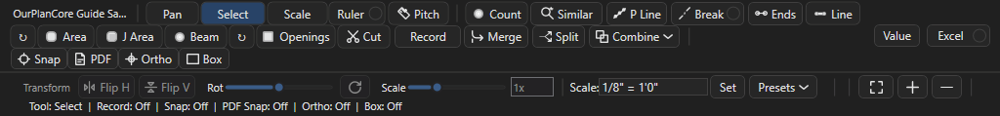
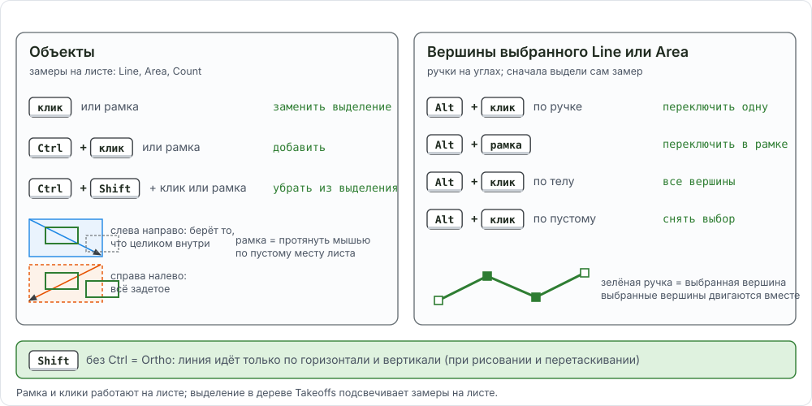
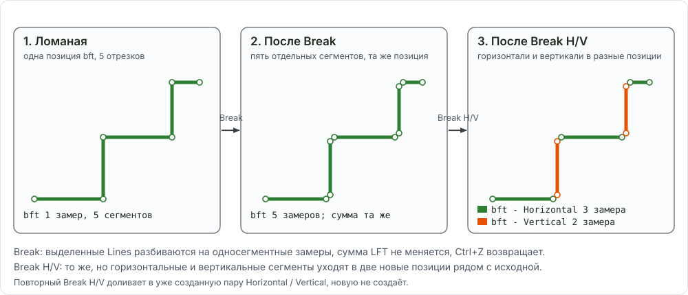

# Правка замеров и привязки: как всё работает вместе

Здесь собрано всё, что делают с уже нарисованным замером: как выделить объект или его вершину, как подвинуть, разрезать, слить, вырезать, отразить и откатить. Таблицы отвечают, каким инструментом и где, рецепты внизу показывают операции в связке, пункты меню правой кнопки (копировать, переименовать, удалить на листе, в Takeoffs, Pages и Estimating) собраны в [конце страницы](#context-menus), подробные шаги каждой операции лежат на [странице Merge, Split, Break, Ends, Combine, Similar](ourplancore-edit-takeoffs.md), привязки и трассировка на [странице Snap и трассировки](ourplancore-snap-trace.md).

<figure markdown>
  
  <figcaption markdown="span">Строка 1 полосы инструментов: рисование, `Cut`, `Merge`, `Split`, `Combine`, переключатели `Snap` / `PDF` / `Ortho` / `Box`. Строка 2: `Transform` (Flip H, Flip V, Rot, Scale).</figcaption>
</figure>

## Модель выделения { #selection }

Инструмент `Select` (клавиша ++e++). Правило одно: **Ctrl работает с объектами, Alt с вершинами**. Shift без Ctrl зарезервирован под Ortho (временно держит прямой угол).

<figure markdown>
  
  <figcaption markdown="span">Слева: клик и рамка без клавиш заменяют выделение, с Ctrl добавляют объект, с Ctrl+Shift убирают. Справа: Alt переключает синие ручки выбранного объекта, Alt-клик по телу берёт все ручки, Alt-клик по пустому месту снимает.</figcaption>
</figure>

| Что хочу | Жест | Что видно в статусе |
| --- | --- | --- |
| выбрать один замер | клик по линии, контуру или метке | `Moving Line...` при перетаскивании |
| выбрать несколько рамкой | рамка слева направо берёт то, что целиком внутри; рамка справа налево берёт всё, что задето | `Selected N measurement(s) and M enclosed cutout(s)` или `... touched cutout(s)` |
| добавить к выделению | ++ctrl++ + клик или ++ctrl++ + рамка | `Selected N measurement(s) and M cutout(s)` |
| убрать из выделения | ++ctrl+shift++ + клик или рамка | `Removed N object(s)` |
| все замеры листа | ++ctrl+a++ | |
| вершины выбранного Line или Area | ++alt++ + клик по ручке переключает одну, ++alt++ + рамка переключает все ручки в рамке, ++alt++ + клик по телу берёт все, ++alt++ + клик по пустому снимает | `N handle(s) selected` |
| одна метка Count | клик по метке и перетаскивание; ++alt++ не нужен | |
| вырез (дырка) в Area | клик внутри выреза; ++ctrl++ добавляет к выделению | `... cutout(s)` |
| снять выделение | клик по пустому месту или ++esc++ | |

Что ещё делает выделение на листе: ++delete++ удаляет выбранные объекты, выбранные вершины или выбранные вырезы (родительская Area остаётся); ++f2++ или двойной клик по замеру переименовывает его позицию; ++ctrl+c++ / ++ctrl+v++ копируют на другой лист ([копирование](ourplancore-takeoffs.md#copy)); ++h++ скрывает всю позицию выбранного замера на этом листе ([видимость](ourplancore-takeoffs.md#hide)).

**Лист и дерево.** Выделение на листе и выделение в дереве Takeoffs живут отдельно. На листе выбираются сегменты, метки и вырезы одной страницы. В дереве выбираются целые позиции (Ctrl или Shift по строкам) или секции под позицией. `Merge`, `Split`, `Break` и `Ends` смотрят, где выделение: если в дереве выделены строки позиций, работают с целыми позициями на всех листах; иначе с тем, что выбрано на листе. ++ctrl+enter++ в дереве выделяет замеры секции на листе.

## Правка вершин { #vertices }

Нужно: инструмент `Select`, замер Line или Area выбран (синие ручки видны).

### Как подвинуть вершину { #move-vertex }

1. Наведите курсор на синюю ручку выбранного замера.
2. Перетащите её. ++shift++ во время перетаскивания держит сдвиг по одной оси, `Snap` (++f3++) цепляет вершину к концам, серединам и пересечениям соседних замеров.
3. Отпустите кнопку.

Результат: статус `Editing Line vertex N`, длина или площадь позиции пересчитана в `Total`.

### Как подвинуть несколько вершин сразу { #move-vertices }

1. Выберите замер (или несколько замеров рамкой).
2. ++alt++ + рамка вокруг нужных углов: ручки становятся выбранными.
3. Перетащите любую выбранную ручку; все выбранные двигаются вместе. ++shift++ держит ось.

Результат: статус `Editing N selected vertices`. Так сдвигают общий угол двух стен одним движением.

### Как добавить и удалить вершину { #add-vertex }

1. ПКМ по линии или контуру в нужном месте: пункт **Insert Vertex Here** вставляет вершину в ближайший сегмент. Статус `Inserted Line vertex N`.
2. Удалить лишнюю: ПКМ рядом с ней, **Remove Nearest Vertex**; или ++alt++ + клик по ручке и ++delete++. У Line должно остаться не меньше двух точек, у Area трёх.
3. Удалить метки Count: ++alt++ + клик или рамка по меткам, ++delete++. Если выбраны все метки замера, удаляется весь замер.

Результат: `Deleted N selected vertex/vertices`. ++ctrl+z++ возвращает.

<!-- DEMO: d-vertex-edit -->

## Undo: где какой { #undo }

Отмен в программе несколько, каждая слушает свой фокус.

| Где фокус | Клавиша | Что откатывает |
| --- | --- | --- |
| лист (вьюпорт) | ++ctrl+z++ или ++backspace++ | последнее действие с геометрией на этом листе: рисование (точку за точкой), перенос, вершины, `Cut`, `Combine`, `Break`, `Transform`, вставку, удаление, разметку и маску `Hide`, кропы на целевом листе, сдвиг наложения. Глубина 80 шагов; стек свой у каждого листа и очищается при смене листа |
| дерево Takeoffs | ++ctrl+z++ или ПКМ **Undo Takeoff Merge / Split** | удаление позиций и папок, `Merge` и `Split` целых позиций, в обратном порядке |
| дерево Pages | ++ctrl+z++ или ПКМ **Undo Last Page Delete** | только последнее удаление листов и папок; другой проект или закрытие программы отправляют его в корзину Windows |
| Main > Open / Import | **Undo Last Page Sort**, **Undo Last Page Operation** | сортировка листов, импорт проекта |

Не отменяются Undo: переименование, перенос позиции между папками, порядок и группы легенды, размещение кропа с листа-источника (удалять на целевом листе).

## Карта операций { #map }

| Что хочу сделать | Инструмент | Клавиша | Где в меню | Страница |
| --- | --- | --- | --- | --- |
| выбрать, подвинуть, удалить | `Select` | ++e++, ++delete++ | полоса инструментов | [выше](#selection) |
| подвинуть или удалить вершину | ручки, ++alt++ | ++delete++ | ПКМ **Insert Vertex Here**, **Remove Nearest Vertex** | [выше](#vertices) |
| слить позиции или сегменты | `Merge` | ++ctrl+m++ | ПКМ в Takeoffs **Merge Selected Takeoffs...** | [Merge](ourplancore-edit-takeoffs.md#merge-takeoffs) |
| разделить позицию по листам или секциям | `Split` | ++ctrl+shift+m++ | ПКМ в Takeoffs **Split Selected Takeoffs...** | [Split](ourplancore-edit-takeoffs.md#split-takeoffs) |
| отделить сегменты или метки в новую позицию | `Split` на листе | ++ctrl+shift+m++ | | [Split на листе](ourplancore-edit-takeoffs.md#split-sheet) |
| разбить ломаную на отрезки | `Break` | ++ctrl+shift+b++ | ПКМ по линии **Break Line Into Segments** | [Break](ourplancore-edit-takeoffs.md#break) |
| разнести горизонтальные и вертикальные | `Break` с точкой H/V | ++ctrl+shift+v++ | | [Break H/V](ourplancore-edit-takeoffs.md#break-hv) |
| точки на концах линий | `Ends` | нет | ПКМ по линии **Count Points At Line Ends...** | [Ends](ourplancore-edit-takeoffs.md#ends) |
| точки вдоль линии с шагом | `P Line` | нет | ПКМ по линии **Create Count Points Along Line...** | [P Line](ourplancore-edit-takeoffs.md#pline) |
| вырез в площади, стереть кусок линии | `Cut` | ++x++, ++f9++ бокс | полоса инструментов | [Cut](ourplancore-edit-takeoffs.md#cut) |
| сложить, вычесть, срезать наложение площадей | `Combine` | нет | список `Combine` | [Combine](ourplancore-edit-takeoffs.md#combine) |
| найти такие же символы | `Similar` | нет | полоса инструментов | [Similar](ourplancore-edit-takeoffs.md#similar) |
| отразить, повернуть, масштабировать выбранное | `Transform` | нет (`Mirror` назначается) | строка 2 полосы | [Transform](ourplancore-edit-takeoffs.md#transform) |
| повторять отрезки или балки без диалога | `Repeat Line`, `Repeat Beam` | нет | кнопки со стрелкой у `Line` и `Beam` | [Repeat](ourplancore-edit-takeoffs.md#repeat) |
| прямой угол, прямоугольник, привязка к своим точкам | `Ortho`, `Box`, `Snap` | ++f8++, ++f9++, ++f3++ | полоса инструментов | [Snap](ourplancore-snap-trace.md#snap) |
| снять стены с векторного PDF | `Trace Walls Inside Area`, `Layer Trace` | нет | ПКМ по Area, вкладка PDF Layers | [трассировка](ourplancore-snap-trace.md#wall-trace) |

Все команды есть и в палитре ++ctrl+shift+p++ (`Break Lines Into Segments`, `Count Points At Line Ends`, `Combine Areas: Union`...). Клавишу без назначения можно задать в [редакторе клавиш](ourplancore-shortcuts.md#remap). `Merge`, `Split`, `Break`, `Ends`, `P Line`, `Combine`, `Similar` и трассировка стен требуют модуль Advanced Takeoff Tools (включён по умолчанию, `Settings > Modules`).

## Что с чем работает { #matrix }

| Операция | Line | Area | Count | J Area | Beam | Openings |
| --- | --- | --- | --- | --- | --- | --- |
| перенос, ++delete++, ++ctrl+c++ / ++ctrl+v++ | да | да | да | да | да | да |
| вершины (Alt, Insert, Remove) | да | да | метки | да | метка | метка |
| `Merge` целых позиций | да | да | да | да | как Count | как Count |
| `Merge` сегментов на листе | да | да | да | да | как Count | как Count |
| `Split` позиции по секциям или листам | да | да | да | да | как Count | как Count |
| `Split` сегментов или меток на листе | да | да | да, выбранные метки | да | метки | метки |
| `Break`, `Break H/V` | да | нет | нет | нет | нет | нет |
| `Ends`, `P Line` | да | нет | нет | нет | нет | нет |
| `Cut` | стирает кусок | вырез | нет | вырез | нет | нет |
| `Combine` | нет | да, 2 и больше | нет | да, как Area | нет | нет |
| `Transform` | да | да | да | да | да | да |
| `Similar` | нет | нет | да | нет | нет | нет |

Beam и Openings хранятся как Count с меткой, поэтому для правки они ведут себя как Count: метку можно подвинуть, слить, разделить; длина балки и размер проёма сидят в имени. `Merge` и `Split` не смешивают типы: Line только с Line, Area с Area, Count с Count, J Area с J Area.

## Рецепты в связке { #recipes }

Каждый рецепт идёт от задачи эстиматора до видимого результата. Привязка `PDF` в рецептах не используется: она работает ненадёжно ([почему](ourplancore-snap-trace.md#pdf-snap)); точность дают `Ortho`, `Box`, `Snap` к своим точкам, зум и правка вершин после.

### Как обвести стену с прямыми углами и замкнуть контур { #recipe-wall }

Зачем: ломаная по оси стены без углов, уехавших на долю градуса.
Нужно: лист с масштабом, точка листа W стоит.

1. Нажмите `Line` (++l++), задайте имя позиции (`ext 2x6 9.09`), **OK**.
2. Включите `Ortho` (++f8++) и `Snap` (++f3++).
3. Приблизьте зум к первому углу и кликните по оси стены.
4. Ведите курсор к следующему углу: `Ortho` держит горизонталь или вертикаль. На диагональном участке отпустите `Ortho` одним нажатием ++f8++ и верните после.
5. Для замыкания подведите курсор к первой точке: подсветка `Snap` показывает `end`; кликните. Для Area достаточно кликнуть рядом с первой точкой, контур замкнётся сам.
6. Нажмите ++c++ или двойной клик, чтобы закончить ломаную.
7. Проверьте углы: `Select`, перетащите ручки, где ось ушла.

Результат: позиция в `walls/<этаж> floor walls`, `Total` показывает длину. Лишняя точка во время рисования убирается ++backspace++.

<!-- DEMO: d-line-walls -->

### Как разбить линию на отрезки и разнести по горизонтали и вертикали { #recipe-break }

Зачем: одна ломаная bracing или trim превращается в два счёта: горизонтальные и вертикальные футы.
Нужно: Line нарисована.

1. Выберите линии на листе или позицию в Takeoffs.
2. Нажмите ++ctrl+shift+v++ (или закрасьте точку H/V на кнопке `Break` и нажмите `Break`).
3. Прочитайте статус: `Broke 1 line(s) into 7 segments: 4 to bft - Horizontal, 3 to bft - Vertical`.
4. В Takeoffs рядом с исходной позицией появились `bft - Horizontal` и `bft - Vertical`. Исходная позиция осталась пустой: удалите её или оставьте.

Результат: два отдельных итога. Обычный `Break` (++ctrl+shift+b++) режет на отрезки, оставляя их в той же позиции. Схема: [что делает Break и Break H/V](#break-scheme).

<!-- DEMO: d-break-ends -->

### Как слить сегменты из разных позиций в одну { #recipe-merge-segments }

Зачем: стена частично нарисована в `ext 2x6 9.09`, частично по ошибке в `int 2x4 9.09`.
Нужно: оба замера на одном листе.

1. `Select`, кликните по сегменту в чужой позиции, ++ctrl++ + клик по остальным ошибочным.
2. Нажмите ++ctrl+m++.
3. В диалоге **Merge Into Takeoff** выберите `ext 2x6 9.09`, **Merge**.

Результат: статус `Merged 2 segment(s) into ext 2x6 9.09`, цвет сегментов сменился на цвет позиции. Чтобы слить две целые позиции, выделите их строки в дереве и нажмите ++ctrl+m++: [Merge целых позиций](ourplancore-edit-takeoffs.md#merge-takeoffs).

<!-- DEMO: d-merge -->

### Как разделить позицию по листам { #recipe-split-sheets }

Зачем: кровля `rf 6` нарисована на трёх листах, в DFL нужна строка на каждый лист.
Нужно: позиция с секциями на нескольких листах.

1. В Takeoffs выделите позицию.
2. Нажмите ++ctrl+shift+m++.
3. В диалоге **Split Selected Takeoffs** выберите `Separate takeoffs by sheet`; превью показывает `1 takeoff(s) ... 3 takeoff(s), 2 new`.
4. Нажмите **Split**.
5. Переименуйте копии (++f2++): `rf 6 a105`, `rf 6 a106`.

Результат: три позиции с одним именем и свойствами, отделённые получили новый цвет. Подробно про раскладку по листам: [страница Split по листам](ourplancore-split-by-sheets.md).

<!-- DEMO: d-split -->

### Как вырезать проём из площади и стереть кусок линии { #recipe-cut }

Зачем: шахта или лестница не должна входить в `1st`, а линия стены не должна идти через проём ворот.
Нужно: Area и Line нарисованы.

1. Нажмите `Cut` (++x++). Для прямоугольного выреза включите `Box` (++f9++).
2. Кликните **внутри** площади, которую режете: она выделяется, вырез пойдёт только в неё.
3. Обведите вырез (в режиме `Box` второй угол), закончите ++c++ или двойным кликом.
4. Для линии: `Select`, выберите линию, снова `Cut` и обведите кусок, который нужно стереть. Линия распадается на части по обе стороны.

Результат: статус `Cut (box): ...` с числом изменённых площадей и линий, `Total` уменьшился. Если первый клик был вне площади, `Cut` режет все линии листа, которых касается контур: сначала выделяйте цель.

<!-- DEMO: d-cut -->

### Как объединить или вычесть площади { #recipe-combine }

Зачем: два ската легли внахлёст, или из площади этажа надо вычесть балкон, нарисованный отдельно.
Нужно: две и больше Area на одном листе.

1. `Select`, кликните первую площадь (она главная), ++ctrl++ + клик по остальным.
2. Откройте список `Combine`.
3. Выберите: `Union` сложить в одну, `Subtract` из первой вычесть остальные, `Remove Overlap` срезать перекрытие (первая остаётся целой), `Intersect` оставить общее, `Divide` разбить на части.
4. Сравните `Total` до и после.

Результат: статус `Combine remove overlap: trimmed 1 area(s) against the first-selected`. Порядок выбора важен: первой кликайте ту площадь, которая должна остаться целой.

<!-- DEMO: d-combine -->

### Как поставить точки на концах и вдоль линии { #recipe-points }

Зачем: посты по концам балок, стойки или hangers с шагом вдоль линии.
Нужно: Line нарисованы.

1. Выберите линии (на листе или позицию в дереве).
2. Нажмите `Ends`. В диалоге **Count Points At Line Ends** оставьте галку `Merge points where segments meet`, задайте имя, **Create**.
3. Снова выберите линии и нажмите `P Line`. В диалоге **Create Count Points Along Line(s)** задайте `Count takeoff name`, `Spacing, inches` (например `96`), галку `Include line end point`, **Create**.

Результат: два новых Count в той же папке, статус `End points created: N Count mark(s)`. Лишние метки на стыках снимаются ++alt++ + клик и ++delete++.

<!-- DEMO: d-pline -->

### Как найти такие же символы на других листах { #recipe-similar }

Зачем: один holdown или post посчитать на всех этажах за один проход.
Нужно: активный Count или готовность завести новый, лист открыт.

1. Нажмите `Similar`, обведите рамкой один символ.
2. В диалоге выберите порог `Default` (или `Strict`, если ловит лишнее), галку `Search all sheets in this job`.
3. Посмотрите метки: синие добавятся, оранжевые слабые, серые уже посчитаны. При сомнении нажмите `Strong only`.
4. Нажмите кнопку `Add N to <имя>`.

Результат: метки добавлены в Count на текущем и других листах, статус перечисляет добавленное. Поиск ищет похожую картинку, не назначение: проверьте оранжевые.

<!-- DEMO: d-similar -->

### Как повторить рисование серии { #recipe-repeat }

Зачем: двадцать коротких ledger или десять балок без диалога на каждую.
Нужно: лист с масштабом.

1. Нажмите стрелку `Repeat Line` рядом с `Line` (или `Repeat Beam` рядом с `Beam`).
2. Для Line задайте имя один раз. Дальше каждые два клика дают отдельный отрезок в этой позиции.
3. Для Beam каждая пара кликов меряет балку, спрашивает имя и ставит метку, потом ждёт следующую.
4. Нажмите ++esc++, чтобы закончить. Статус `Repeat drawing stopped`.

Результат: серия отрезков или балок без переключения инструмента.

<!-- DEMO: d-repeat -->

### Как отразить и повернуть замеры { #recipe-transform }

Зачем: зеркальный юнит или повёрнутый корпус: скопированные замеры надо развернуть на месте.
Нужно: замеры выделены на листе.

1. `Select`, выделите замеры рамкой.
2. В строке 2 полосы нажмите `Flip H` или `Flip V`: зеркало вокруг центра выделения.
3. Поворот: тяните оранжевую ручку поворота на рамке выделения (++shift++ даёт шаг 15°) или двигайте ползунок `Rot`; кнопка со стрелкой возвращает ползунок в ноль для следующего поворота.
4. Размер: угловые ручки масштабируют от центра, боковые тянут одну сторону (++shift++ сохраняет пропорции); или ползунок `Scale` и поле `1x`.
5. Перетащите выделение на место.

Результат: статус `Mirrored selection horizontal`, `Rotated selection 90 deg`. Один ++ctrl+z++ отменяет всё движение ползунка. Клавиши для зеркала назначаются в редакторе клавиш (`Mirror selected objects horizontally / vertically`).

<!-- DEMO: d-transform -->

### Как исправить замер, который ушёл не в ту позицию { #recipe-wrong-takeoff }

Зачем: стена нарисована при активном `Record` чужой позиции или на листе с неверной точкой.
Нужно: знать, куда должен лечь замер.

1. Найдите замер на листе: в дереве кликните чужую позицию, ++ctrl+enter++ по секции подсветит её замеры.
2. Если нужная позиция уже есть: `Select`, выберите замер, ++ctrl+m++, в **Merge Into Takeoff** выберите правильную позицию.
3. Если нужной позиции нет: ++ctrl+shift+m++, в **Split Selected Measurements** введите новое имя. Новая позиция ляжет рядом с исходной.
4. Если ошибся весь лист (не та точка W/F/S): поправьте точку под `Scale`, затем перетащите позицию в дереве в нужную папку или слейте с правильной через ++ctrl+m++ по строкам дерева.

Результат: `Total` исходной позиции уменьшился, статус `Merged N segment(s) into ...` или `Split N segment(s) into new takeoff ...`. Куда ляжет новый замер: [маршрутизация](ourplancore-routing.md).

### Как замкнуть угол двух стен, нарисованных отдельно { #recipe-corner }

Зачем: две линии встык дают щель или перехлёст в углу, в PDF это видно.
Нужно: обе линии на одном листе.

1. `Select`, кликните первую линию, ++ctrl++ + клик по второй.
2. ++alt++ + рамка вокруг угла: выбираются обе концевые ручки.
3. Перетащите одну ручку с включённым `Snap` (++f3++): обе точки сдвигаются вместе и прилипают к концу или пересечению.
4. Если линии в одной позиции и нужен один сегмент вместо двух, оставьте как есть: `Merge` геометрию не склеивает, сумма длин уже верна.

Результат: статус `Editing 2 selected vertices`, угол сходится в одну точку.

## Схема Break и Break H/V { #break-scheme }

<figure markdown>
  
  <figcaption markdown="span">Слева ломаная из пяти отрезков в позиции `bft`. В центре после `Break`: пять отдельных сегментов в той же позиции, сумма та же. Справа после `Break H/V`: горизонтальные ушли в `bft - Horizontal`, вертикальные в `bft - Vertical`.</figcaption>
</figure>

## Меню правой кнопки: копировать, переименовать, удалить { #context-menus }

Те же действия, что клавиши и кнопки выше, есть в меню правой кнопки мыши. Название пункта меняется под выделение: при нескольких строках вместо `Copy Item` будет `Copy Selected`, у позиции Count вместо `Section` будет `Count`. Ниже пункты собраны по месту, где открыто меню.

??? note "ПКМ по замеру на листе"
    | Пункт | Что делает | Когда нужно |
    | --- | --- | --- |
    | `Copy Measurement` | кладёт в буфер замер под курсором, как ++ctrl+c++; при выделении пункт называется `Copy Selected Measurements`, с вырезами `Copy N Cutout(s)` | перенести замер на другой лист |
    | `Paste Measurements to This Sheet` | вставляет буфер на этот лист (с числом: `Paste 3 Measurement(s) to This Sheet`): левый верхний угол скопированного набора встаёт в точку клика, дальше тот же диалог **Paste Measurements**, что у ++ctrl+v++ | одинаковый этаж или корпус: [копирование](ourplancore-takeoffs.md#copy) |
    | `Merge Segment...`, `Split Segment...` | перенести замер в другую позицию или отделить в новую | [Merge на листе](ourplancore-edit-takeoffs.md#merge-sheet), [Split на листе](ourplancore-edit-takeoffs.md#split-sheet) |
    | `Takeoff Properties...`, `Section Properties...` | свойства всей позиции; имя и заметка одного замера (секции) | поменять шаг, цвет, высоту; пометить один участок |
    | `Rename Section` | меняет имя секции, то есть строки этого замера под позицией в Takeoffs; имя позиции не трогает. У Count пункт называется `Rename Count`, у замера без позиции `Rename Measurement` и неактивен | подписать участок (`north wing`), чтобы найти его в дереве |
    | `Insert Vertex Here`, `Remove Nearest Vertex` | вставить или убрать вершину | [вершины](#add-vertex) |
    | `Delete Section` | удаляет только этот замер после вопроса `Delete this section from <позиция>?`; позиция и остальные её замеры остаются. У Count `Delete Count`, у замера без позиции `Delete Measurement` (неактивен) | лишний участок; всю позицию удаляют в дереве |
    | пункты Line и J Area | `Break Line Into Segments`, `Count Points At Line Ends...`, `Create Count Points Along Line...`; `Use Area As Joists...`, `Delete Nearest Extra Joist` и другие | [Break и Ends](ourplancore-edit-takeoffs.md#break), [меню J Area](ourplancore-tools.md#jarea-menu) |

    В отдельном окне листа (Detach) меню короче: `Copy Measurement`, `Paste Measurements to This Sheet`, `Takeoff Properties...`, `Section Properties...`, `Rename Section`, пункты J Area и `Hide on This Sheet` / `Show on This Sheet`. Пунктов `Delete Section`, `Merge`, `Split` и вершин там нет: это делается в главном окне.

??? note "ПКМ в дереве Takeoffs"
    | Где | Пункт | Что делает |
    | --- | --- | --- |
    | позиция | `Duplicate Item` (++ctrl+d++) | копия позиции с тем же именем, свойствами и всеми замерами в той же папке, в конце списка. Замеры копии лежат на тех же листах поверх исходных: до Excel копию переименуйте и перенесите или удалите лишнее |
    | позиция | `Delete item + measurements` | удаляет позицию и все её замеры на всех листах после вопроса `Delete "<имя>" and all contained measurements?`; ++ctrl+z++ в панели Takeoffs возвращает |
    | позиция, подменю `Clipboard` | `Copy Item`, `Cut Item`, `Paste Into Parent Folder` | копия или перенос позиции; вставить в другую папку: ПКМ по папке, `Paste Into Folder` |
    | папка | `Delete folder + children` | удаляет папку со всеми позициями и замерами; ++ctrl+z++ в панели Takeoffs возвращает |
    | папка, подменю `Clipboard` | `Copy Folder`, `Cut Folder`, `Paste Into Folder`, `Duplicate Folder` | то же для папки целиком: перенести этаж в другой корпус, размножить дерево этажа |
    | корень Takeoffs (пустое место под деревом) | `Paste Into Root` | вставляет скопированное или вырезанное на верхний уровень дерева |
    | секция под позицией | `Rename Section`, `Delete Section` (для нескольких: `Delete 3 Sections`) | как на листе, но для выделенных строк секций |

    При нескольких выделенных строках пункты называются `Copy Selected`, `Cut Selected`, `Duplicate Selected`, `Delete selected takeoffs`. Вырезать и вставить: замеры, цвет и порядок легенды сохраняются. Копировать и вставить или `Duplicate`: копируются и замеры.

??? note "ПКМ в дереве Pages и Batch Rotate"
    | Где | Пункт | Что делает |
    | --- | --- | --- |
    | лист или папка, первая строка | `Undo Last Page Delete` | возвращает последнее удаление листов или папок, как ++ctrl+z++ в Pages; когда есть что вернуть, пункт называется `Undo Delete: <имя>`. Хранится одно удаление: следующее удаление, переход в другой проект или закрытие программы отправляют прежнее в корзину Windows |
    | лист | `Delete Page` (несколько: `Delete Selected`) | удаляет лист после вопроса `Delete page '<имя>'?` |
    | папка | `Delete Folder` | удаляет папку со всем содержимым после вопроса `Delete folder '<имя>' and everything inside it?` |
    | лист, подменю `Clipboard` | `Copy Page`, `Cut Page`, `Paste Into Parent Folder` | вырезать и вставить переносит лист, замеры остаются привязаны к нему. Копировать и вставить даёт копию листа (PDF, масштаб, разметка) без замеров: замеры живут в Takeoffs |
    | папка, подменю `Clipboard` | `Copy Folder`, `Cut Folder`, `Paste Into Folder` | то же для папки листов |
    | лист или папка, подменю `PDF Metadata` | `Auto Rename from PDF...`, `Auto Rename + Scale from PDF...` | то же, что кнопки `Name` и `Name+Scale` панели Pages, для листов под курсором и выделенных: превью имён (и масштабов), применение после OK ([имена](ourplancore-pages.md#names)) |
    | лента **Page**, кнопка `Batch Rotate` | `Rotate Selected Left`, `Rotate Selected Right`, `Rotate Selected 180` | поворачивает PDF всех листов, выделенных в Pages (без выделения текущий лист); замеры, вырезы, разметка и точка origin поворачиваются вместе с листом |

??? note "ПКМ по строке Estimating"
    `Go to Page` (при нескольких строках `Go to First Page`) открывает лист замера, `Select on Canvas` выделяет замер на листе, `Section Properties...` открывает имя и заметку секции, `Rename Section` и `Delete Section` работают как на листе. При нескольких выделенных строках эти два пункта называются `Rename Measurement` и `Delete Measurement` и неактивны: переименование и удаление идут по одной строке.

## Ловушки { #traps }

- `Merge` не склеивает геометрию: две линии встык остаются двумя сегментами с общей суммой.
- `Cut` без выделенной цели режет все линии листа, которых касается контур. Первый клик делайте внутри площади или выделяйте цель заранее.
- `Combine` смотрит на порядок выбора: первая выбранная площадь главная для `Subtract` и `Remove Overlap`.
- ++ctrl+z++ отменяет там, где фокус: лист, дерево Takeoffs или дерево Pages. После смены листа стек отмены листа пуст.
- `Break H/V` при повторном запуске доливает в уже созданную пару `- Horizontal` / `- Vertical`, а не создаёт новую.
- `Snap` на плотном чертеже цепляется к соседнему замеру: выключите ++f3++ или приблизьте зум.
- Клик по метке Count двигает её сразу, без Alt: случайный сдвиг возвращает ++ctrl+z++.
- `Duplicate Item` и копирование позиции в дереве копируют и замеры: на листе копия лежит поверх исходника, сумма в Excel удвоится. `Copy Page` наоборот копирует лист без замеров.
- `Rename Section` переименовывает строку замера, а не позицию: имя для Excel даёт позиция (++f2++ по строке позиции в дереве).

## См. также

- [Merge, Split, Break, Ends, Combine, Similar: пошагово](ourplancore-edit-takeoffs.md)
- [Snap и трассировка](ourplancore-snap-trace.md)
- [Инструменты замера](ourplancore-tools.md), [Дерево Takeoffs](ourplancore-takeoffs.md)
- [Горячие клавиши](ourplancore-shortcuts.md)
- [Частые ошибки: листы и дерево](../start/common-mistakes.md#pages)
