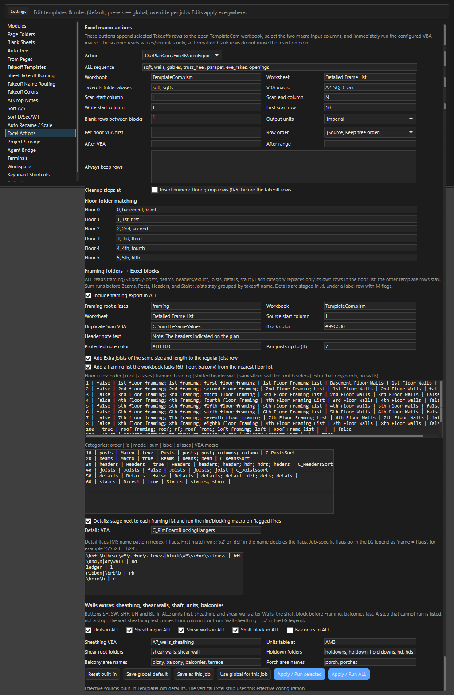

# Export to Excel

This page covers the XL strip to the right of the sheet, what each button takes from the tree and where it writes in the `TemplateCom.xlsm` workbook, the LG legend, the "comments" dot, the `Value` and `Excel` buttons, a permanent link from a takeoff to a cell with `Link to Excel`, `Auto Link` for the whole DFL and resetting links, setting up the buttons in `Settings > Excel Actions`, the workflow and errors. You need it after measuring, before working in the DFL.

<!-- DEMO: d-excel-xl -->

<figure markdown>
  
  <figcaption markdown="span">Top of the strip: `ALL` and `LG`, below them the wall and area buttons, then framing starts (`FR`). In a short window the strip scrolls with the mouse wheel down to the lower framing buttons. Each button's tooltip says what it does.</figcaption>
</figure>

<figure markdown>
  <video class="kb-demo" loop muted playsinline preload="none" poster="../../assets/images/ourplancore/demo/d-xl-scroll.png"><source src="../../assets/images/ourplancore/demo/d-xl-scroll.mp4" type="video/mp4"></video>
  <figcaption markdown="span">Demo: the AI Inbox is open and the XL strip got short; the mouse wheel over the strip scrolls it down to `FR`, `PS`, `BM`, `HD` and back.</figcaption>
</figure>

## What you need before pressing

- [ ] Excel has the building workbook open, made from `TemplateCom.xlsm` (a copy of the template from the app update folder), macros enabled. The app looks for an open `TemplateCom.xlsm` workbook; if there is none, it takes the active macro-enabled workbook (`.xlsm`) that has a `Detailed Frame List` worksheet.
- [ ] The `Excel Integration` module is on (`Settings > Modules`, on by default).
- [ ] **One** building (a folder with roots) or one export folder (`walls`, `sqfts`...) is selected in the Takeoffs tree. For `ALL` a selection from two buildings is not accepted ([multiple buildings](ourplancore-buildings.md#excel)).
- [ ] The `LG` legend is filled with the job's beam, post and header codes (otherwise the workbook keeps codes instead of sizes).
- [ ] The job is saved, `Total` checked on the large takeoffs.

## How to export a building with one button: ALL { #steps }

Why: the whole building workbook in one run, steps in the right order.
You need: the list above.

1. Open the building workbook in Excel and activate the `Detailed Frame List` worksheet.
2. In OurPlanCore select the building folder in Takeoffs (or the root for a single building).
3. Press `LG`, type rows like `H5 - (2) 1 3/4 x 11 7/8 LVL`, `C4 - 6x6`; the **Add missing codes** button adds empty rows for all job codes without a size; press **Save for job**.
4. Press `ALL`. Read what the app will skip (takeoffs without a number, names not in the format) and press **Continue**.
5. Watch the step label `Excel ALL 3/12: Walls...` and wait for the summary `Completed: ...` with the list of what was skipped. A step that could not run is listed and does not stop the rest (except the A-series macros: they stop the chain).
6. Check the workbook: the wall matrix, Front Page, framing lists.
7. Save the workbook in Excel yourself: the app does not save it.

Result: the building workbook is filled; if you fix a measurement in the app, repeat the relevant button, not the whole `ALL`.

`ALL` in order: `UN`, `SF`, `WL` (right after it `SH` and `SW`), `GB`, `TH`, `PP`, `E/R`, `OP`, `SHF`, then all of framing (`FR`), and at the end `BL` (off in `ALL` by default). What goes into `ALL` is set in `Settings > Excel Actions`.

## XL strip buttons: reference { #buttons }

The general scheme: the branch takeoffs are written to the `J:L` work zone of the worksheet (name, number, unit; first free spot from row 10), the app selects what it wrote and runs the workbook macro, and the macro lays the rows out into the delivered columns `A:H`. How the workbook works: [DFL: how the workbook works](dfl-overview.md); what each macro does: [Excel macros and hotkeys](excel-hotkeys.md).

| Button | Takes from the tree | Writes in the workbook |
| --- | --- | --- |
| `ALL` | the whole selected building | all steps in the order above |
| `LG` | - | opens the job legend for `PS`, `BM`, `HD`; the row `wall sheathing = 7/16" Zip no insulation` is needed by `SH`. The cross in the panel header (`Hide the Excel legend panel`) or pressing `LG` again closes it without saving: first **Save for job**, otherwise the edit is lost; **Clear** empties and saves an empty legend |
| `SF` | `sqfts` (`sqft`) | `J:L`, macro `A2_SQFT_calc`: floor areas, Front Page, roof by pitch |
| `WL` | `walls` | `J:L` with floor headers, strict order, macro `A3_Walls_Calc_AllGroup`: the `O:AB` wall matrix and the Floor Walls rows; then zero rows are deleted in `A:H` of the wall block (the template rows Flashing, Headers, Wall Sheathing, Insulation, Box Sheathing, Tape, Shear Walls, Holdowns stay) |
| `GB` | `gables` | `J:L`, `A2_SQFT_calc` |
| `TH` | `trussheel` | `J:L`, `A2_SQFT_calc` |
| `PP` | `parapets` | `J:L`, `A4_Parapet`: three numbers from the tail of the name `prpt 6.4 5.3 0.5` |
| `E/R` | `eves rakes` | `J:L`: eaves by descending LF, then rakes; `A6_Eve_Rakes` |
| `OP` | `openings/<floor>` | the zone from `Z158` by floor; for each floor `C_SumNearWindowValues`, then `A5_Openings`: headers by width buckets and flashing. The name must start with the size `WxH`, otherwise the takeoff is skipped with a warning |
| `SH` | the sheathing text from column J or the `wall sheathing = ...` row from `LG` | `A7_walls_sheathing`: keeps one sheathing system (Zip, Ply, OSB), removes the extra rows; in `ALL` it runs right after `WL` |
| `SW` | `shear walls/<floor>/shear` and `.../holdowns` | `J:L`; a Shear Walls row (interior; exterior ones take wall sheathing) and one Holdowns row for each holdown in the floor's wall block |
| `SHF` | walls whose name starts with `shaft` | the Shaft walls block above the first framing list: panels, CH and J channels from LF times wall height |
| `UN` | `units/<mark size>` (Line) and `units/<floor>/<mark>` (Count) | units table from cell `AM3` (Settings): mark on `2x4` / `2x6` / half, count by floor, SUMPRODUCT totals |
| `BL` | `sqfts` areas named `blcny`, `balcony`, `terrace`, `porch` | blocks `#n Upper Balcony/Terrace List W' x L' N units` and `#n Porch Framing List` for each size, as a copy of the template's `#1` block |

??? note "BL separate from ALL"
    The balcony block macro writes formulas in localized notation and is built for the Russian-language Excel interface; that is why it is off in `ALL` and is run with the `BL` button. It is turned on in `Settings > Excel Actions`. What the blocks look like: [Balcony, porch and holdown blocks](dfl-blocks.md).

## Framing { #framing }

| Button | Takes | Writes |
| --- | --- | --- |
| `FR` | all of the building's `framing` | all the steps below for each floor; a missing framing list (`6th Floor Framing List`, `Balcony Framing List`) is added from the nearest one |
| `PS` | `framing/<floor> framing/posts` | Posts rows in the floor's framing list; size by code from `LG` (`C_PostsSort`) |
| `BM` | `.../beams` | Beam rows; size by code from `LG` |
| `HD` | `.../headers/ext`, `.../headers/int` | header rows in the wall block **one floor down** (the 2nd floor framing sits on the 1st floor walls); Wall Sheathing and the rows after it are not touched |
| `JS` | `.../joists` | Joists rows; Extra joists of the same length are added into the row; joists up to 7' go on doubled stock (`45 x 12'` with the note `90 pcs 6'`) |
| `DT` | `.../details` | detail rows in `J:L` under a label row, once; a flag in M by name (`bft`, `bd`, ledger gives `l`, ribbon `rb`, rim `r`, or `name = flags` from `LG`), then `C_RimBoardBlockingHangers` |
| `ST` | `.../stairs` | stair rows before Subfloor; a repeat export replaces them |

| Tree folder | Framing list in the workbook | Headers go to the block |
| --- | --- | --- |
| `framing/1st floor framing` | `1st Floor Framing List` | `Basement Floor Walls` |
| `framing/2nd floor framing` | `2nd Floor Framing List` | `1st Floor Walls` |
| `framing/3rd floor framing` ... `8th` | `3rd ... 8th Floor Framing List` | the floor below |
| `framing/roof framing`, `loft framing` | `Roof Frame list` | - |
| `framing/balcony`, `porch`, `canopy` | `Balcony / Porch / Canopy Framing List` | - |

Posts, beams and joists **replace** their rows in the list; the other template rows (Blocking, Rim, Hangers, Subfloor) stay; a second run does not break the worksheet. Flag codes and material overrides: [Takeoff tree, detail codes](../start/takeoff-structure.md).

## How to put one takeoff into a cell: Value and Excel { #value }

Why: drop a number or several rows into a finished workbook without macros.

1. In Excel click the target cell in the open workbook.
2. Select a takeoff or folder in Takeoffs.
3. Press `Excel` at the bottom left: the rows (name, number, unit) are written from the active cell. Or press `Value`: only the numbers of the same selection in one column, to quickly fill `G` in existing rows.

Result: the data is in the workbook from the selected cell. The message `Open Excel, open a workbook, click the destination cell` means there is no active cell.

| Button | What it does |
| --- | --- |
| `Excel` (bottom left) | writes the selected folder or takeoff as rows (name, number, unit) from the active cell of the open workbook; no macros |
| the dot on the `Excel` button (`Include takeoff comments in Excel export`) | filled - the takeoff and measurement comments (notes) go into the export; off by default. Applies to `Excel` and `Export > Export Excel`; `Value` and the XL strip do not write comments, CSV and TXT always do |
| `Value` | writes only the numbers of the same selection in one column from the active cell |
| `Link to Excel` | writes the number of one takeoff into the active cell and keeps it there: [below](#link) |
| `Auto Link` | DFL only: links all takeoffs whose numbers are already in the `J:L` list, at once: [below](#auto-link) |
| `Export > Export CSV / TXT / Excel` | export of the tree to a file |
| `Export > Export to Current Excel` | same as the `Excel` button |

### How to add a comment to a measurement and send it to Excel { #notes }

Why: a note for the DFL next to the number (`verify on site`, `per S2.1`) that travels to the workbook with the takeoff.

1. Right-click the measurement (section) row under the takeoff in Takeoffs and choose **Set Notes...**; for several selected rows the item is called `Set Notes for N Rows...`.
2. Type the text, each line is a separate comment, press OK. A comment for the whole takeoff goes into the `Notes:` field of the takeoff's **Properties...** window.
3. Click the dot on the `Excel` button at the bottom left so it is filled: status `Excel comments are on: include takeoff and measurement comments.`
4. Click the target cell in Excel and press `Excel`.

Result: under the takeoff row come the comment rows (first the takeoff's, then the measurements'; duplicates are not repeated) and an empty row after them.

## How to keep a number in a cell: Link to Excel { #link }

`Value` writes the number once. **Link to Excel** writes the number into the cell and remembers the link: change the measurement and the cell updates by itself. One takeoff, one number, one cell.

!!! warning "One way only, from OurPlanCore to Excel"
    Editing the cell does not change the measurement. The app does not save the open workbook; you do. Until you press Link, the app does not touch Excel: a job without links leaves Excel alone.

<figure markdown>
  
  <figcaption markdown="span">The number goes from the takeoff to the cell. The icon color on the takeoff row shows the link state. Names in the diagram are examples.</figcaption>
</figure>

Why: the number in the workbook follows the measurement by itself; no need to repeat `Value` after every edit.
You need: version 3.0.28 or newer, the workbook open in Excel and saved as a file, the job not opened read-only.

1. Select one takeoff in Takeoffs. A measurement row under a takeoff counts as that takeoff; a folder does not work, nor does an annotation takeoff with no quantity.
2. In Excel click the cell you need.
3. In OurPlanCore press **Link to Excel** at the bottom right, next to `Value` and `Excel`. The same command: right-click on the takeoff, **Excel Link > Link to Excel**, or the ++ctrl+shift+p++ palette. No default key.
4. If the cell already has text, another number, a formula or another link, the app asks: **Replace** or **Cancel**.
5. Read the status at the bottom: `Linked <takeoff> to <workbook> <sheet!cell>: <number>`. A chain icon appears on the takeoff row.
6. Change the measurement and look at the cell: the number updates after a short pause.
7. Save the workbook in Excel yourself.

Result: the takeoff number sits in the cell and follows the measurement. The value is the same one `Value` writes: same units and rounding.

The feature is new. On the first workbook, compare the cell with `Total` in the tree with your own eyes.

### What happens next { #link-update }

| What happened | What happens |
| --- | --- |
| the workbook is open | the cell updates after a short pause. The active worksheet, selection and calculation mode in Excel stay as they were. A write from the app clears Excel's own undo (++ctrl+z++): a formula replaced with **Replace** cannot be brought back with undo |
| Excel is busy or a cell is being edited | the link waits (`Pending`), the app retries by itself |
| the workbook is closed | the link waits (`Pending`). The number is written when the job is saved (++ctrl+s++; autosave does not count) or by **Update Links**: in a hidden Excel with macros off, with a copy of the workbook made before writing; then the write is read back from disk |
| rows were inserted above the cell | the link holds on to a hidden name `_OPLink_...` in the workbook, which follows the cell. The app does not guess the address |
| the row with the cell was deleted, by hand or by a macro | the link is `Broken`, nothing is written |
| the takeoff was renamed or moved to another folder | the link follows it. A copy of the takeoff has no link |
| the takeoff was deleted | the link is `Broken`, the cell stays as it is; ++ctrl+z++ in the app restores the link |

Link and Unlink themselves cannot be undone with ++ctrl+z++. The workbook copies are in the app profile, `%LOCALAPPDATA%\OurPlanCore\excel-link-backups` (Lite has its own profile folder, `%LOCALAPPDATA%\OurPlanCore Lite`); there are none next to the workbook.

### States: the icon on the takeoff { #link-states }

| State | Icon | What it means | What to do |
| --- | --- | --- | --- |
| `Linked` | gray | the cell has this takeoff's number | nothing |
| `Pending` | yellow | the new number is not written yet: the workbook is closed, Excel is busy, the workbook or file is read-only, the file is locked by another program or missing, the cell is protected, the joists have no direction set | closed workbook: ++ctrl+s++ or **Update Links**. The icon tooltip gives the reason |
| `Conflict` | orange | the cell was changed by hand or a formula was typed into it. The app does not write over it | **Overwrite the Cell** (the app's number on top) or **Keep the Cell and Unlink** (the cell stays, there is no link any more) |
| `Broken` | red | the takeoff was deleted, the row or cell was deleted (`#REF!`), the hidden name disappeared from the workbook, the joists got a different number of lengths. Nothing is written | a deleted takeoff comes back with ++ctrl+z++. Otherwise **Unlink** and link again |

The icon tooltip: state, workbook, worksheet and cell, last number written, reason.

### Joists: which number { #link-joist }

A `J Area` takeoff has no single number (`Value` writes a line of text there), so Link asks which number goes into this cell:

| Option in the window | What it is |
| --- | --- |
| `Count of the 16 length: 45` | pieces of this order length |
| `Length 16` | the order length itself |
| `Total count, all lengths: ...` | all pieces, if there are several lengths |
| `Total length, all lengths: ...` | total length, if there are several lengths |

For a second number, click another cell and press Link again. The link holds on to "length number N of M": if the number of lengths in the takeoff changed, the link becomes `Broken` and asks to be linked again; a wrong number will not get into the cell. The totals survive any such edit. Without a joist direction set, the app will not link: `Set the joist direction before linking this takeoff.`

### All job links: All Excel Links { #link-list }

To open it: right-click on a takeoff, **Excel Link > All Excel Links...**, or the `Excel Links...` command in the palette. The `Excel Links` window has the columns `Takeoff`, `Workbook`, `Cell`, `Last value`, `State`, `Why`.

| Button | What it does |
| --- | --- |
| **Go to Cell** | shows the cell in Excel, opening a closed workbook first |
| **Overwrite the Cell**, **Keep the Cell and Unlink** | visible when a link in `Conflict` is selected |
| `Unlink` | there is no link any more, the number stays in the cell. If the workbook is closed, its hidden name goes away when the workbook is opened while this job is open |
| **Update Links** | writes everything that is waiting, including to closed workbooks, and rechecks the hidden names of broken links. This button works with any settings. The same: **Excel Link > Update Links** or `Update Excel Links` in the palette |
| **Point to New Path...** | the workbook was moved or renamed. No new workbook is created |
| **Remove All Links from This Workbook...** | see below |
| **Reset All Links...** | removes all links of this job: [see below](#reset-links) |

!!! warning "Before delivering the workbook to the client"
    **All Excel Links...**, select a link to this workbook, **Remove All Links from This Workbook...**. The numbers stay in the cells, the hidden names leave the workbook. All of them go, including those made by other jobs and OurPDF.

### How to link the whole DFL in one click: Auto Link { #auto-link }

Why: the numbers are already exported to the `J:L` list, and linking each takeoff by hand takes long.
You need: version 3.0.29 or newer (the same in Lite), a saved DFL workbook active in Excel, the job not opened read-only. [OurPDF](../ourpdf/excel-link.md#auto-link) has the same button since 0.9.27.

!!! warning "Look at the result window right after pressing"
    There is no question before linking; the result window is the check. A `Probable` link can land on someone else's row with the same number, and the next measurement edit will write the new number there. Once you close the window, **Undo This Auto Link** is gone.

1. In a job with several buildings, put the [green dot](ourplancore-buildings.md#root) on the building you need: Auto Link takes only its takeoffs. With no active building, all takeoffs of the job are taken.
2. Press **Auto Link** at the bottom, next to `Link to Excel`. The same command: right-click on a takeoff, **Excel Link > Auto Link (DFL)**, or `Auto Link` in the ++ctrl+shift+p++ palette. No default key.
3. The links appear at once; the `Auto Link` window shows the result for each takeoff: `Group`, `Takeoff`, `Number`, `Cell`, `Label in column J`, `Result`, `Why`.
4. Check every `Probable` row: the label in column J must be about this takeoff.
5. Save the workbook in Excel yourself. Auto Link does not change cell values and does not save the workbook; it only adds hidden names. Close the workbook without saving and the names disappear, the links become `Broken`.

Result: the `Sure` and `Probable` takeoffs are linked; the rest are described in the window with a reason.

**DFL only**: an `.xlsm`, `.xlsb` or `.xls` workbook with a `Detailed Frame List` worksheet whose column A has the word `Description` in the first 150 rows. Another workbook: status `Auto Link works only with a DFL`, nothing else happens. `Link to Excel` works on any workbook.

**What gets linked.** There is only one target: constant numbers in column K of this worksheet, from row 2; the label is taken from column J. Formulas never count. Columns `A:H`, the blocks `O:AB`, `O135:W147`, `O105:AL129`, `Z158` and beyond (the macros fill them from `J:L`), spec cells and other worksheets are never targets, even if the number matches.

| Group | When | What happens |
| --- | --- | --- |
| `Sure` | the label in J equals the takeoff name (case and spaces do not matter), the number matches, there is one such row | linked at once |
| `Probable` | the label does not equal the name, but the number is one to one: it sits in exactly one K cell and no other participating takeoff has it (openings, joists and already linked ones do not count). The label of that row is not the name of another takeoff | linked at once, check it by eye |
| `Ambiguous` | this number is in several cells or belongs to several takeoffs, the name does not decide it | not linked: select the row in the window, pick the cell in the `Cell` column, press **Link This Row** |
| `Skipped` | the list below; the reason is written in the window row | not linked |

The number is compared at the rounding `Value` shows, and no looser. A cell with `162.504` matches `162.5` and keeps its value until the takeoff number changes. If you changed the measurement after exporting, the number is not in the list and the takeoff will be skipped.

**What is skipped:**

- windows, doors and other openings: an `openings` folder above the takeoff, or the name `window`, `windows`, `wind`, `wnd`, `door`, `doors`, `opening`, `openings`, `storefront`, `gd`, `lv`, `louver`, words starting with `окн`, `двер`, `проём` (Russian for window, door, opening), an opening size with a dot like `3.0x6.7 d`. A J row with such a label is not a target either. Manual `Link to Excel` works on them;
- `J Area` takeoffs: they have more than one number; link them by hand with the question, [as usual](#link-joist);
- points (Count) without their own name in J: points are linked only by name, whatever the number. 240 without a name stays unlinked;
- a small whole number without a name: a line or area with a whole number under 10 (threshold in the [settings](#link-settings)). With a name it gets linked;
- zero and a takeoff with no number;
- an already linked takeoff, a cell with another link, a formula in the cell, a list row with the name of another takeoff, the number not in the list.

**When `Probable` gets it wrong:**

- a hand-typed J row with a different name and the same number, while the takeoff itself is not exported to the list yet;
- a sum row (two takeoffs in one number) happens to equal a third one;
- a takeoff of another building, when no active building is set and its number equals a row in this workbook;
- two floors with the same area: one row is exported, and the second floor is not measured yet;
- harmless: the takeoff was renamed after exporting, or the label was edited. The row is right, it is just `Probable` instead of `Sure`.

**What to do.** **Undo This Auto Link** removes all links of this window, including those linked in it by hand. `Unlink` removes one takeoff. The numbers in the cells stay, including those written after linking. A closed workbook loses the names the next time it is opened. **Go to Cell** shows the cell of the selected row in Excel.

What Auto Link does on a real workbook has not been checked yet: only on generated rows in template copies. On the first workbook, look through the whole window.

### How to remove all job links: Reset All Links { #reset-links }

**Reset All Links...** removes all links of this job. The button is in the `Excel Links` window, **Excel Link > Reset All Links...**, or `Reset All Excel Links` in the palette. First a question with the number of links. **It cannot be undone.** The values in the cells stay.

- Open workbooks lose this job's hidden names at once. The workbook is not saved; you save it.
- Closed workbooks lose the names when the workbook is opened while this job is open. Without saving.
- A second button, **Remove Them and Clean the Closed Workbooks Now**, appears if some workbook is closed. It cleans the closed workbooks at once, with a hidden Excel and a copy of the workbook, and removes all names from them, including those of other jobs and OurPDF.

| | Reset All Links | Remove All Links from This Workbook |
| --- | --- | --- |
| Scope | this job, all its workbooks | one workbook |
| Which names | only this job's, except with the second button | all, including other jobs and OurPDF |
| Closed workbook | at the next opening or with the second button | at once, with a hidden Excel and a copy |
| When | to link the job again | before delivering the workbook to the client |

### Settings: Settings > Excel Links { #link-settings }

Section header `Link to Excel behaviour`. There are **Apply**, **Reset**, **Save global default**, **Save as this job**, **Clear job override**.

| Field | Default |
| --- | --- |
| `Update an open workbook at once` | on; off: only **Update Links** writes to an open workbook |
| `Update a closed workbook when the job is saved` | on; off: waits for **Update Links** |
| `Backups kept per workbook` | 5, from 1 to 50 |
| `Delay before an open workbook is updated, ms` | 800, from 100 to 10000 |
| `Time limit for a closed workbook, seconds` | 180, from 15 to 1800; after it the app stops its hidden Excel, the links stay `Pending` |
| `Lines and areas: a whole number below this needs its name` | `Auto Link` section, 10, from 0 to 1000; points always need a name |

OurPlanCore Lite has the same button, menu, window and Settings section. Lite has no XL strip. [OurPDF](../ourpdf/excel-link.md) has the same link.

## TemplateCom template { #template }

`TemplateCom.xlsm` sits in the app update folder next to `ourplancore.exe`. Each building gets a copy (`Bldng#A.xlsm`); the workbook name equals the Job Name on the Front Page. Worksheets: `Front Page` (areas, Total SQFT), `Detailed Frame List` (the delivered columns `A:H` and work zones to the right: `J:N` export, `O:AB` wall matrix, spec cells `O:S`, height calculator), `Standarts` (notes library), `Mat List`. The A-series macros are run by the XL strip; the B, C, X, Y series by hotkeys in Excel. Details: [DFL: how the workbook works](dfl-overview.md), [Excel macros and hotkeys](excel-hotkeys.md), [Standard notes](standard-notes.md).

## Repeat export { #rerun }

- Framing (`FR`, `PS`, `BM`, `HD`, `JS`, `ST`) replaces its rows: repeat as often as needed. `DT` writes a group once; a group that is already exported is not touched.
- The A series (`SF`, `WL`, `GB`, `TH`, `PP`, `E/R`, `OP`) appends a new block in `J:L` at the first free spot and runs the macro on it. The old block stays in the work zone; the `A:H` rows with a formula like `=K37` point to their own block.

!!! warning "To be confirmed"
    How to cleanly remove the previous `J:L` block before repeating `WL` or `SF` (by hand or with a macro) will be checked on the next delivery.

## How to change what an XL button does: Settings > Excel Actions { #settings }

<figure markdown>
  
  <figcaption markdown="span">The `Action` list (XL strip button), its fields, the `ALL sequence` order and the floor, framing and walls extras blocks.</figcaption>
</figure>

Why: a different workbook, different tree folders or a different `ALL` set without changing the app. By default the `TemplateCom.xlsm` rules described above are in place.

1. Open **Settings > Excel Actions** and pick the button in the **Action** list.
2. Edit the fields (table below) and the step order in **ALL sequence** (ids separated by commas).
3. Press **Apply / Run selected** (or **Apply / Run ALL**) to test on the open workbook.
4. Press **Save as this job** (this job only) or **Save global default** (all jobs).

Result: the XL strip buttons work by the new rules. **Use global for this job** removes the job rules; **Reset built-in** loads the built-in rules as a draft (saved with the buttons in step 4).

The section has four blocks: `Excel macro actions`, `Floor folder matching`, `Framing folders - Excel blocks`, `Walls extras: sheathing, shear walls, shaft, units, balconies`.

??? note "Fields of all four blocks"
    | Block | What is in it |
    | --- | --- |
    | `Excel macro actions` | for the selected button: `Workbook`, `Worksheet`, `Takeoffs folder aliases` (which tree folders it reads), `VBA macro`, the columns `Scan start column`, `Scan end column`, `Write start column`, `First scan row`, `Blank rows between blocks`, `Output units`, `Per-floor VBA first`, `Row order`, the cleanup macro `After VBA` with the range `After range` (for example `B_DeleteZeroRowsOnlyIn_AtoH`), `Always keep rows` (rows the cleanup does not touch), `Cleanup stops at`, the checkbox `Insert numeric floor group rows (0-5) before the takeoff rows` |
    | `Floor folder matching` | floor folder words for `Floor 0` ... `Floor 5`: by default `0, basement, bsmt`, `1, 1st, first`, `2, 2nd, second` and so on up to `5, 5th, fifth` |
    | `Framing folders - Excel blocks` (in the app the words are separated by an arrow) | `Include framing export in ALL`, `Framing root aliases`, `Pair joists up to (ft)` (default 7, 0 turns doubled stock off), `Add Extra joists of the same size and length to the regular joist row`, `Add a framing list the workbook lacks (6th floor, balcony) from the nearest floor list`, the floor and category rule tables, the checkbox for running the details macro |
    | `Walls extras: sheathing, shear walls, shaft, units, balconies` | checkboxes `Units in ALL`, `Sheathing in ALL`, `Shear walls in ALL`, `Shaft block in ALL`, `Balconies in ALL`; fields `Sheathing VBA`, `Units table at` (the units table cell, default `AM3`), `Shear root folders`, `Holdown folders`, `Balcony area names`, `Porch area names` |

Overview of all Settings sections: [Settings](ourplancore-settings.md).

## Common mistakes { #errors }

| Message or symptom | Cause and what to do |
| --- | --- |
| `Select one Takeoffs folder or item for Walls, then press the button again` | nothing is selected in the tree |
| `Excel ALL found more than one building/root in the selection` | folders of two buildings are selected; keep one |
| `Configured workbook 'TemplateCom.xlsm' is not open ...` | no open macro-enabled workbook with a `Detailed Frame List` worksheet |
| `Workbook ... is not macro-enabled` | the workbook is saved as `.xlsx`; `.xlsm` is needed |
| `No configured export folders with measured rows were found` | the selected building has no `sqfts`, `walls`... folders with numbers |
| The workbook has the code `H5` instead of a size | the `LG` legend is not filled |
| An opening is skipped with a warning | the name does not start with `WxH` (`4.3x7.8 d`) |
| `Skipped ...: floor folder ...` | the floor folder was not recognized: `openings/1`, `1st`, `first` are valid |
| Headers landed on the wrong floor | that is normal: the headers of a framing floor go to the wall block one floor down |
| The workbook did not change | macros are disabled in Excel; check the Trust Center |
| `Select one takeoff before pressing Link to Excel.` | nothing or several takeoffs are selected in Takeoffs |
| `Link to Excel takes one takeoff, not a folder: one number goes to one cell.` | a folder is selected; select one takeoff |
| `Open Excel, open a workbook, click the destination cell, then press Link to Excel again.` | Excel not found; open the workbook, click a cell |
| `Save the workbook first: a link needs its file path.` | the workbook is new and has no file; save it |
| `Excel is busy or a cell is being edited. Finish it and try again.` | Excel is busy or a cell is being edited in it; finish and press again |
| `An annotation takeoff has no quantity to link.` | the annotation takeoff has no quantity |
| `The workbook is open read-only.`, `The cell is protected.` | remove read-only or the worksheet protection |
| `Auto Link works only with a DFL...` | the active workbook is not a DFL: no `Detailed Frame List` worksheet, no word `Description` in column A, or the workbook has no macros. `Link to Excel` works on any workbook |

All workbook mistakes: [Common mistakes, Excel DFL and notes](../start/common-mistakes.md#excel).

## See also

- [DFL: how the workbook works](dfl-overview.md), [Excel macros and hotkeys](excel-hotkeys.md), [Balcony, porch and holdown blocks](dfl-blocks.md)
- [Takeoff tree and sheet names](../start/takeoff-structure.md): numbers in the name and detail codes
- [Multiple buildings](ourplancore-buildings.md#excel): a workbook per building
- [Workflow: Excel DFL and notes](../start/workflow.md)
