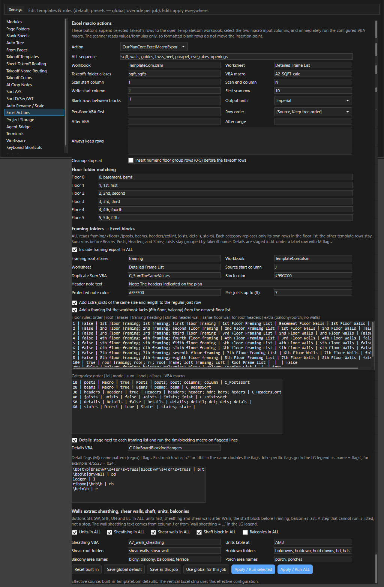

# Экспорт в Excel

Здесь: полоса XL справа от листа, что каждая кнопка берёт из дерева и куда пишет в книге `TemplateCom.xlsm`, легенда LG, точка "комментарии", кнопки `Value` и `Excel`, постоянная связь позиции с ячейкой `Link to Excel`, настройка кнопок в `Settings > Excel Actions`, порядок работы и ошибки. Нужно после замеров, перед работой в DFL.

<!-- DEMO: d-excel-xl -->

<figure markdown>
  
  <figcaption markdown="span">Верх полосы: `ALL` и `LG`, ниже кнопки стен и площадей, дальше начинается framing (`FR`). На низком окне полоса прокручивается колесом мыши до нижних кнопок framing. Подсказка каждой кнопки говорит, что она делает.</figcaption>
</figure>

<figure markdown>
  <video class="kb-demo" loop muted playsinline preload="none" poster="../../assets/images/ourplancore/demo/d-xl-scroll.png"><source src="../../assets/images/ourplancore/demo/d-xl-scroll.mp4" type="video/mp4"></video>
  <figcaption markdown="span">Демонстрация: открыт AI Inbox, полоса XL стала короткой; колесо мыши над полосой прокручивает её до `FR`, `PS`, `BM`, `HD` и обратно.</figcaption>
</figure>

## Что нужно до нажатия

- [ ] В Excel открыта книга корпуса, сделанная из `TemplateCom.xlsm` (копия шаблона из папки обновлений программы), макросы разрешены. Программа ищет открытую книгу `TemplateCom.xlsm`; если её нет, берёт активную книгу с макросами (`.xlsm`), в которой есть лист `Detailed Frame List`.
- [ ] Модуль `Excel Integration` включён (`Settings > Modules`, по умолчанию включён).
- [ ] В дереве Takeoffs выделен **один** корпус (папка с корнями) или одна папка экспорта (`walls`, `sqfts`...). Для `ALL` выделение из двух корпусов не принимается ([несколько зданий](ourplancore-buildings.md#excel)).
- [ ] Легенда `LG` заполнена кодами балок, постов и headers проекта (иначе в книге останутся коды вместо размеров).
- [ ] Проект сохранён, `Total` у крупных позиций проверен.

## Как выгрузить корпус одной кнопкой: ALL { #steps }

Зачем: вся книга корпуса за один прогон, шаги в правильном порядке.
Нужно: список выше.

1. Откройте книгу корпуса в Excel и активируйте лист `Detailed Frame List`.
2. Выделите в OurPlanCore папку корпуса в Takeoffs (или корень при одном корпусе).
3. Нажмите `LG`, впишите строки `H5 - (2) 1 3/4 x 11 7/8 LVL`, `C4 - 6x6`; кнопка **Add missing codes** добавляет пустые строки для всех кодов проекта без размера; нажмите **Save for job**.
4. Нажмите `ALL`. Прочитайте, что программа пропустит (позиции без числа, имена не по формату), и нажмите **Continue**.
5. Следите за подписью шагов `Excel ALL 3/12: Walls...` и дождитесь итога `Completed: ...` со списком пропущенного. Шаг, который не смог выполниться, перечисляется, а не останавливает остальные (кроме макросов серии A: они останавливают цепочку).
6. Проверьте книгу: матрицу стен, Front Page, framing lists.
7. Сохраните книгу в Excel сами: программа её не сохраняет.

Результат: книга корпуса заполнена; поправили замер в программе - повторите нужную кнопку, не весь `ALL`.

`ALL` по порядку: `UN`, `SF`, `WL` (сразу за ним `SH` и `SW`), `GB`, `TH`, `PP`, `E/R`, `OP`, `SHF`, затем framing целиком (`FR`), в конце `BL` (в `ALL` по умолчанию выключен). Что входит в `ALL`, настраивается в `Settings > Excel Actions`.

## Кнопки полосы XL: справка { #buttons }

Общая схема: позиции ветки пишутся в рабочую зону `J:L` листа (имя, число, единица; первое свободное место от строки 10), программа выделяет записанное и запускает макрос книги, макрос раскладывает строки в сдаваемые колонки `A:H`. Как устроена книга - [DFL: как устроена книга](dfl-overview.md), что делает каждый макрос - [Макросы и клавиши Excel](excel-hotkeys.md).

| Кнопка | Берёт из дерева | Пишет в книге |
| --- | --- | --- |
| `ALL` | весь выделенный корпус | все шаги по порядку выше |
| `LG` | - | открывает легенду проекта для `PS`, `BM`, `HD`; строка `wall sheathing = 7/16" Zip no insulation` нужна `SH`. Крестик в шапке панели (`Hide the Excel legend panel`) или повторное `LG` закрывают её без сохранения: сначала **Save for job**, иначе правка пропадёт; **Clear** очищает и сохраняет пустую легенду |
| `SF` | `sqfts` (`sqft`) | `J:L`, макрос `A2_SQFT_calc`: площади этажей, Front Page, кровля по уклонам |
| `WL` | `walls` | `J:L` с заголовками этажей, строгий порядок, макрос `A3_Walls_Calc_AllGroup`: матрица стен `O:AB` и строки Floor Walls; потом удаление нулевых строк в `A:H` блока стен (шаблонные строки Flashing, Headers, Wall Sheathing, Insulation, Box Sheathing, Tape, Shear Walls, Holdowns остаются) |
| `GB` | `gables` | `J:L`, `A2_SQFT_calc` |
| `TH` | `trussheel` | `J:L`, `A2_SQFT_calc` |
| `PP` | `parapets` | `J:L`, `A4_Parapet`: три числа из хвоста имени `prpt 6.4 5.3 0.5` |
| `E/R` | `eves rakes` | `J:L`: eve по убыванию LF, потом rake; `A6_Eve_Rakes` |
| `OP` | `openings/<этаж>` | зона от `Z158` по этажам; на каждый этаж `C_SumNearWindowValues`, затем `A5_Openings`: headers по корзинам ширины и flashing. Имя должно начинаться с размера `ШxВ`, иначе позиция пропускается с предупреждением |
| `SH` | текст обшивки из колонки J или строка `wall sheathing = ...` из `LG` | `A7_walls_sheathing`: оставляет одну систему обшивки (Zip, Ply, OSB), лишние строки убирает; в `ALL` идёт сразу после `WL` |
| `SW` | `shear walls/<этаж>/shear` и `.../holdowns` | `J:L`; строка Shear Walls (внутренние; наружные берут wall sheathing) и одна строка Holdowns на каждый holdown в блоке стен этажа |
| `SHF` | стены с именем, начинающимся на `shaft` | блок Shaft walls над первым framing list: панели, CH и J channels из LF на высоту стены |
| `UN` | `units/<марка сечение>` (Line) и `units/<этаж>/<марка>` (Count) | таблица units от ячейки `AM3` (Settings): марка на `2x4` / `2x6` / half, счёт по этажам, итоги SUMPRODUCT |
| `BL` | площади `sqfts` с именами `blcny`, `balcony`, `terrace`, `porch` | блоки `#n Upper Balcony/Terrace List W' x L' N units` и `#n Porch Framing List` на каждый размер, копией блока `#1` шаблона |

??? note "BL отдельно от ALL"
    Макрос блоков балконов пишет формулы в локализованной записи и рассчитан на русский интерфейс Excel; поэтому в `ALL` он выключен и запускается кнопкой `BL`. Включается в `Settings > Excel Actions`. Как выглядят блоки - [Блоки балконов, porch и holdowns](dfl-blocks.md).

## Framing { #framing }

| Кнопка | Берёт | Пишет |
| --- | --- | --- |
| `FR` | весь `framing` корпуса | все шаги ниже для каждого этажа; недостающий лист (`6th Floor Framing List`, `Balcony Framing List`) добавляется из ближайшего |
| `PS` | `framing/<этаж> framing/posts` | строки Posts в framing list этажа; размер по коду из `LG` (`C_PostsSort`) |
| `BM` | `.../beams` | строки Beam; размер по коду из `LG` |
| `HD` | `.../headers/ext`, `.../headers/int` | строки headers в блоке стен **на этаж ниже** (перекрытие 2-го этажа лежит на стенах 1-го); Wall Sheathing и строки после него не трогаются |
| `JS` | `.../joists` | строки Joists; Extra joists той же длины добавляются в строку; joists до 7' идут на сдвоенный сток (`45 x 12'` с нотой `90 pcs 6'`) |
| `DT` | `.../details` | строки деталей в `J:L` под строкой-подписью, один раз; флаг в M по имени (`bft`, `bd`, ledger даёт `l`, ribbon `rb`, rim `r`, или `имя = флаги` из `LG`), затем `C_RimBoardBlockingHangers` |
| `ST` | `.../stairs` | строки лестниц перед Subfloor; повторный экспорт заменяет |

| Папка дерева | Framing list в книге | Headers идут в блок |
| --- | --- | --- |
| `framing/1st floor framing` | `1st Floor Framing List` | `Basement Floor Walls` |
| `framing/2nd floor framing` | `2nd Floor Framing List` | `1st Floor Walls` |
| `framing/3rd floor framing` ... `8th` | `3rd ... 8th Floor Framing List` | этаж ниже |
| `framing/roof framing`, `loft framing` | `Roof Frame list` | - |
| `framing/balcony`, `porch`, `canopy` | `Balcony / Porch / Canopy Framing List` | - |

Posts, beams и joists **заменяют** свои строки в списке, остальные строки шаблона (Blocking, Rim, Hangers, Subfloor) остаются; второй прогон не ломает лист. Коды флагов и переопределения материала: [Дерево takeoff, коды деталей](../start/takeoff-structure.md).

## Как вписать одну позицию в ячейку: Value и Excel { #value }

Зачем: подставить число или несколько строк в готовую книгу без макросов.

1. Щёлкните в Excel ячейку назначения в открытой книге.
2. Выделите в Takeoffs позицию или папку.
3. Нажмите `Excel` внизу слева: строки (имя, число, единица) записаны от активной ячейки. Или нажмите `Value`: только числа той же выборки в одну колонку, чтобы быстро подставить `G` в готовые строки.

Результат: данные в книге от выбранной ячейки. Сообщение `Open Excel, open a workbook, click the destination cell` означает, что активной ячейки нет.

| Кнопка | Что делает |
| --- | --- |
| `Excel` (внизу слева) | пишет выделенную папку или позицию строками (имя, число, единица) от активной ячейки открытой книги; без макросов |
| точка на кнопке `Excel` (`Include takeoff comments in Excel export`) | закрашена - в экспорт идут комментарии позиций и замеров (notes); по умолчанию выключена. Действует на `Excel` и `Export > Export Excel`; `Value` и полоса XL комментарии не пишут, CSV и TXT пишут всегда |
| `Value` | пишет только числа той же выборки в одну колонку от активной ячейки |
| `Link to Excel` | пишет число одной позиции в активную ячейку и держит его в ней: [ниже](#link) |
| `Export > Export CSV / TXT / Excel` | выгрузка дерева в файл |
| `Export > Export to Current Excel` | то же, что кнопка `Excel` |

### Как добавить комментарий к замеру и вывести его в Excel { #notes }

Зачем: пометка для DFL рядом с числом (`verify on site`, `per S2.1`), которая едет в книгу вместе с позицией.

1. Щёлкните ПКМ по строке замера (секции) под позицией в Takeoffs и выберите **Set Notes...**; для нескольких выделенных строк пункт называется `Set Notes for N Rows...`.
2. Впишите текст, каждая строка - отдельный комментарий, нажмите OK. Комментарий для всей позиции пишется в поле `Notes:` окна **Properties...** позиции.
3. Щёлкните точку на кнопке `Excel` внизу слева, чтобы она стала закрашенной: статус `Excel comments are on: include takeoff and measurement comments.`
4. Щёлкните ячейку назначения в Excel и нажмите `Excel`.

Результат: под строкой позиции идут строки комментариев (сначала позиции, потом замеров, одинаковые не повторяются) и пустая строка после них.

## Как держать число в ячейке: Link to Excel { #link }

`Value` пишет число один раз. **Link to Excel** пишет число в ячейку и запоминает связь: поменяли замер, ячейка обновилась сама. Одна позиция, одно число, одна ячейка.

!!! warning "Только в одну сторону, из OurPlanCore в Excel"
    Правка ячейки замер не меняет. Открытую книгу программа не сохраняет, сохраняете вы. Пока вы не нажали Link, программа к Excel не обращается: проект без связей Excel не трогает.

<figure markdown>
  
  <figcaption markdown="span">Число идёт из позиции в ячейку. Цвет значка у строки позиции показывает состояние связи. Имена на схеме примерные.</figcaption>
</figure>

Зачем: число в книге само идёт за замером, не надо повторять `Value` после каждой правки.
Нужно: версия 3.0.28 или новее, книга открыта в Excel и сохранена файлом, проект открыт не только для чтения.

1. В Takeoffs выделите одну позицию. Строка замера под позицией считается этой позицией; папка не подходит, как и позиция-аннотация без количества.
2. В Excel щёлкните нужную ячейку.
3. В OurPlanCore нажмите **Link to Excel** внизу справа, рядом с `Value` и `Excel`. Та же команда: правая кнопка по позиции, **Excel Link > Link to Excel**, или палитра ++ctrl+shift+p++. Клавиши по умолчанию нет.
4. Если в ячейке уже есть текст, другое число, формула или другая связь, программа спросит: **Replace** или **Cancel**.
5. Прочитайте статус внизу: `Linked <позиция> to <книга> <лист!ячейка>: <число>`. У строки позиции появился значок-цепочка.
6. Поменяйте замер и посмотрите на ячейку: число обновится через короткую паузу.
7. Сохраните книгу в Excel сами.

Результат: число позиции стоит в ячейке и идёт за замером. Значение то же, что пишет `Value`: те же единицы и округление.

Функция новая. На первой книге сверьте ячейку с `Total` в дереве своими глазами.

### Что происходит дальше { #link-update }

| Что случилось | Что происходит |
| --- | --- |
| книга открыта | ячейка обновляется после короткой паузы. Активный лист, выделение и режим расчёта в Excel остаются как были. Запись из программы очищает отмену (++ctrl+z++) самого Excel: формулу, заменённую через **Replace**, отменой не вернуть |
| Excel занят или правится ячейка | связь ждёт (`Pending`), программа пробует снова сама |
| книга закрыта | связь ждёт (`Pending`). Число пишется при сохранении проекта (++ctrl+s++, автосохранение не считается) или по **Update Links**: в скрытом Excel с выключенными макросами, с копией книги до записи, потом запись читается обратно с диска |
| вставили строки над ячейкой | связь держится за скрытое имя `_OPLink_...` в книге, оно идёт за ячейкой. Адрес программа не угадывает |
| удалили строку с ячейкой, руками или макросом | связь `Broken`, ничего не пишется |
| позицию переименовали или перенесли в другую папку | связь идёт за ней. Копия позиции остаётся без связи |
| позицию удалили | связь `Broken`, ячейка остаётся как есть; ++ctrl+z++ в программе возвращает связь |

Сами Link и Unlink не отменяются ++ctrl+z++. Копии книги лежат в профиле программы, `%LOCALAPPDATA%\OurPlanCore\excel-link-backups` (у Lite своя папка профиля, `%LOCALAPPDATA%\OurPlanCore Lite`), рядом с книгой их нет.

### Состояния: значок у позиции { #link-states }

| Состояние | Значок | Что значит | Что делать |
| --- | --- | --- | --- |
| `Linked` | серый | в ячейке число этой позиции | ничего |
| `Pending` | жёлтый | новое число ещё не записано: книга закрыта, Excel занят, книга или файл только для чтения, файл занят другой программой или пропал, ячейка защищена, у joists не задано направление | закрытая книга: ++ctrl+s++ или **Update Links**. Причину пишет подсказка значка |
| `Conflict` | оранжевый | ячейку изменили руками или вписали в неё формулу. Поверх программа не пишет | **Overwrite the Cell** (число программы поверх) или **Keep the Cell and Unlink** (ячейка остаётся, связи больше нет) |
| `Broken` | красный | позицию удалили, строку или ячейку удалили (`#REF!`), скрытое имя пропало из книги, у joists стало другое число длин. Ничего не пишется | удалённую позицию вернёт ++ctrl+z++. Иначе **Unlink** и свяжите заново |

Подсказка значка: состояние, книга, лист и ячейка, последнее записанное число, причина.

### Joists: какое число { #link-joist }

У позиции `J Area` одного числа нет (`Value` пишет туда строку текста), поэтому Link спрашивает, какое число идёт в эту ячейку:

| Вариант в окне | Что это |
| --- | --- |
| `Count of the 16 length: 45` | штуки этой заказной длины |
| `Length 16` | сама заказная длина |
| `Total count, all lengths: ...` | все штуки, если длин несколько |
| `Total length, all lengths: ...` | суммарная длина, если длин несколько |

Для второго числа щёлкните другую ячейку и нажмите Link ещё раз. Связь держится за "длину номер N из M": если число длин в позиции изменилось, связь станет `Broken` и попросит связать заново, чужое число в ячейку не попадёт. Итоги переживают любую такую правку. Без заданного направления joists программа не свяжет: `Set the joist direction before linking this takeoff.`

### Все связи проекта: All Excel Links { #link-list }

Откройте: правая кнопка по позиции, **Excel Link > All Excel Links...**, или команда `Excel Links...` в палитре. В окне `Excel Links` колонки `Takeoff`, `Workbook`, `Cell`, `Last value`, `State`, `Why`.

| Кнопка | Что делает |
| --- | --- |
| **Go to Cell** | показывает ячейку в Excel, закрытую книгу сначала открывает |
| **Overwrite the Cell**, **Keep the Cell and Unlink** | видны, когда выбрана связь в `Conflict` |
| `Unlink` | связи больше нет, число остаётся в ячейке. Если книга закрыта, её скрытое имя остаётся там до **Remove All Links** |
| **Update Links** | записывает всё, что ждёт, в том числе в закрытые книги, и заново проверяет скрытые имена оборванных связей. Эта кнопка работает при любых настройках. То же: **Excel Link > Update Links** или `Update Excel Links` в палитре |
| **Point to New Path...** | книгу перенесли или переименовали. Новая книга не создаётся |
| **Remove All Links from This Workbook...** | см. ниже |

!!! warning "Перед сдачей книги клиенту"
    **All Excel Links...**, выберите связь с этой книгой, **Remove All Links from This Workbook...**. Числа остаются в ячейках, скрытые имена уходят из книги. Уходят все, также сделанные другими проектами и OurPDF.

### Настройки: Settings > Excel Links { #link-settings }

Заголовок раздела `Link to Excel behaviour`. Есть **Apply**, **Reset**, **Save global default**, **Save as this job**, **Clear job override**.

| Поле | По умолчанию |
| --- | --- |
| `Update an open workbook at once` | вкл; выключено: в открытую книгу пишет только **Update Links** |
| `Update a closed workbook when the job is saved` | вкл; выключено: ждёт **Update Links** |
| `Backups kept per workbook` | 5, от 1 до 50 |
| `Delay before an open workbook is updated, ms` | 800, от 100 до 10000 |
| `Time limit for a closed workbook, seconds` | 180, от 15 до 1800; после него программа останавливает свой скрытый Excel, связи остаются `Pending` |

В OurPlanCore Lite кнопка, меню, окно и этот раздел Settings те же. Полосы XL в Lite нет. Такая же связь есть в [OurPDF](../ourpdf/excel-link.md).

## Шаблон TemplateCom { #template }

`TemplateCom.xlsm` лежит в папке обновлений программы рядом с `ourplancore.exe`. На каждый корпус делается копия (`Bldng#A.xlsm`), имя книги равно Job Name на Front Page. Листы: `Front Page` (площади, Total SQFT), `Detailed Frame List` (сдаваемые колонки `A:H` и рабочие зоны справа: `J:N` экспорт, `O:AB` матрица стен, спек-ячейки `O:S`, калькулятор высот), `Standarts` (библиотека нот), `Mat List`. Макросы серии A запускает полоса XL, серии B, C, X, Y - клавиши в Excel. Подробно: [DFL: как устроена книга](dfl-overview.md), [Макросы и клавиши Excel](excel-hotkeys.md), [Стандартные notes](standard-notes.md).

## Повторный экспорт { #rerun }

- Framing (`FR`, `PS`, `BM`, `HD`, `JS`, `ST`) заменяет свои строки: повторять можно сколько нужно. `DT` пишет группу один раз; уже выгруженная группа не трогается.
- Серия A (`SF`, `WL`, `GB`, `TH`, `PP`, `E/R`, `OP`) дописывает новый блок в `J:L` на первое свободное место и прогоняет макрос по нему. Старый блок остаётся в рабочей зоне; строки `A:H` с формулой `=K37` смотрят на свой блок.

!!! warning "Уточняется"
    Как чисто убрать прежний блок `J:L` перед повтором `WL` или `SF` (руками или макросом), проверяется на следующей сдаче.

## Как поменять, что делает кнопка XL: Settings > Excel Actions { #settings }

<figure markdown>
  
  <figcaption markdown="span">Список `Action` (кнопка полосы XL), её поля, порядок `ALL sequence` и блоки этажей, framing и walls extras.</figcaption>
</figure>

Зачем: другая книга, другие папки дерева или другой состав `ALL` без правки программы. По умолчанию стоят правила `TemplateCom.xlsm`, описанные выше.

1. Откройте **Settings > Excel Actions** и выберите кнопку в списке **Action**.
2. Поправьте поля (таблица ниже) и порядок шагов в **ALL sequence** (id через запятую).
3. Нажмите **Apply / Run selected** (или **Apply / Run ALL**), чтобы проверить на открытой книге.
4. Нажмите **Save as this job** (только этот проект) или **Save global default** (все проекты).

Результат: кнопки полосы XL работают по новым правилам. **Use global for this job** снимает правила проекта, **Reset built-in** загружает встроенные правила как черновик (сохраняются кнопками шага 4).

Раздел состоит из четырёх блоков: `Excel macro actions`, `Floor folder matching`, `Framing folders - Excel blocks`, `Walls extras: sheathing, shear walls, shaft, units, balconies`.

??? note "Поля всех четырёх блоков"
    | Блок | Что в нём |
    | --- | --- |
    | `Excel macro actions` | для выбранной кнопки: `Workbook`, `Worksheet`, `Takeoffs folder aliases` (какие папки дерева она читает), `VBA macro`, колонки `Scan start column`, `Scan end column`, `Write start column`, `First scan row`, `Blank rows between blocks`, `Output units`, `Per-floor VBA first`, `Row order`, макрос чистки `After VBA` с диапазоном `After range` (например `B_DeleteZeroRowsOnlyIn_AtoH`), `Always keep rows` (строки, которые чистка не трогает), `Cleanup stops at`, галка `Insert numeric floor group rows (0-5) before the takeoff rows` |
    | `Floor folder matching` | слова папок этажей для `Floor 0` ... `Floor 5`: по умолчанию `0, basement, bsmt`, `1, 1st, first`, `2, 2nd, second` и так до `5, 5th, fifth` |
    | `Framing folders - Excel blocks` (в программе между словами стрелка) | `Include framing export in ALL`, `Framing root aliases`, `Pair joists up to (ft)` (по умолчанию 7, 0 выключает сдвоенный сток), `Add Extra joists of the same size and length to the regular joist row`, `Add a framing list the workbook lacks (6th floor, balcony) from the nearest floor list`, таблицы правил этажей и категорий, галка запуска макроса деталей |
    | `Walls extras: sheathing, shear walls, shaft, units, balconies` | галки `Units in ALL`, `Sheathing in ALL`, `Shear walls in ALL`, `Shaft block in ALL`, `Balconies in ALL`; поля `Sheathing VBA`, `Units table at` (ячейка таблицы units, по умолчанию `AM3`), `Shear root folders`, `Holdown folders`, `Balcony area names`, `Porch area names` |

Обзор всех разделов Settings: [Settings](ourplancore-settings.md).

## Частые ошибки { #errors }

| Сообщение или симптом | Причина и что делать |
| --- | --- |
| `Select one Takeoffs folder or item for Walls, then press the button again` | ничего не выделено в дереве |
| `Excel ALL found more than one building/root in the selection` | выделены папки двух корпусов; оставить одну |
| `Configured workbook 'TemplateCom.xlsm' is not open ...` | нет открытой книги с макросами и листом `Detailed Frame List` |
| `Workbook ... is not macro-enabled` | книга сохранена как `.xlsx`; нужен `.xlsm` |
| `No configured export folders with measured rows were found` | в выделенном корпусе нет папок `sqfts`, `walls`... с числами |
| В книге код `H5` вместо размера | легенда `LG` не заполнена |
| Opening пропущен в предупреждении | имя не начинается с `ШxВ` (`4.3x7.8 d`) |
| `Skipped ...: floor folder ...` | папка этажа не распознана: `openings/1`, `1st`, `first` допустимы |
| Headers легли не в тот этаж | это норма: headers framing-этажа идут в блок стен на этаж ниже |
| Book не изменилась | макросы запрещены в Excel; проверить Trust Center |
| `Select one takeoff before pressing Link to Excel.` | в Takeoffs ничего не выделено или выделено несколько позиций |
| `Link to Excel takes one takeoff, not a folder: one number goes to one cell.` | выделена папка; выделить одну позицию |
| `Open Excel, open a workbook, click the destination cell, then press Link to Excel again.` | Excel не найден; открыть книгу, щёлкнуть ячейку |
| `Save the workbook first: a link needs its file path.` | книга новая, у неё нет файла; сохранить её |
| `Excel is busy or a cell is being edited. Finish it and try again.` | Excel занят или в нём правится ячейка; закончить и нажать ещё раз |
| `An annotation takeoff has no quantity to link.` | у позиции-аннотации нет количества |
| `The workbook is open read-only.`, `The cell is protected.` | снять только чтение или защиту листа |

Все ошибки по книге: [Частые ошибки, Excel DFL и ноты](../start/common-mistakes.md#excel).

## См. также

- [DFL: как устроена книга](dfl-overview.md), [Макросы и клавиши Excel](excel-hotkeys.md), [Блоки балконов, porch и holdowns](dfl-blocks.md)
- [Дерево takeoff и имена листов](../start/takeoff-structure.md): числа в имени и коды деталей
- [Несколько зданий](ourplancore-buildings.md#excel): книга на корпус
- [Процесс работы: Excel DFL и ноты](../start/workflow.md)
