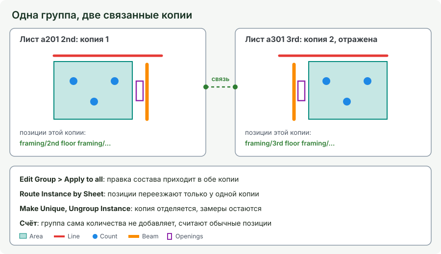

# Groups: linked copies of measurements

A group collects measurements of one sheet under one name: lines, areas, Count points, J Area, Beam, Openings and annotation takeoffs. You paste it onto other sheets and into other places of a sheet, and the copies stay linked: a change to the contents of one copy reaches all of them. You need it when an assembly repeats: a typical unit, a balcony, a stair, the same joist layout on several floors. Groups appeared in version 3.1 and work the same in Lite.

<figure markdown>
  
  <figcaption markdown="span">One group on two sheets: the second copy is mirrored and sits in the takeoffs of its own floor. `Edit Group` changes the contents of both copies, `Route Instance by Sheet` moves the takeoffs of one copy only.</figcaption>
</figure>

!!! note "A group counts nothing by itself"
    The measurements of a group stay ordinary measurements of their takeoffs. Total, Excel, the legend and PDF count them as always; the group has no quantity of its own. Annotations in a group stay without quantity.

## Cheat sheet { #cheatsheet }

| Command | Where | What it does |
| --- | --- | --- |
| `Create Group...` | `Groups` button on the bottom strip (after `Cut`), right-click on the sheet > `Groups`, palette `Create Group` | makes a group from the selected measurements of the sheet |
| ++ctrl+c++, ++ctrl+v++ | sheet | pastes a linked copy, window `Paste Linked Groups`: `By sheet router` or `Source takeoffs` |
| `Edit Group...` | `Groups`, palette `Edit Group` | window for editing the contents, `Apply to all` changes every copy |
| `Route Instance by Sheet...` | `Groups`, palette `Route Group Instance by Sheet` | moves the takeoffs of one copy by the sheet dot and the active building |
| `Make Unique...` | `Groups`, palette `Make Group Unique` | the copy becomes a separate group with its own name |
| `Ungroup Instance` | `Groups`, palette `Ungroup Instance` | removes the link from this copy only, the measurements stay |
| `Select Instances on This Sheet` | `Groups`, palette `Select Group Instances on Sheet` | selects every copy of this group on the open sheet |

These commands have no default keys; you can assign them in `Settings > Keyboard Shortcuts` ([shortcuts](ourplancore-shortcuts.md#remap)). They work in a job opened for writing.

## How to make a group { #create }

Why: build a repeating assembly once.
You need: a sheet with a scale, measurements already drawn in their takeoffs, none of them in another group.

1. Click `Select` (++e++) and select the measurements with a box or ++ctrl++ + click. All of them must be on one sheet.
2. Click `Groups` on the bottom strip (or right-click on the sheet > `Groups`) > `Create Group...`.
3. In the `Create Group` window type a name in the `Group name:` field, for example `balcony A`, and click OK.

Result: a click or a box on any measurement of the group selects its whole copy; the status bar shows `Group: balcony A (5 members). Ctrl+C copies; Groups > Edit Group updates all instances.`

!!! tip "Part of the Count marks"
    If only some marks of a Count are selected (++alt++ and a box over the marks), only those marks go into the group. The other marks stay in the same takeoff, outside the group.

## How to paste a copy on another sheet { #paste }

Why: the same assembly on another floor or in another place of the sheet.

1. Click the group (the whole copy is selected) and press ++ctrl+c++.
2. Open the destination sheet, point the cursor and press ++ctrl+v++.
3. In the `Paste Linked Groups` window choose:
    - **By sheet router** (default): the destination takeoffs come from the W/F/S/U dot of this sheet and the active building. Subfolders follow the `Copies keep their source folders` checkbox ([routing](ourplancore-routing.md#sheet-routing)), Openings follow their usual rule.
    - **Source takeoffs**: the copy lands on the new sheet, and the quantities are added to the original takeoffs.

    The `Paste in place (same position as copied)` checkbox puts the copy at the same coordinates as the original.

Result: a new copy of the group on the sheet. If the sheet scales differ, the copy is recalculated so the sizes in feet stay the same. Every copy has its own sheet, place, rotation, mirroring and destination takeoffs.

A whole copy can be moved, rotated and mirrored (`Transform`, dragging) and deleted as a whole. Moving a point of one measurement of a copy, or deleting one measurement from it right on the sheet, is not allowed; the status bar answers `Use Groups > Edit Group to change its contents, or Ungroup this instance.`

## How to change the contents of every copy: Edit Group { #edit }

Why: a measurement in the assembly changed, and it has to change in every copy.

1. Click any copy of the group and click `Groups` > `Edit Group...`.
2. The window `Edit Group: <name> (N instances)` opens with the sheet of this copy:

    | Button | What it does |
    | --- | --- |
    | `Select` | selection, editing points and edges as on the sheet |
    | takeoff list and `Draw` | a new measurement into the selected existing takeoff |
    | `Assign takeoff` | move the selected measurements to another takeoff of the same type |
    | `Remove`, `Undo`, `Cut` | remove a measurement, undo a step, cut |
    | `Rotate 90`, `Flip H`, `Flip V` | rotate or mirror the selection |
    | `Fit group`, `Fit sheet`, `Ortho` | view of the group or the sheet, orthogonal mode |

    The `Group` field at the top renames the group. ++ctrl+c++ and ++ctrl+v++ work inside the window.
3. Click **Apply to all**. **Cancel** or closing the window changes nothing in the job.

Result: the change reached every copy, and each copy kept its place and rotation. ++ctrl+z++ on the sheet right after that restores every copy it touched.

!!! tip "Tips"
    - `Draw` draws only into an existing takeoff. Create a new takeoff in the main window first (++t++), then open `Edit Group`.
    - A new measurement in each copy goes to the folder of that copy's saved building and floor, even if the active building or the sheet dot has changed since.
    - A group copied before the edit can no longer be pasted: `The copied group has been edited. Copy an updated instance before pasting.` Copy an instance again.

## How to move the takeoffs of one copy: Route Instance by Sheet { #route }

Why: a copy was pasted with the wrong building or floor, and its takeoffs landed in the wrong place.

1. Give the sheet the right dot and choose the active building (green dot, [multiple buildings](ourplancore-buildings.md#root)).
2. Click the copy and click `Groups` > `Route Instance by Sheet...`.
3. In the `Route Instance: <name>` window check the `Takeoff`, `Current folder`, `Destination folder` table and click **Apply to this instance**.

Result: only the takeoffs of this copy moved; the geometry and the link stayed, the other copies are untouched. New measurements of this copy go to the new place from now on. ++ctrl+z++ undoes the move.

## How to split off a copy: Make Unique and Ungroup Instance { #unique }

- **Make Unique...**: the copy becomes a separate group. Type a name in the `New group type name:` field (default `<name> copy`). Nothing moves, and edits of the new group no longer touch the earlier copies.
- **Ungroup Instance**: the link is removed from this copy only. Its measurements stay ordinary measurements in the same takeoffs.
- **Select Instances on This Sheet**: selects every copy of this group on the open sheet.

## What is blocked { #blocked }

| Action | Message | What to do |
| --- | --- | --- |
| Move a point or delete one measurement of a copy on the sheet | `Use Groups > Edit Group to change its contents, or Ungroup this instance.` | `Edit Group` or `Ungroup Instance` |
| Delete part of a copy with a selection | `This selection contains part of a linked group. Use Edit Group or Ungroup Instance first.` | select the whole copy or open `Edit Group` |
| `Merge` or `Split` of takeoffs that hold group measurements | `Use Edit Group or Ungroup Instance before merging takeoffs that contain linked groups.` | `Ungroup Instance` first |
| Editing such geometry through Agent Bridge | `Linked group members must be edited with Edit Group or ungrouped first.` | `Edit Group` or `Ungroup Instance` |
| The saved folder of a copy was deleted | `The saved group destination no longer exists. Use Groups > Route Instance again.` | `Route Instance by Sheet...` |

## Limits { #limits }

- One copy lies on one sheet; a group inside a group is not possible.
- Markups of the Annotation ribbon (highlight, cloud, arrow, note) cannot join a group; annotation takeoffs can.
- Copying in the Takeoffs tree: if not the whole group is copied, the copies become ordinary measurements without a link.
- A group operation can be undone with ++ctrl+z++, there is no Redo.
- Versions before 3.1 do not know groups. Do not open or save a job with groups in an older program: everyone updates to 3.1. Older jobs need no conversion.

## See also

- [Takeoffs tree: how to copy measurements](ourplancore-takeoffs.md#copy)
- [Merge, Split, Break step by step](ourplancore-edit-takeoffs.md)
- [Routing and rules](ourplancore-routing.md)
- [Multiple buildings](ourplancore-buildings.md)
