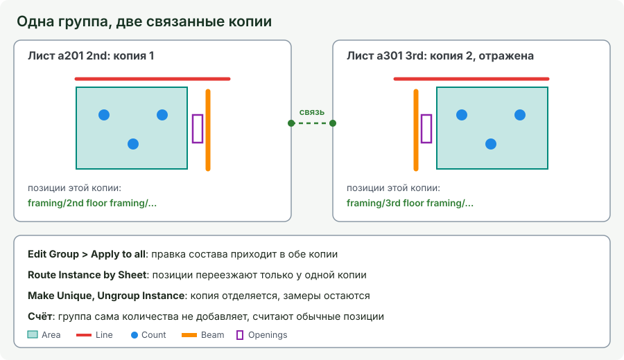

# Группы: связанные копии замеров

Группа собирает замеры одного листа под одним именем: линии, площади, точки Count, J Area, Beam, Openings и позиции-аннотации. Её вставляют на другие листы и в другие места листа, и копии остаются связанными: правка состава в одной копии приходит во все. Это нужно, когда узел повторяется: типовой юнит, балкон, лестница, одна и та же раскладка балок на нескольких этажах. Группы появились в версии 3.1, в Lite работают так же.

<figure markdown>
  
  <figcaption markdown="span">Одна группа на двух листах: вторая копия отражена и лежит в позициях своего этажа. `Edit Group` меняет состав в обеих копиях, `Route Instance by Sheet` переносит позиции только одной.</figcaption>
</figure>

!!! note "Группа сама ничего не считает"
    Замеры группы остаются обычными замерами своих позиций. Total, Excel, легенда и PDF считают их как всегда, отдельного количества у группы нет. Аннотации в группе так и остаются без количества.

## Шпаргалка { #cheatsheet }

| Команда | Где | Что делает |
| --- | --- | --- |
| `Create Group...` | кнопка `Groups` на нижней полосе (после `Cut`), ПКМ по листу > `Groups`, палитра `Create Group` | делает группу из выбранных замеров листа |
| ++ctrl+c++, ++ctrl+v++ | лист | вставляет связанную копию, окно `Paste Linked Groups`: `By sheet router` или `Source takeoffs` |
| `Edit Group...` | `Groups`, палитра `Edit Group` | окно правки состава, `Apply to all` меняет все копии |
| `Route Instance by Sheet...` | `Groups`, палитра `Route Group Instance by Sheet` | переносит позиции одной копии по точке листа и активному корпусу |
| `Make Unique...` | `Groups`, палитра `Make Group Unique` | копия становится отдельной группой со своим именем |
| `Ungroup Instance` | `Groups`, палитра `Ungroup Instance` | снимает связь только с этой копии, замеры остаются |
| `Select Instances on This Sheet` | `Groups`, палитра `Select Group Instances on Sheet` | выделяет все копии этой группы на открытом листе |

Клавиш по умолчанию у этих команд нет, назначить их можно в `Settings > Keyboard Shortcuts` ([горячие клавиши](ourplancore-shortcuts.md#remap)). Команды работают в проекте, открытом на запись.

## Как сделать группу { #create }

Зачем: один раз собрать узел, который повторяется.
Нужно: лист с масштабом, замеры уже нарисованы в своих позициях, ни один из них не состоит в другой группе.

1. Нажмите `Select` (++e++) и выделите замеры рамкой или ++ctrl++ + щелчок. Все замеры должны быть на одном листе.
2. Нажмите `Groups` на нижней полосе (или ПКМ по листу > `Groups`) > `Create Group...`.
3. В окне `Create Group` впишите имя в поле `Group name:`, например `balcony A`, и нажмите OK.

Результат: щелчок или рамка по любому замеру группы выделяет её копию целиком, в статусе `Group: balcony A (5 members). Ctrl+C copies; Groups > Edit Group updates all instances.`

!!! tip "Часть меток Count"
    Если у Count выделены только некоторые метки (++alt++ и рамка по меткам), в группу уйдут только они. Остальные метки останутся в той же позиции, вне группы.

## Как вставить копию на другой лист { #paste }

Зачем: тот же узел на другом этаже или в другом месте листа.

1. Щёлкните по группе (выделится вся копия) и нажмите ++ctrl+c++.
2. Откройте лист назначения, наведите курсор и нажмите ++ctrl+v++.
3. В окне `Paste Linked Groups` выберите:
    - **By sheet router** (по умолчанию): позиции назначения берутся по точке W/F/S/U этого листа и активному корпусу. Подпапки идут по галке `Copies keep their source folders` ([маршрутизация](ourplancore-routing.md#sheet-routing)), Openings по своему обычному правилу.
    - **Source takeoffs**: копия ложится на новый лист, а количества добавляются в исходные позиции.

    Галка `Paste in place (same position as copied)` ставит копию в те же координаты, что у оригинала.

Результат: на листе новая копия группы. Если масштабы листов разные, копия пересчитывается так, чтобы размеры в футах остались прежними. У каждой копии свой лист, своё место, поворот, отражение и свои позиции назначения.

Копию целиком можно двигать, поворачивать и отражать (`Transform`, перетаскивание) и удалять целиком. Сдвинуть точку одного замера копии или удалить из неё один замер прямо на листе нельзя, статус ответит `Use Groups > Edit Group to change its contents, or Ungroup this instance.`

## Как поменять состав во всех копиях: Edit Group { #edit }

Зачем: в узле поменялся замер, и так должно быть во всех копиях.

1. Щёлкните по любой копии группы и нажмите `Groups` > `Edit Group...`.
2. Откроется окно `Edit Group: <имя> (N instances)` с листом этой копии:

    | Кнопка | Что делает |
    | --- | --- |
    | `Select` | выбор, правка точек и граней, как на листе |
    | список позиций и `Draw` | новый замер в выбранную существующую позицию |
    | `Assign takeoff` | перевести выбранные замеры в другую позицию того же типа |
    | `Remove`, `Undo`, `Cut` | убрать замер, отменить шаг, вырез |
    | `Rotate 90`, `Flip H`, `Flip V` | повернуть или отразить выбранное |
    | `Fit group`, `Fit sheet`, `Ortho` | вид на группу или на лист, ортогональный режим |

    Поле `Group` вверху переименовывает группу. ++ctrl+c++ и ++ctrl+v++ работают внутри окна.
3. Нажмите **Apply to all**. **Cancel** или закрытие окна ничего не меняют в проекте.

Результат: правка пришла во все копии, каждая осталась на своём месте и в своём повороте. ++ctrl+z++ на листе сразу после этого возвращает все затронутые копии.

!!! tip "Советы"
    - `Draw` рисует только в уже существующую позицию. Новую позицию сначала создайте в главном окне (++t++), потом откройте `Edit Group`.
    - Новый замер в каждой копии ложится в папку по её сохранённому корпусу и этажу, даже если активный корпус или точка листа с тех пор поменялись.
    - Группа, скопированная до правки, больше не вставляется: `The copied group has been edited. Copy an updated instance before pasting.` Скопируйте копию заново.

## Как перенести позиции одной копии: Route Instance by Sheet { #route }

Зачем: копию вставили не с тем корпусом или этажом, и её позиции легли не туда.

1. Поставьте листу нужную точку и выберите активный корпус (зелёная точка, [несколько зданий](ourplancore-buildings.md#root)).
2. Щёлкните по копии и нажмите `Groups` > `Route Instance by Sheet...`.
3. В окне `Route Instance: <имя>` проверьте таблицу `Takeoff`, `Current folder`, `Destination folder` и нажмите **Apply to this instance**.

Результат: переехали позиции только этой копии, геометрия и связь остались, другие копии не тронуты. Новые замеры этой копии дальше идут в новое место. ++ctrl+z++ отменяет перенос.

## Как отделить копию: Make Unique и Ungroup Instance { #unique }

- **Make Unique...**: копия становится отдельной группой. Впишите имя в поле `New group type name:` (по умолчанию `<имя> copy`). Ничего не двигается, а правка новой группы больше не трогает прежние копии.
- **Ungroup Instance**: связь снимается только с этой копии. Её замеры остаются обычными замерами в тех же позициях.
- **Select Instances on This Sheet**: выделяет все копии этой группы на открытом листе.

## Что заблокировано { #blocked }

| Действие | Сообщение | Что сделать |
| --- | --- | --- |
| Сдвинуть точку или удалить один замер копии на листе | `Use Groups > Edit Group to change its contents, or Ungroup this instance.` | `Edit Group` или `Ungroup Instance` |
| Удалить часть копии выделением | `This selection contains part of a linked group. Use Edit Group or Ungroup Instance first.` | выделить копию целиком или открыть `Edit Group` |
| `Merge` или `Split` позиций, где есть замеры группы | `Use Edit Group or Ungroup Instance before merging takeoffs that contain linked groups.` | сначала `Ungroup Instance` |
| Правка такой геометрии через Agent Bridge | `Linked group members must be edited with Edit Group or ungrouped first.` | `Edit Group` или `Ungroup Instance` |
| Сохранённую папку копии удалили | `The saved group destination no longer exists. Use Groups > Route Instance again.` | `Route Instance by Sheet...` |

## Ограничения { #limits }

- Одна копия лежит на одном листе, группу внутри группы сделать нельзя.
- Разметка ленты Annotation (маркер, облако, стрелка, заметка) в группу не входит, позиции-аннотации входят.
- Копирование в дереве Takeoffs: если копируется не вся группа, копии становятся обычными замерами без связи.
- Отмену группы ++ctrl+z++ можно сделать, повтора (Redo) нет.
- Версии до 3.1 групп не знают. Проект с группами не открывайте и не сохраняйте старой программой: обновитесь все до 3.1. Старым проектам переделка не нужна.

## См. также

- [Дерево Takeoffs: как скопировать замеры](ourplancore-takeoffs.md#copy)
- [Merge, Split, Break пошагово](ourplancore-edit-takeoffs.md)
- [Маршрутизация и правила](ourplancore-routing.md)
- [Несколько зданий](ourplancore-buildings.md)
