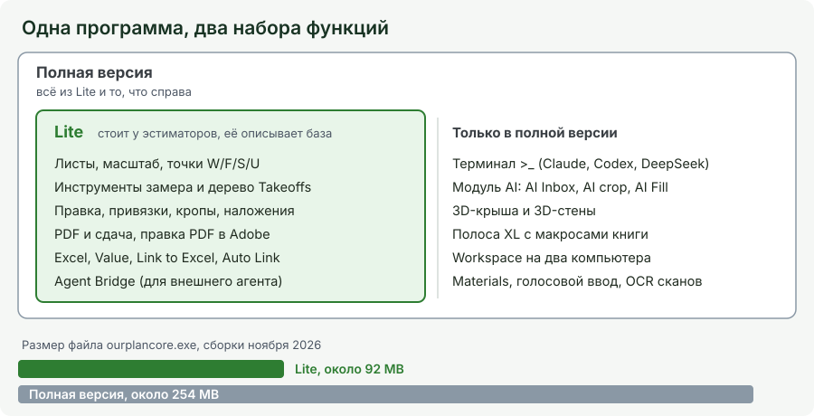

# OurPlanCore Lite vs full version

OurPlanCore comes in two versions built from the same code. Estimators run **Lite**: it has no AI models and no terminal, it is a bit simpler and almost three times smaller. This knowledge base describes Lite. What exists only in the full version is collected in the menu block "AI, terminal and 3D (full version)" or marked on the page with the words "full version only".

<figure markdown>
  
  <figcaption markdown="span">The full version does everything Lite does, plus the terminal, the AI module, 3D, the XL strip, Workspace and Materials. The app file size is at the bottom.</figcaption>
</figure>

## Which version for whom { #who }

| Version | For whom | What it gives |
| --- | --- | --- |
| Lite | estimators who do not use AI models | everything for takeoff and delivery: sheets, tools, the Takeoffs tree, PDF, Excel and `Link to Excel` |
| Full | those who work with AI | the same plus the Claude, Codex and DeepSeek terminal in the window, the AI module, the 3D roof, the XL strip, Workspace for two computers |

## Where to get Lite and how it updates { #get }

| What | Where |
| --- | --- |
| The app | a single `ourplancore.exe` file in the shared Dropbox folder `Office Folder\programs`. It is usually copied to your own computer and run from there; running it straight from the Dropbox folder works too |
| Excel templates | in the same place, the `templates` folder: `TemplateCom.xlsm`, `TemplateResidential.xlsm` |
| What changed | in the same place, the `changes` folder: files `Изменения программ <date>.txt` ("program changes") |
| Update | the new file arrives in the same folder through Dropbox and replaces the old one; the previous version is not kept next to it. If you keep your own copy, copy the new file over it after the update |
| Version | in the window title, with a `-lite` tail: `OurPlanCore 3.0.x-lite - <job>`; the full version has no such tail |

Lite is built from the same code as the full version, but separately and not with every release. So the Lite number can lag behind, and a new feature from [What's new](ourplancore-changelog.md) reaches Lite with the next Lite build (except what is cut out, see below).

## Size { #size }

| `ourplancore.exe` file | Size |
| --- | --- |
| Lite (build of 11/11/2026) | about 92 MB |
| Full version (build of 11/14/2026) | about 254 MB |

Lite is smaller because its file leaves out the DeepSeek and OpenCode engine, the copy of the knowledge base for the assistant, voice input, Tesseract OCR, the Python libraries for parsing PDFs and images, the `TemplateCom.xlsm` template, window snapshots for the sample job cards and the .NET language files other than English.

## What Lite does not have { #missing }

| Missing | What it is | Where it is described |
| --- | --- | --- |
| The `>_` terminal | the panel with Claude, Codex and DeepSeek to the right of the sheet: the `>_` button on the right strip, a palette command, `Settings > Terminals` | [AI console](ourplancore-ai-console.md) |
| The AI module | AI Inbox, AI Manager, AI crop and markers, `AI Fill` and `Crop Hints`, title block reading by the model, tracing requests through the AI Inbox, `Settings > AI Crop Notes`, palette commands in the AI category | [AI in the app](ourplancore-ai.md) |
| Workspace | shared server, second computer, archive of assistant conversations, `Settings > Workspace` | [Workspace](ourplancore-workspace.md) |
| Voice input | `Settings > Voice Input` | - |
| The 3D module | the 3D tab, 3D roof, Roof Base, 3D walls | [3D roof](ourplancore-3d-roof.md), [3D and Massing](ourplancore-3d.md) |
| The Materials module | the Materials tab: materials from the PDF text | [Managers](ourplancore-managers.md#materials) |
| The XL strip | the `ALL`, `LG`, `SF`, `WL` ... `ST` strip to the right of the sheet that writes into the workbook and runs its macros; the `Settings > Excel Actions` and `Excel Rules` sections; the Excel buttons on the side command strips | [Export to Excel, XL strip](ourplancore-excel.md#xl) |
| `Create Project Excel Workbook` | the command that copies the built-in `TemplateCom.xlsm` into the job folder | take the template from the `templates` folder in Dropbox |
| OCR of scans | reading the sheet number without a text layer | [Sheets](ourplancore-pages.md) |

This cannot be turned on: the AI, 3D and Materials modules are not in `Settings > Modules`, and neither a saved preset nor the job settings will turn them on.

## What Lite has and what works the same { #same }

- Sheets, scale, W/F/S/U dots, all measuring tools, the Takeoffs tree, editing and snaps, crops, the Hide mask, overlays, the legend.
- Detailed sheet rendering, PDF layers, Layer Trace, Count Similar, sheet names and scales from the PDF text: Python and PyMuPDF are kept in Lite for these.
- PDF export, including the PDF for editing in Adobe ([PDF and delivery](ourplancore-pdf.md)).
- Excel: `Export > Export Excel` to an `.xlsx` file, the `Excel` and `Value` buttons at the bottom (they write from the active cell of the open workbook), `Link to Excel`, `Auto Link`, `Settings > Excel Links` ([Export to Excel, Lite](ourplancore-excel.md#lite)).
- The `.ourplan` job format is the same: it is one app built with a different switch.
- `Settings > Agent Bridge` stayed, but without the terminal the bridge is needed only by an external agent; an estimator does not need it in Lite.

## How Lite differs in daily work { #differences }

| What | In Lite |
| --- | --- |
| Settings | its own profile `%LOCALAPPDATA%\OurPlanCore Lite`: settings start from the built-in ones and do not mix with the full version's settings. Logs are in `%LOCALAPPDATA%\OurPlanCore Lite\roaming\logs` |
| `.ourplan` files | Lite does not become the app for `.ourplan`, a double click on the file does not start it. Open the job from the app (++ctrl+o++, the `Open project file...` link) or drag the file into the window |
| Scans | no OCR: the name and scale are read only from the PDF text, name a scanned sheet by hand (++f2++) |
| Both versions on one computer | they can be installed side by side: their profiles and settings are separate |

## How to tell which version is open { #which }

1. Look at the window title: `OurPlanCore 3.0.x-lite - <job>` means Lite.
2. Look at the right strip next to the sheet: Lite has no `>_` button and no XL strip with the `ALL`, `LG`, `SF` buttons.

If you need AI models, the terminal or 3D: that is the full version, everything about it is in the menu block "AI, terminal and 3D (full version)", starting with [AI in the app](ourplancore-ai.md).

## See also

- [OurPlanCore 3.0: section hub](ourplanecore.md)
- [Getting started](ourplancore-start.md): where the app is and where the settings are
- [Export to Excel](ourplancore-excel.md): what Lite has and what the XL strip does
- [Settings and modules](ourplancore-settings.md#modules)
