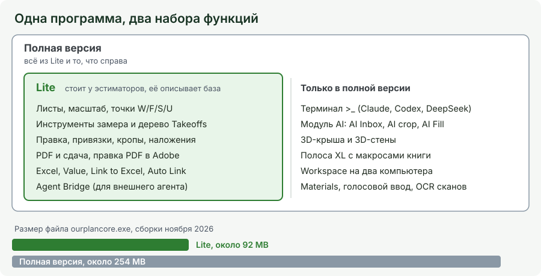

# OurPlanCore Lite и полная версия

OurPlanCore выходит в двух вариантах из одного кода. У эстиматоров стоит **Lite**: в ней нет нейронок и терминала, она чуть проще и весит почти в три раза меньше. Эта база описывает Lite. То, что есть только в полной версии, собрано в блоке меню "Нейронки, терминал и 3D (полная версия)" или помечено на странице словами "только в полной версии".

<figure markdown>
  
  <figcaption markdown="span">Полная версия умеет всё, что Lite, и сверх того терминал, модуль AI, 3D, Workspace и Materials. Полоса XL есть в обеих, в Lite её включают в `Settings > Modules`. Внизу размер файла программы.</figcaption>
</figure>

## Кому какая версия { #who }

| Версия | Для кого | Что даёт |
| --- | --- | --- |
| Lite | эстиматоры, которые не пользуются нейронками | всё для замера и сдачи: листы, инструменты, дерево Takeoffs, PDF, Excel и `Link to Excel`; полоса XL по галке в `Settings > Modules` |
| Полная | кто работает с ИИ | то же плюс терминал Claude, Codex и DeepSeek в окне, модуль AI, 3D-крыша, Workspace на два компьютера |

## Где взять Lite и как она обновляется { #get }

| Что | Где |
| --- | --- |
| Программа | один файл `ourplancore.exe` в общей папке Dropbox `Office Folder\programs`. Обычно его копируют к себе на компьютер и запускают оттуда; запускать прямо из папки Dropbox тоже можно |
| Шаблоны Excel | там же, папка `templates`: `TemplateCom.xlsm`, `TemplateResidential.xlsm` |
| Что изменилось | там же, папка `changes`: файлы `Изменения программ <дата>.txt` |
| Обновление | новый файл приходит в ту же папку через Dropbox и заменяет прежний; прошлой версии рядом нет. Если вы держите копию у себя, после обновления скопируйте новый файл поверх своей копии |
| Версия | в заголовке окна: `OurPlanCore 3.1 - <проект>`. С версии 3.1 номер у Lite и полной версии одинаковый, без хвоста `-lite` (до 3.1 было `3.0.x-lite`); как их отличить, [ниже](#which) |

Lite собирается из того же кода, что полная версия, но отдельно и не с каждым выпуском. Поэтому номер Lite может отставать, а новая функция из [Что нового](ourplancore-changelog.md) приходит в Lite со следующей сборкой Lite (кроме вырезанного, см. ниже).

## Размер { #size }

| Файл `ourplancore.exe` | Размер |
| --- | --- |
| Lite 3.1 (сборка 17.11.2026) | 92,4 MB |
| Полная версия (3.1, сборка 17.11.2026) | около 254 MB |

Lite меньше, потому что в её файл не кладут движок DeepSeek и OpenCode, копию базы знаний для ассистента, голосовой ввод, OCR Tesseract, библиотеки Python для разбора PDF и картинок, шаблон `TemplateCom.xlsm`, снимки окна для карточек демо-проекта и языковые файлы .NET кроме английского.

## Чего нет в Lite { #missing }

| Чего нет | Что это | Где описано |
| --- | --- | --- |
| Терминал `>_` | панель с Claude, Codex и DeepSeek справа от листа: кнопка `>_` на правой полосе, команда палитры, `Settings > Terminals` | [Консоль ИИ](ourplancore-ai-console.md) |
| Модуль AI | AI Inbox, AI Manager, AI crop и маркеры, `AI Fill` и `Crop Hints`, чтение штампа моделью, запросы трассы через AI Inbox, `Settings > AI Crop Notes`, команды палитры категории AI | [ИИ в программе](ourplancore-ai.md) |
| Workspace | общий сервер, второй компьютер, архив бесед ассистентов, `Settings > Workspace` | [Workspace](ourplancore-workspace.md) |
| Голосовой ввод | `Settings > Voice Input` | - |
| Модуль 3D | вкладка 3D, 3D-крыша, Roof Base, 3D-стены | [3D-крыша](ourplancore-3d-roof.md), [3D и Massing](ourplancore-3d.md) |
| Модуль Materials | вкладка Materials: материалы из текста PDF | [Менеджеры](ourplancore-managers.md#materials) |
| `Create Project Excel Workbook` | команда, которая копирует встроенный `TemplateCom.xlsm` в папку проекта | шаблон берите из папки `templates` в Dropbox |
| OCR сканов | чтение номера листа без текстового слоя | [Листы](ourplancore-pages.md) |

Включить это нельзя: модулей AI, 3D и Materials нет в `Settings > Modules`, и ни сохранённый пресет, ни настройки проекта их не включат.

## Что в Lite есть и работает так же { #same }

- Листы, масштаб, точки W/F/S/U, все инструменты замера, дерево Takeoffs, правка и привязки, кропы, маска Hide, наложения, легенда.
- Детальная отрисовка листа, слои PDF, Layer Trace, Count Similar, имена и масштаб листов по тексту PDF: для них в Lite оставлены Python и PyMuPDF.
- Экспорт PDF, в том числе PDF для правки в Adobe ([PDF и сдача](ourplancore-pdf.md)).
- Excel: `Export > Export Excel` в файл `.xlsx`, кнопки `Excel` и `Value` внизу (пишут от активной ячейки открытой книги), `Link to Excel`, `Auto Link`, `Settings > Excel Links` ([Экспорт в Excel, Lite](ourplancore-excel.md#lite)).
- Формат проекта `.ourplan` тот же: это одна программа, собранная с другим ключом.
- `Settings > Agent Bridge` остался, но без терминала мост нужен только внешнему агенту; эстиматору в Lite он не нужен.

## Чем Lite отличается в работе { #differences }

| Что | В Lite |
| --- | --- |
| Настройки | свой профиль `%LOCALAPPDATA%\OurPlanCore Lite`: настройки начинаются со встроенных и не смешиваются с настройками полной версии. Логи в `%LOCALAPPDATA%\OurPlanCore Lite\roaming\logs` |
| Файлы `.ourplan` | Lite не становится программой для `.ourplan`, двойной щелчок по файлу её не запускает. Откройте проект из программы (++ctrl+o++, ссылка `Open project file...`) или перетащите файл в окно |
| Сканы | OCR нет: имя и масштаб читаются только из текста PDF, лист-скан назовите руками (++f2++) |
| Полоса XL | по умолчанию выключена. Включите: `Settings > Modules`, галка `Excel Strip (XL)` (вместе с `Excel Integration`, она стоит сразу). Появятся полоса `ALL`, `LG`, `SF`, `WL` ... `ST` справа от листа, кнопка `XLS` на правой полосе команд, разделы `Settings > Excel Actions` и `Excel Rules`; снимете галку, и они спрячутся. [Полоса XL](ourplancore-excel.md#xl) |
| Обе версии на одном компьютере | могут стоять рядом: профили и настройки у них раздельные |

## Как понять, какая версия открыта { #which }

1. Посмотрите на правую полосу команд у листа: у Lite нет кнопки `>_`. Полоса XL с кнопками `ALL`, `LG`, `SF` версию не выдаёт: в Lite её можно включить.
2. Заголовок окна выдаёт Lite только до версии 3.1: там был хвост `-lite` (`OurPlanCore 3.0.37-lite - <проект>`). С 3.1 обе версии пишут просто `OurPlanCore 3.1 - <проект>`.
3. Лог Lite лежит в `%LOCALAPPDATA%\OurPlanCore Lite\roaming\logs`, лог полной версии в `%APPDATA%\OurPlanCore\logs`. Файл Lite весит около 92 MB, полной версии около 254 MB.

Нужны нейронки, терминал или 3D: это полная версия, всё про неё в блоке меню "Нейронки, терминал и 3D (полная версия)", начало - [ИИ в программе](ourplancore-ai.md).

## См. также

- [OurPlanCore 3.0: хаб раздела](ourplanecore.md)
- [Начало работы](ourplancore-start.md): где программа и где настройки
- [Экспорт в Excel](ourplancore-excel.md): что есть в Lite и что делает полоса XL
- [Settings и модули](ourplancore-settings.md#modules)
