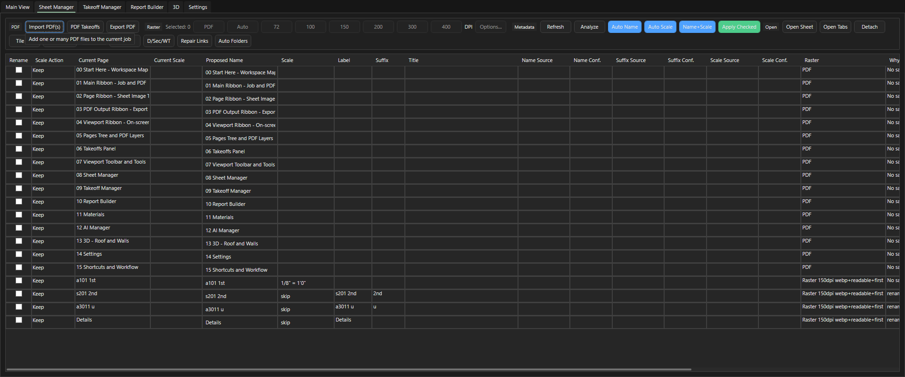
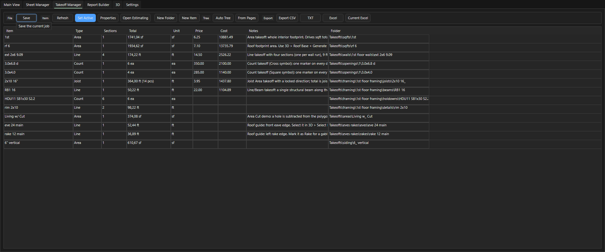
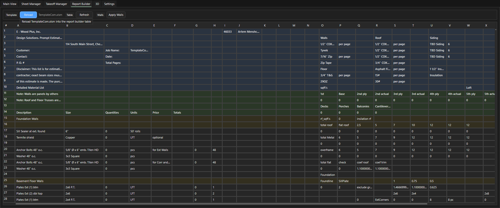

# Managers: Sheet Manager, Takeoff Manager, Report Builder, Materials, AI Manager, Job Tracker

Here: the mode bar tabs that are off by default in `Settings > Modules`, and the Job Tracker button. You need them when there are dozens of sheets and editing them in a table is easier, when you need a material list or prices, when AI works through AI Inbox, and when you want to switch the job card in the tracker from the app. Everyday measuring does without these tabs.

Turning on: `Settings > Modules`, check the module, `Apply` or `Save global default` ([how to turn on](ourplancore-extras.md#enable)). The tab appears in the mode bar next to `Main View` and `Settings`. From the command palette (++ctrl+shift+p++) the tabs open with the commands `Show Sheet Manager`, `Show Takeoff Manager`, `Show Report Builder`, `Show Materials`, `Show AI Manager` and `Show 3D Viewer` ([3D](ourplancore-3d.md)); for a disabled module the command does not fire.

## Sheet Manager { #sheet-manager }

<figure markdown>
  
  <figcaption markdown="span">The sheet table with proposed names, scale, source and confidence. The `Rename` and `Scale Action` checkboxes pick what to apply.</figcaption>
</figure>

A table of all sheets for bulk operations. Turning the module on also adds the `Name`, `Scale`, `Name+Scale` buttons to the Main ribbon, and together with the AI module, `AI Fill` and `Crop Hints`.

| Group | Buttons |
| --- | --- |
| PDF | `Import PDF(s)`, `PDF Takeoffs`, `Export PDF` |
| Raster | source `PDF` / `Auto`, DPI presets, `Options...`, format Auto / WebP / PNG, `Prepare`, `First On`, `First Off`, `Clean`, `Cancel` |
| Metadata | `Refresh`, `Analyze`, `Auto Name`, `Auto Scale`, `Name+Scale`, `AI Fill`, `Crop Hints`, `Apply Checked` |
| Open | `Open Sheet`, `Open Tabs`, `Detach`, `Tile M2`, `Open JSON` |
| Organize | `Sort A/S`, `D/Sec/WT`, `Repair Links`, `Auto Folders` |

Columns: `Rename`, `Scale Action`, `Current Page`, `Current Scale`, `Proposed Name`, `Scale`, `Label`, `Suffix`, `Title`, `Name Source` / `Name Conf.`, `Suffix Source` / `Suffix Conf.`, `Scale Source` / `Scale Conf.`, `Raster`, `Why`, `Warnings`. The checkboxes in `Rename` and `Scale Action` pick what the `Apply Checked` button applies.

### How to prepare a raster for heavy sheets { #raster }

What for: large sheets open faster from a ready raster, `Ctrl+F3` snaps to black lines.

1. Select the sheets in the table.
2. In the **Raster** group, pick the PNG format and the DPI.
3. Press **Prepare** and wait for it to finish.
4. Press **First On**.

Result: the `Raster` column is filled, the sheet opens from the raster.

### How to set title block regions: Crop Hints { #crop-hints }

What for: a plan set with an unreadable title block gets names and scale from regions drawn once.
Needed: the Sheet Manager and AI modules.

1. Press **Crop Hints** (Main ribbon or the **Metadata** group): the app opens a typical sheet of the plan set with the status `show Sheet title / number, then Scale on the middle <profile> sheet`.
2. Draw three regions with the left button: **Sheet #**, **Sheet Title**, **Scale**; the right or middle button moves the sheet, **Clear Current** and **Clear All** erase.
3. Press **Save**.
4. Press **Analyze**: the metadata is re-read using the hints; **AI Fill** hands unrecognized title blocks to the model (online, needs a key).
5. Check the `Why`, `Warnings` and `Name Source` columns (text, OCR, model or a learned rule) and press **Apply Checked**.

Result: the sheets are named and scaled from the title block regions; the app looks for the same regions on the other sheets of the plan set.

The same actions without the tab: the `Name`, `Scale`, `Name+Scale` buttons in the Pages panel and a preview before applying ([sheets](ourplancore-pages.md)).

## Takeoff Manager { #takeoff-manager }

<figure markdown>
  
  <figcaption markdown="span">The takeoff table: type, sections, total, unit, price, folder.</figcaption>
</figure>

The Takeoffs tree as a table: `Item`, `Type`, `Sections`, `Total`, `Unit`, `Price`, `Cost`, `Notes`, `Folder`. Buttons: `Save`, `Refresh`, `Set Active`, `Properties`, `Open Estimating`, `New Folder`, `New Item`, `Auto Tree`, `From Pages`, export `CSV` / `TXT` / `Excel` / `Current Excel`. Handy for checking totals and prices across a whole building; drawing is still done in Main View. To check totals before Excel, the `Estimating` tab in the Takeoffs panel is usually enough ([tree](ourplancore-takeoffs.md)).

## Report Builder { #report-builder }

<figure markdown>
  
  <figcaption markdown="span">Report Builder reads `TemplateCom.xlsm` and shows the wall table.</figcaption>
</figure>

`Reload` reads the `TemplateCom.xlsm` template, `Refresh` updates the table, `Apply Walls` writes the walls into the workbook. This is the old path into Excel; today walls, areas and framing are written by the XL strip with per-section buttons and `ALL` ([Excel export](ourplancore-excel.md)). The tab stays for checking how old workbooks got their wall block.

## Materials { #materials }

The tab reads materials from the drawings themselves, not from the Takeoffs tree: material mentions and schedule tables in the text of the job's source PDFs.

### How to collect materials from the job PDFs { #materials-extract }

What for: quickly see which materials, sections and schedules (sheathing, beams, hardware) are named in the plan set, with a link to the sheet.
Needed: the Materials module is on, the job has sheets from a PDF.

1. Open the **Materials** tab (or the palette command `Show Materials`).
2. Press **Extract**; the palette command `Extract Materials` opens the tab and runs the same thing right away. The built-in helper reads the text of all source PDFs (with OCR on sheets without text, if it is installed) and the tables titled `SCHEDULE`, `TABLE`, `LEGEND`.
3. Wait for the status `Materials: N row(s), M schedule(s).`
4. Open the result: `Rows CSV` (a row for each mention: category, thickness, section, grade, quantity, sheet), `Summary CSV` (a summary by material), `JSON` (the full result), `Folder` (the result folder in the job).
5. Press **Report Sheet** if you need a `Materials Report` sheet in Pages with this summary for copying.

Result: a material table on the tab and files in the job folder; `Refresh` re-reads the last result.

This is a reference from the drawings, not quantities: the E-Wood delivery is the DFL workbook. An assembly library (wall = studs + plates + OSB) is still an idea ([plans](ourplancore-ideas.md)).

## AI Inbox and AI Manager { #ai-manager }

AI Inbox is a panel at the bottom of Main View (AI module): requests, responses, observations, markers. AI Manager is a separate tab with a table `Type`, `Page`, `Observation`, `Quality`, `Time`:

| Group | Buttons |
| --- | --- |
| Setup | `AI Settings`, `+ Add`, `Refresh` |
| Review | `Open Details`, `Go to Page`, `Run AI` |
| Batch | `Run New` (all new requests from bookmarks), `Retry Failed` |
| Markers | `Create Set`, `Marker Sets`, `Export Markers` |

What goes into Inbox: crops `AI crop here -> note` and `AI quick box here -> note`, observations `Save observation here`, `Add as pending check`, `Suggest takeoff item here`, trace requests `Trace wall from this point`, `Trace closed area`, `Check missed takeoffs on this page` ([tracing](ourplancore-snap-trace.md#ai-trace)), crops from the AI console `AI Crop +` ([console](ourplancore-ai-console.md#crop)). A marker is a verified symbol sample; `Find Similar From Marker` works from it. AI output in Inbox is a draft, not measurements: it gets into the tree only after confirmation. The key and model are set in the `AI Settings` dialog; the format of notes from crops in `Settings > AI Crop Notes` ([AI in the app](ourplancore-ai.md#crop-notes)).

## Job Tracker: the In Progress button { #job-tracker }

The `Job Tracker` module (Integrations group) is off by default. Once it is on, an `In Progress` button appears on the Main ribbon in the JOB group.

### How to switch the job card to In Progress { #in-progress }

What for: the tracker sees that work has started, without switching the card by hand.
Needed: the job name starts with a number `NN. Name`; the module is on.

1. Open the job and press **Main > JOB > In Progress**.
2. Read the status: `Setting Job Tracker card NN to In Progress...`, then `Job Tracker: project NN set to In Progress.`

Result: the card with the job number in the tracker is moved to In Progress by an external pipeline command. If the name has no number, the status says `'<name>' has no leading project number (expected 'NN. Name'); Job Tracker was not updated.`

The command is edited in `Settings > Modules`: `Executable`, `Arguments (one per line)`, `Save`, `Reset` (restores the default pipeline command). The `{number}` placeholder is the job number. The pipeline moves the card to done on delivery, not the app ([workflow](../start/workflow.md)).

## See also

- [Extra features](ourplancore-extras.md): a table of all moved-out features
- [Workspace and modules](ourplancore-workspace.md#modules): the module list with groups
- [Sheets (Pages)](ourplancore-pages.md), [Excel export](ourplancore-excel.md)
- [AI in the app](ourplancore-ai.md), [AI console](ourplancore-ai-console.md)
