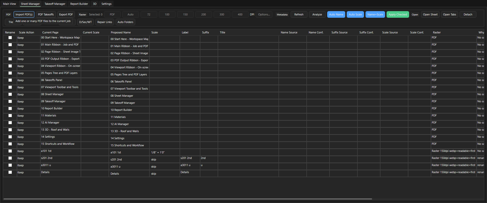
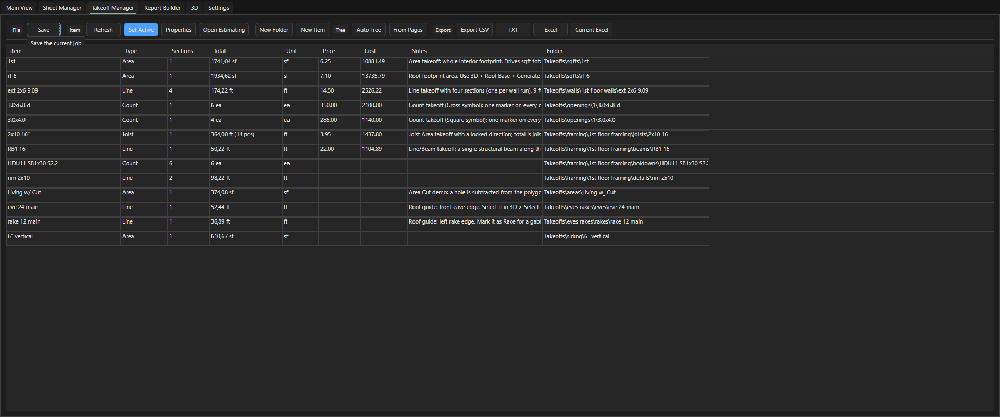
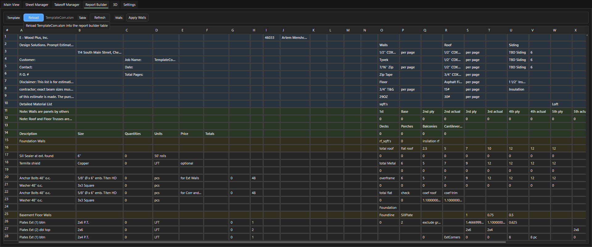

# Менеджеры: Sheet Manager, Takeoff Manager, Report Builder, Materials, AI Manager, Job Tracker

Здесь: вкладки строки режимов, которые по умолчанию выключены в `Settings > Modules`, и кнопка Job Tracker. Нужно, когда листов десятки и их удобнее править таблицей, когда нужен список материалов или цены, когда работает ИИ через AI Inbox, и когда карточку проекта в трекере хочется переключить из программы. Повседневный замер обходится без этих вкладок.

Включение: `Settings > Modules`, галка у модуля, `Apply` или `Save global default` ([как включить](ourplancore-extras.md#enable)). Вкладка появляется в строке режимов рядом с `Main View` и `Settings`. Из палитры команд (++ctrl+shift+p++) вкладки открываются командами `Show Sheet Manager`, `Show Takeoff Manager`, `Show Report Builder`, `Show Materials`, `Show AI Manager` и `Show 3D Viewer` ([3D](ourplancore-3d.md)); у выключенного модуля команда не срабатывает.

## Sheet Manager { #sheet-manager }

<figure markdown>
  
  <figcaption markdown="span">Таблица листов с предложенными именами, масштабом, источником и уверенностью. Галки `Rename` и `Scale Action` выбирают, что применить.</figcaption>
</figure>

Таблица всех листов для массовых операций. Включение модуля также добавляет на ленту Main кнопки `Name`, `Scale`, `Name+Scale`, а вместе с модулем AI - `AI Fill` и `Crop Hints`.

| Группа | Кнопки |
| --- | --- |
| PDF | `Import PDF(s)`, `PDF Takeoffs`, `Export PDF` |
| Raster | источник `PDF` / `Auto`, пресеты DPI, `Options...`, формат Auto / WebP / PNG, `Prepare`, `First On`, `First Off`, `Clean`, `Cancel` |
| Metadata | `Refresh`, `Analyze`, `Auto Name`, `Auto Scale`, `Name+Scale`, `AI Fill`, `Crop Hints`, `Apply Checked` |
| Open | `Open Sheet`, `Open Tabs`, `Detach`, `Tile M2`, `Open JSON` |
| Organize | `Sort A/S`, `D/Sec/WT`, `Repair Links`, `Auto Folders` |

Колонки: `Rename`, `Scale Action`, `Current Page`, `Current Scale`, `Proposed Name`, `Scale`, `Label`, `Suffix`, `Title`, `Name Source` / `Name Conf.`, `Suffix Source` / `Suffix Conf.`, `Scale Source` / `Scale Conf.`, `Raster`, `Why`, `Warnings`. Галки в `Rename` и `Scale Action` выбирают, что применить кнопкой `Apply Checked`.

### Как подготовить растр тяжёлых листов { #raster }

Зачем: большие листы открываются из готового растра быстрее, `Ctrl+F3` цепляется к чёрным линиям.

1. Выделите листы в таблице.
2. Выберите в группе **Raster** формат PNG и DPI.
3. Нажмите **Prepare** и дождитесь конца.
4. Нажмите **First On**.

Результат: колонка `Raster` заполнена, лист открывается из растра.

### Как задать области штампа: Crop Hints { #crop-hints }

Зачем: комплект с нечитаемым штампом получает имена и масштаб по нарисованным один раз областям.
Нужно: модули Sheet Manager и AI.

1. Нажмите **Crop Hints** (лента Main или группа **Metadata**): программа открывает типовой лист комплекта со статусом `show Sheet title / number, then Scale on the middle <профиль> sheet`.
2. Нарисуйте левой кнопкой три области: **Sheet #**, **Sheet Title**, **Scale**; правая или средняя кнопка двигает лист, **Clear Current** и **Clear All** стирают.
3. Нажмите **Save**.
4. Нажмите **Analyze**: метаданные перечитаны с учётом подсказок; **AI Fill** отдаёт нераспознанные штампы модели (онлайн, нужен ключ).
5. Проверьте колонки `Why`, `Warnings` и `Name Source` (текст, OCR, модель или выученное правило) и нажмите **Apply Checked**.

Результат: листы названы и замасштабированы по областям штампа; те же области программа ищет на остальных листах комплекта.

Те же действия без вкладки: кнопки `Name`, `Scale`, `Name+Scale` в панели Pages и предпросмотр перед применением ([листы](ourplancore-pages.md)).

## Takeoff Manager { #takeoff-manager }

<figure markdown>
  
  <figcaption markdown="span">Таблица позиций: тип, секции, итог, единица, цена, папка.</figcaption>
</figure>

Дерево Takeoffs в виде таблицы: `Item`, `Type`, `Sections`, `Total`, `Unit`, `Price`, `Cost`, `Notes`, `Folder`. Кнопки: `Save`, `Refresh`, `Set Active`, `Properties`, `Open Estimating`, `New Folder`, `New Item`, `Auto Tree`, `From Pages`, экспорт `CSV` / `TXT` / `Excel` / `Current Excel`. Удобно для сверки итогов и цен по всему корпусу; рисование по-прежнему в Main View. Для проверки итогов перед Excel обычно хватает вкладки `Estimating` в панели Takeoffs ([дерево](ourplancore-takeoffs.md)).

## Report Builder { #report-builder }

<figure markdown>
  
  <figcaption markdown="span">Report Builder читает `TemplateCom.xlsm` и показывает таблицу стен.</figcaption>
</figure>

`Reload` читает шаблон `TemplateCom.xlsm`, `Refresh` обновляет таблицу, `Apply Walls` пишет стены в книгу. Это прежний путь в Excel; сегодня стены, площади и framing пишет полоса XL с кнопками по секциям и `ALL` ([экспорт в Excel](ourplancore-excel.md)). Вкладка остаётся для сверки, как старые книги получали блок стен.

## Materials { #materials }

Вкладка читает материалы из самих чертежей, а не из дерева Takeoffs: упоминания материалов и таблицы schedules в тексте исходных PDF проекта.

### Как собрать материалы из PDF проекта { #materials-extract }

Зачем: быстро увидеть, какие материалы, сечения и schedules (обшивка, балки, крепёж) названы в комплекте, со ссылкой на лист.
Нужно: модуль Materials включён, в проекте есть листы из PDF.

1. Откройте вкладку **Materials** (или команду палитры `Show Materials`).
2. Нажмите **Extract**; команда палитры `Extract Materials` сразу открывает вкладку и запускает то же самое. Встроенный помощник читает текст всех исходных PDF (на листах без текста OCR, если он установлен) и таблицы с заголовками `SCHEDULE`, `TABLE`, `LEGEND`.
3. Дождитесь статуса `Materials: N row(s), M schedule(s).`
4. Откройте результат: `Rows CSV` (строка на каждое упоминание: категория, толщина, сечение, grade, количество, лист), `Summary CSV` (сводка по материалам), `JSON` (полный результат), `Folder` (папка результата в проекте).
5. Нажмите **Report Sheet**, если нужен лист `Materials Report` в Pages с этой сводкой для копирования.

Результат: таблица материалов на вкладке и файлы в папке проекта; `Refresh` перечитывает последний результат.

Это справка по чертежам, не количества: в сдачу E-Wood идёт книга DFL. Библиотека сборок (стена = стойки + обвязка + OSB) пока идея ([планы](ourplancore-ideas.md)).

## AI Inbox и AI Manager { #ai-manager }

AI Inbox - панель внизу Main View (модуль AI): запросы, ответы, наблюдения, маркеры. AI Manager - отдельная вкладка с таблицей `Type`, `Page`, `Observation`, `Quality`, `Time`:

| Группа | Кнопки |
| --- | --- |
| Setup | `AI Settings`, `+ Add`, `Refresh` |
| Review | `Open Details`, `Go to Page`, `Run AI` |
| Batch | `Run New` (все новые запросы по закладкам), `Retry Failed` |
| Markers | `Create Set`, `Marker Sets`, `Export Markers` |

Что попадает в Inbox: кропы `AI crop here -> note` и `AI quick box here -> note`, наблюдения `Save observation here`, `Add as pending check`, `Suggest takeoff item here`, запросы трассы `Trace wall from this point`, `Trace closed area`, `Check missed takeoffs on this page` ([трассировка](ourplancore-snap-trace.md#ai-trace)), кропы из консоли ИИ `AI Crop +` ([консоль](ourplancore-ai-console.md#crop)). Маркер - проверенный образец символа; по нему работает `Find Similar From Marker`. Выводы ИИ в Inbox - черновики, не замеры: в дерево они попадают только после подтверждения. Ключ и модель задаёт диалог `AI Settings`; формат заметок из кропов - `Settings > AI Crop Notes` ([ИИ в программе](ourplancore-ai.md#crop-notes)).

## Job Tracker: кнопка In Progress { #job-tracker }

Модуль `Job Tracker` (группа Integrations) по умолчанию выключен. После включения на ленте Main в группе JOB появляется кнопка `In Progress`.

### Как переключить карточку проекта в In Progress { #in-progress }

Зачем: трекер видит, что работа началась, без ручного переключения карточки.
Нужно: имя проекта начинается с номера `NN. Name`; модуль включён.

1. Откройте проект и нажмите **Main > JOB > In Progress**.
2. Прочитайте статус: `Setting Job Tracker card NN to In Progress...`, потом `Job Tracker: project NN set to In Progress.`

Результат: карточка с номером проекта в трекере переведена в In Progress внешней командой конвейера. Если имя без номера, статус скажет `'<имя>' has no leading project number (expected 'NN. Name'); Job Tracker was not updated.`

Команда правится в `Settings > Modules`: `Executable`, `Arguments (one per line)`, `Save`, `Reset` (возвращает команду конвейера по умолчанию). Подстановка `{number}` - номер проекта. Карточка в done ставится конвейером при сдаче, не из программы ([процесс работы](../start/workflow.md)).

## См. также

- [Дополнительные возможности](ourplancore-extras.md): таблица всех вынесенных функций
- [Workspace и модули](ourplancore-workspace.md#modules): список модулей с группами
- [Листы (Pages)](ourplancore-pages.md), [Экспорт в Excel](ourplancore-excel.md)
- [ИИ в программе](ourplancore-ai.md), [Консоль ИИ](ourplancore-ai-console.md)
