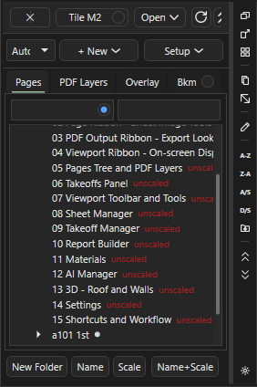
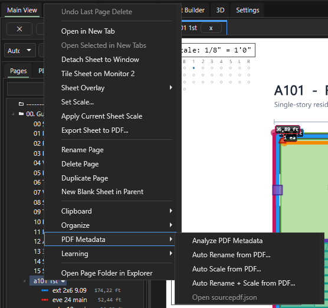
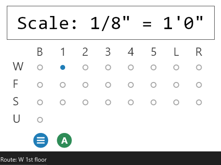
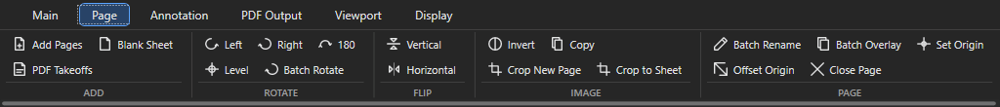

# Sheets (Pages)

Here: the Pages panel, sheet folders, sorting sheets and takeoffs, names and scale across the whole set, W/F/S/U dots, visibility, tabs and separate sheet windows, sheet rotation (Page ribbon). Needed at the start of every job and when a new measurement landed on the wrong floor. Which sheet is for which kind of work: [Split by sheets and routing](ourplancore-split-by-sheets.md).

<figure markdown>
  
  <figcaption markdown="span">Tree of folders and sheets. Under a sheet are the takeoffs measured on it. The dot to the left of a sheet hides all its measurements.</figcaption>
</figure>

## Pages panel: reference

| Button | What it does |
| --- | --- |
| `Open` | open the selected sheets: `Open as Tabs` or `Detach to windows`; `Tile M2` arranges the windows on the second monitor ([tabs and windows](#tabs)) |
| Dot to the right of `Tile M2` | `Toggle vertical Tile M2 layout`: a filled dot means windows on the second monitor are stacked vertically |
| `x` in two halves | left half `Close other sheets and keep the main viewport sheet`: close all other tabs and separate windows, the main window's sheet stays; right half `Close detached sheets on monitor 2`: close the separate windows on the second monitor |
| Refresh, collapse, expand icons | `Refresh Pages tree` rereads the tree from the job folder; `Collapse all Pages nodes` collapses all folders (the left icon strip has the same command, `Collapse Pages Tree`), the icon next to it expands |
| `Folder template` | `Auto`, `COM`, `EWP` (tooltip `Folder Template Mode`): the set of standard folders for `Auto Folders` in Pages and `Auto Tree` in Takeoffs |
| `+ New` | `New Folder`, `Blank Sheet`, `Auto Folders` |
| `Setup` | `Name / Scale...` (`F5`), `Sort: A > Arch / S > Struct`, `Sort: D / Sec / WT suffix`, `Repair page links` |
| `New Folder`, `Name`, `Scale`, `Name+Scale` | a folder under the selected one; auto-name, auto-scale or both for the selected sheets or folder |
| Search | the left field searches by folder name, the right by sheet name. The `Match page folder case exactly` dot in the folder field is on by default: case matters (`Arch` will not find `arch`); a click turns it off |
| Sub-tabs | `Pages`, `PDF Layers`, `Overlay`, `Bookmarks`; `Templates` docks here too |
| Sheet table | the `Sheet Manager` tab (a module) or the palette command `Show Sheet Manager`; back to the sheets with the `Main View` tab or `Show Main View` ([Sheet Manager](ourplancore-managers.md#sheet-manager)) |

Keys in the tree: `F2` rename, `Ctrl+D` duplicate, `Ctrl+C` / `Ctrl+X` / `Ctrl+V`, `Ctrl+Up` / `Ctrl+Down` order, `Delete`, `Ctrl+Z` restore a deleted item, `F4` scale of the selected sheets.

??? note "Right-click on a folder and a sheet: all items"
    | Item | Where | What it does |
    | --- | --- | --- |
    | `New Blank Sheet` | folder | a blank sheet in this folder ([blank sheets](ourplancore-sheets-advanced.md#blank)) |
    | `New Blank Sheet in Parent` | sheet | a blank sheet next to this sheet, in the same folder |
    | `Organize > Auto Create Folders` | folder | the standard folders of the **Folder template** inside this folder; existing ones are skipped |
    | `Organize > Sort Children A-Z`, `Sort Children Z-A` | folder | order of the folder's children ([sorting](#sort)) |
    | `Organize > Sort A/S in This Folder`, `Sort D/Sec/WT in This Folder` | folder | sorting by letter and by tag only inside this folder ([folders](#folders)) |
    | `Organize > Sort A/S into Arch/Struct`, `Sort D/Sec/WT by Suffix` | sheet | the same as **Setup > Sort: A > Arch / S > Struct** and **Sort: D / Sec / WT suffix** |
    | `Organize` on a folder and a sheet | both | `Move Up` / `Move Down`, legend sorting, `Repair Measurement Links`, `Move to Folder...` |
    | `PDF Metadata` | both | `Analyze PDF Metadata`, `Auto Rename from PDF...`, `Auto Scale from PDF...`, `Auto Rename + Scale from PDF...` with a preview ([names](#names), [scale](#scale)); visible with the Sheet Manager module |
    | `Open in New Tab`, `Open Selected in New Tabs`, `Detach Sheet to Window`, `Tile Sheet on Monitor 2` | sheet | open the sheet in a new tab or window ([tabs and windows](#tabs)) |
    | `Set Scale...`, `Apply Current Sheet Scale` | sheet | enter a scale for the selected sheets or copy the scale of the open sheet ([scale](#scale)) |
    | `Rename Page`, `Duplicate Page`, `Delete Page`, `Change Sheet Size...` (blank sheets), `Export Sheet to PDF...` | sheet | sheet editing and export |
    | `Batch Overlay...`, `Open in Explorer` | folder | overlays of all floors; the job folder in File Explorer |

## How to sort sheets into folders { #folders }

Why: a set of a hundred sheets turns into `Arch`, `Struct`, `sections`, `details ...`, and what is not needed goes to `--------others`.
You need: sheets imported into `00. imported` and named ([names](#names)). Folder canon: [Takeoff tree and sheet names](../start/takeoff-structure.md).

1. Pick a template in the **Folder template** list (`COM` for commercial, `EWP`).
2. Press **+ New > Auto Folders**: the standard folders are created.
3. Press **Setup > Sort: A > Arch / S > Struct**: sheets are split by the letter of their number.
4. Press **Setup > Sort: D / Sec / WT suffix**: details, sections, wall types and rcp go to their folders by the last tag of the name (`d`, `sec`, `wt`, `rcp`, `u`). Only non-empty folders are created.
5. Drag the rest by hand or use right-click **Move to Folder...**, **Cut** and **Paste Into Folder**.

Result: `00. imported` has the subfolders `Arch`, `Struct`, `sections`, `details arch`, `details struct`, `rcp`, `units`, `demolition`; extras in `--------others`; each building has its own folder with the same name as in Takeoffs; a revision has `01. old/` and `02. NEW SET <date>/`.

!!! tip "Tips"
    - A sheet whose name ends with `-` goes to `--------others` when sorting (the rule is in `Settings > Sort A/S`).
    - Only one folder (a building, `02. NEW SET <date>`): right-click it, **Organize > Auto Create Folders**, then **Sort A/S in This Folder** and **Sort D/Sec/WT in This Folder**. The folders `Arch`, `Struct`, `--------others`, `sections` and others are created inside this folder, the rest of the set is not touched.
    - Made a mistake: **Open / Import > Undo Last Page Sort**.
    - Sorting rules are edited in `Settings > Sort A/S` and `Sort D/Sec/WT` ([Settings](ourplancore-settings.md)).

## How to sort sheets and takeoffs { #sort }

Why: to restore the order `a101, a102, a201` after import and manual moves, and to group details in Takeoffs by sheet.
You need: the job open, not read-only.

1. Select a folder in Pages; if nothing is selected, the root is sorted.
2. On the left icon strip press `A-Z` (`Sort Pages A-Z`) or `Z-A` (`Sort Pages Z-A`). Right-click on a folder, **Organize > Sort Children A-Z** or **Sort Children Z-A** does the same.
3. In Takeoffs, select a building or floor folder and press the sort you need from the table on the right icon strip.

Result: the order in the tree is updated, the status shows `Sorted ...` with the folder name and the kind of sort.

| Command | Where | What it does |
| --- | --- | --- |
| `Sort Pages A-Z`, `Sort Pages Z-A` | left strip, command palette | children of the selected Pages folder or the root, one level; numbers by value (`a2` before `a10`) |
| `Sort Children A-Z`, `Sort Children Z-A` | right-click on a folder in Pages or Takeoffs, `Organize` | the same for this folder |
| `Sort Takeoffs A-Z`, `Sort Takeoffs Z-A` | right strip, command palette | children of the selected Takeoffs folder or the root, one level; detail references `1/A501` go by sheet, then by detail number |
| `Sort Root A-Z`, `Sort Root Z-A` | right-click on the Takeoffs root | top level of the tree (buildings) |
| `Sort Takeoffs: Walls` | right strip | walls in the folder and all subfolders: `ext`, `corr`, `dem`, then 2x6 and 2x4 |
| `Sort Takeoffs: Details by Sheet` | right strip, command palette | details `1/A501`, `2_A501` in the folder and all subfolders are grouped by the sheet after `/` or `_` (sheets in number order, as in Pages), within a sheet by detail number; names without a separator go after the details |

!!! tip "Tips"
    - A-Z and Z-A are not covered by **Undo Last Page Sort**: only `Sort A/S` and `Sort D/Sec/WT` can be undone. Made a mistake: run the reverse sort or rearrange with `Ctrl+Up` / `Ctrl+Down`.
    - The order of takeoffs in the sheet legend is set separately: right-click the sheet, **Organize > Sort Sheet Legend Auto**, **Sort Sheet Legend A-Z** or **Sort Sheet Legend by Key (before space)** ([legend](ourplancore-sheets-advanced.md#legend)).

## How to name sheets across the whole set { #names }

<figure markdown>
  
  <figcaption markdown="span">Right-click a sheet, the `PDF Metadata` submenu (visible with the Sheet Manager module on). Before applying, the app shows a preview: the proposed name, the scale action, confidence and the reason. Uncheck anything unclear.</figcaption>
</figure>

Why: names like `a101 1st`, `s201 2nd` instead of `Page 7`; together with the name, the sheet gets a W/F/S/U dot and a scale.
You need: sheets in `00. imported`; for scans without text, a raster at import ([raster](job-creation-storage.md#raster)).

1. Select the `00. imported` folder (or the sheets you need) and press **Name+Scale** (**Name** and **Scale** work separately; the same buttons are on the Main ribbon with the Sheet Manager module).
2. Read the `Proposed Name`, `Scale Action`, confidence and `Why` columns in the dialog; uncheck doubtful rows. **Rename All** and **Scale All** check all rows, **Clear** unchecks them.
3. Press **Apply**.
4. Name by hand whatever was not recognized: `F2` on the sheet, **Page > Batch Rename** for a series, or **Setup > Name / Scale...**.

Result: names in the `<number> <tag>` format, lowercase: `a101 1st`, `s201 2nd`, `a105 rf`, `a8.01 1st rcp`, `ad101 demo`, `a3011 u`; plans have a dot under the Scale header; the status shows `Route: W 1st`.

What the app reads: the sheet number based on the profile of the whole set (title block location, the `SHEET NO.` label, the sheet index); text repeated on every sheet (firm, phone) is not taken as a number. In Lite the number comes only from the PDF text: name a scan without a text layer by hand (`F2`). In the full version such scans are read by the built-in OCR, and a sheet that the text did not name can be read by an AI model from an image of the title block: the `Read title blocks the PDF text cannot name with AI` checkbox in `Settings > Auto Rename / Scale` (needs the AI module and a key, works online). Names you kept when opening the job are remembered by the app as final: in the suffix rules table this is the `Kept` column. For a set with an unreadable title block the full version has `Crop Hints` ([Managers, Sheet Manager](ourplancore-managers.md#sheet-manager)).

!!! tip "Tips"
    - The tag always goes last: `overall 1st`, `stair d`. `f` only for the foundation, do not add it to floor plans.
    - `Name` on a folder is faster than on single sheets: the title block profile is built from the whole set.

## How to set and check the scale { #scale }

Why: without a scale, Line and Area are not recorded; the scale belongs to the sheet, not to the takeoff.
You need: a labeled dimension or a dimension string on the sheet.

1. Press `S` (Scale) and click both ends of a dimension string or an overall dimension with a labeled size.
2. Type the length in the dialog: `1/8" = 1'0"`, `1:96` and a segment length (`24'`) are accepted. Press `Enter`.
3. Press `R` (Ruler) and check against a second dimension: the tape shows the length without writing anything to the tree.
4. For several sheets at once, select them in Pages, press `F4` and enter the scale once. At the bottom of the window: the `Scale: 1:N` field, **Set** and **Presets** for typical values.
5. If the scale of the open sheet is checked and other floors need the same, select them in Pages and choose right-click **Apply Current Sheet Scale**: the open sheet's scale is copied to the selected ones.

Result: the status shows `Scale: 1/8" = 1'0"`, the tape matches the labeled dimension.

The app reads the scale from the label on the sheet by itself: the **Scale** button in the Pages panel or right-click **PDF Metadata > Auto Scale from PDF...** shows a preview (`Scale Action`, confidence), only checked rows are applied. The sheet name does not change.

| Sheet | Usual scale |
| --- | --- |
| Floor plans | `1/8" = 1'0"` (1:96), `1/4"` for small houses |
| Unit plans | `1/4" = 1'0"` (1:48) |
| Sections | `3/8" = 1'0"` |
| Details | NTS, no scale needed: measure from the dimensions in the text |

!!! warning "The sheet label is not proof"
    Structural sheets are sometimes labeled `1/8"` and printed at `3/16"`. Auto-scale and a manual choice are checked against a dimension string on the sheet itself. A sheet with several scales is calibrated for the zone you measure; enlarged plans are better moved to `Arch/unlarged` as a sheet copy. All sheet mistakes: [Common mistakes](../start/common-mistakes.md#pages).

## W/F/S/U dots { #dots }

<figure markdown>
  
  <figcaption markdown="span">Rows W, F, S by floor B, 1-5, L, R and one U dot. The selected dot is named in the status bar: `Route: W 1st`.</figcaption>
</figure>

Under the Scale header each sheet has a grid of dots. One selected dot decides which building folder every **new** measurement from this sheet goes into, with any tool.

| Row | For which sheets | Where new takeoffs go |
| --- | --- | --- |
| `W` (walls) | architectural plans `a101 1st` | `walls/<floor> floor walls`; Area and J Area into `sqfts` |
| `F` (framing) | structural plans `s201 2nd` | `framing/<floor> floor framing/...` by tool |
| `S` (shear) | plan copies for shear walls | `shear walls/<floor>/shear`, Count into `.../holdowns` |
| `U` (units) | unit plans `a3011 u` | `units`, with any tool |

### How to set a sheet's dot { #set-dot }

Why: new takeoffs from the sheet land on the right floor and branch by themselves.
You need: the sheet open; the dot grid is visible with the **Viewport > Sheet routing** checkbox (off by default; turning it off does not reset the dots, routing still works).

1. Name the sheet per the canon (`F2`, **Name**, **Batch Rename** or **Page Setup**): the letter `a` plus a floor tag gives W, `s` plus a floor gives F, a last tag `u` gives U (`a3011 u`, `S0-4A U`, a copy `... U (2)`; `a301 u el` does not get the U dot). Sheets with the tags `rcp`, `el`, `sec`, `d`, `demo`, `sch`, `n`, `wt`, `ft`, `fin` and similar are skipped.
2. If the dot did not appear or you need a different one, click the right dot by hand; clicking again clears it. A plan copy for shear walls gets S by hand. A dot set by hand is not replaced.
3. For the whole job open **Settings > Sheet Takeoff Routing** and press **Route sheets without a dot now**.

Result: the status shows `Route: W 1st` (or `F 2nd`, `S 1st`, `U all floors`); in the New Item dialog the destination line shows the folder.

!!! tip "Tips"
    - A blank sheet from **Blank Sheet** with a name like `a3011 u` is left without a dot: press `F2` and `Enter` with the same text, or click the dot.
    - A sheet copy (`Ctrl+D`) inherits the original's dot: on copies for shear walls switch it to S ([sheet copy, dot](ourplancore-split-by-sheets.md#copy-dot)).
    - `Record` continues the selected takeoff and ignores the dot.

The full destination table by tool, name rules and what to do with a wrong route: [Names and auto-routing](takeoff-naming.md#sheet-dots); row and floor settings: [Routing: settings](ourplancore-routing.md).

## How to hide a sheet's measurements { #visibility }

Why: to get finished or unrelated work out of sight before a check and the PDF.

| What | How |
| --- | --- |
| Hide all measurements on a sheet | click the dot to the left of the sheet in Pages (tooltip `Hide all current takeoffs on ...`); new measurements stay visible |
| Hide one takeoff on a sheet | select a segment on the sheet or a row in Takeoffs and press `H` ([tree](ourplancore-takeoffs.md#hide)) |
| Bring back | the visibility dot next to the takeoff under the sheet in Pages (`Visible on <sheet>: <takeoff>`) or the dot at the sheet |
| Toggle from a menu | right-click a takeoff under the sheet in Pages, or a measurement in a separate sheet window: `Hide on This Sheet` / `Show on This Sheet` (the item name changes with the state) |
| Bookmark a spot on the sheet | `B`, then `K`; the `Bookmarks` tab ([bookmarks](ourplancore-extras-other.md#bookmarks)) |
| PDF layers | the `PDF Layers` tab: visibility of vector PDF layers and Layer Trace ([snaps and tracing](ourplancore-snap-trace.md#layers)) |
| Sheet overlay | the `Overlay` tab: an S plan over an A plan; for all floors **Page > Batch Overlay** ([overlays](ourplancore-sheets-advanced.md)) |
| Blank sheet, crops, mask | **Page > Blank Sheet**, **Crop to Sheet**, **Annotation > Hide** ([sheets: advanced](ourplancore-sheets-advanced.md)) |

Result: what is hidden does not print in the PDF; this is how a separate PDF per building is made ([PDF and delivery](ourplancore-pdf.md#buildings)).

## How to pick a takeoff already measured on the sheet { #sheet-targets }

Why: to continue a takeoff that is already on the open sheet without scrolling through the Takeoffs tree.
You need: the sheet open, with measurements on it.

1. In the Takeoffs panel, on the active takeoff row press **More > Sheet Targets...**.
2. Read the list: this sheet's takeoffs in legend order, each with its quantity on this sheet, an asterisk `*` on the active one.
3. Click the takeoff you need: it becomes active, `Space` (Record) continues it.
4. To cycle through them, choose the top menu item **Next Sheet Target** or the palette command `Next Sheet Takeoff Target`.

Result: the status shows `Sheet takeoff target 2/5: <takeoff>`.

## How to open a sheet in a tab or a separate window { #tabs }

Why: to keep a plan and a detail side by side, to move sheets to the second monitor.
You need: for separate windows, the Detached Sheets module (on by default).

1. Click a sheet in Pages: it opens in the current tab instead of the previous one.
2. To keep the previous sheet open, right-click the sheet and choose **Open in New Tab**. For several sheets, select them with `Ctrl` or `Shift` and choose **Open Selected in New Tabs**.
3. For a separate window choose **Detach Sheet to Window**; to tile the selected sheets on the second monitor, **Tile Sheet on Monitor 2** (up to 64 sheets at a time).
4. Move an open tab with right-click on the tab: **Detach Tab to Window** or **Tile Tab on Monitor 2**; all tabs at once: `Detach All ... Tabs to Windows` and `Tile All ... Tabs on Monitor 2` (the number of tabs replaces the dots).
5. Close what is not needed: the cross or right-click **Close Tab** on the tab, **Page > Close Page** for the active tab, the `x` button in the Pages header for all others at once.

Result: sheet tabs above the sheet window, separate windows on the second monitor; all tools work in a separate window.

Right-click on a measurement in a separate window gives `Takeoff Properties...` (takeoff properties), `Section Properties...` or `Count Properties...` (properties of this measurement; for a measurement with no takeoff the item is grayed out and called `Measurement Properties...`), `Hide on This Sheet` / `Show on This Sheet`, copying and pasting measurements. More about windows: [detached windows](ourplancore-extras-other.md#detached).

## How to rotate, flip or level a sheet { #rotate }

<figure markdown>
  
  <figcaption markdown="span">The `Page` ribbon: groups ADD, ROTATE (`Left`, `Right`, `180`, `Level`, `Batch Rotate`), FLIP, IMAGE and PAGE.</figcaption>
</figure>

Why: a scan came in sideways, upside down or skewed.
You need: the sheet open, the job not read-only.

1. Open the sheet and go to the **Page** ribbon.
2. In the ROTATE group press `Left`, `Right` or `180`: rotate 90 degrees counterclockwise, clockwise, or 180.
3. For several sheets, select them in Pages, press **Batch Rotate** and choose `Rotate Selected Left`, `Rotate Selected Right` or `Rotate Selected 180`.
4. If the plan is skewed by a few degrees, press **Level**, type a clockwise angle from -45 to 45 and press `Enter` (0 only fits the sheet to the window).
5. Flip a mirrored scan with the `Vertical` or `Horizontal` button in the FLIP group.

Result: the status shows `Rotate Right: updated <sheet>.`; the sheet's measurements and markup are rotated with it, the scale is kept.

!!! warning "The sheet turns into an image"
    Rotate, flip, `Level`, `Invert` and `Crop New Page` rebuild the sheet as an image of about 108 DPI. Vector lines (PDF Snap, `Black vector`), the text layer (auto-name and auto-scale from text) and PDF layers are lost, small text gets blurry. There is no undo: rotating back restores the orientation but not the vectors. Rotate scans; a vector plan is better left as it is.

| Button | Group | What it does |
| --- | --- | --- |
| `Invert` | IMAGE | inverts the sheet colors (light lines on dark); the sheet is replaced, and the inversion also goes into the PDF export |
| `Copy` | IMAGE | puts a PNG of the sheet on the clipboard as a file: it can be pasted into File Explorer or a messenger |
| `Crop New Page` | IMAGE | a new sheet `<sheet> Crop` from the currently visible area, with the same scale ([steps](ourplancore-sheets-advanced.md#crop-new-page)) |
| `Crop to Sheet` | IMAGE | details from different sheets on one sheet at true scale ([steps](ourplancore-sheets-advanced.md#crop)) |
| `Batch Rename` | PAGE | names of the selected sheets as a list, one per line ([names](#names)) |
| `Batch Overlay` | PAGE | overlays of S plans on A plans across the whole job ([steps](ourplancore-sheets-advanced.md#batch-overlay)) |
| `Set Origin` | PAGE | remembers the center of the visible area as the sheet's coordinate origin |
| `Offset Origin` | PAGE | shifts that origin by X, Y in PDF points (input `12, -6`) |
| `Close Page` | PAGE | closes the active sheet tab |

The origin from `Set Origin` is stored in the sheet and rotates with it; it does not affect measurements, Total or export, and is not needed in E-Wood work.

## Common mistakes

- `f` added to a floor plan (`a101 1st f`): `f` only for the foundation.
- The tag is not last (`a3011 u el`): the U dot is not set, suffix sorting gets confused.
- The scale taken from the sheet label without checking against a dimension.
- A sheet copy for each takeoff type: copies are needed only for shear walls, a second level on the same sheet, another building and a new sheet set.
- A vector plan rotated or inverted with the Page ribbon buttons: the sheet became an image, PDF Snap and auto-name no longer work on it ([rotation](#rotate)).

All sheet and tree mistakes: [Common mistakes](../start/common-mistakes.md#pages).

## See also

- [Takeoff tree and sheet names](../start/takeoff-structure.md): table of tags and folders
- [Split by sheets and routing](ourplancore-split-by-sheets.md), [Names and auto-routing](takeoff-naming.md), [Routing: settings](ourplancore-routing.md)
- [Jobs and saving](job-creation-storage.md), [Sheets: advanced](ourplancore-sheets-advanced.md)
