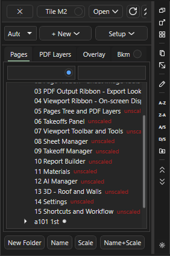
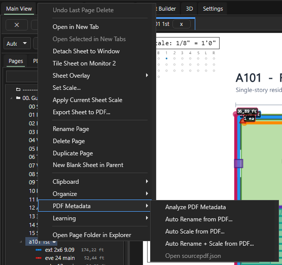
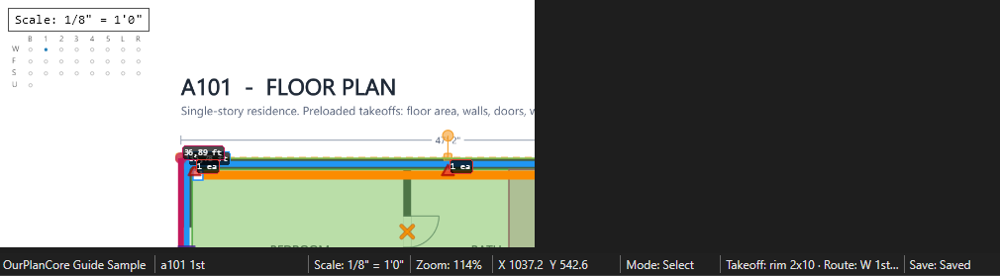
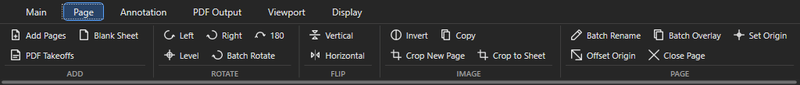

# Листы (Pages)

Здесь: панель Pages, папки листов, сортировка листов и позиций, имена и масштаб по всему комплекту, точки W/F/S/U, видимость, вкладки и отдельные окна листов, поворот листа (лента Page). Нужно в начале каждой работы и когда новый замер лёг не в тот этаж. Какой лист под какой вид работ - [Раскладка по листам и роутинг](ourplancore-split-by-sheets.md).

<figure markdown>
  
  <figcaption markdown="span">Дерево папок и листов. Под листом показаны позиции, измеренные на нём. Точка слева от листа прячет все его замеры.</figcaption>
</figure>

## Панель Pages: справка

| Кнопка | Что делает |
| --- | --- |
| `Open` | открыть выделенные листы: `Open as Tabs` или `Detach to windows`; `Tile M2` раскладывает окна на второй монитор ([вкладки и окна](#tabs)) |
| Точка справа на `Tile M2` | `Toggle vertical Tile M2 layout`: залитая точка - окна на втором мониторе ставятся вертикальной стопкой |
| `x` из двух половин | левая половина `Close other sheets and keep the main viewport sheet`: закрыть все другие вкладки и отдельные окна, лист главного окна остаётся; правая `Close detached sheets on monitor 2`: закрыть отдельные окна на втором мониторе |
| Значки обновить, свернуть, развернуть | `Refresh Pages tree` перечитывает дерево из папки проекта; `Collapse all Pages nodes` сворачивает все папки (на левой полосе значков та же команда `Collapse Pages Tree`), соседний значок разворачивает |
| `Folder template` | `Auto`, `COM`, `EWP` (подсказка `Folder Template Mode`): набор стандартных папок для `Auto Folders` в Pages и `Auto Tree` в Takeoffs |
| `+ New` | `New Folder`, `Blank Sheet`, `Auto Folders` |
| `Setup` | `Name / Scale...` (`F5`), `Sort: A > Arch / S > Struct`, `Sort: D / Sec / WT suffix`, `Repair page links` |
| `New Folder`, `Name`, `Scale`, `Name+Scale` | папка под выделенной; автоимя, автомасштаб или оба для выделенных листов или папки |
| Поиск | левое поле по имени папки, правое по имени листа. Точка в поле папок `Match page folder case exactly` включена по умолчанию: регистр учитывается (`Arch` не найдёт `arch`); щелчок выключает |
| Под-вкладки | `Pages`, `PDF Layers`, `Overlay`, `Bookmarks`; сюда же стыкуется `Templates` |
| Таблица листов | вкладка `Sheet Manager` (модуль) или команда палитры `Show Sheet Manager`; назад к листам - вкладка `Main View` или `Show Main View` ([Sheet Manager](ourplancore-managers.md#sheet-manager)) |

Клавиши в дереве: `F2` переименовать, `Ctrl+D` дублировать, `Ctrl+C` / `Ctrl+X` / `Ctrl+V`, `Ctrl+Up` / `Ctrl+Down` порядок, `Delete`, `Ctrl+Z` вернуть удалённое, `F4` масштаб выделенных листов.

??? note "ПКМ по папке и по листу: все пункты"
    | Пункт | Где | Что делает |
    | --- | --- | --- |
    | `New Blank Sheet` | папка | пустой лист в этой папке ([пустые листы](ourplancore-sheets-advanced.md#blank)) |
    | `New Blank Sheet in Parent` | лист | пустой лист рядом с этим листом, в той же папке |
    | `Organize > Auto Create Folders` | папка | стандартные папки шаблона **Folder template** внутри этой папки; существующие пропускаются |
    | `Organize > Sort Children A-Z`, `Sort Children Z-A` | папка | порядок детей папки ([сортировка](#sort)) |
    | `Organize > Sort A/S in This Folder`, `Sort D/Sec/WT in This Folder` | папка | сортировки по букве и по тегу только внутри этой папки ([папки](#folders)) |
    | `Organize > Sort A/S into Arch/Struct`, `Sort D/Sec/WT by Suffix` | лист | то же, что **Setup > Sort: A > Arch / S > Struct** и **Sort: D / Sec / WT suffix** |
    | `Organize` у папки и листа | оба | `Move Up` / `Move Down`, сортировки легенд, `Repair Measurement Links`, `Move to Folder...` |
    | `PDF Metadata` | оба | `Analyze PDF Metadata`, `Auto Rename from PDF...`, `Auto Scale from PDF...`, `Auto Rename + Scale from PDF...` с предпросмотром ([имена](#names), [масштаб](#scale)); виден при модуле Sheet Manager |
    | `Open in New Tab`, `Open Selected in New Tabs`, `Detach Sheet to Window`, `Tile Sheet on Monitor 2` | лист | открыть лист новой вкладкой или окном ([вкладки и окна](#tabs)) |
    | `Set Scale...`, `Apply Current Sheet Scale` | лист | вписать масштаб выделенным листам или скопировать масштаб открытого листа ([масштаб](#scale)) |
    | `Rename Page`, `Duplicate Page`, `Delete Page`, `Change Sheet Size...` (пустые листы), `Export Sheet to PDF...` | лист | правка листа и экспорт |
    | `Batch Overlay...`, `Open in Explorer` | папка | наложения всех этажей; папка проекта в проводнике |

## Как разложить листы по папкам { #folders }

Зачем: комплект из сотни листов превращается в `Arch`, `Struct`, `sections`, `details ...`, ненужное уходит в `--------others`.
Нужно: листы импортированы в `00. imported` и названы ([имена](#names)). Канон папок: [Дерево takeoff и имена листов](../start/takeoff-structure.md).

1. Выберите шаблон в списке **Folder template** (`COM` для коммерческих, `EWP`).
2. Нажмите **+ New > Auto Folders**: стандартные папки созданы.
3. Нажмите **Setup > Sort: A > Arch / S > Struct**: листы разошлись по букве номера.
4. Нажмите **Setup > Sort: D / Sec / WT suffix**: детали, разрезы, типы стен и rcp ушли в свои папки по последнему тегу имени (`d`, `sec`, `wt`, `rcp`, `u`). Создаются только непустые папки.
5. Перетащите остатки руками или через ПКМ **Move to Folder...**, **Cut** и **Paste Into Folder**.

Результат: в `00. imported` подпапки `Arch`, `Struct`, `sections`, `details arch`, `details struct`, `rcp`, `units`, `demolition`; лишнее в `--------others`; у каждого корпуса своя папка с тем же именем, что в Takeoffs; ревизия - `01. old/` и `02. NEW SET <дата>/`.

!!! tip "Советы"
    - Лист с именем, оканчивающимся на `-`, при сортировке уходит в `--------others` (правило в `Settings > Sort A/S`).
    - Только одна папка (корпус, `02. NEW SET <дата>`): ПКМ по ней **Organize > Auto Create Folders**, потом **Sort A/S in This Folder** и **Sort D/Sec/WT in This Folder**. Папки `Arch`, `Struct`, `--------others`, `sections` и другие создаются внутри этой папки, остальной комплект не трогается.
    - Ошиблись: **Open / Import > Undo Last Page Sort**.
    - Правила сортировок правятся в `Settings > Sort A/S` и `Sort D/Sec/WT` ([Settings](ourplancore-settings.md)).

## Как отсортировать листы и позиции { #sort }

Зачем: вернуть порядок `a101, a102, a201` после импорта и ручных переносов, собрать детали в Takeoffs по листам.
Нужно: проект открыт не только для чтения.

1. Выделите папку в Pages; если ничего не выделено, сортируется корень.
2. Нажмите на левой полосе значков `A-Z` (`Sort Pages A-Z`) или `Z-A` (`Sort Pages Z-A`). То же делает ПКМ по папке **Organize > Sort Children A-Z** или **Sort Children Z-A**.
3. В Takeoffs выделите папку корпуса или этажа и нажмите на правой полосе значков нужную сортировку из таблицы.

Результат: порядок в дереве обновился, в статусе `Sorted ...` с названием папки и вида сортировки.

| Команда | Где | Что делает |
| --- | --- | --- |
| `Sort Pages A-Z`, `Sort Pages Z-A` | левая полоса, палитра команд | дети выбранной папки Pages или корня, один уровень; числа по величине (`a2` раньше `a10`) |
| `Sort Children A-Z`, `Sort Children Z-A` | ПКМ по папке в Pages или Takeoffs, `Organize` | то же для этой папки |
| `Sort Takeoffs A-Z`, `Sort Takeoffs Z-A` | правая полоса, палитра команд | дети выбранной папки Takeoffs или корня, один уровень; ссылки на детали `1/A501` идут по листу, потом по номеру детали |
| `Sort Root A-Z`, `Sort Root Z-A` | ПКМ по корню Takeoffs | верхний уровень дерева (корпуса) |
| `Sort Takeoffs: Walls` | правая полоса | стены в папке и всех подпапках: `ext`, `corr`, `dem`, потом 2x6 и 2x4 |
| `Sort Takeoffs: Details by Sheet` | правая полоса, палитра команд | детали `1/A501`, `2_A501` в папке и всех подпапках собираются по листу после `/` или `_` (листы по порядку номеров, как в Pages), внутри листа по номеру детали; имена без разделителя идут после деталей |

!!! tip "Советы"
    - A-Z и Z-A не попадают в **Undo Last Page Sort**: откатываются только `Sort A/S` и `Sort D/Sec/WT`. Ошиблись - запустите обратную сортировку или переставьте `Ctrl+Up` / `Ctrl+Down`.
    - Порядок позиций в легенде листа задаётся отдельно: ПКМ по листу **Organize > Sort Sheet Legend Auto**, **Sort Sheet Legend A-Z** или **Sort Sheet Legend by Key (before space)** ([легенда](ourplancore-sheets-advanced.md#legend)).

## Как назвать листы по всему комплекту { #names }

<figure markdown>
  
  <figcaption markdown="span">ПКМ по листу, подменю `PDF Metadata` (видно при включённом модуле Sheet Manager). Перед применением программа показывает предпросмотр: предложенное имя, действие по масштабу, уверенность и причина. Непонятное снять галкой.</figcaption>
</figure>

Зачем: имена `a101 1st`, `s201 2nd` вместо `Page 7`; вместе с именем лист получает точку W/F/S/U и масштаб.
Нужно: листы в `00. imported`; у сканов без текста - растр при импорте ([растр](job-creation-storage.md#raster)).

1. Выделите папку `00. imported` (или нужные листы) и нажмите **Name+Scale** (**Name** и **Scale** работают по отдельности; те же кнопки на ленте Main при модуле Sheet Manager).
2. Прочитайте в диалоге колонки `Proposed Name`, `Scale Action`, уверенность и `Why`; снимите галки с сомнительных строк. **Rename All** и **Scale All** ставят галки всем, **Clear** снимает.
3. Нажмите **Apply**.
4. Назовите руками то, что не распозналось: `F2` на листе, **Page > Batch Rename** для серии или **Setup > Name / Scale...**.

Результат: имена в формате `<номер> <тег>` строчными: `a101 1st`, `s201 2nd`, `a105 rf`, `a8.01 1st rcp`, `ad101 demo`, `a3011 u`; под заголовком Scale у планов стоит точка; в статусе `Route: W 1st`.

Что читает программа: номер листа по профилю всего комплекта (место штампа, подпись `SHEET NO.`, индекс листов); текст, повторяющийся на всех листах (фирма, телефон), номером не считается. Сканы без текстового слоя читаются встроенным OCR. Лист, который текст не назвал, может прочитать модель по картинке штампа: галка `Read title blocks the PDF text cannot name with AI` в `Settings > Auto Rename / Scale` (нужен модуль AI и ключ, операция онлайн). Имена, которые вы оставили при открытии проекта, программа запоминает как финальные: в таблице правил суффиксов это колонка `Kept`. Для комплекта с нечитаемым штампом есть `Crop Hints` ([Менеджеры, Sheet Manager](ourplancore-managers.md#sheet-manager)).

!!! tip "Советы"
    - Тег всегда последний: `overall 1st`, `stair d`. `f` только у фундамента, к планам этажей не дописывать.
    - `Name` по папке быстрее, чем по одному листу: профиль штампа строится на всём комплекте.

## Как поставить и проверить масштаб { #scale }

Зачем: без масштаба Line и Area не записываются; масштаб живёт у листа, не у позиции.
Нужно: на листе подписанный размер или размерная цепочка.

1. Нажмите `S` (Scale) и щёлкните два конца размерной цепочки или габарита с подписанным размером.
2. Впишите длину в диалоге: принимаются `1/8" = 1'0"`, `1:96` и длина отрезка (`24'`). Нажмите `Enter`.
3. Нажмите `R` (Ruler) и проверьте вторым размером: рулетка показывает длину без записи в дерево.
4. Для нескольких листов сразу выделите их в Pages, нажмите `F4` и впишите масштаб один раз. Внизу окна поле `Scale: 1:N`, **Set** и **Presets** для типовых значений.
5. Если масштаб открытого листа проверен и такой же нужен другим этажам, выделите их в Pages и выберите ПКМ **Apply Current Sheet Scale**: масштаб открытого листа скопирован на выделенные.

Результат: в статусе `Scale: 1/8" = 1'0"`, рулетка совпадает с подписанным размером.

Масштаб из подписи на листе программа читает сама: кнопка **Scale** в панели Pages или ПКМ **PDF Metadata > Auto Scale from PDF...** покажет предпросмотр (`Scale Action`, уверенность), применяются только отмеченные строки. Имя листа при этом не меняется.

| Лист | Обычный масштаб |
| --- | --- |
| Планы этажей | `1/8" = 1'0"` (1:96), у маленьких домов `1/4"` |
| Планы юнитов | `1/4" = 1'0"` (1:48) |
| Разрезы | `3/8" = 1'0"` |
| Детали | NTS, масштаб не нужен: мерят по размерам в тексте |

!!! warning "Подпись листа не доказательство"
    Structural-листы бывают подписаны `1/8"`, а напечатаны в `3/16"`. Автомасштаб и ручной выбор проверяются по размерной цепочке на самом листе. Лист с несколькими масштабами калибруется по той зоне, где меришь; увеличенные фрагменты лучше вынести копией листа в `Arch/unlarged`. Все ошибки по листам: [Частые ошибки](../start/common-mistakes.md#pages).

## Точки W/F/S/U { #dots }

<figure markdown>
  
  <figcaption markdown="span">Строки W, F, S по этажам B, 1-5, L, R и одна точка U. Выбранная точка подписана в статусе: `Route: W 1st`.</figcaption>
</figure>

Под заголовком Scale на листе стоит сетка точек. Одна выбранная точка решает, в какую папку корпуса ляжет каждый **новый** замер с этого листа, любым инструментом.

| Строка | Для каких листов | Куда идут новые позиции |
| --- | --- | --- |
| `W` (walls) | архитектурные планы `a101 1st` | `walls/<этаж> floor walls`; Area и J Area в `sqfts` |
| `F` (framing) | structural планы `s201 2nd` | `framing/<этаж> floor framing/...` по инструменту |
| `S` (shear) | копии планов под shear walls | `shear walls/<этаж>/shear`, Count в `.../holdowns` |
| `U` (units) | планы юнитов `a3011 u` | `units`, любым инструментом |

### Как поставить точку листу { #set-dot }

Зачем: новые позиции с листа сами ложатся в нужный этаж и ветку.
Нужно: лист открыт; сетка точек видна при галке **Viewport > Sheet routing** (по умолчанию выключена; выключенная галка точки не сбрасывает, маршрут работает).

1. Назовите лист по канону (`F2`, **Name**, **Batch Rename** или **Page Setup**): буква `a` плюс тег этажа даёт W, `s` плюс этаж даёт F, последний тег `u` даёт U (`a3011 u`, `S0-4A U`, копия `... U (2)`; `a301 u el` точку U не получает). Листы с тегами `rcp`, `el`, `sec`, `d`, `demo`, `sch`, `n`, `wt`, `ft`, `fin` и подобными пропускаются.
2. Если точка не появилась или нужна другая, щёлкните нужную точку руками; повторный щелчок снимает. Копия плана под shear walls получает S руками. Точка, поставленная руками, не заменяется.
3. Для всего проекта откройте **Settings > Sheet Takeoff Routing** и нажмите **Route sheets without a dot now**.

Результат: в статусе `Route: W 1st` (или `F 2nd`, `S 1st`, `U all floors`); в диалоге New Item строка назначения показывает папку.

!!! tip "Советы"
    - Пустой лист из **Blank Sheet** с именем вроде `a3011 u` остался без точки: нажмите `F2` и `Enter` с тем же текстом или щёлкните точку.
    - Копия листа (`Ctrl+D`) наследует точку оригинала: на копиях под shear walls переключите её на S ([копия листа, точка](ourplancore-split-by-sheets.md#copy-dot)).
    - `Record` продолжает выбранную позицию и точку не слушает.

Полная таблица назначений по инструментам, правила по имени и что делать при ошибочном маршруте - [Имена и автомаршрут](takeoff-naming.md#sheet-dots); настройки строк и этажей - [Маршрутизация: настройки](ourplancore-routing.md).

## Как спрятать замеры листа { #visibility }

Зачем: убрать с глаз готовое или чужое перед проверкой и PDF.

| Что | Как |
| --- | --- |
| Спрятать все замеры листа | щёлкните точку слева от листа в Pages (подсказка `Hide all current takeoffs on ...`); новые замеры остаются видны |
| Спрятать одну позицию на листе | выделите сегмент на листе или строку в Takeoffs и нажмите `H` ([дерево](ourplancore-takeoffs.md#hide)) |
| Вернуть | точка видимости у позиции под листом в Pages (`Visible on <лист>: <позиция>`) или точка у листа |
| Переключить из меню | ПКМ по позиции под листом в Pages или по замеру в отдельном окне листа: `Hide on This Sheet` / `Show on This Sheet` (название пункта меняется по состоянию) |
| Закладка на место листа | `B`, затем `K`; вкладка `Bookmarks` ([закладки](ourplancore-extras-other.md#bookmarks)) |
| Слои PDF | вкладка `PDF Layers`: видимость слоёв векторного PDF и Layer Trace ([привязки и трассировка](ourplancore-snap-trace.md#layers)) |
| Наложение листов | вкладка `Overlay`: S-план поверх A-плана; для всех этажей **Page > Batch Overlay** ([наложения](ourplancore-sheets-advanced.md)) |
| Пустой лист, кропы, маска | **Page > Blank Sheet**, **Crop to Sheet**, **Annotation > Hide** ([листы: продвинутое](ourplancore-sheets-advanced.md)) |

Результат: спрятанное не печатается в PDF, так готовится отдельный PDF на корпус ([PDF и сдача](ourplancore-pdf.md#buildings)).

## Как выбрать позицию, уже измеренную на листе { #sheet-targets }

Зачем: продолжить позицию, которая уже есть на открытом листе, не листая дерево Takeoffs.
Нужно: лист открыт, на нём есть замеры.

1. В панели Takeoffs на строке активной позиции нажмите **More > Sheet Targets...**.
2. Прочитайте список: позиции этого листа в порядке легенды, у каждой количество на этом листе, звёздочка `*` у активной.
3. Щёлкните нужную позицию: она становится активной, `Space` (Record) продолжает её.
4. Для перебора по кругу выберите верхний пункт меню **Next Sheet Target** или команду палитры `Next Sheet Takeoff Target`.

Результат: в статусе `Sheet takeoff target 2/5: <позиция>`.

## Как открыть лист во вкладке или отдельном окне { #tabs }

Зачем: держать рядом план и деталь, вынести листы на второй монитор.
Нужно: для отдельных окон модуль Detached Sheets (включён по умолчанию).

1. Щёлкните лист в Pages: он открывается в текущей вкладке вместо прежнего.
2. Чтобы прежний лист остался открытым, выберите ПКМ по листу **Open in New Tab**. Для нескольких листов выделите их с `Ctrl` или `Shift` и выберите **Open Selected in New Tabs**.
3. Для отдельного окна выберите **Detach Sheet to Window**; чтобы разложить выделенные листы плиткой на втором мониторе, **Tile Sheet on Monitor 2** (до 64 листов за раз).
4. Открытую вкладку перенесите ПКМ по вкладке: **Detach Tab to Window** или **Tile Tab on Monitor 2**; все вкладки сразу: `Detach All ... Tabs to Windows` и `Tile All ... Tabs on Monitor 2` (вместо точек число вкладок).
5. Закройте лишнее: крестик или ПКМ **Close Tab** на вкладке, **Page > Close Page** для активной вкладки, кнопка `x` в заголовке Pages для всех других сразу.

Результат: вкладки листов над окном листа, отдельные окна на втором мониторе; в отдельном окне работают все инструменты.

ПКМ по замеру в отдельном окне даёт `Takeoff Properties...` (свойства позиции), `Section Properties...` или `Count Properties...` (свойства этого замера; у замера без позиции пункт серый и называется `Measurement Properties...`), `Hide on This Sheet` / `Show on This Sheet`, копирование и вставку замеров. Остальное про окна: [открепленные окна](ourplancore-extras-other.md#detached).

## Как повернуть, отразить или выровнять лист { #rotate }

<figure markdown>
  
  <figcaption markdown="span">Лента `Page`: группы ADD, ROTATE (`Left`, `Right`, `180`, `Level`, `Batch Rotate`), FLIP, IMAGE и PAGE.</figcaption>
</figure>

Зачем: скан лёг боком, вверх ногами или с перекосом.
Нужно: лист открыт, проект не только для чтения.

1. Откройте лист и перейдите на ленту **Page**.
2. Нажмите в группе ROTATE `Left`, `Right` или `180`: поворот на 90 градусов против часовой, по часовой или на 180.
3. Для нескольких листов выделите их в Pages, нажмите **Batch Rotate** и выберите `Rotate Selected Left`, `Rotate Selected Right` или `Rotate Selected 180`.
4. Если план перекошен на несколько градусов, нажмите **Level**, впишите угол по часовой от -45 до 45 и нажмите `Enter` (0 только вписывает лист в окно).
5. Зеркальный скан отразите кнопкой `Vertical` или `Horizontal` в группе FLIP.

Результат: в статусе `Rotate Right: updated <лист>.`; замеры и разметка листа повёрнуты вместе с ним, масштаб сохранён.

!!! warning "Лист превращается в картинку"
    Поворот, отражение, `Level`, `Invert` и `Crop New Page` пересобирают лист как изображение примерно 108 DPI. Пропадают векторные линии (привязка PDF Snap, `Black vector`), текстовый слой (автоимя и автомасштаб по тексту) и слои PDF, мелкий текст размывается. Отката нет: обратный поворот возвращает ориентацию, но не вектор. Поворачивайте сканы; векторный план лучше оставить как есть.

| Кнопка | Группа | Что делает |
| --- | --- | --- |
| `Invert` | IMAGE | меняет цвета листа на обратные (светлые линии на тёмном); лист заменён, инверсия попадёт и в экспорт PDF |
| `Copy` | IMAGE | кладёт в буфер обмена PNG листа как файл: вставляется в проводник или мессенджер |
| `Crop New Page` | IMAGE | новый лист `<лист> Crop` из видимой сейчас области, с тем же масштабом ([шаги](ourplancore-sheets-advanced.md#crop-new-page)) |
| `Crop to Sheet` | IMAGE | детали с разных листов на одном листе в истинном масштабе ([шаги](ourplancore-sheets-advanced.md#crop)) |
| `Batch Rename` | PAGE | имена выделенных листов списком, по одному в строке ([имена](#names)) |
| `Batch Overlay` | PAGE | наложения S-планов на A-планы по всему проекту ([шаги](ourplancore-sheets-advanced.md#batch-overlay)) |
| `Set Origin` | PAGE | запоминает центр видимой области как начало координат листа |
| `Offset Origin` | PAGE | сдвигает это начало на X, Y в точках PDF (ввод `12, -6`) |
| `Close Page` | PAGE | закрывает активную вкладку листа |

Начало координат из `Set Origin` хранится в листе и поворачивается вместе с ним; на замеры, Total и экспорт оно не влияет, в работе E-Wood не нужно.

## Частые ошибки

- `f` дописан к плану этажа (`a101 1st f`): `f` только у фундамента.
- Тег не последний (`a3011 u el`): точка U не ставится, сортировка по суффиксу путается.
- Масштаб принят по подписи листа без проверки размером.
- Копия листа под каждый тип замера: копии нужны только под shear walls, второй уровень на том же листе, другой корпус и новый комплект.
- Векторный план повёрнут или инвертирован кнопками ленты Page: лист стал картинкой, PDF Snap и автоимя на нём больше не работают ([поворот](#rotate)).

Все ошибки по листам и дереву: [Частые ошибки](../start/common-mistakes.md#pages).

## См. также

- [Дерево takeoff и имена листов](../start/takeoff-structure.md): таблица тегов и папок
- [Раскладка по листам и роутинг](ourplancore-split-by-sheets.md), [Имена и автомаршрут](takeoff-naming.md), [Маршрутизация: настройки](ourplancore-routing.md)
- [Проекты и сохранение](job-creation-storage.md), [Листы: продвинутое](ourplancore-sheets-advanced.md)
