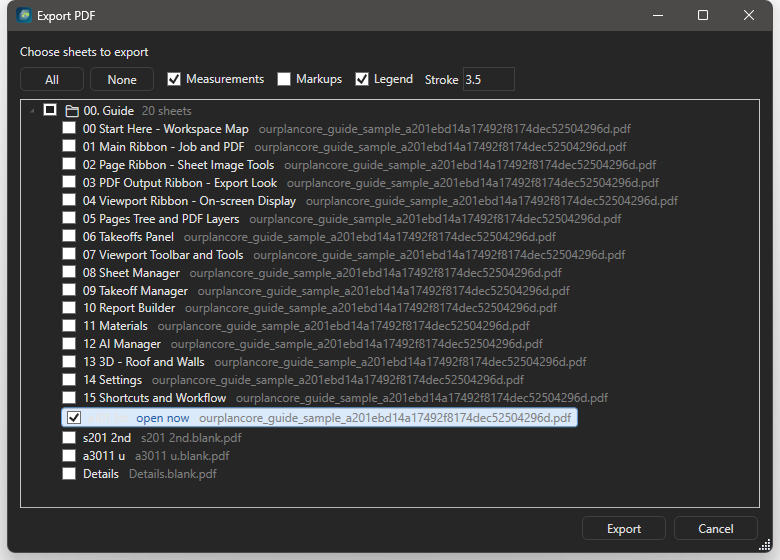
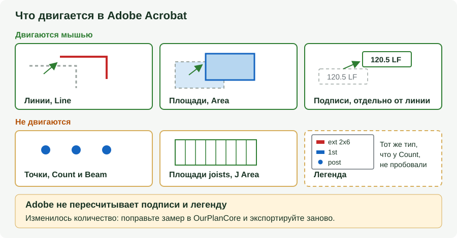
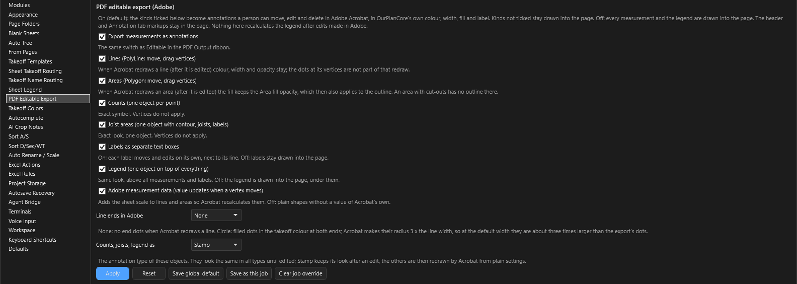
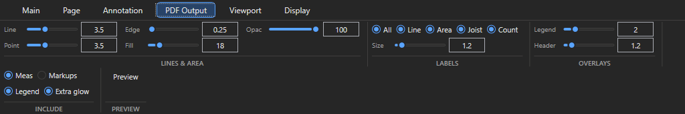
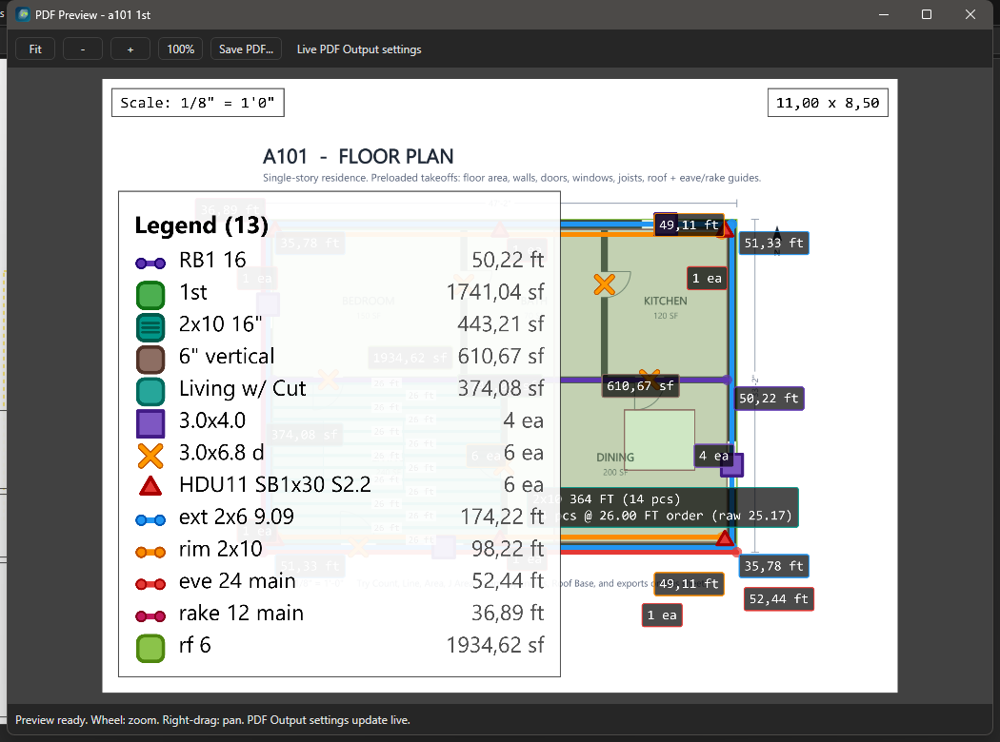
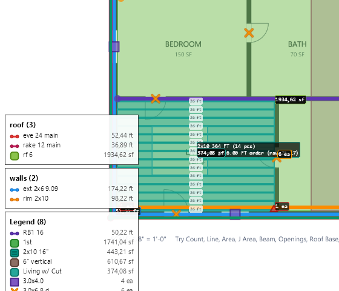

# PDF and delivery

This page covers exporting sheets with measurements to PDF, a separate file per building, editing the finished PDF in Adobe Acrobat, the PDF Output ribbon and the live Preview, the sheet legend, and what else goes into the delivery. You need it at the end of a job and on a revision.

<figure markdown>
  
  <figcaption markdown="span">Sheets in the same folder structure as in Pages. A checkbox on a folder ticks all its sheets; `open now` marks the sheets that are open right now.</figcaption>
</figure>

## What gets delivered

- The PDF gets only sheets with visible measurements; the client does not need the blank sheets of the plan set.
- Different buildings get different PDFs. Measurements of other buildings on a shared sheet are hidden before export.
- `Measurements` always on, `Legend` usually on, `Markups` only if the client needs the markup (the Hide mask and crops print without it).
- A "new only" revision: by the branches of the new plan set, hide the rest.
- By default the lines, areas and labels in the PDF can be moved in Adobe Acrobat, by the client too. If you need a PDF without that: [turn off `Editable`](#adobe-off).

The full delivery package (processed xlsx, `Changes.txt`, the `.Finished` folder): [Workflow, export and delivery](../start/workflow.md).

## How to export a PDF { #export }

<figure markdown>
  <video class="kb-demo" loop muted playsinline preload="none" poster="../../assets/images/ourplancore/demo/d-export-pdf.png"><source src="../../assets/images/ourplancore/demo/d-export-pdf.mp4" type="video/mp4"></video>
  <figcaption markdown="span">Demo: `Main > Export`, tick the sheets you need, `Export`; status `Exported PDF (2 sheet(s))`.</figcaption>
</figure>

Why: a file for the client with only the sheets that have measurements.
You need: measurements checked, extras hidden.

1. Press `Ctrl+S`: the saved state is what gets exported.
2. Hide the extras: `H` on takeoffs, the visibility dot on the sheet in Pages, the **Annotation > Hide** mask over a neighboring plan ([tree](ourplancore-takeoffs.md#hide)).
3. Press **PDF Output > Preview** and look at the current sheet: line weight, labels, legend ([below](#output)).
4. Press **Main > PDF > Export** (the PDF Output module is required). For one or several sheets, select them in Pages and right-click **Export Sheet to PDF...** or **Export N Selected to PDF...**.
5. In the **Export PDF** dialog tick the sheets or folders (**All**, **None**), check the **Measurements**, **Markups**, **Legend** checkboxes and the **Stroke** field (line weight multiplier 0.25-10, default 1.5; saved on export).
6. Press **Export**: the save window offers the job export folder and the name `<job>_sheets.pdf` (for one sheet, the sheet name). Name it by building: `<job> Bldg A.pdf`.
7. Open the finished PDF and page through all of it.

Result: measurements in place, the legend is readable, no extra sheets.

## How to make a separate PDF per building { #buildings }

Why: the client gets a file for each building.
You need: each building has its own sheet folder in Pages ([multiple buildings](ourplancore-buildings.md)).

1. In **Export PDF** tick the building folder with one checkbox.
2. If a sheet has measurements of another building (a shared plan), open the sheet, select the other building's folder in Takeoffs and press `H`: all its takeoffs on this sheet are hidden. Repeat on every shared sheet.
3. Export and name the file by building.
4. Restore visibility with the dots on the takeoffs under the sheet in Pages, and repeat for the next building.

Result: a file per building; the pipeline does the same automatically by the green dot ([CLI](ourplancore-buildings.md#pdf)).

## How to edit a finished PDF in Adobe Acrobat { #adobe }

Since version 3.0.27 the export by default puts measurements into the PDF as separate objects (annotations) instead of drawing them into the page. They look the same: OurPlanCore colors, weights and labels. In Adobe Acrobat these objects can be moved, edited and deleted. OurPlanCore Lite does the same.

<figure markdown>
  
  <figcaption markdown="span">Checked with the mouse in Acrobat on test files: lines, areas and labels move, points and joist areas do not.</figcaption>
</figure>

| Object | In Acrobat | What matters |
| --- | --- | --- |
| Lines (`Line`) | move | |
| Areas (`Area`) | move | |
| Labels | move | a label is not tied to its line: if you moved the line, move the label separately |
| Points (`Count`, `Beam`) | do not move | |
| Joist areas (`J Area`) | do not move | the outline, joists and labels are one object here |
| Legend | should not move | the same object type as `Count`; not tested on its own. It sits on top of all measurements and labels |
| Sheet header, `Annotation` markup | do not move | they are in the page itself, not objects |

Why: a small fix right in the PDF, without a new export.
You need: a PDF exported with the `Editable` checkbox on, and Adobe Acrobat.

1. Export the PDF as usual ([above](#export)). The **PDF Output > ADOBE > Editable** checkbox is on by default.
2. Open the PDF in Adobe Acrobat.
3. Click a line, area or label and drag it with the mouse.
4. Save the PDF in Acrobat.

Result: the object is moved in this PDF, and only in it.

!!! warning "Editing in Adobe does not recalculate labels and the legend"
    The numbers on the labels and in the legend stay the same. The edit lives only in this PDF: the OurPlanCore job does not change, and a new export will not repeat it. If the quantity changed, fix the measurement in the app and export again.

After an edit Acrobat draws the object itself, so the look changes a little:

- a line keeps its color, weight and transparency; the dots at its vertices disappear;
- an area fill keeps its transparency, and the same transparency goes onto the outline; an area with cutouts has no outline.

### How to turn it off { #adobe-off }

| Where | What to do | Applies |
| --- | --- | --- |
| **PDF Output > ADOBE > Editable** | uncheck it | until another job is opened |
| **Settings > PDF Editable Export** | uncheck `Export measurements as annotations`, press **Save global default** or **Save as this job** | for all jobs or for one; **Clear job override** removes the job setting, **Reset** loads the defaults |

With the checkbox off: every measurement and the legend are drawn into the page, as in the old export, with the legend under the measurements.

<figure markdown>
  
  <figcaption markdown="span">Section header `PDF editable export (Adobe)`. Captured on a generated job in 3.0.27: the `Excel Links` section was not yet in the list on the left at that time.</figcaption>
</figure>

| Field | Default | What it does |
| --- | --- | --- |
| `Export measurements as annotations` | on | the same switch as `Editable` |
| `Lines (PolyLine: move, drag vertices)` | on | lines as separate objects |
| `Areas (Polygon: move, drag vertices)` | on | areas as separate objects |
| `Counts (one object per point)` | on | points as separate objects, one object per point |
| `Joist areas (one object with contour, joists, labels)` | on | a joist area as one object |
| `Labels as separate text boxes` | on | unchecked: labels are drawn into the page |
| `Legend (one object on top of everything)` | on | unchecked: the legend is drawn into the page, under the measurements |
| `Adobe measurement data (value updates when a vertex moves)` | on | adds the sheet scale to lines and areas so Acrobat calculates its own value; this does not change the OurPlanCore labels and legend |
| `Line ends in Adobe` | `None` | `Circle` - round line ends after an edit in Acrobat, about three times larger than the export dots |
| `Counts, joists, legend as` | `Stamp` | object type. No need to change it: other types are untested and may lose their look when moved |

The type settings change neither the sheet on screen nor the measurements themselves, only how they sit in the PDF.

Lite has the same ribbon and section; Lite stores its settings separately from the full version.

## PDF Output ribbon: reference { #output }

<figure markdown>
  
  <figcaption markdown="span">Print settings live separately from the screen settings (`Viewport`, `Display`): thick on screen, thin in the PDF. This capture is older: it does not have the `ADOBE` group yet.</figcaption>
</figure>

| Group | Buttons | What they set |
| --- | --- | --- |
| `LINES & AREA` | `Line`, `Point`, `Edge`, `Fill`, `Opac` | line weight, Count point size, area border weight, area fill, transparency of Line and of the Draw line and Arrow markups (0-100 %, default 100) |
| `LABELS` | `All`, `Line`, `Area`, `Joist`, `Count`, `Size` | which labels to print and their size |
| `OVERLAYS` | `Legend`, `Header` | size of the legend and the sheet header |
| `ADOBE` | `Editable` | measurements in the PDF as separate objects that move in Adobe Acrobat ([details](#adobe)); on by default |
| `INCLUDE` | `Meas`, `Markups`, `Legend`, `Extra glow` | what to include by default; Extra joists highlight |
| `PREVIEW` | `Preview` | live window of the current sheet |

`Opac` at 60-70 % keeps the drawing readable under heavy wall lines. The settings are saved globally and used on every export.

## How to check a sheet before export: Preview { #preview }

<figure markdown>
  <video class="kb-demo" loop muted playsinline preload="none" poster="../../assets/images/ourplancore/demo/d-preview.png"><source src="../../assets/images/ourplancore/demo/d-preview.mp4" type="video/mp4"></video>
  <figcaption markdown="span">Demo: `PDF Output > Preview`; the sheet preview redraws when you change the transparency and legend size on the ribbon.</figcaption>
</figure>

<figure markdown>
  
  <figcaption markdown="span">A non-modal window: change a setting on the ribbon and the preview redraws.</figcaption>
</figure>

Why: see the sheet as it will print and tune the line weight and legend without test exports.

1. Open the sheet and press **PDF Output > Preview**.
2. Change `Line`, `Opac`, `Legend` on the ribbon: the preview redraws by itself.
3. Zoom with the wheel toward the cursor, pan with the right button; buttons **Fit**, **-**, **+**, **100%**.
4. Switch sheets in Pages: the window follows the current sheet.
5. Press **Save PDF...** if you need a PDF of just the current sheet straight from the preview.

Result: the settings are tuned; the window can stay open while you work. In the preview the legend is one list, `Legend (N)`: the sheet legend groups are not taken into account here yet. With a large `Legend` on an 11x8.5 sheet the legend can cover half the plan; check the size.

## Sheet legend { #legend }

<figure markdown>
  <video class="kb-demo" loop muted playsinline preload="none" poster="../../assets/images/ourplancore/demo/d-legend-groups.png"><source src="../../assets/images/ourplancore/demo/d-legend-groups.mp4" type="video/mp4"></video>
  <figcaption markdown="span">Demo: two takeoffs under the sheet in Pages, right-click `Legend Group > New Group`; the legend on the sheet splits into walls and openings blocks.</figcaption>
</figure>

<figure markdown>
  
  <figcaption markdown="span">The legend lists the sheet takeoffs with color and symbol. Groups put shear walls or framing in a separate block.</figcaption>
</figure>

The legend lists only the takeoffs measured on this sheet ([split by sheets](ourplancore-split-by-sheets.md#legend)).

| What | Where |
| --- | --- |
| Show, size, position on screen | `Display > Legend Show / Size / Pos` |
| Size in the PDF | `PDF Output > OVERLAYS > Legend` |
| Order | `Pages > sheet > Organize > Sort Sheet Legend Auto / A-Z / by Key (before space)`, `Reset Sheet Legend Order` ([legend order](takeoff-naming.md#legend-order)) |
| Groups | under the sheet in Pages select takeoffs, `Legend Group > New Group...`; manage them in `Organize > Legend Groups...` ([groups](ourplancore-sheets-advanced.md#legend)) |

The legend is the same on screen, in the preview and in the PDF. Legend groups, the Hide mask, Crop to Sheet crops and sheet overlays: [Sheets: advanced](ourplancore-sheets-advanced.md).

## Common mistakes

- The PDF got sheets without measurements or another building's measurements.
- Export before `Ctrl+S`: the latest edits did not make it in.
- The legend covers the drawing: move `Pos` or reduce `Legend` in PDF Output.
- Wall lines cover the dimensions: reduce `Line` or set `Opac`.
- Neighboring takeoffs with the same color: the legend is unreadable ([colors](ourplancore-takeoffs.md#colors)).
- A line was moved or stretched in Acrobat, and the label and legend kept the old number. That is expected: Adobe does not recalculate them; fix the measurement in the app ([details](#adobe)).

All delivery mistakes: [Common mistakes, delivery](../start/common-mistakes.md#delivery).

## See also

- [Workflow: export and delivery](../start/workflow.md), [Pre-delivery check](../start/quality-checklist.md)
- [Export to Excel](ourplancore-excel.md), [DFL: how the workbook works](dfl-overview.md)
- [Sheets: advanced](ourplancore-sheets-advanced.md), [Multiple buildings](ourplancore-buildings.md#pdf)
