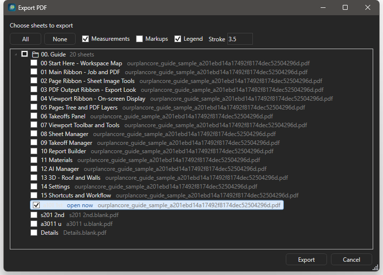
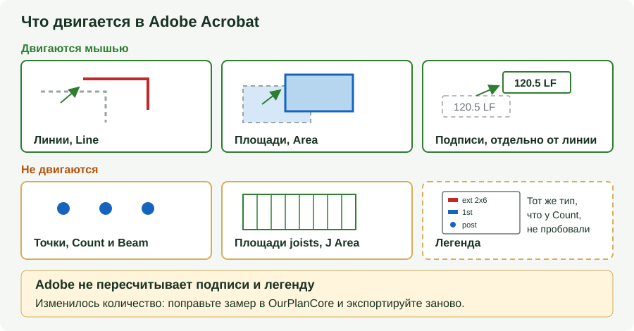
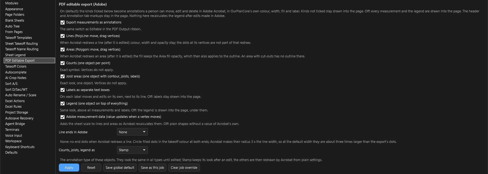
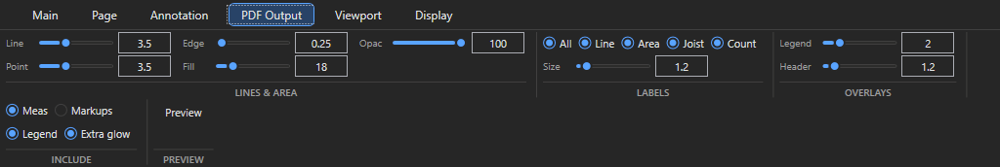
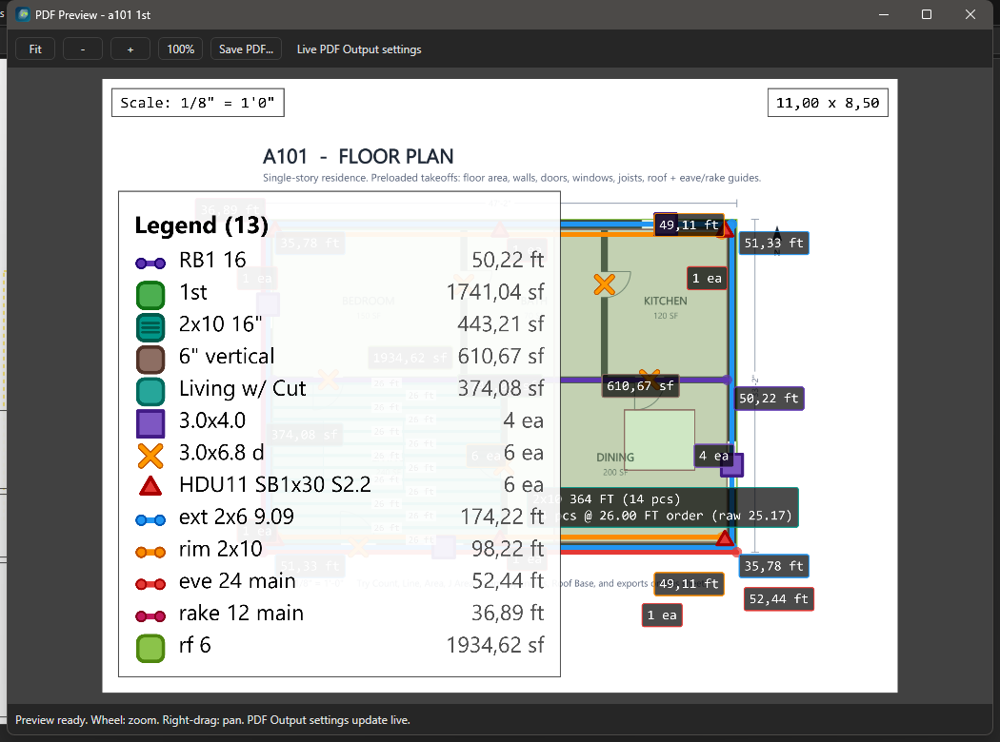
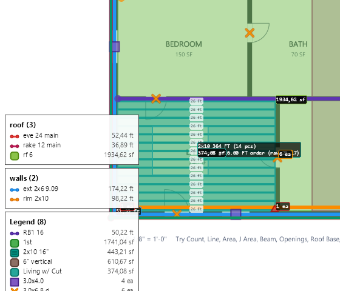

# PDF и сдача

Здесь: экспорт листов с замерами в PDF, отдельный файл на корпус, правка готового PDF в Adobe Acrobat, лента PDF Output и живой Preview, легенда листа, что ещё входит в сдачу. Нужно в конце работы и при ревизии.

<figure markdown>
  
  <figcaption markdown="span">Листы в той же структуре папок, что в Pages. Галка на папке отмечает все её листы; `open now` у открытых сейчас листов.</figcaption>
</figure>

## Что сдаётся

- В PDF идут только листы, на которых есть видимые замеры; чистые листы комплекта клиенту не нужны.
- Разные корпуса - разные PDF. Замеры других корпусов на общем листе скрываются перед экспортом.
- `Measurements` включены всегда, `Legend` обычно включена, `Markups` - только если разметка нужна клиенту (маска Hide и кропы печатаются и без неё).
- Ревизия "только новое": по веткам нового комплекта, остальное скрыть.
- По умолчанию линии, площади и подписи в PDF можно двигать в Adobe Acrobat, у клиента тоже. Нужен PDF без этого: [выключите `Editable`](#adobe-off).

Полный состав сдачи (processed xlsx, `Changes.txt`, папка `.Finished`): [Процесс работы, экспорт и сдача](../start/workflow.md).

## Как экспортировать PDF { #export }

<figure markdown>
  <video class="kb-demo" loop muted playsinline preload="none" poster="../../assets/images/ourplancore/demo/d-export-pdf.png"><source src="../../assets/images/ourplancore/demo/d-export-pdf.mp4" type="video/mp4"></video>
  <figcaption markdown="span">Демонстрация: `Main > Export`, галки нужных листов, `Export`; статус `Exported PDF (2 sheet(s))`.</figcaption>
</figure>

Зачем: файл клиенту только с листами, где есть замеры.
Нужно: замеры проверены, лишнее спрятано.

1. Нажмите `Ctrl+S`: экспортируется сохранённое состояние.
2. Спрячьте лишнее: `H` по позициям, точка видимости у листа в Pages, маска **Annotation > Hide** поверх соседнего плана ([дерево](ourplancore-takeoffs.md#hide)).
3. Нажмите **PDF Output > Preview** и посмотрите текущий лист: толщина линий, подписи, легенда ([ниже](#output)).
4. Нажмите **Main > PDF > Export** (нужен модуль PDF Output). Для одного или нескольких листов выделите их в Pages и выберите ПКМ **Export Sheet to PDF...** или **Export N Selected to PDF...**.
5. Отметьте в диалоге **Export PDF** листы или папки (**All**, **None**), проверьте галки **Measurements**, **Markups**, **Legend** и поле **Stroke** (множитель толщины линий 0.25-10, по умолчанию 1.5; сохраняется при экспорте).
6. Нажмите **Export**: окно сохранения предлагает папку экспорта проекта и имя `<проект>_sheets.pdf` (для одного листа - имя листа). Назовите по корпусу: `<проект> Bldg A.pdf`.
7. Откройте готовый PDF и пролистайте все страницы.

Результат: замеры на месте, легенда читается, лишних листов нет.

## Как сделать отдельный PDF на корпус { #buildings }

Зачем: клиент получает файл на каждое здание.
Нужно: у каждого корпуса своя папка листов в Pages ([несколько зданий](ourplancore-buildings.md)).

1. Отметьте в **Export PDF** папку корпуса одной галкой.
2. Если на листе есть замеры другого корпуса (общий план), откройте лист, выделите в Takeoffs папку чужого корпуса и нажмите `H`: все его позиции на этом листе скрыты. Повторите на каждом общем листе.
3. Экспортируйте и назовите файл по корпусу.
4. Верните видимость точками у позиций под листом в Pages и повторите для следующего корпуса.

Результат: файл на корпус; конвейер делает то же автоматически по зелёной точке ([CLI](ourplancore-buildings.md#pdf)).

## Как поправить готовый PDF в Adobe Acrobat { #adobe }

С версии 3.0.27 экспорт по умолчанию кладёт замеры в PDF отдельными объектами (аннотациями), а не рисует их в странице. Вид тот же: цвета, толщины и подписи OurPlanCore. В Adobe Acrobat такие объекты можно двигать, править и удалять. В OurPlanCore Lite то же самое.

<figure markdown>
  
  <figcaption markdown="span">Проверено мышью в Acrobat на тестовых файлах: линии, площади и подписи двигаются, точки и площади joists нет.</figcaption>
</figure>

| Объект | В Acrobat | Что важно |
| --- | --- | --- |
| Линии (`Line`) | двигаются | |
| Площади (`Area`) | двигаются | |
| Подписи | двигаются | подпись не привязана к своей линии: сдвинули линию, подпись двигайте отдельно |
| Точки (`Count`, `Beam`) | не двигаются | |
| Площади joists (`J Area`) | не двигаются | контур, joists и подписи здесь один объект |
| Легенда | не должна двигаться | тот же тип объекта, что у `Count`; отдельно её не пробовали. Лежит поверх всех замеров и подписей |
| Заголовок листа, разметка `Annotation` | не двигаются | они в самой странице, это не объекты |

Зачем: мелкая правка прямо в PDF, без нового экспорта.
Нужно: PDF, выгруженный с включённой галкой `Editable`, и Adobe Acrobat.

1. Экспортируйте PDF как обычно ([выше](#export)). Галка **PDF Output > ADOBE > Editable** стоит по умолчанию.
2. Откройте PDF в Adobe Acrobat.
3. Щёлкните линию, площадь или подпись и тяните мышью.
4. Сохраните PDF в Acrobat.

Результат: объект сдвинут в этом PDF, и только в нём.

!!! warning "Правка в Adobe не пересчитывает подписи и легенду"
    Числа на подписях и в легенде остаются прежними. Правка живёт только в этом PDF: проект OurPlanCore не меняется, новый экспорт её не повторит. Изменилось количество - поправьте замер в программе и экспортируйте заново.

После правки Acrobat рисует объект сам, поэтому вид немного меняется:

- у линии остаются цвет, толщина и прозрачность, точки в её вершинах пропадают;
- у площади заливка сохраняет свою прозрачность, и она же ложится на контур; у площади с вырезами контура нет.

### Как выключить { #adobe-off }

| Где | Что сделать | Действует |
| --- | --- | --- |
| **PDF Output > ADOBE > Editable** | снять галку | до открытия другого проекта |
| **Settings > PDF Editable Export** | снять `Export measurements as annotations`, нажать **Save global default** или **Save as this job** | на все проекты или на один; **Clear job override** убирает настройку проекта, **Reset** загружает значения по умолчанию |

Галка снята: каждый замер и легенда нарисованы в странице, как в старом экспорте, легенда под замерами.

<figure markdown>
  
  <figcaption markdown="span">Заголовок раздела `PDF editable export (Adobe)`. Снято на сгенерированном проекте в 3.0.27: раздела `Excel Links` в списке слева тогда ещё не было.</figcaption>
</figure>

| Поле | По умолчанию | Что делает |
| --- | --- | --- |
| `Export measurements as annotations` | вкл | тот же выключатель, что `Editable` |
| `Lines (PolyLine: move, drag vertices)` | вкл | линии отдельными объектами |
| `Areas (Polygon: move, drag vertices)` | вкл | площади отдельными объектами |
| `Counts (one object per point)` | вкл | точки отдельными объектами, один объект на точку |
| `Joist areas (one object with contour, joists, labels)` | вкл | площадь joists одним объектом |
| `Labels as separate text boxes` | вкл | снято: подписи нарисованы в странице |
| `Legend (one object on top of everything)` | вкл | снято: легенда нарисована в странице, под замерами |
| `Adobe measurement data (value updates when a vertex moves)` | вкл | добавляет масштаб листа к линиям и площадям, чтобы своё значение считал сам Acrobat; подписи и легенду OurPlanCore это не меняет |
| `Line ends in Adobe` | `None` | `Circle` - круглые концы линии после правки в Acrobat, примерно втрое крупнее точек экспорта |
| `Counts, joists, legend as` | `Stamp` | тип объекта. Менять не нужно: другие типы не проверены и при сдвиге могут потерять вид |

Настройка типов не меняет ни лист на экране, ни сами замеры, только то, как они лежат в PDF.

В Lite лента и раздел те же, настройки Lite хранит отдельно от полной версии.

## Лента PDF Output: справка { #output }

<figure markdown>
  
  <figcaption markdown="span">Настройки печати живут отдельно от экранных (`Viewport`, `Display`): на экране толсто, в PDF тонко. Кадр снят раньше: группы `ADOBE` на нём ещё нет.</figcaption>
</figure>

| Группа | Кнопки | Что задают |
| --- | --- | --- |
| `LINES & AREA` | `Line`, `Point`, `Edge`, `Fill`, `Opac` | толщина линий, размер точек Count, толщина границы площади, заливка площади, прозрачность Line и разметок Draw line и Arrow (0-100 %, по умолчанию 100) |
| `LABELS` | `All`, `Line`, `Area`, `Joist`, `Count`, `Size` | какие подписи печатать и их размер |
| `OVERLAYS` | `Legend`, `Header` | размер легенды и заголовка листа |
| `ADOBE` | `Editable` | замеры в PDF отдельными объектами, которые двигаются в Adobe Acrobat ([подробно](#adobe)); по умолчанию включено |
| `INCLUDE` | `Meas`, `Markups`, `Legend`, `Extra glow` | что включать по умолчанию; подсветка Extra joists |
| `PREVIEW` | `Preview` | живое окно текущего листа |

`Opac` 60-70 % оставляет чертёж читаемым под плотными линиями стен. Настройки сохраняются глобально и используются при любом экспорте.

## Как проверить лист до экспорта: Preview { #preview }

<figure markdown>
  <video class="kb-demo" loop muted playsinline preload="none" poster="../../assets/images/ourplancore/demo/d-preview.png"><source src="../../assets/images/ourplancore/demo/d-preview.mp4" type="video/mp4"></video>
  <figcaption markdown="span">Демонстрация: `PDF Output > Preview`; превью листа перерисовывается при смене прозрачности и размера легенды на ленте.</figcaption>
</figure>

<figure markdown>
  
  <figcaption markdown="span">Немодальное окно: меняешь настройку на ленте, превью перерисовывается.</figcaption>
</figure>

Зачем: увидеть лист так, как он напечатается, и подобрать толщину линий и легенду без пробных экспортов.

1. Откройте лист и нажмите **PDF Output > Preview**.
2. Меняйте `Line`, `Opac`, `Legend` на ленте: превью перерисовывается само.
3. Приближайте колесом к курсору, двигайте правой кнопкой; кнопки **Fit**, **-**, **+**, **100%**.
4. Переключайте листы в Pages: окно следует за текущим листом.
5. Нажмите **Save PDF...**, если нужен PDF одного текущего листа прямо из превью.

Результат: настройки подобраны, окно можно оставить открытым на время работы. В превью легенда идёт одним списком `Legend (N)`: группы легенды листа здесь пока не учитываются. При крупном `Legend` на листе 11x8.5 легенда может закрыть половину плана, проверьте размер.

## Легенда листа { #legend }

<figure markdown>
  <video class="kb-demo" loop muted playsinline preload="none" poster="../../assets/images/ourplancore/demo/d-legend-groups.png"><source src="../../assets/images/ourplancore/demo/d-legend-groups.mp4" type="video/mp4"></video>
  <figcaption markdown="span">Демонстрация: две позиции под листом в Pages, правый щелчок `Legend Group > New Group`; легенда на листе делится на блоки walls и openings.</figcaption>
</figure>

<figure markdown>
  
  <figcaption markdown="span">Легенда перечисляет позиции листа с цветом и значком. Группы выделяют shear walls или framing отдельным блоком.</figcaption>
</figure>

Легенда перечисляет только позиции, измеренные на этом листе ([раскладка по листам](ourplancore-split-by-sheets.md#legend)).

| Что | Где |
| --- | --- |
| Показать, размер, положение на экране | `Display > Legend Show / Size / Pos` |
| Размер в PDF | `PDF Output > OVERLAYS > Legend` |
| Порядок | `Pages > лист > Organize > Sort Sheet Legend Auto / A-Z / by Key (before space)`, `Reset Sheet Legend Order` ([порядок легенды](takeoff-naming.md#legend-order)) |
| Группы | под листом в Pages выделить позиции, `Legend Group > New Group...`; управление `Organize > Legend Groups...` ([группы](ourplancore-sheets-advanced.md#legend)) |

Легенда одинакова на экране, в превью и в PDF. Группы легенды, маска Hide, кропы Crop to Sheet и наложения листов: [Листы: продвинутое](ourplancore-sheets-advanced.md).

## Частые ошибки

- В PDF попали листы без замеров или замеры чужого корпуса.
- Экспорт до `Ctrl+S`: последние правки не попали.
- Легенда перекрыла чертёж: сдвинуть `Pos` или уменьшить `Legend` в PDF Output.
- Линии стен закрыли размеры: уменьшить `Line` или поставить `Opac`.
- Одинаковые цвета соседних позиций: легенда нечитаема ([цвета](ourplancore-takeoffs.md#colors)).
- Сдвинули или вытянули линию в Acrobat, а подпись и легенда остались со старым числом. Так и должно быть: Adobe их не пересчитывает, правьте замер в программе ([подробно](#adobe)).

Все ошибки сдачи: [Частые ошибки, сдача](../start/common-mistakes.md#delivery).

## См. также

- [Процесс работы: экспорт и сдача](../start/workflow.md), [Проверка перед сдачей](../start/quality-checklist.md)
- [Экспорт в Excel](ourplancore-excel.md), [DFL: как устроена книга](dfl-overview.md)
- [Листы: продвинутое](ourplancore-sheets-advanced.md), [Несколько зданий](ourplancore-buildings.md#pdf)
