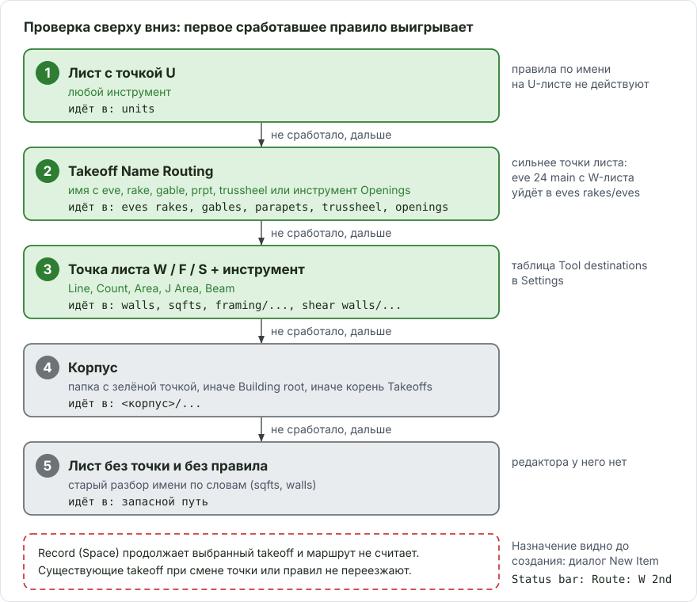
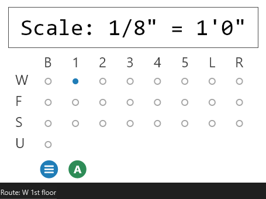
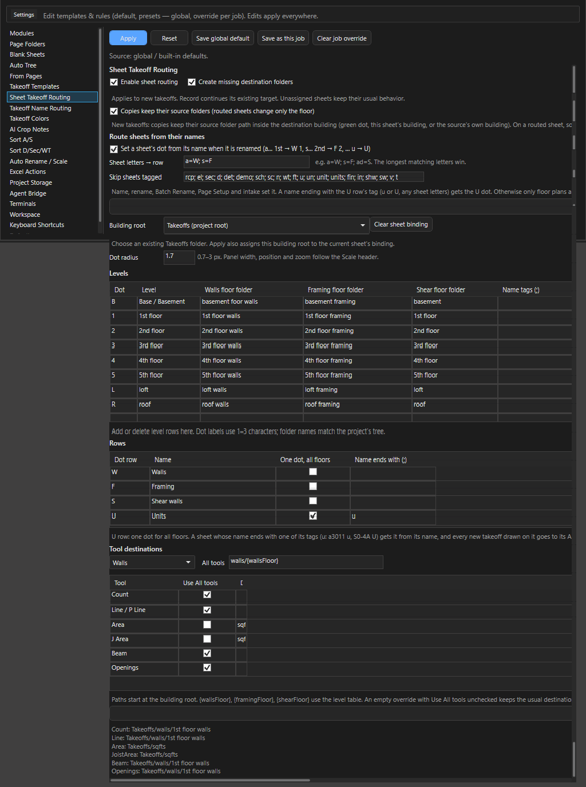
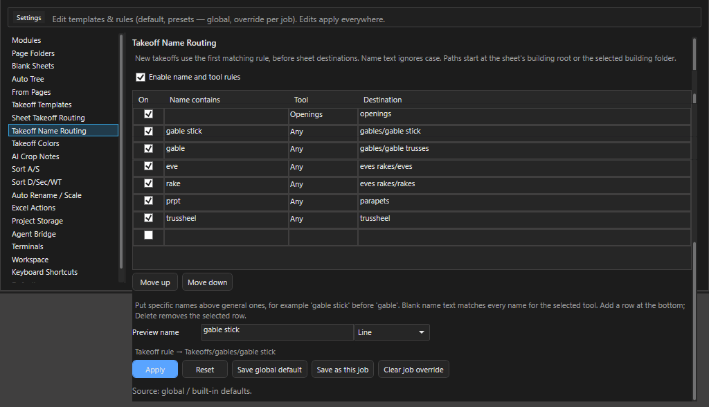
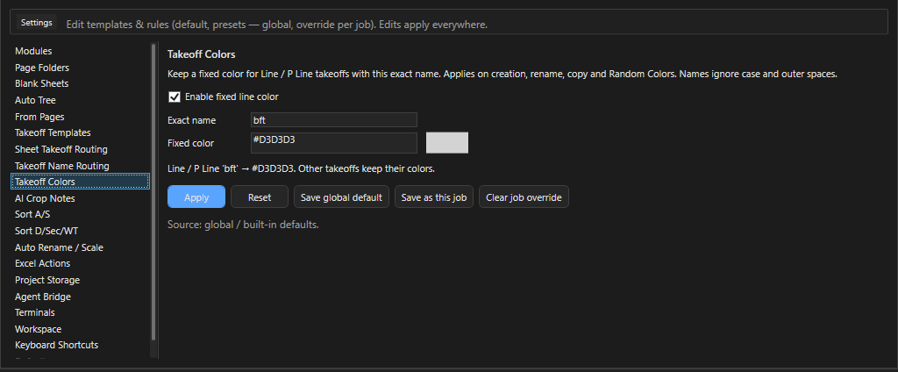

# Takeoff Routing in Settings

This page covers how OurPlanCore 3.0 sorts new takeoffs into building folders by itself and where to edit those rules. You need it when a new takeoff landed in the wrong place, when a job has non-standard folders, or when you prepare a job for a different tree template. How a plan set is split up in practice (which sheet carries walls, framing, shear walls, units) is on [Split by sheets and routing](ourplancore-split-by-sheets.md).

<figure markdown>
  
  <figcaption markdown="span">Decision order: U sheet, then a rule by name or tool, then the W/F/S sheet dot, then the building. Record ignores all of this.</figcaption>
</figure>

## How the app decides where to put a new takeoff

Checked from top to bottom, the first rule that fires wins:

1. **Sheet with the U dot.** Any tool puts the takeoff into `<building>/units`. Name rules do not apply on a U sheet.
2. **Takeoff Name Routing.** The takeoff name contains a word from the rules table (`eve`, `rake`, `gable`, `prpt`, `trussheel`), or the tool matches a rule (Openings). This rule beats the sheet dot: `eve 24 main` from a W sheet still goes to `eves rakes/eves`.
3. **W/F/S sheet dot** plus the tool: see the Tool destinations table below.
4. **Building.** The folder with the green dot in the Takeoffs header; if there is none, the Building root field from the settings; if that is empty too, the Takeoffs root.
5. **Sheet with no dot and no rule.** The old word-based name parsing (`sqfts`, `walls`) kicks in: a fallback with no editor.

`Record` (Space) continues the takeoff that is already selected and does not compute a route. Existing takeoffs do not move when the dot or the rules change.

## Sheet Takeoff Routing: sheet dots {#sheet-routing}

<figure markdown>
  
  <figcaption markdown="span">The dot matrix under the scale label: rows W, F, S, U; columns B, 1-5, L, R. W/1 is selected, the status bar shows `Route: W 1st`.</figcaption>
</figure>

| Element | Where | What it does |
| --- | --- | --- |
| Dot matrix | under the Scale label on the sheet | one click sets a dot, a second click removes it; one dot per sheet |
| `Route: W 2nd` | status bar, after `Takeoff:` | shows the row and floor; for U it is `Route: U all floors` |
| `Sheet routing` checkbox | Viewport ribbon | shows or hides the matrix |
| `Routing settings` | Viewport ribbon | opens `Settings > Sheet Takeoff Routing` |
| Destination preview | New Item dialog | the path where the takeoff will go is visible before it is created |

The dot is stored in the sheet folder (`takeoff_routing.json`) and survives closing the job.

### Where new takeoffs go (defaults, 2nd floor example)

| Tool | W (Walls) | F (Framing) | S (Shear walls) | U (Units) |
| --- | --- | --- | --- | --- |
| Line, P Line | `walls/2nd floor walls` | `framing/2nd floor framing/details` | `shear walls/2nd floor/shear` | `units` |
| Count | `walls/2nd floor walls` | `framing/2nd floor framing` | `shear walls/2nd floor/holdowns` | `units` |
| Area, J Area | `sqfts` | `framing/2nd floor framing/joists` | `shear walls/2nd floor/shear` | `units` |
| Beam | `walls/2nd floor walls` | `framing/2nd floor framing/beams` | `shear walls/2nd floor/shear` | `units` |
| Openings | name rule: `openings` | name rule: `openings` | name rule: `openings` | `units` |

For Openings the tool rule in Takeoff Name Routing fires before the sheet dot, so openings from any sheet except U go into `openings`. If you turn that rule off, Openings on an F sheet land in `framing/<floor> framing/headers`.

### Levels

| Dot | Level | Walls folder | Framing folder | Shear folder | Tags in the sheet name |
| --- | --- | --- | --- | --- | --- |
| B | Base / Basement | `basement foor walls` | `basement framing` | `basement` | `base`, `b`, `bsmt`, `basement` |
| 1-5 | 1st-5th floor | `1st floor walls` | `1st floor framing` | `1st floor` | `1st` ... `5th` |
| L | loft | `loft walls` | `loft framing` | `loft` | `loft` |
| R | roof | `roof walls` | `roof framing` | `roof` | `roof`, `rf` |

??? note "Typo in the basement folder"
    In build 3.0 the W row folder for the B dot is named `basement foor walls` by default (that is how the app spells it). If you need the correct spelling, change the Walls floor folder column for level B and click Save global default.

### Automatic dot from the sheet name

The dot is set automatically when a sheet gets a name: the Name button, F2 in Pages, Batch Rename, Page Setup, job intake by the pipeline and the `Route sheets without a dot now` button.

1. The name ends in `u` or `U` (`a3011 u`, `S0-4A U`, a copy `... U (2)`): U dot. `a301 u el` does not get the U dot: `u` is not the last word.
2. Otherwise the letter of the sheet number picks the row: `a...` is W, `s...` is F. The rule is edited in the Route sheets from their names table.
3. A level tag picks the column: `1st`, `2nd`, `base`, `rf`, `loft`. There must be exactly one tag: `a1.7 1st 2nd` gets no dot.
4. A sheet with a tag from the Skip tags list is skipped: `rcp; el; sec; d; det; demo; sch; sc; n; wt; ft; u; un; unit; units; fin; in; shw; sw; v; t`.
5. A dot set by hand is never replaced.

### Settings fields

<figure markdown>
  
  <figcaption markdown="span">The Levels, Rows and Tool destinations tables; at the bottom the Apply, Reset, Save global default, Save as this job, Clear job override buttons.</figcaption>
</figure>

| Field | What it sets |
| --- | --- |
| Enable sheet routing | turns off the whole dot matrix |
| Create missing destination folders | create destination folders that do not exist yet (with confirmation) |
| Copies keep their source folders | when pasting New takeoffs, the copy keeps the source subfolders, only the floor changes |
| Building root | default building when no green dot is selected |
| Dot radius | size of the dots on the sheet, 0.7-3 px |
| Levels | up to 16 levels: dot label, name, three floor folders, sheet name tags (Name tags) |
| Rows | four rows W, F, S, U: name, One dot flag, all floors, name-ending tags (Name ends with) |
| Tool destinations | for each row an All tools folder and a per-tool override: Count, Line / P Line, Area, J Area, Beam, Openings |
| Route sheets from their names | the letter rule (`a` is W, `s` is F) and the Skip tags list |
| Route sheets without a dot now | a pass over the whole job: sets dots on sheets that have none |
| Preview current sheet destinations | shows where takeoffs from the open sheet will go |

A folder template is written with placeholders: `framing/{framingFloor}/beams`, `walls/{wallsFloor}`, `shear walls/{shearFloor}/holdowns`. The U row does not accept placeholders: it has no floor.

## Takeoff Name Routing: rules by name and tool {#name-routing}

<figure markdown>
  
  <figcaption markdown="span">An ordered rules table and the Preview name field: type the name of a future takeoff and see the folder.</figcaption>
</figure>

Default rules (top to bottom, the first match wins; the match mode is in the Match column):

| Name text | Match | Tool | Sheet row | Destination |
| --- | --- | --- | --- | --- |
| (empty) | Contains | Openings | Any | `openings` |
| `gable stick` | Contains | Any | Any | `gables/gable stick` |
| `gable` | Contains | Any | Any | `gables/gable trusses` |
| `eve` | Contains | Any | Any | `eves rakes/eves` |
| `rake` | Contains | Any | Any | `eves rakes/rakes` |
| `prpt` | Contains | Any | Any | `parapets` |
| `trussheel` | Contains | Any | Any | `trussheel` |
| `post` | EndsWithWord | Count | F | `framing/{framingFloor}/posts` |
| `stair` | EndsWithWord | Any | F | `framing/{framingFloor}/stairs` |

Order matters: `gable stick` sits above `gable`, otherwise every gable stick would go to trusses. `EndsWithWord` for `post` and `stair` requires a space before the word at the end of the name, case-insensitive. These two rules apply only on an F sheet; `{framingFloor}` comes from the selected floor. The path is counted from the building (green dot, Building root or the Takeoffs root).

### How to add or change a rule { #add-rule }

Why: takeoffs with a given word in the name land in their own folder by themselves on the right sheet.

1. Open **Settings > Takeoff Name Routing** and check that **Enable name and tool rules** is ticked.
2. Add a row: **Name text** is the name text (for example `siding`), **Match** is `Contains` or `EndsWithWord`, **Tool** is `Any` or a specific tool, **Sheet row** is `Any` or `F`, **Destination** is the folder (`roof misc/siding`). The **Enabled** checkbox in the row turns the rule off temporarily without deleting it.
3. Put the rule above the more general ones with the **Move up** / **Move down** buttons.
4. Check it in the **Preview name** field: type `6" vertical siding` and read the path.
5. Click **Apply** (works until restart), **Save global default** (for all jobs) or **Save as this job** (only for the open one). **Reset** brings back the table above, **Clear job override** removes the job copy.

Result: in the New Item dialog a name with this word shows the new destination folder. No more than 100 rules; a rule with an empty Name contains is allowed only for a specific Tool.

## Takeoff Colors: fixed color {#colors}

<figure markdown>
  
  <figcaption markdown="span">One rule: a Line or P Line with an exact name gets the set color.</figcaption>
</figure>

| Field | Default | What it does |
| --- | --- | --- |
| Enable fixed line color | on | the rule works on create, rename, copy and Random Colors |
| Exact name | `bft` | the name is compared as a whole, case-insensitive, ignoring outer spaces |
| Fixed color | `#D3D3D3` (light gray) | color for a Line and P Line with this name |

Why: bracing for trusses (`bft`) is always gray and is not confused with walls. In the New Item dialog such a name shows the label `Fixed by Takeoff Colors settings` instead of a color picker. The app hands out all other colors at random, avoiding gray, black and white; Split gives the split-off takeoff a new color.

## How to check that the route is right { #verify }

Why: make sure before drawing that the takeoff will land in the right folder.

1. Open the sheet and read the status bar: `Route: F 2nd` means the F row, 2nd floor. No `Route:` means the sheet has no dot.
2. Click the tool and read the destination path in the New Item dialog before clicking OK.
3. After drawing, find the takeoff in the Takeoffs tree: the path must match the table above.
4. For the whole sheet click **Settings > Sheet Takeoff Routing > Preview current sheet destinations**.
5. When pasting with **Paste > New takeoffs**, read the line `Root: Takeoffs/B.`: that is the destination building.

Result: the path in the dialog, the status bar and the tree all say the same thing.

A takeoff landed in the wrong place: check the sheet dot and the green dot first, then the name rules table. Common cases are walked through in [Troubleshooting](ourplancore-troubleshooting.md#routing).

## Settings examples

??? note "A six-story job"
    `Settings > Sheet Takeoff Routing > Levels`: add a level with the label `6`, name `6th floor`, folders `6th floor walls`, `6th floor framing`, `6th floor`, tag `6th`. Save as this job, so the other jobs do not get an extra column.

??? note "Holdowns needed in a separate folder per floor"
    This is already set up: a Count on an S sheet goes to `shear walls/<floor>/holdowns`. If holdowns are placed on the architectural plan (W sheet), add a name rule: `hdu` to `shear walls/holdowns`, or temporarily switch the sheet dot to S.

??? note "Turn routing off for one job"
    `Settings > Sheet Takeoff Routing`: untick `Enable sheet routing`, click `Save as this job`. The global rules do not change; `Clear job override` brings them back.

## See also

- [Takeoff names](takeoff-naming.md) - the naming canon for takeoffs and sheet dots
- [Split by sheets and routing](ourplancore-split-by-sheets.md) - practice: what each sheet carries
- [Multiple buildings](ourplancore-buildings.md) - green and red dots, Building root
- [Takeoffs tree](ourplancore-takeoffs.md) - copying
- [Pages sheets](ourplancore-pages.md) - sheet names, Name and Batch Rename
- [Settings: all categories](ourplancore-settings.md)
- [Troubleshooting](ourplancore-troubleshooting.md)
