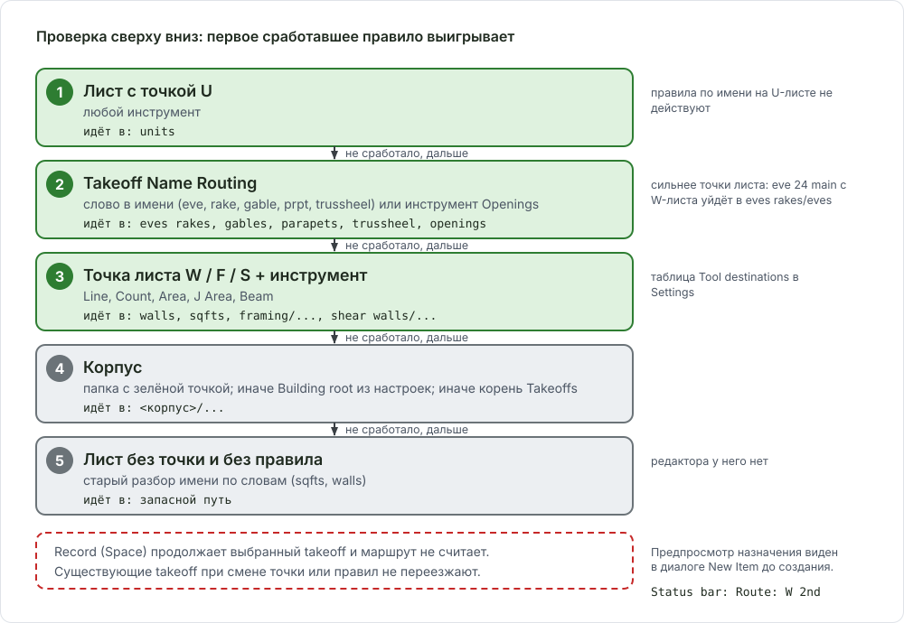
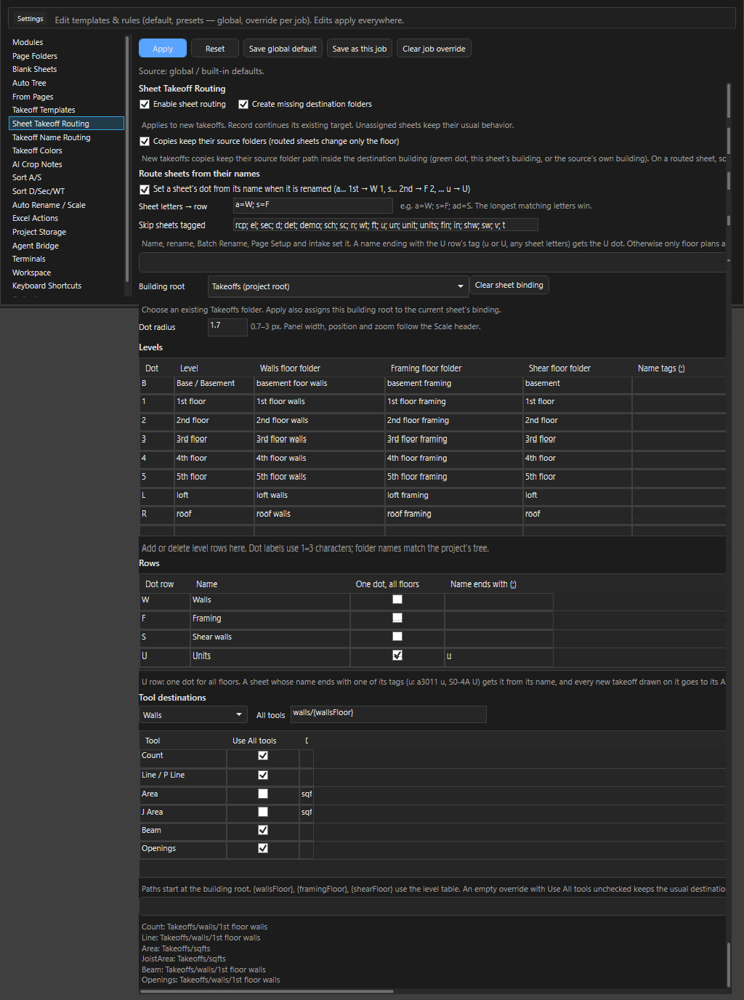
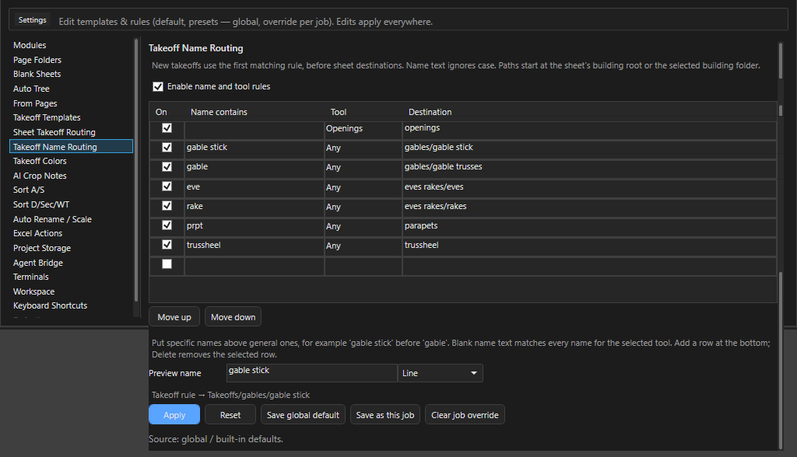
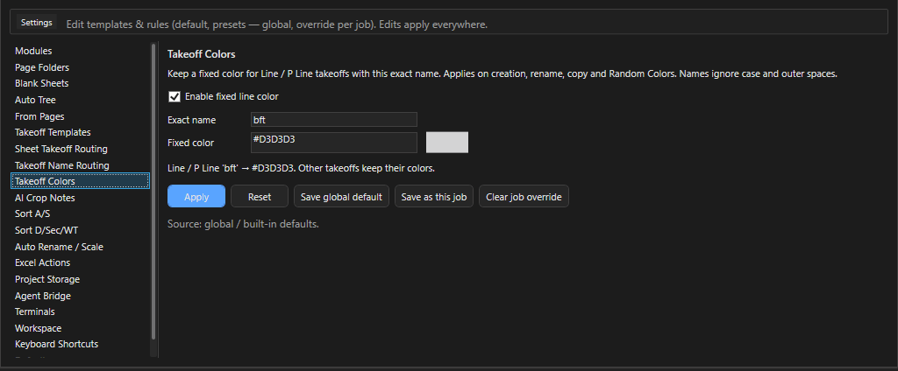

# Маршрутизация takeoff в Settings

Здесь - как OurPlanCore 3.0 сама раскладывает новые takeoff по папкам корпуса и где эти правила править. Нужно, когда новый takeoff лёг не туда, когда в проекте нестандартные папки или когда вы готовите проект под другой шаблон дерева. Как раскладывается комплект листов в работе (какой лист под стены, framing, shear walls, units) - [Раскладка по листам и роутинг](ourplancore-split-by-sheets.md).

<figure markdown>
  
  <figcaption markdown="span">Порядок решения: U-лист, потом правило по имени или инструменту, потом точка листа W/F/S, потом корпус. Record ничего из этого не слушает.</figcaption>
</figure>

## Как программа решает, куда положить новый takeoff

Проверяется сверху вниз, первое сработавшее правило выигрывает:

1. **Лист с точкой U.** Любой инструмент кладёт takeoff в `<корпус>/units`. Правила по имени на U-листе не действуют.
2. **Takeoff Name Routing.** Имя takeoff содержит слово из таблицы правил (`eve`, `rake`, `gable`, `prpt`, `trussheel`) или инструмент совпадает с правилом (Openings). Это правило сильнее точки листа: `eve 24 main` с W-листа всё равно уйдёт в `eves rakes/eves`.
3. **Точка листа W/F/S** плюс инструмент: таблица Tool destinations ниже.
4. **Корпус.** Папка с зелёной точкой в заголовке Takeoffs; если её нет - поле Building root из настроек; если и оно пустое - корень Takeoffs.
5. **Лист без точки и без правила.** Работает старый разбор имени по словам (`sqfts`, `walls`): запасной путь, редактора у него нет.

`Record` (Space) продолжает уже выбранный takeoff и маршрут не считает. Существующие takeoff при смене точки или правил не переезжают.

## Sheet Takeoff Routing: точки листа {#sheet-routing}

<figure markdown>
  
  <figcaption markdown="span">Матрица точек под надписью масштаба: строки W, F, S, U; столбцы B, 1-5, L, R. Выбрана W/1, в статусе `Route: W 1st`.</figcaption>
</figure>

| Элемент | Где | Что делает |
| --- | --- | --- |
| Матрица точек | под заголовком Scale на листе | один щелчок ставит точку, повторный снимает; одна точка на лист |
| `Route: W 2nd` | строка состояния, после `Takeoff:` | показывает строку и этаж; для U - `Route: U all floors` |
| Галка `Sheet routing` | лента Viewport | показать или скрыть матрицу |
| `Routing settings` | лента Viewport | открывает `Settings > Sheet Takeoff Routing` |
| Предпросмотр назначения | диалог New Item | путь, куда лягет takeoff, виден до создания |

Точка хранится в папке листа (`takeoff_routing.json`) и переживает закрытие проекта.

### Куда идут новые takeoff (значения по умолчанию, пример для 2-го этажа)

| Инструмент | W (Walls) | F (Framing) | S (Shear walls) | U (Units) |
| --- | --- | --- | --- | --- |
| Line, P Line | `walls/2nd floor walls` | `framing/2nd floor framing/details` | `shear walls/2nd floor/shear` | `units` |
| Count | `walls/2nd floor walls` | `framing/2nd floor framing` | `shear walls/2nd floor/holdowns` | `units` |
| Area, J Area | `sqfts` | `framing/2nd floor framing/joists` | `shear walls/2nd floor/shear` | `units` |
| Beam | `walls/2nd floor walls` | `framing/2nd floor framing/beams` | `shear walls/2nd floor/shear` | `units` |
| Openings | правило имени: `openings` | правило имени: `openings` | правило имени: `openings` | `units` |

Для Openings правило инструмента в Takeoff Name Routing срабатывает раньше точки листа, поэтому проёмы с любого листа, кроме U, идут в `openings`. Если это правило выключить, Openings на F-листе лягут в `framing/<этаж> framing/headers`.

### Уровни (Levels)

| Точка | Уровень | Папка Walls | Папка Framing | Папка Shear | Теги в имени листа |
| --- | --- | --- | --- | --- | --- |
| B | Base / Basement | `basement foor walls` | `basement framing` | `basement` | `base`, `b`, `bsmt`, `basement` |
| 1-5 | 1st-5th floor | `1st floor walls` | `1st floor framing` | `1st floor` | `1st` ... `5th` |
| L | loft | `loft walls` | `loft framing` | `loft` | `loft` |
| R | roof | `roof walls` | `roof framing` | `roof` | `roof`, `rf` |

??? note "Опечатка в папке базы"
    В сборке 3.0 папка строки W для точки B по умолчанию называется `basement foor walls` (так в программе). Если нужна правильная, поменяйте колонку Walls floor folder у уровня B и нажмите Save global default.

### Автоматическая точка по имени листа

Точка ставится сама, когда лист получает имя: кнопка Name, F2 в Pages, Batch Rename, Page Setup, приём проекта конвейером и кнопка `Route sheets without a dot now`.

1. Имя кончается на `u` или `U` (`a3011 u`, `S0-4A U`, копия `... U (2)`) - точка U. `a301 u el` точку U не получает: `u` не последнее слово.
2. Иначе буква номера листа выбирает строку: `a...` - W, `s...` - F. Правило редактируется в таблице Route sheets from their names.
3. Тег уровня выбирает столбец: `1st`, `2nd`, `base`, `rf`, `loft`. Тегов должно быть ровно один: `a1.7 1st 2nd` точку не получит.
4. Лист с тегом из списка Skip tags пропускается: `rcp; el; sec; d; det; demo; sch; sc; n; wt; ft; u; un; unit; units; fin; in; shw; sw; v; t`.
5. Точка, поставленная рукой, никогда не заменяется.

### Поля настроек

<figure markdown>
  
  <figcaption markdown="span">Таблицы Levels, Rows и Tool destinations; снизу кнопки Apply, Reset, Save global default, Save as this job, Clear job override.</figcaption>
</figure>

| Поле | Что настраивает |
| --- | --- |
| Enable sheet routing | выключает всю матрицу точек |
| Create missing destination folders | создавать папки назначения, которых ещё нет (с подтверждением) |
| Copies keep their source folders | при вставке New takeoffs копия сохраняет подпапки исходника, меняется только этаж |
| Building root | корпус по умолчанию, когда зелёная точка не выбрана |
| Dot radius | размер точек на листе, 0.7-3 px |
| Levels | до 16 уровней: подпись точки, имя, три папки этажа, теги имени листа (Name tags) |
| Rows | четыре строки W, F, S, U: имя, флаг One dot, all floors, теги конца имени (Name ends with) |
| Tool destinations | для каждой строки папка All tools и переопределение по инструменту: Count, Line / P Line, Area, J Area, Beam, Openings |
| Route sheets from their names | правило букв (`a` - W, `s` - F) и список Skip tags |
| Route sheets without a dot now | прогон по всему проекту: ставит точки листам без точки |
| Preview current sheet destinations | показывает, куда лягут takeoff с открытого листа |

Шаблон папки пишется с заполнителями: `framing/{framingFloor}/beams`, `walls/{wallsFloor}`, `shear walls/{shearFloor}/holdowns`. Строка U заполнителей не принимает: у неё нет этажа.

## Takeoff Name Routing: правила по имени и инструменту {#name-routing}

<figure markdown>
  
  <figcaption markdown="span">Упорядоченная таблица правил и поле Preview name: введите имя будущего takeoff и увидите папку.</figcaption>
</figure>

Правила по умолчанию (сверху вниз, первое совпадение выигрывает, поиск по части слова без учёта регистра):

| Name contains | Tool | Destination |
| --- | --- | --- |
| (пусто) | Openings | `openings` |
| `gable stick` | Any | `gables/gable stick` |
| `gable` | Any | `gables/gable trusses` |
| `eve` | Any | `eves rakes/eves` |
| `rake` | Any | `eves rakes/rakes` |
| `prpt` | Any | `parapets` |
| `trussheel` | Any | `trussheel` |

Порядок важен: `gable stick` стоит выше `gable`, иначе все gable stick уходили бы в trusses. Путь считается от корпуса (зелёная точка, Building root или корень Takeoffs).

### Как добавить или изменить правило { #add-rule }

Зачем: позиции с нужным словом в имени сами ложатся в свою папку на любом листе.

1. Откройте **Settings > Takeoff Name Routing** и проверьте галку **Enable name and tool rules**.
2. Добавьте строку: **Name contains** - слово в имени (например `siding`), **Tool** - `Any` или конкретный инструмент, **Destination** - папка (`roof misc/siding`). Галка **Enabled** в строке временно выключает правило без удаления.
3. Поставьте правило выше более общих кнопками **Move up** / **Move down**.
4. Проверьте в поле **Preview name**: впишите `6" vertical siding` и прочитайте путь.
5. Нажмите **Apply** (действует до перезапуска), **Save global default** (для всех проектов) или **Save as this job** (только для открытого). **Reset** возвращает таблицу выше, **Clear job override** снимает проектную копию.

Результат: в диалоге New Item имя с этим словом показывает новую папку назначения. Не больше 100 правил; правило с пустым Name contains возможно только для конкретного Tool.

## Takeoff Colors: фиксированный цвет {#colors}

<figure markdown>
  
  <figcaption markdown="span">Одно правило: Line или P Line с точным именем получает заданный цвет.</figcaption>
</figure>

| Поле | По умолчанию | Что делает |
| --- | --- | --- |
| Enable fixed line color | включено | правило работает при создании, переименовании, копировании и Random Colors |
| Exact name | `bft` | имя сравнивается целиком, без учёта регистра и внешних пробелов |
| Fixed color | `#D3D3D3` (светло-серый) | цвет для Line и P Line с этим именем |

Зачем: bracing for trusses (`bft`) всегда серый и не путается со стенами. В диалоге New Item у такого имени вместо выбора цвета стоит подпись `Fixed by Takeoff Colors settings`. Остальные цвета программа раздаёт случайно, без серого, чёрного и белого; Split даёт отделённому takeoff новый цвет.

## Как проверить, что маршрут верный { #verify }

Зачем: убедиться до рисования, что позиция ляжет в нужную папку.

1. Откройте лист и прочитайте строку состояния: `Route: F 2nd` значит F-строка, 2-й этаж. Нет `Route:` - на листе нет точки.
2. Нажмите инструмент и прочитайте в диалоге New Item путь назначения до нажатия OK.
3. После рисования найдите takeoff в дереве Takeoffs: путь должен совпасть с таблицей выше.
4. Для всего листа нажмите **Settings > Sheet Takeoff Routing > Preview current sheet destinations**.
5. При вставке **Paste > New takeoffs** прочитайте строку `Root: Takeoffs/B.` - это корпус назначения.

Результат: путь в диалоге, статус и дерево говорят одно и то же.

Takeoff лёг не туда: сначала точка листа и зелёная точка, потом таблица правил по имени. Разбор типичных случаев - [Решение проблем](ourplancore-troubleshooting.md#routing).

## Примеры настроек

??? note "Проект на шесть этажей"
    `Settings > Sheet Takeoff Routing > Levels`: добавить уровень с подписью `6`, именем `6th floor`, папками `6th floor walls`, `6th floor framing`, `6th floor`, тегом `6th`. Save as this job, чтобы остальные проекты не получили лишний столбец.

??? note "Holdowns нужны в отдельной папке по этажам"
    Так уже настроено: Count на S-листе идёт в `shear walls/<этаж>/holdowns`. Если holdowns ставят на архитектурном плане (W-лист), добавьте правило имени: `hdu` - `shear walls/holdowns`, или временно переключите точку листа на S.

??? note "Отключить маршрутизацию для одного проекта"
    `Settings > Sheet Takeoff Routing`: снять `Enable sheet routing`, нажать `Save as this job`. Глобальные правила не изменятся; `Clear job override` вернёт их.

## См. также

- [Имена takeoffs](takeoff-naming.md) - канон имён позиций и точек листов
- [Раскладка по листам и роутинг](ourplancore-split-by-sheets.md) - практика: какой лист что несёт
- [Несколько зданий](ourplancore-buildings.md) - зелёная и красная точки, Building root
- [Дерево Takeoffs](ourplancore-takeoffs.md) - копирование
- [Листы Pages](ourplancore-pages.md) - имена листов, Name и Batch Rename
- [Settings: все категории](ourplancore-settings.md)
- [Решение проблем](ourplancore-troubleshooting.md)
