# Settings: all categories

Here: what is in each category of the OurPlanCore 3.0 Settings tab and when to go there. You need it when an app rule (folder, name, color, sheet size, key) does not match how you work: almost everything that used to be hard-coded is now edited here.

<figure markdown>
  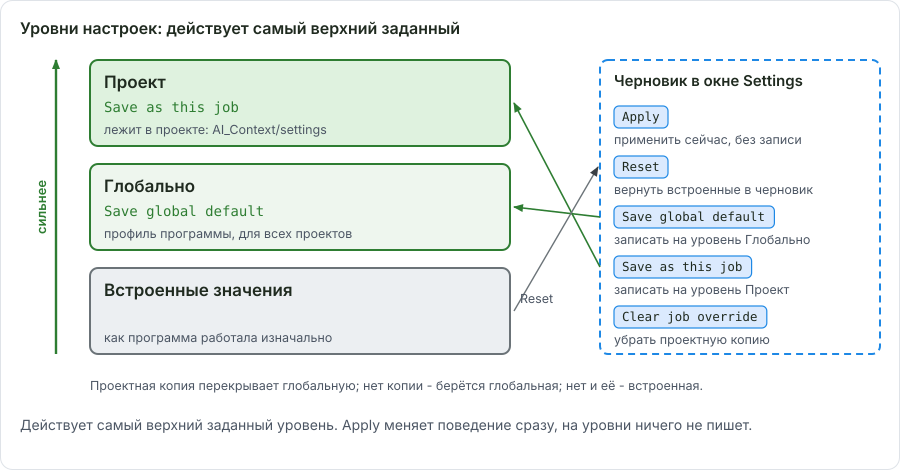
  <figcaption markdown="span">Resolution order: the job setting beats the global one, the global one beats the built-in one. Reset puts the built-in values back into the draft, Save writes the draft where you choose.</figcaption>
</figure>

## The principle: draft, global, per job

Almost every category has five buttons at the bottom:

| Button | What it does |
| --- | --- |
| `Apply` | apply the draft now, until the app restarts; nothing is written to disk |
| `Reset` | put the built-in values back into the draft (how the app behaved before any edits) |
| `Save global default` | write it for all jobs |
| `Save as this job` | write it only for the open job (override) |
| `Clear job override` | remove the job copy, the global one applies again |

Job copies live inside the job in `AI_Context/settings/*.json`, global ones in the app profile (for Lite `%LOCALAPPDATA%\OurPlanCore Lite\local\presets`, for the full version `%LOCALAPPDATA%\OurPlanCore\presets`). The profiles are separate: global settings of the full version are not visible in Lite. The rule: changing it for one job - `Save as this job`; changing it for good - `Save global default`; broke something - `Reset` and Save.

### How to change a rule for one job only { #job-override }

What for: a non-standard job (a sixth floor, different folders) does not break the rules of other jobs.

1. Open the **Settings** tab and the category you need in the list on the left.
2. Edit the fields or table rows in the draft.
3. Press **Apply** and check the behavior in Main View.
4. Press **Save as this job**.

Result: the category status says `Using this job's override`; other jobs follow the global rule. **Clear job override** returns the job to the global rule, **Reset** and **Save global default** change the built-in for everyone.

## Category map

<figure markdown>
  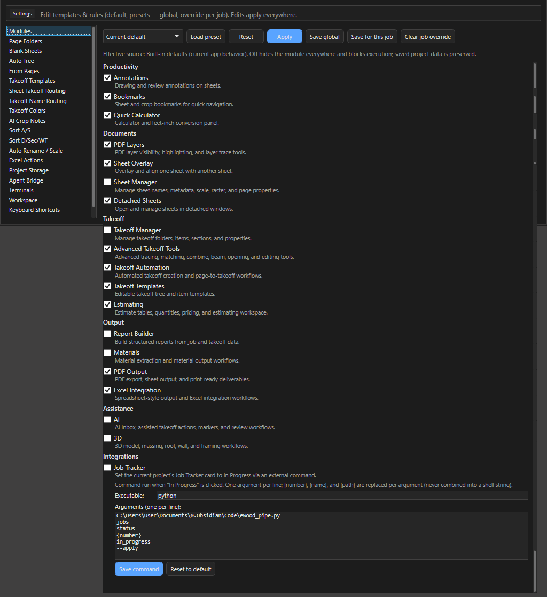
  <figcaption markdown="span">Category list on the left, the panel of the selected category on the right. The first category is Modules. Taken in the full version: Lite has no AI, 3D and Materials modules and no categories for their sections.</figcaption>
</figure>

| Category | What it sets | When to touch it | Details |
| --- | --- | --- | --- |
| Modules | modules (17 in Lite, 20 in the full version) and the Job Tracker command | a tab or button is missing; turn on Sheet Manager | [Modules](#modules), [Extra features](ourplancore-extras.md) |
| Page Folders | standard Pages folders for the Auto / COM / EWP templates | a different set of `00. imported` folders | [Pages](ourplancore-pages.md) |
| Blank Sheets | default size and paper presets | you often need a different blank sheet size | [Blank sheets](ourplancore-sheets-advanced.md#blank) |
| Auto Tree | the Takeoffs tree that `More > Auto Tree` builds | your own folder canon | [Takeoffs tree](ourplancore-takeoffs.md) |
| From Pages | a tree from the sheet structure | rarely | [Takeoffs tree](ourplancore-takeoffs.md) |
| Takeoff Templates | saved tree and takeoff presets | repeating sets of takeoffs | [Other, Templates](ourplancore-extras-other.md#templates) |
| Sheet Takeoff Routing | W/F/S/U dots, levels, folders by tool, auto dot by name | a takeoff lands in the wrong folder | [Routing](ourplancore-routing.md) |
| Takeoff Name Routing | name or tool rules, then the folder | eve, rake, prpt, Openings in their own folders | [Routing](ourplancore-routing.md#name-routing) |
| Sheet Legend | names and order of the automatic blocks by Takeoffs folders | change the order of Walls, Posts, Beams, Details, SQFTs | [Sheet legend](ourplancore-sheets-advanced.md#legend) |
| PDF Editable Export | which measurements are written to the PDF as objects editable in Adobe Acrobat | turn that export off for everyone or for a job | [PDF and delivery](ourplancore-pdf.md#adobe-off) |
| Takeoff Colors | a fixed color for an exact name (`bft`) | you need one more fixed color | [Routing](ourplancore-routing.md#colors) |
| AI Crop Notes | the format of Tag/Size lines in notes from an AI crop; full version only | notes from a schedule read badly | [AI](ourplancore-ai.md#crop-notes) |
| Sort A/S | the `Sort: A - Arch / S - Struct` rules, sheets ending in `-` go to `--------others` | non-standard sheet prefixes | [Pages](ourplancore-pages.md) |
| Sort D/Sec/WT | sheet name suffix, then the folder (`sections`, `details`, `rcp`) | new sheet types | [Pages](ourplancore-pages.md) |
| Auto Rename / Scale | the name and scale engine, suffix rules, the Kept column, AI from the title block (AI in the full version only) | Name gives bad names | [Pages](ourplancore-pages.md), [AI](ourplancore-ai.md#sheet-names) |
| Excel Actions | XL strip buttons and the ALL sequence; shown while the Excel Strip (XL) module is on | your own order of export steps | [Excel](ourplancore-excel.md#settings) |
| Excel Links | how `Link to Excel` writes to an open and a closed workbook, workbook backups, the small-number threshold for `Auto Link` | do not write to the open workbook right away, a different number of backups | [Excel export](ourplancore-excel.md#link-settings) |
| Project Storage | job size, `Preview safe compact`, `Compact snap.json` | the job file got bloated | [Jobs and saving](job-creation-storage.md) |
| Autosave Recovery | retry intervals after an autosave error | you need to change the wait before the next attempt | [Autosave](job-creation-storage.md#autosave) |
| Agent Bridge | access of a local assistant to the open job | working with an agent | [AI](ourplancore-ai.md#bridge) |
| Terminals | Claude or Codex profile, width, effort, context; full version only | the `>_` panel | [AI console](ourplancore-ai-console.md#settings) |
| Workspace | server, device, sync, second computer; full version only | working from two PCs | [Workspace](ourplancore-workspace.md#workspace) |
| Keyboard Shortcuts | the `Open Keyboard Shortcuts...` button | reassign a key | [Keyboard shortcuts](ourplancore-shortcuts.md#remap) |
| Defaults | wheel zoom, background warm-up, raster cache, Sheet Manager DPI buttons, section rows in the tree, Beam line, jump to the view ribbons | general personal setup | [below](#defaults), [on-screen view](#display) |

## Each one in short

### Modules { #modules }

Module checkboxes in the groups Documents, Takeoff, Output, Assistance, Productivity, Integrations: 17 in Lite, 20 in the full version. Presets `Current default`, `All modules on`, `Takeoff Only`, `Minimal`; Apply, Save global, Save for this job, Clear job override, Reset. The Job Tracker module command is here too: `Executable`, `Arguments (one per line)`, `Save`, `Reset`.

| Module | Group | Default | What it turns on |
| --- | --- | --- | --- |
| Annotations | Productivity | on | Annotation ribbon: Highlight, Draw Line, Arrow, Box, Cloud, Area, Hide, Note; crops and masks in the PDF |
| PDF Layers | Documents | on | the PDF Layers sub-tab, layer highlight, Layer Trace |
| Sheet Overlay | Documents | on | the Overlay sub-tab, Batch Overlay |
| Sheet Manager | Documents | off | the Sheet Manager tab; the Name, Scale, Name+Scale buttons on the Main ribbon |
| Takeoff Manager | Takeoff | off | the Takeoff Manager tab |
| Advanced Takeoff Tools | Takeoff | on | Similar, P Line, Combine, Beam, Openings, Break, Ends |
| Takeoff Automation | Takeoff | on | Auto Tree, From Pages, auto-creation |
| Takeoff Templates | Takeoff | on | the Templates tab |
| Estimating | Takeoff | on | the Estimating tab and the Estimating window |
| Report Builder | Output | off | the Report Builder tab |
| Materials | Output | off | the Materials tab; full version only |
| AI | Assistance | off | AI Inbox, AI Manager, AI crop, markers, AI from the title block; full version only |
| 3D | Assistance | off | the 3D tab and the 3D sub-tab in Takeoffs; full version only |
| Bookmarks | Productivity | on | the Bkm sub-tab, bookmarks and bookmark crops |
| Quick Calculator | Productivity | on | feet and inches calculator |
| PDF Output | Output | on | the PDF Output ribbon, Preview, export |
| Detached Sheets | Documents | on | detached sheet windows, Tile M2 |
| Excel Integration | Output | on | `Excel`, `Value`, `Link to Excel`, `Auto Link`; the XL strip needs it too |
| Excel Strip (XL) | Output | on in the full version, off in Lite | the XL strip to the right of the sheet, the Excel Actions and Excel Rules sections, in Lite also the `XLS` button on the right command strip; needs Excel Integration |
| Job Tracker | Integrations | off | the In Progress button |

A disabled module hides its buttons and tab; a key for its command does not fire. The job copy of modules beats the global one. Lite has no AI, 3D and Materials modules at all, and neither a preset nor a job can turn them on ([Lite vs full version](ourplancore-lite.md)). What the modules that are off by default do and when to turn them on: [Extra features](ourplancore-extras.md).

### Page Folders, Auto Tree, From Pages, Takeoff Templates

<figure markdown>
  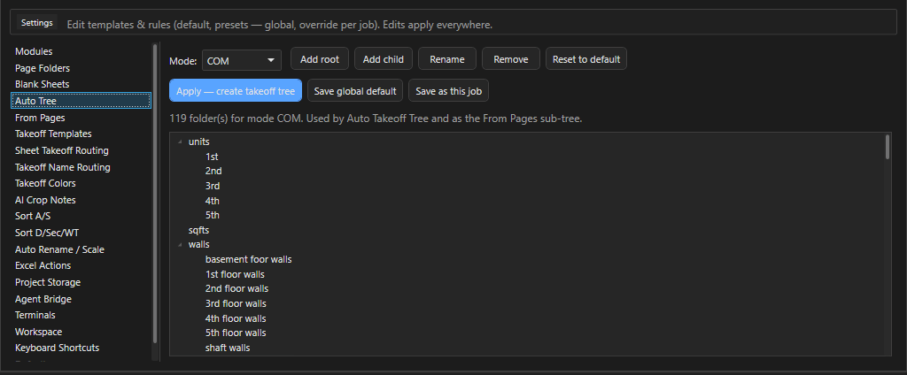
  <figcaption markdown="span">Auto Tree: the Mode switch and the folder tree with takeoffs for `More > Auto Tree`. Page Folders, From Pages and Takeoff Templates work the same way.</figcaption>
</figure>

Four template editors with a `Mode` switch (Auto / COM / EWP). Page Folders - the folders `Auto Folders` creates; Auto Tree - folders and takeoffs for `More > Auto Tree` (in the COM template, `units` now has `1st`-`5th` subfolders); From Pages - the top folders of the tree built from sheets; Takeoff Templates - presets that dock as the Templates tab under Takeoffs or Pages. An edit is saved right away, globally or for the job.

### Blank Sheets

<figure markdown>
  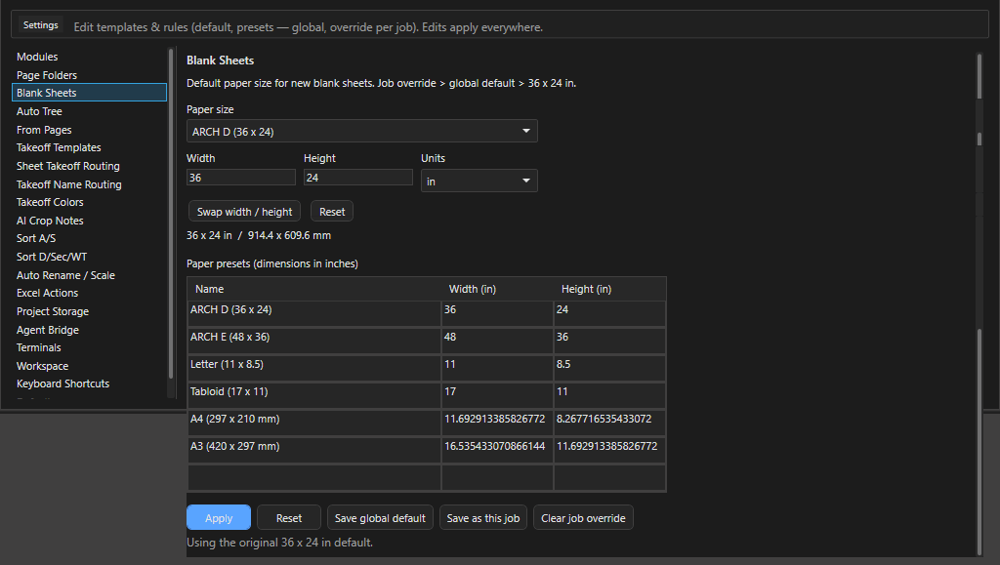
  <figcaption markdown="span">Default size and the paper preset table.</figcaption>
</figure>

Default size (36 x 24 in) and a preset table `Name`, `Width (in)`, `Height (in)`. Order: the job copy, then the global one, then 36 x 24. The presets show in the Blank Sheet dialog and in Crop to Sheet.

### Sheet Takeoff Routing, Takeoff Name Routing, Sheet Legend, Takeoff Colors

The first two categories set the folder of a new takeoff; Takeoff Colors sets its color. Details: [Takeoff routing](ourplancore-routing.md). Sheet Legend sets the automatic blocks by the current Takeoffs folders and their order on the sheet. It has Apply, Reset, a global setting and a job-only option. On a single sheet the automatic blocks can be turned off with a button by the legend, while manual groups stay available: [Sheet legend](ourplancore-sheets-advanced.md#legend).

### AI Crop Notes

Full version only. Formats the AI answer for a schedule table crop into lines like `HP1  (2) 2x8`. Fields `Tag/size separator`, a preview (`paste the recognized text on the left`), a checkbox for the original tables. The raw answer stays in AI Inbox.

### Sort A/S and Sort D/Sec/WT

<figure markdown>
  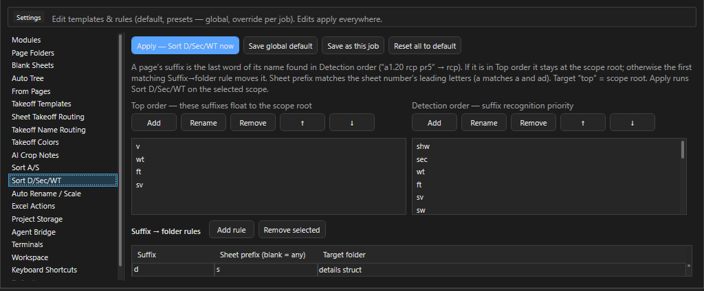
  <figcaption markdown="span">"Sheet name suffix, then folder" rules. The neighboring category Sort A/S holds the prefix rules.</figcaption>
</figure>

Sort A/S: a table `Match (sheet prefix / filename keyword)` and `Target` plus the rule `Page name ends with "-"` into `--------others`. Sort D/Sec/WT: a table `Suffix` and `Target folder`; the suffix is taken from the last known word of the name (`a1.20 rcp pr5` gives `rcp`); synonyms `un`/`unit`, `det`, `sch`/`sc`, `sw`. Only folders that receive something are created.

### Auto Rename / Scale

<figure markdown>
  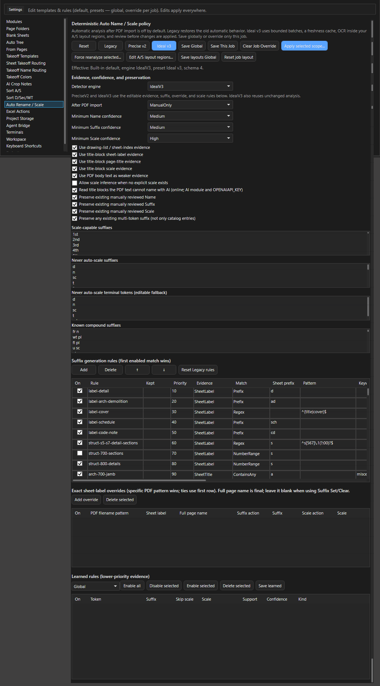
  <figcaption markdown="span">The name engine, the suffix rule table with the Kept column and the checkbox for reading the title block with an AI model.</figcaption>
</figure>

Engine: `Ideal v3` (current), `Precise v2`, `Legacy`. A tag rule table with a `Kept` column: how many times a name with this tag stayed final when jobs were opened (learning, global only). A checkbox for reading the title block with an AI model on sheets without text. New rules can be tested before saving: select sheets in Pages and press `Apply selected scope...`.

??? note "Parts of the category in detail"
    | Part | What is in it |
    | --- | --- |
    | `Deterministic Auto Name / Scale policy` | presets `Ideal v3` (recommended), `Precise v2`, `Legacy`, `Reset`; `Save Global`, `Save This Job`, `Clear Job Override`. `Apply selected scope...` runs Name+Scale with a preview on the sheets selected in Pages, using the draft rules not yet saved; `Force reanalyze selected...` does the same but re-reads the sheets from scratch, without the cache of the previous analysis. `Edit A/S layout regions...` opens the title block regions for OCR (same as `Crop Hints`), `Save layouts Global`, `Reset job layout`. Analysis right after PDF import is off by default |
    | `Evidence, confidence, and preservation` | `Detector engine`; `After PDF import`: `ManualOnly` for Ideal v3 (only by button), `Preview`, `AnalyzeOnly`, `AutoApplyHighConfidence`, `LegacyAutoApply`; thresholds `Minimum Name confidence`, `Minimum Suffix confidence`, `Minimum Scale confidence` (Low, Medium, High; for Ideal v3 Medium, Medium, High); checkboxes for where to take evidence from (sheet index, number and title in the title block, scale in the title block, sheet text as weak evidence), guessing the scale without a caption (off), reading the title block with an AI model; `Preserve existing manually reviewed Name`, `Suffix`, `Scale` keep what you already checked from being overwritten; tag lists with and without scale |
    | `Suffix generation rules (first enabled match wins)` | the tag rule table: the first enabled matching row wins. Columns `On`, `Rule`, `Kept`, `Priority`, `Evidence`, `Match`, `Sheet prefix`, `Pattern`, `Keywords (;)`, `Exclude (;)`, `Exclude from`, `Require flags (;)`, `Min #`, `Max #`, `Output suffix`, `Confidence`, `Skip scale`; buttons `Add`, `Delete`, up, down, `Reset Legacy rules` |
    | Exact overrides and learned rules | the `Exact sheet-label overrides` table (a PDF name pattern and a sheet number give a ready name, tag or scale) and `Learned rules` with scope Global or This job |

### Excel Actions

<figure markdown>
  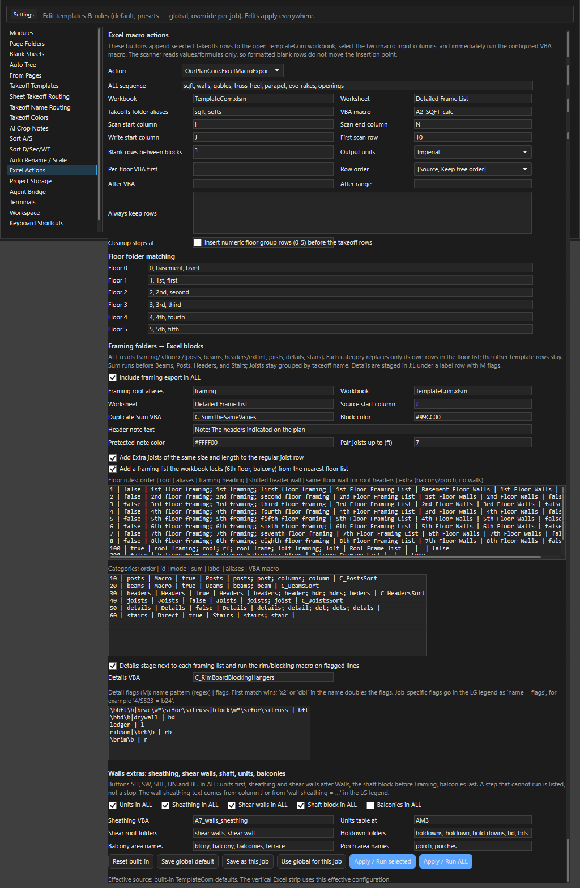
  <figcaption markdown="span">XL strip buttons and the order of steps for ALL.</figcaption>
</figure>

The section is shown while the `Excel Strip (XL)` module is on: on by default in the full version, turned on in Modules in Lite. The Excel Rules section next to it is shown the same way. The list of XL strip buttons (`Action`), the sequence for `ALL`, the checkbox `Insert numeric floor group rows (0-5) before the takeoff rows`, floor folder words (`1, 1st, first`). How to use the strip: [Excel export](ourplancore-excel.md).

### Project Storage

<figure markdown>
  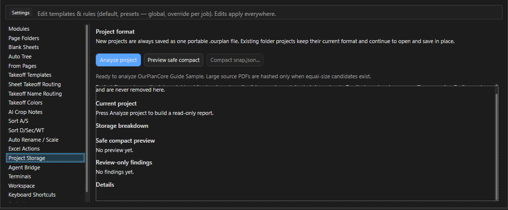
  <figcaption markdown="span">Job size analysis, Preview safe compact and Compact snap.json.</figcaption>
</figure>

An analysis of where the job takes up space; `Preview safe compact` shows what can be shrunk, `Compact snap.json` does it atomically. New jobs are always a single `.ourplan` file. Report sections `Project format`, `Current project`, `Storage breakdown`, `Safe compact preview`, `Review-only findings` and the steps: [Jobs and saving, Project Storage](job-creation-storage.md#storage-check).

### Agent Bridge, Terminals, Workspace

Three categories about AI and a second computer: [AI in the app](ourplancore-ai.md) and [Workspace](ourplancore-workspace.md). Terminals and Workspace are in the full version only (as is Voice Input), Agent Bridge is in Lite too. Workspace settings are stored on each device separately and have no job copy.

### Keyboard Shortcuts

<figure markdown>
  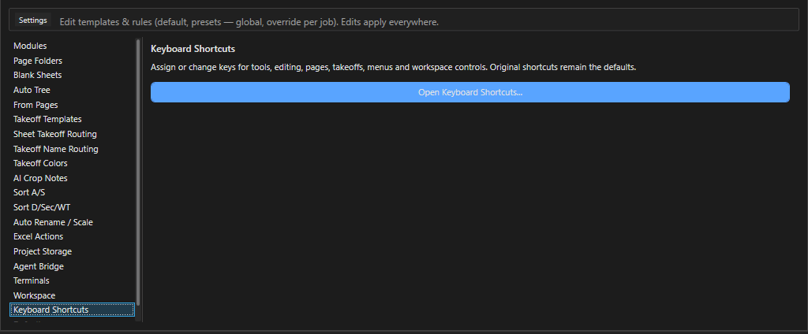
  <figcaption markdown="span">The button opens a separate key editor.</figcaption>
</figure>

A single button `Open Keyboard Shortcuts...`. Assignments can also be global or per job. The full key table and instructions: [Keyboard shortcuts](ourplancore-shortcuts.md).

### Defaults { #defaults }

<figure markdown>
  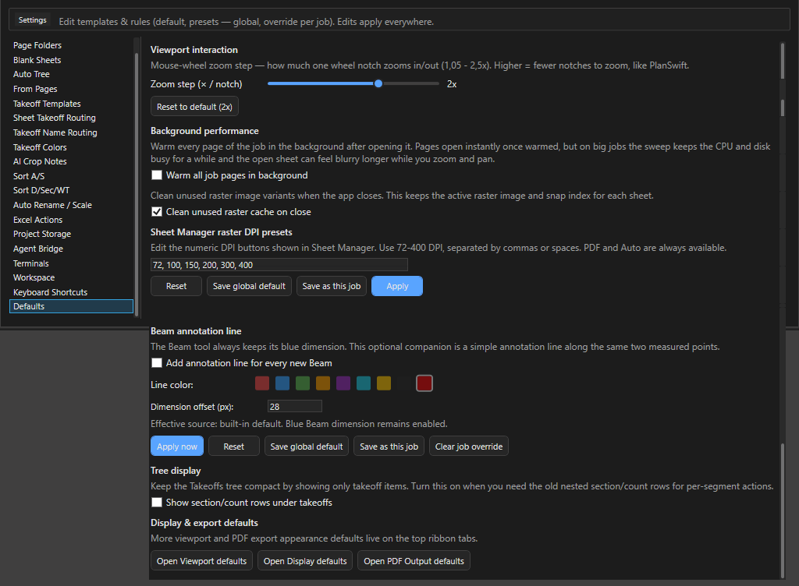
  <figcaption markdown="span">Zoom step, background warm-up, raster cache, DPI buttons for Sheet Manager, Beam line, section rows in the tree.</figcaption>
</figure>

| Group | Setting | Default |
| --- | --- | --- |
| Viewport interaction | `Zoom step (x / notch)` - wheel zoom step, button `Reset to default` | 2.0 |
| Background performance | `Warm all job pages in background` | off |
| Background performance | `Clean unused raster cache on close` | on |
| `Sheet Manager raster DPI presets` | numbers for the DPI buttons in Sheet Manager, comma-separated, 72-400, no more than 12; `PDF` and `Auto` are always there. Buttons `Reset`, `Save global default`, `Save as this job`, `Apply` | 72, 100, 150, 200, 300, 400 |
| Beam | `Add annotation line for every new Beam`, `Line color`, `Dimension offset (px)` 0-200 | line off |
| Tree display | `Show section/count rows under takeoffs`: measurement rows under takeoffs in Takeoffs, needed for actions on a single segment | off |
| `Display & export defaults` | the `Open Viewport defaults`, `Open Display defaults`, `Open PDF Output defaults` buttons open the ribbon of the same name | - |

The other view and export settings live on the Viewport, Display and PDF Output ribbons: they are not a Settings category, but they are saved too ([on-screen view](#display)).

### On-screen view: the Viewport and Display ribbons { #display }

<figure markdown>
  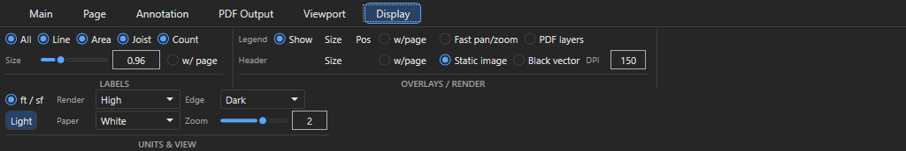
  <figcaption markdown="span">The `Display` ribbon: value labels, legend and header, sheet rendering, units, background around and under the sheet, zoom step.</figcaption>
</figure>

These fields change only the screen, for all jobs at once; the PDF look is set by the PDF Output ribbon ([PDF export](ourplancore-pdf.md)). A slider is saved when you release it; in the box next to it, a number is entered with `Enter`.

| Ribbon, group | Field (tooltip) | What it does | Default |
| --- | --- | --- | --- |
| Viewport, LINES & AREA | `Line` (`Line measurement thickness`) | thickness of Line measurements, 0.25-4 | 3 |
| Viewport, LINES & AREA | `Point` | size of Count points, 0.25-4 | 2 |
| Viewport, LINES & AREA | `Edge` (`Area boundary thickness`) | thickness of the Area outline, 0.25-4 | 0.25 |
| Viewport, LINES & AREA | `Fill` (`Area fill opacity`) | Area fill, 0-100 % | 28 |
| Display, LABELS | `All`, `Line`, `Area`, `Joist`, `Count` | which value labels show on measurements | - |
| Display, LABELS | `Size` (`Value label size`) | value label size, 0.25-3 | about 1 |
| Display, LABELS | `w/ page` | off: labels keep their screen size when zooming; on: they grow and shrink with the sheet | off |
| Display, Legend and Header | `Size` | size of the sheet legend and header: `Tiny`, `XS`, `Small`, `Normal`, `Large`, `XL`, `XXL` or `Custom...` (your own number 0.25-3) | `Normal` |
| Display, UNITS & VIEW | `ft / sf` | feet, square feet, pieces; off - meters | on |
| Display, UNITS & VIEW | `Render` (`Viewport PDF render RAM/quality profile`) | `Balanced` saves memory, `Max` is sharper at high zoom and uses more memory | `High` |
| Display, UNITS & VIEW | `Edge` (`Choose the background around the sheet`) | window background around the sheet: `White`, `Gray`, `Dark` | `Dark` |
| Display, UNITS & VIEW | `Paper` (`Choose a softer page background tint`) | sheet background: `White`, `Soft gray`, `Medium gray`, `Dark gray`, `Warm`, `Soft green`, `Black`; the palette command `Page Background` opens this list | `White` |
| Display, UNITS & VIEW | `Zoom` (`Mouse-wheel zoom step per notch`) | zoom step per wheel notch, 1.05-2.5; same as `Zoom step` in Defaults | 2 |

The OVERLAYS / RENDER group (`Fast pan/zoom`, `PDF layers`, `Static image`, `Black vector`, `DPI`) controls sheet speed and sharpness: [Troubleshooting, slow](ourplancore-troubleshooting.md#speed). The `LIVE LFT / PITCH`, `RULER / EXTRA` and `PDF SNAP` groups of the Viewport ribbon are described with the tools ([snapping](ourplancore-snap-trace.md)).

??? note "Protection against a corrupted settings file"
    If the key assignment file cannot be read, the editor offers `Recover settings...`: `Retry reading`, `Restore / import...` or a confirmed `Reset to original keys`. The old bytes are kept, a regular Save does not overwrite the damaged file. For job data the equivalent is `Open / Import > Project Data Recovery...`.

## See also

- [Getting started](ourplancore-start.md)
- [Takeoff routing](ourplancore-routing.md)
- [Keyboard shortcuts](ourplancore-shortcuts.md)
- [Troubleshooting](ourplancore-troubleshooting.md)
