# Settings: все категории

Здесь - что лежит в каждой категории вкладки Settings OurPlanCore 3.0 и когда туда стоит заходить. Нужно, когда правило программы (папка, имя, цвет, размер листа, клавиша) не совпадает с вашей практикой: почти всё, что раньше было зашито в код, теперь правится здесь.

<figure markdown>
  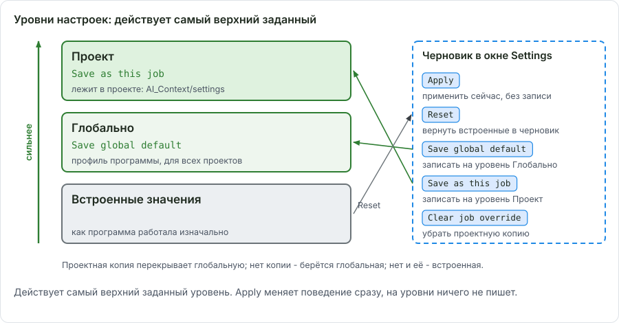
  <figcaption markdown="span">Порядок разрешения: настройка проекта сильнее глобальной, глобальная сильнее встроенной. Reset возвращает встроенную в черновик, Save записывает черновик туда, куда вы выбрали.</figcaption>
</figure>

## Принцип: черновик, глобально, для проекта

Почти в каждой категории внизу пять кнопок:

| Кнопка | Что делает |
| --- | --- |
| `Apply` | применить черновик сейчас, до перезапуска программы; на диск не пишется |
| `Reset` | вернуть в черновик встроенные значения (то, как программа вела себя до правок) |
| `Save global default` | записать для всех проектов |
| `Save as this job` | записать только для открытого проекта (override) |
| `Clear job override` | убрать проектную копию, снова действует глобальная |

Проектные копии лежат внутри проекта в `AI_Context/settings/*.json`, глобальные - в профиле программы (у Lite `%LOCALAPPDATA%\OurPlanCore Lite\local\presets`, у полной версии `%LOCALAPPDATA%\OurPlanCore\presets`). Профили раздельные: глобальные настройки полной версии в Lite не видны. Правило: меняете под один проект - `Save as this job`; меняете навсегда - `Save global default`; сломали - `Reset` и Save.

### Как изменить правило только для одного проекта { #job-override }

Зачем: нестандартный проект (шестой этаж, другие папки) не ломает правила остальных работ.

1. Откройте вкладку **Settings** и нужную категорию в списке слева.
2. Поправьте поля или строки таблицы в черновике.
3. Нажмите **Apply** и проверьте поведение в Main View.
4. Нажмите **Save as this job**.

Результат: статус категории говорит `Using this job's override`; остальные проекты живут по глобальному правилу. **Clear job override** возвращает проект к глобальному, **Reset** и **Save global default** меняют встроенное для всех.

## Карта категорий

<figure markdown>
  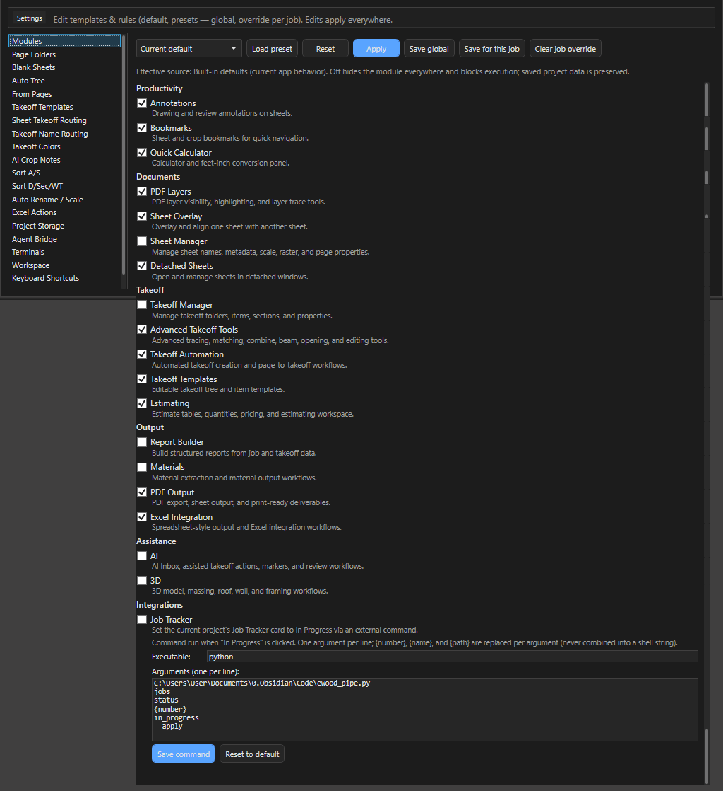
  <figcaption markdown="span">Список категорий слева, панель выбранной категории справа. Первая категория - Modules. Снято в полной версии: в Lite нет модулей AI, 3D и Materials и категорий их разделов.</figcaption>
</figure>

| Категория | Что настраивает | Когда трогать | Подробно |
| --- | --- | --- | --- |
| Modules | модули (17 в Lite, 20 в полной версии) и команда Job Tracker | нет вкладки или кнопки; включить Sheet Manager | [Модули](#modules), [Дополнительные возможности](ourplancore-extras.md) |
| Page Folders | стандартные папки Pages для шаблонов Auto / COM / EWP | другой состав папок `00. imported` | [Pages](ourplancore-pages.md) |
| Blank Sheets | размер по умолчанию и пресеты бумаги | часто нужен другой формат пустого листа | [Пустые листы](ourplancore-sheets-advanced.md#blank) |
| Auto Tree | дерево Takeoffs, которое строит `More > Auto Tree` | свой канон папок | [Дерево Takeoffs](ourplancore-takeoffs.md) |
| From Pages | дерево из структуры листов | редко | [Дерево Takeoffs](ourplancore-takeoffs.md) |
| Takeoff Templates | сохранённые заготовки деревьев и позиций | повторяющиеся наборы позиций | [Прочее, Templates](ourplancore-extras-other.md#templates) |
| Sheet Takeoff Routing | точки W/F/S/U, уровни, папки по инструментам, авто-точка по имени | takeoff ложится не в ту папку | [Маршрутизация](ourplancore-routing.md) |
| Takeoff Name Routing | правила имя или инструмент, потом папка | eve, rake, prpt, Openings в своих папках | [Маршрутизация](ourplancore-routing.md#name-routing) |
| Sheet Legend | названия и порядок автоматических блоков по папкам Takeoffs | изменить порядок Walls, Posts, Beams, Details, SQFTs | [Легенда листа](ourplancore-sheets-advanced.md#legend) |
| PDF Editable Export | какие замеры в PDF лежат объектами для правки в Adobe Acrobat | выключить такой экспорт для всех или для проекта | [PDF и сдача](ourplancore-pdf.md#adobe-off) |
| Takeoff Colors | фиксированный цвет для точного имени (`bft`) | нужен ещё один фиксированный цвет | [Маршрутизация](ourplancore-routing.md#colors) |
| AI Crop Notes | формат строк Tag/Size в заметках из AI crop; только полная версия | заметки из schedule читаются плохо | [ИИ](ourplancore-ai.md#crop-notes) |
| Sort A/S | правила `Sort: A - Arch / S - Struct`, листы на `-` в `--------others` | нестандартные префиксы листов | [Pages](ourplancore-pages.md) |
| Sort D/Sec/WT | суффикс имени листа, потом папка (`sections`, `details`, `rcp`) | новые типы листов | [Pages](ourplancore-pages.md) |
| Auto Rename / Scale | движок имён и масштаба, правила суффиксов, колонка Kept, AI по штампу (AI только в полной версии) | Name даёт плохие имена | [Pages](ourplancore-pages.md), [ИИ](ourplancore-ai.md#sheet-names) |
| Excel Actions | кнопки полосы XL и последовательность ALL; виден, пока включён модуль Excel Strip (XL) | свой порядок шагов экспорта | [Excel](ourplancore-excel.md#settings) |
| Excel Links | как `Link to Excel` пишет в открытую и закрытую книгу, копии книги, порог малых чисел для `Auto Link` | не писать в открытую книгу сразу, другое число копий | [Экспорт в Excel](ourplancore-excel.md#link-settings) |
| Project Storage | размер проекта, `Preview safe compact`, `Compact snap.json` | проект раздулся | [Проекты и сохранение](job-creation-storage.md) |
| Autosave Recovery | интервалы повторов после ошибки автосохранения | нужно изменить ожидание следующей попытки | [Автосохранение](job-creation-storage.md#autosave) |
| Agent Bridge | доступ локального ассистента к открытому проекту | работа с агентом | [ИИ](ourplancore-ai.md#bridge) |
| Terminals | профиль Claude или Codex, ширина, усилие, контекст; только полная версия | панель `>_` | [Консоль ИИ](ourplancore-ai-console.md#settings) |
| Workspace | сервер, устройство, синхронизация, второй компьютер; только полная версия | работа с двух ПК | [Workspace](ourplancore-workspace.md#workspace) |
| Keyboard Shortcuts | кнопка `Open Keyboard Shortcuts...` | переназначить клавишу | [Горячие клавиши](ourplancore-shortcuts.md#remap) |
| Defaults | зум колесом, фоновый прогрев, кеш растра, кнопки DPI Sheet Manager, строки секций в дереве, линия Beam, переход к лентам вида | общая настройка под себя | [ниже](#defaults), [вид на экране](#display) |

## Коротко о каждой

### Modules { #modules }

Галки по модулям в группах Documents, Takeoff, Output, Assistance, Productivity, Integrations: в Lite их 17, в полной версии 20. Пресеты `Current default`, `All modules on`, `Takeoff Only`, `Minimal`; Apply, Save global, Save for this job, Clear job override, Reset. Здесь же команда модуля Job Tracker: `Executable`, `Arguments (one per line)`, `Save`, `Reset`.

| Модуль | Группа | По умолчанию | Что включает |
| --- | --- | --- | --- |
| Annotations | Productivity | вкл | лента Annotation: Highlight, Draw Line, Arrow, Box, Cloud, Area, Hide, Note; кропы и маски в PDF |
| PDF Layers | Documents | вкл | под-таб PDF Layers, подсветка слоёв, Layer Trace |
| Sheet Overlay | Documents | вкл | под-таб Overlay, Batch Overlay |
| Sheet Manager | Documents | выкл | вкладка Sheet Manager; кнопки Name, Scale, Name+Scale на ленте Main |
| Takeoff Manager | Takeoff | выкл | вкладка Takeoff Manager |
| Advanced Takeoff Tools | Takeoff | вкл | Similar, P Line, Combine, Beam, Openings, Break, Ends |
| Takeoff Automation | Takeoff | вкл | Auto Tree, From Pages, автосоздание |
| Takeoff Templates | Takeoff | вкл | вкладка Templates |
| Estimating | Takeoff | вкл | вкладка Estimating и окно Estimating |
| Report Builder | Output | выкл | вкладка Report Builder |
| Materials | Output | выкл | вкладка Materials; только в полной версии |
| AI | Assistance | выкл | AI Inbox, AI Manager, AI crop, маркеры, AI по штампу; только в полной версии |
| 3D | Assistance | выкл | вкладка 3D и под-таб 3D в Takeoffs; только в полной версии |
| Bookmarks | Productivity | вкл | под-таб Bkm, закладки и кропы-закладки |
| Quick Calculator | Productivity | вкл | калькулятор футов и дюймов |
| PDF Output | Output | вкл | лента PDF Output, Preview, экспорт |
| Detached Sheets | Documents | вкл | открепленные окна листов, Tile M2 |
| Excel Integration | Output | вкл | `Excel`, `Value`, `Link to Excel`, `Auto Link`; без него не работает и полоса XL |
| Excel Strip (XL) | Output | вкл в полной версии, выкл в Lite | полоса XL справа от листа, разделы Excel Actions и Excel Rules, в Lite ещё кнопка `XLS` на правой полосе команд; нужен Excel Integration |
| Job Tracker | Integrations | выкл | кнопка In Progress |

Выключенный модуль прячет кнопки и вкладку; клавиша на его команду не срабатывает. Проектная копия модулей сильнее глобальной. Модулей AI, 3D и Materials в Lite нет совсем, их не включит ни пресет, ни проект ([Lite и полная версия](ourplancore-lite.md)). Что делают выключенные по умолчанию модули и когда их включать: [Дополнительные возможности](ourplancore-extras.md).

### Page Folders, Auto Tree, From Pages, Takeoff Templates

<figure markdown>
  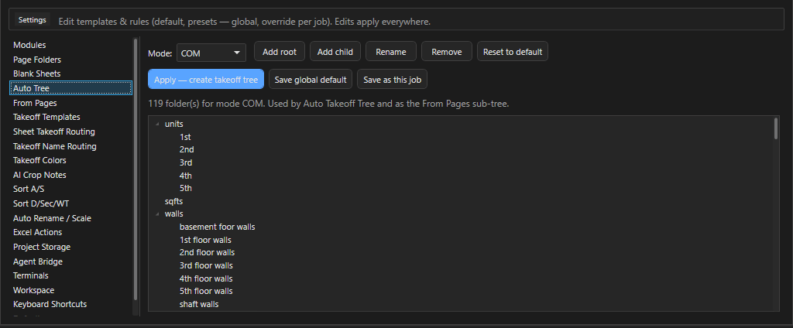
  <figcaption markdown="span">Auto Tree: переключатель Mode и дерево папок с позициями для `More > Auto Tree`. Page Folders, From Pages и Takeoff Templates устроены так же.</figcaption>
</figure>

Четыре редактора шаблонов с переключателем `Mode` (Auto / COM / EWP). Page Folders - папки, которые создаёт `Auto Folders`; Auto Tree - папки и позиции для `More > Auto Tree` (в COM-шаблоне `units` теперь с подпапками `1st`-`5th`); From Pages - верхние папки дерева из листов; Takeoff Templates - заготовки, которые стыкуются вкладкой Templates под Takeoffs или Pages. Правка сохраняется сразу, глобально или для проекта.

### Blank Sheets

<figure markdown>
  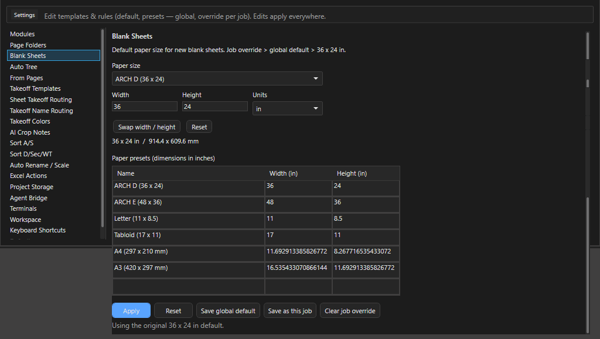
  <figcaption markdown="span">Размер по умолчанию и таблица пресетов бумаги.</figcaption>
</figure>

Размер по умолчанию (36 x 24 in) и таблица пресетов `Name`, `Width (in)`, `Height (in)`. Порядок: проектная копия, потом глобальная, потом 36 x 24. Пресеты видны в диалоге Blank Sheet и в Crop to Sheet.

### Sheet Takeoff Routing, Takeoff Name Routing, Sheet Legend, Takeoff Colors

Первые две категории задают папку новой позиции; Takeoff Colors - её цвет. Подробно: [Маршрутизация takeoff](ourplancore-routing.md). Sheet Legend задаёт автоматические блоки по текущим папкам Takeoffs и их порядок на листе. Есть Apply, Reset, глобальная настройка и вариант только для проекта. На отдельном листе автоматические блоки можно выключить кнопкой у легенды, сохранив возможность ручных групп: [Легенда листа](ourplancore-sheets-advanced.md#legend).

### AI Crop Notes

Только в полной версии. Форматирует ответ AI на кроп таблицы schedule в строки `HP1  (2) 2x8`. Поля `Tag/size separator`, предпросмотр (`paste the recognized text on the left`), галка оригинальных таблиц. Исходный ответ остаётся в AI Inbox.

### Sort A/S и Sort D/Sec/WT

<figure markdown>
  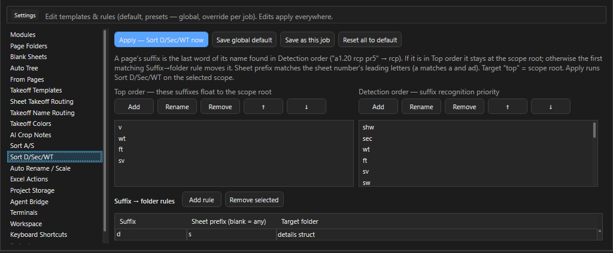
  <figcaption markdown="span">Правила "суффикс имени листа, потом папка". Соседняя категория Sort A/S держит правила префиксов.</figcaption>
</figure>

Sort A/S: таблица `Match (sheet prefix / filename keyword)` и `Target` плюс правило `Page name ends with "-"` в `--------others`. Sort D/Sec/WT: таблица `Suffix` и `Target folder`; суффикс берётся из последнего известного слова имени (`a1.20 rcp pr5` даёт `rcp`); синонимы `un`/`unit`, `det`, `sch`/`sc`, `sw`. Создаются только папки, в которые что-то попадает.

### Auto Rename / Scale

<figure markdown>
  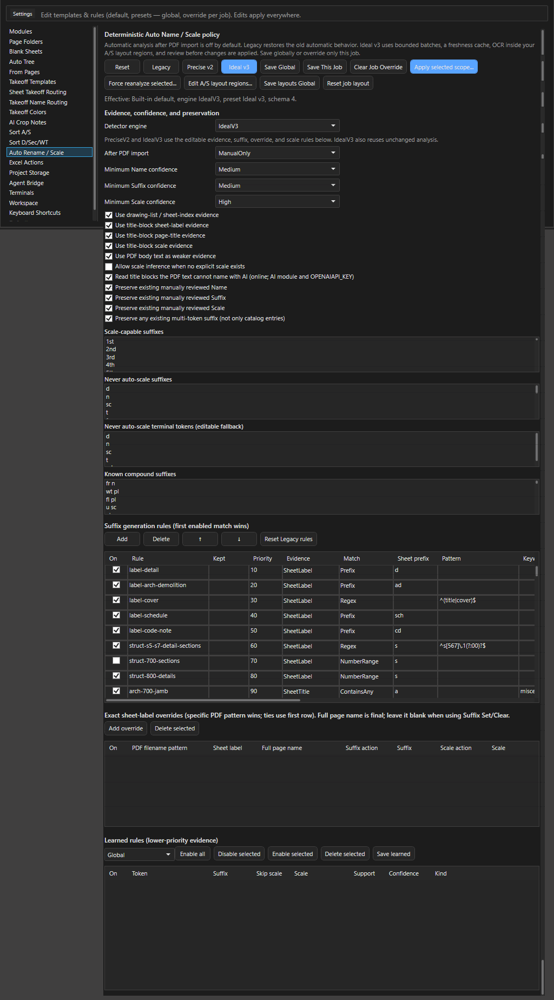
  <figcaption markdown="span">Движок имён, таблица правил суффиксов с колонкой Kept и галка чтения штампа моделью AI.</figcaption>
</figure>

Движок: `Ideal v3` (текущий), `Precise v2`, `Legacy`. Таблица правил тегов с колонкой `Kept`: сколько раз имя с этим тегом оставалось финальным при открытии проектов (обучение, только глобально). Галка чтения штампа моделью AI для листов без текста. Новые правила можно проверить до сохранения: выделите листы в Pages и нажмите `Apply selected scope...`.

??? note "Части категории подробно"
    | Часть | Что в ней |
    | --- | --- |
    | `Deterministic Auto Name / Scale policy` | пресеты `Ideal v3` (рекомендуемый), `Precise v2`, `Legacy`, `Reset`; `Save Global`, `Save This Job`, `Clear Job Override`. `Apply selected scope...` запускает Name+Scale с предпросмотром на выделенных в Pages листах по правилам из черновика, ещё не сохранённым; `Force reanalyze selected...` то же, но перечитывает листы заново, без кеша прошлого анализа. `Edit A/S layout regions...` открывает области штампа для OCR (то же, что `Crop Hints`), `Save layouts Global`, `Reset job layout`. Анализ сразу после импорта PDF по умолчанию выключен |
    | `Evidence, confidence, and preservation` | `Detector engine`; `After PDF import`: `ManualOnly` у Ideal v3 (только по кнопке), `Preview`, `AnalyzeOnly`, `AutoApplyHighConfidence`, `LegacyAutoApply`; пороги `Minimum Name confidence`, `Minimum Suffix confidence`, `Minimum Scale confidence` (Low, Medium, High; у Ideal v3 Medium, Medium, High); галки, откуда брать доказательства (индекс листов, номер и название в штампе, масштаб в штампе, текст листа как слабое доказательство), угадывание масштаба без подписи (выключено), чтение штампа моделью AI; `Preserve existing manually reviewed Name`, `Suffix`, `Scale` не дают перезаписать то, что вы уже проверили; списки тегов с масштабом и без него |
    | `Suffix generation rules (first enabled match wins)` | таблица правил тега: побеждает первая включённая подходящая строка. Колонки `On`, `Rule`, `Kept`, `Priority`, `Evidence`, `Match`, `Sheet prefix`, `Pattern`, `Keywords (;)`, `Exclude (;)`, `Exclude from`, `Require flags (;)`, `Min #`, `Max #`, `Output suffix`, `Confidence`, `Skip scale`; кнопки `Add`, `Delete`, вверх, вниз, `Reset Legacy rules` |
    | Точные подмены и выученные правила | таблица `Exact sheet-label overrides` (шаблон имени PDF и номер листа дают готовое имя, тег или масштаб) и `Learned rules` с областью Global или This job |

### Excel Actions

<figure markdown>
  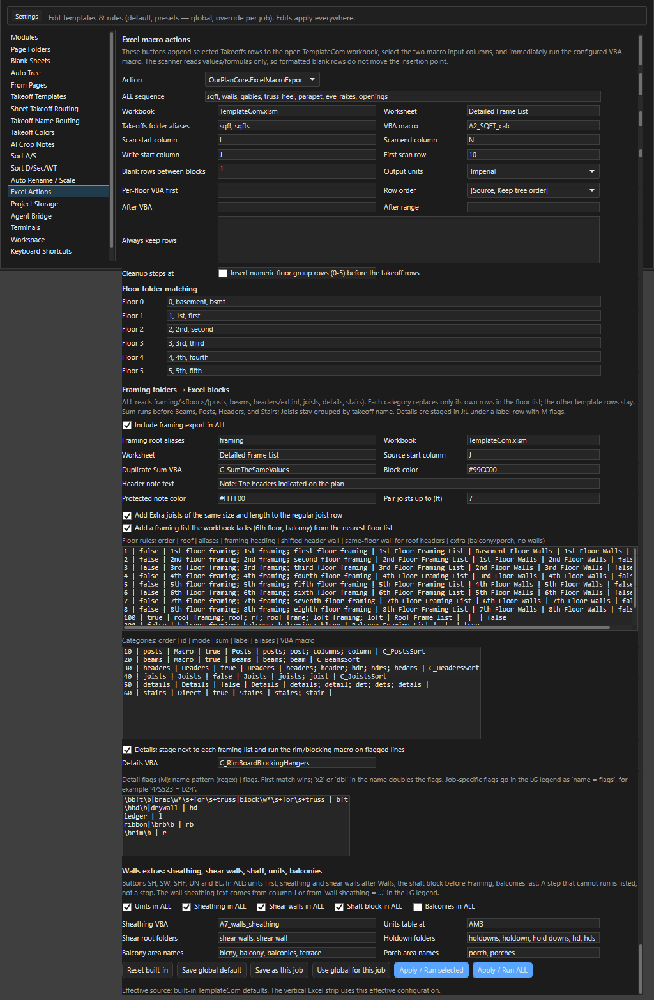
  <figcaption markdown="span">Кнопки полосы XL и порядок шагов для ALL.</figcaption>
</figure>

Раздел виден, пока включён модуль `Excel Strip (XL)`: в полной версии он включён по умолчанию, в Lite его включают в Modules. Так же показывается соседний раздел Excel Rules. Список кнопок полосы XL (`Action`), последовательность для `ALL`, галка `Insert numeric floor group rows (0-5) before the takeoff rows`, слова папок этажей (`1, 1st, first`). Как пользоваться полосой - [Экспорт в Excel](ourplancore-excel.md).

### Project Storage

<figure markdown>
  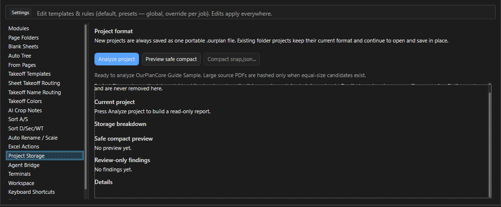
  <figcaption markdown="span">Анализ размера проекта, Preview safe compact и Compact snap.json.</figcaption>
</figure>

Анализ, где проект занимает место; `Preview safe compact` показывает, что можно ужать, `Compact snap.json` делает это атомарно. Новые проекты всегда один файл `.ourplan`. Разделы отчёта `Project format`, `Current project`, `Storage breakdown`, `Safe compact preview`, `Review-only findings` и шаги: [Проекты и сохранение, Project Storage](job-creation-storage.md#storage-check).

### Agent Bridge, Terminals, Workspace

Три категории про ИИ и второй компьютер: [ИИ в программе](ourplancore-ai.md) и [Workspace](ourplancore-workspace.md). Terminals и Workspace есть только в полной версии (как и Voice Input), Agent Bridge есть и в Lite. У Workspace настройки хранятся на каждом устройстве отдельно и не имеют проектной копии.

### Keyboard Shortcuts

<figure markdown>
  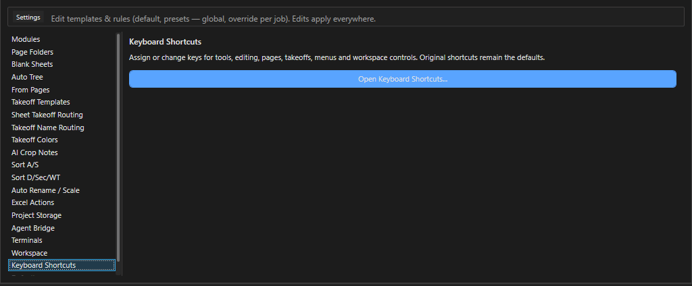
  <figcaption markdown="span">Кнопка открывает отдельный редактор клавиш.</figcaption>
</figure>

Одна кнопка `Open Keyboard Shortcuts...`. Назначения тоже бывают глобальными и проектными. Полная таблица клавиш и инструкция - [Горячие клавиши](ourplancore-shortcuts.md).

### Defaults { #defaults }

<figure markdown>
  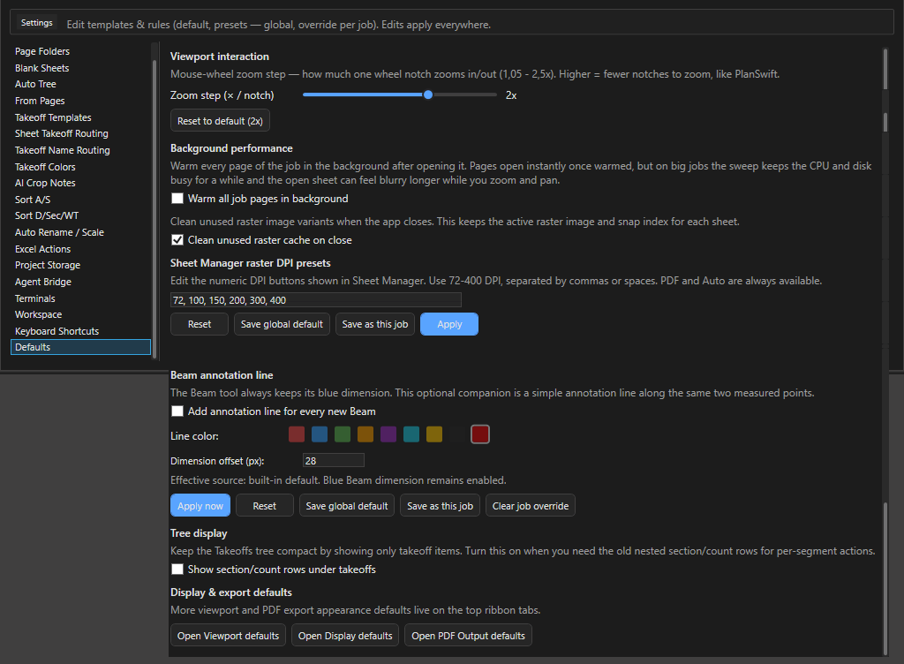
  <figcaption markdown="span">Шаг зума, фоновый прогрев, кеш растра, кнопки DPI для Sheet Manager, линия Beam, строки секций в дереве.</figcaption>
</figure>

| Группа | Настройка | По умолчанию |
| --- | --- | --- |
| Viewport interaction | `Zoom step (x / notch)` - шаг зума колесом, кнопка `Reset to default` | 2.0 |
| Background performance | `Warm all job pages in background` | выключено |
| Background performance | `Clean unused raster cache on close` | включено |
| `Sheet Manager raster DPI presets` | числа кнопок DPI в Sheet Manager через запятую, 72-400, не больше 12; `PDF` и `Auto` есть всегда. Кнопки `Reset`, `Save global default`, `Save as this job`, `Apply` | 72, 100, 150, 200, 300, 400 |
| Beam | `Add annotation line for every new Beam`, `Line color`, `Dimension offset (px)` 0-200 | линия выключена |
| Tree display | `Show section/count rows under takeoffs`: строки замеров под позициями в Takeoffs, нужны для действий над отдельным сегментом | выключено |
| `Display & export defaults` | кнопки `Open Viewport defaults`, `Open Display defaults`, `Open PDF Output defaults` открывают одноимённую ленту | - |

Остальные настройки вида и экспорта живут на лентах Viewport, Display и PDF Output: они не категория Settings, но тоже сохраняются ([вид на экране](#display)).

### Вид на экране: ленты Viewport и Display { #display }

<figure markdown>
  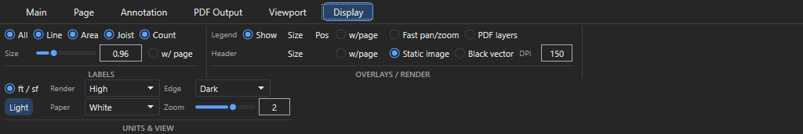
  <figcaption markdown="span">Лента `Display`: подписи значений, легенда и шапка, рендер листа, единицы, фон вокруг листа и под ним, шаг зума.</figcaption>
</figure>

Эти поля меняют только экран, для всех проектов сразу; вид PDF задаёт лента PDF Output ([экспорт PDF](ourplancore-pdf.md)). Ползунок сохраняется, когда его отпустили; в поле рядом число вписывается с `Enter`.

| Лента, группа | Поле (подсказка) | Что делает | По умолчанию |
| --- | --- | --- | --- |
| Viewport, LINES & AREA | `Line` (`Line measurement thickness`) | толщина Line-замеров, 0.25-4 | 3 |
| Viewport, LINES & AREA | `Point` | размер точек Count, 0.25-4 | 2 |
| Viewport, LINES & AREA | `Edge` (`Area boundary thickness`) | толщина контура Area, 0.25-4 | 0.25 |
| Viewport, LINES & AREA | `Fill` (`Area fill opacity`) | заливка Area, 0-100 % | 28 |
| Display, LABELS | `All`, `Line`, `Area`, `Joist`, `Count` | какие подписи значений видны на замерах | - |
| Display, LABELS | `Size` (`Value label size`) | размер подписей значений, 0.25-3 | около 1 |
| Display, LABELS | `w/ page` | выключено: подписи держат размер на экране при зуме; включено: растут и уменьшаются вместе с листом | выключено |
| Display, Legend и Header | `Size` | размер легенды и шапки листа: `Tiny`, `XS`, `Small`, `Normal`, `Large`, `XL`, `XXL` или `Custom...` (своё число 0.25-3) | `Normal` |
| Display, UNITS & VIEW | `ft / sf` | футы, кв. футы, штуки; выключено - метры | включено |
| Display, UNITS & VIEW | `Render` (`Viewport PDF render RAM/quality profile`) | `Balanced` бережёт память, `Max` чётче при большом зуме и ест больше памяти | `High` |
| Display, UNITS & VIEW | `Edge` (`Choose the background around the sheet`) | фон окна вокруг листа: `White`, `Gray`, `Dark` | `Dark` |
| Display, UNITS & VIEW | `Paper` (`Choose a softer page background tint`) | подложка листа: `White`, `Soft gray`, `Medium gray`, `Dark gray`, `Warm`, `Soft green`, `Black`; команда палитры `Page Background` открывает этот список | `White` |
| Display, UNITS & VIEW | `Zoom` (`Mouse-wheel zoom step per notch`) | шаг зума на щелчок колеса, 1.05-2.5; то же, что `Zoom step` в Defaults | 2 |

Группа OVERLAYS / RENDER (`Fast pan/zoom`, `PDF layers`, `Static image`, `Black vector`, `DPI`) отвечает за скорость и чёткость листа: [Решение проблем, медленно](ourplancore-troubleshooting.md#speed). Группы `LIVE LFT / PITCH`, `RULER / EXTRA` и `PDF SNAP` ленты Viewport описаны вместе с инструментами ([привязки](ourplancore-snap-trace.md)).

??? note "Защита от испорченного файла настроек"
    Если файл назначений клавиш не читается, редактор предлагает `Recover settings...`: `Retry reading`, `Restore / import...` или подтверждённый `Reset to original keys`. Старые байты сохраняются, обычный Save повреждённый файл не перезаписывает. Для данных проекта аналог - `Open / Import > Project Data Recovery...`.

## См. также

- [Начало работы](ourplancore-start.md)
- [Маршрутизация takeoff](ourplancore-routing.md)
- [Горячие клавиши](ourplancore-shortcuts.md)
- [Решение проблем](ourplancore-troubleshooting.md)
