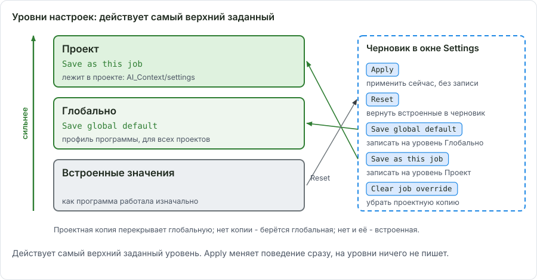
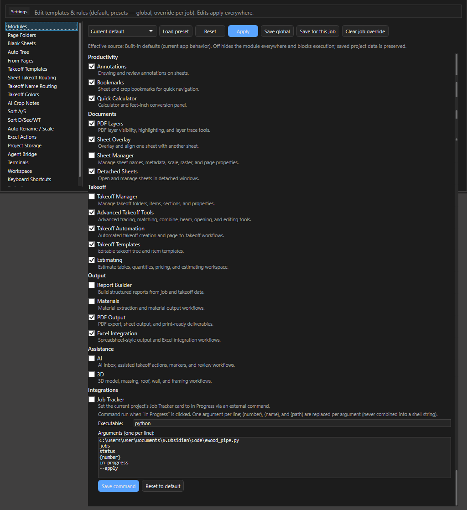
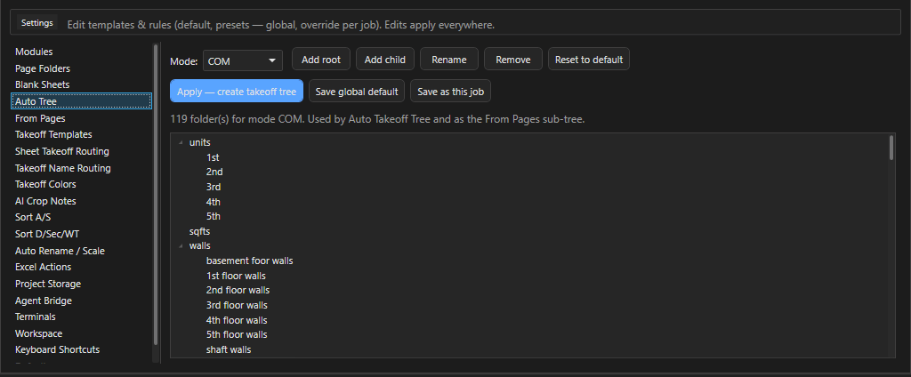
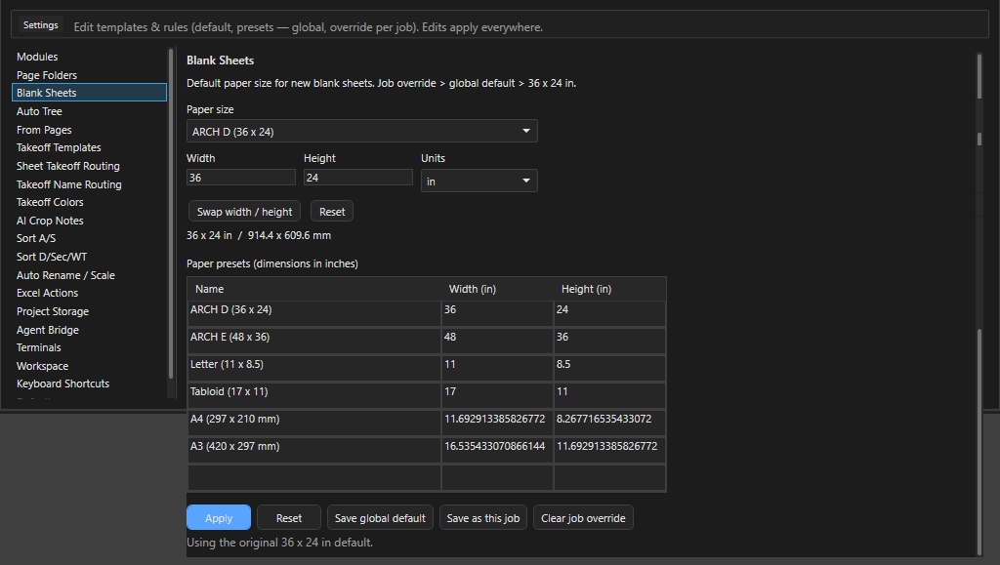
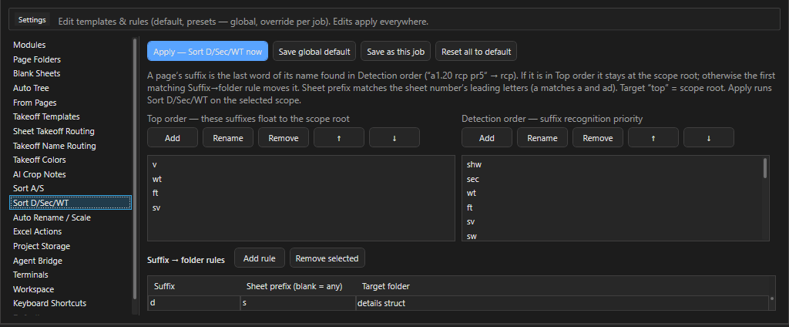
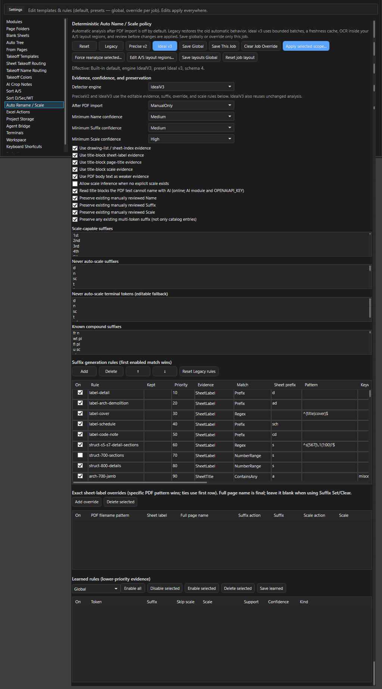
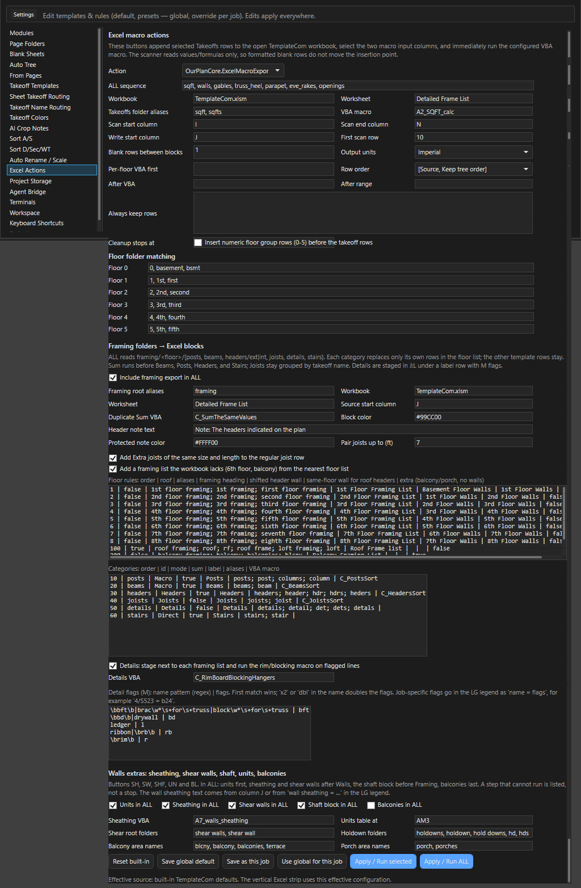
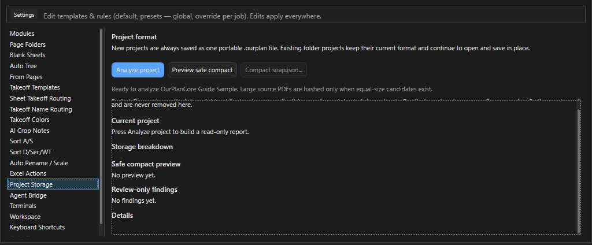
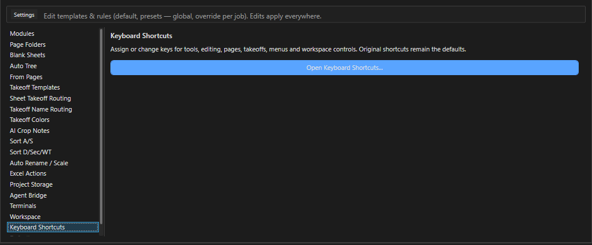
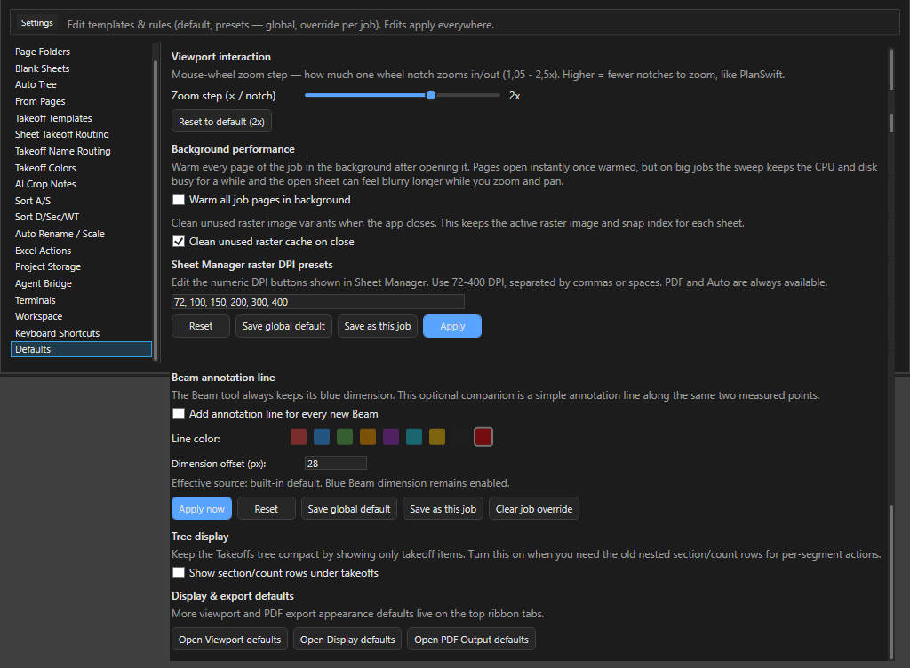

# Settings: 20 категорий

Здесь - что лежит в каждой категории вкладки Settings OurPlanCore 3.0 и когда туда стоит заходить. Нужно, когда правило программы (папка, имя, цвет, размер листа, клавиша) не совпадает с вашей практикой: почти всё, что раньше было зашито в код, теперь правится здесь.

<figure markdown>
  
  <figcaption markdown="span">Порядок разрешения: настройка проекта сильнее глобальной, глобальная сильнее встроенной. Reset возвращает встроенную в черновик, Save записывает черновик туда, куда вы выбрали.</figcaption>
</figure>

## Принцип: черновик, глобально, для проекта

Почти в каждой категории внизу пять кнопок:

| Кнопка | Что делает |
| --- | --- |
| `Apply` | применить черновик сейчас, до перезапуска программы; на диск не пишется |
| `Reset` | вернуть в черновик встроенные значения (то, как программа вела себя до правок) |
| `Save global default` | записать для всех проектов |
| `Save as this job` | записать только для открытого проекта (override) |
| `Clear job override` | убрать проектную копию, снова действует глобальная |

Проектные копии лежат внутри проекта в `AI_Context/settings/*.json`, глобальные - в профиле программы (`%LOCALAPPDATA%\OurPlanCore\presets`). Правило: меняете под один проект - `Save as this job`; меняете навсегда - `Save global default`; сломали - `Reset` и Save.

## Карта категорий

<figure markdown>
  
  <figcaption markdown="span">Список категорий слева, панель выбранной категории справа. Первая категория - Modules.</figcaption>
</figure>

| Категория | Что настраивает | Когда трогать | Подробно |
| --- | --- | --- | --- |
| Modules | 19 модулей и команда Job Tracker | нет вкладки или кнопки; включить Sheet Manager, 3D, AI | [Модули](ourplancore-workspace.md#modules) |
| Page Folders | стандартные папки Pages для шаблонов Auto / COM / EWP | другой состав папок `00. imported` | [Pages](ourplancore-pages.md) |
| Blank Sheets | размер по умолчанию и пресеты бумаги | часто нужен другой формат пустого листа | [Пустые листы](ourplancore-sheets-advanced.md#blank) |
| Auto Tree | дерево Takeoffs, которое строит `More > Auto Tree` | свой канон папок | [Дерево Takeoffs](ourplancore-takeoffs.md) |
| From Pages | дерево из структуры листов | редко | [Дерево Takeoffs](ourplancore-takeoffs.md) |
| Takeoff Templates | сохранённые заготовки деревьев и позиций | повторяющиеся наборы позиций | [Дерево Takeoffs](ourplancore-takeoffs.md) |
| Sheet Takeoff Routing | точки W/F/S/U, уровни, папки по инструментам, авто-точка по имени | takeoff ложится не в ту папку | [Маршрутизация](ourplancore-routing.md) |
| Takeoff Name Routing | правила имя или инструмент, потом папка | eve, rake, prpt, Openings в своих папках | [Маршрутизация](ourplancore-routing.md#name-routing) |
| Takeoff Colors | фиксированный цвет для точного имени (`bft`) | нужен ещё один фиксированный цвет | [Маршрутизация](ourplancore-routing.md#colors) |
| AI Crop Notes | формат строк Tag/Size в заметках из AI crop | заметки из schedule читаются плохо | [ИИ](ourplancore-ai.md#crop-notes) |
| Sort A/S | правила `Sort: A - Arch / S - Struct`, листы на `-` в `--------others` | нестандартные префиксы листов | [Pages](ourplancore-pages.md) |
| Sort D/Sec/WT | суффикс имени листа, потом папка (`sections`, `details`, `rcp`) | новые типы листов | [Pages](ourplancore-pages.md) |
| Auto Rename / Scale | движок имён и масштаба, правила суффиксов, колонка Kept, AI по штампу | Name даёт плохие имена | [Pages](ourplancore-pages.md), [ИИ](ourplancore-ai.md#sheet-names) |
| Excel Actions | кнопки полосы XL и последовательность ALL | свой порядок шагов экспорта | [Excel](ourplancore-excel.md) |
| Project Storage | размер проекта, `Preview safe compact`, `Compact snap.json` | проект раздулся | [Проекты и сохранение](job-creation-storage.md) |
| Agent Bridge | доступ локального ассистента к открытому проекту | работа с агентом | [ИИ](ourplancore-ai.md#bridge) |
| Terminals | профиль Claude или Codex, ширина, усилие, контекст | панель `>_` | [ИИ](ourplancore-ai.md#terminals) |
| Workspace | сервер, устройство, синхронизация, второй компьютер | работа с двух ПК | [Workspace](ourplancore-workspace.md#workspace) |
| Keyboard Shortcuts | кнопка `Open Keyboard Shortcuts...` | переназначить клавишу | [Горячие клавиши](ourplancore-shortcuts.md#remap) |
| Defaults | зум колесом, фоновый прогрев, кеш растра, строки секций в дереве, линия Beam | общая настройка под себя | ниже |

## Коротко о каждой

### Modules

Галки по 19 модулям в группах Documents, Takeoff, Output, Assistance, Productivity, Integrations; пресеты `Current default`, `All modules on`, `Takeoff Only`, `Minimal`. Здесь же команда модуля Job Tracker: `Executable`, `Arguments (one per line)`, `Save`, `Reset`. Выключенный модуль прячет свои кнопки и вкладку; клавиша на спрятанную команду не срабатывает. Список модулей - в [Workspace и модули](ourplancore-workspace.md#modules).

### Page Folders, Auto Tree, From Pages, Takeoff Templates

<figure markdown>
  
  <figcaption markdown="span">Auto Tree: переключатель Mode и дерево папок с позициями для `More > Auto Tree`. Page Folders, From Pages и Takeoff Templates устроены так же.</figcaption>
</figure>

Четыре редактора шаблонов с переключателем `Mode` (Auto / COM / EWP). Page Folders - папки, которые создаёт `Auto Folders`; Auto Tree - папки и позиции для `More > Auto Tree` (в COM-шаблоне `units` теперь с подпапками `1st`-`5th`); From Pages - верхние папки дерева из листов; Takeoff Templates - заготовки, которые стыкуются вкладкой Templates под Takeoffs или Pages. Правка сохраняется сразу, глобально или для проекта.

### Blank Sheets

<figure markdown>
  
  <figcaption markdown="span">Размер по умолчанию и таблица пресетов бумаги.</figcaption>
</figure>

Размер по умолчанию (36 x 24 in) и таблица пресетов `Name`, `Width (in)`, `Height (in)`. Порядок: проектная копия, потом глобальная, потом 36 x 24. Пресеты видны в диалоге Blank Sheet и в Crop to Sheet.

### Sheet Takeoff Routing, Takeoff Name Routing, Takeoff Colors

Три категории одной темы: куда и каким цветом ложится новый takeoff. Полностью разобраны на странице [Маршрутизация takeoff](ourplancore-routing.md).

### AI Crop Notes

Форматирует ответ AI на кроп таблицы schedule в строки `HP1  (2) 2x8`. Поля `Tag/size separator`, предпросмотр (`paste the recognized text on the left`), галка оригинальных таблиц. Исходный ответ остаётся в AI Inbox.

### Sort A/S и Sort D/Sec/WT

<figure markdown>
  
  <figcaption markdown="span">Правила "суффикс имени листа, потом папка". Соседняя категория Sort A/S держит правила префиксов.</figcaption>
</figure>

Sort A/S: таблица `Match (sheet prefix / filename keyword)` и `Target` плюс правило `Page name ends with "-"` в `--------others`. Sort D/Sec/WT: таблица `Suffix` и `Target folder`; суффикс берётся из последнего известного слова имени (`a1.20 rcp pr5` даёт `rcp`); синонимы `un`/`unit`, `det`, `sch`/`sc`, `sw`. Создаются только папки, в которые что-то попадает.

### Auto Rename / Scale

<figure markdown>
  
  <figcaption markdown="span">Движок имён, таблица правил суффиксов с колонкой Kept и галка чтения штампа моделью AI.</figcaption>
</figure>

Движок: `Ideal v3` (текущий), `Precise v2`, `Legacy`. Таблица правил суффиксов с колонками `Priority`, `Evidence`, `Sheet prefix`, `Pattern`, `Keywords`, `Exclude`, `Require flags`, `Output suffix`, `Confidence`, `Skip scale` и колонка `Kept`: сколько раз имя с этим тегом оставалось финальным при открытии проектов (обучение, только глобально). Галка чтения штампа моделью AI для листов без текста. Кнопки Learned rules открывают выученные правила проекта и глобальные.

### Excel Actions

<figure markdown>
  
  <figcaption markdown="span">Кнопки полосы XL и порядок шагов для ALL.</figcaption>
</figure>

Список кнопок полосы XL (`Action`), последовательность для `ALL`, галка `Insert numeric floor group rows (0-5) before the takeoff rows`, слова папок этажей (`1, 1st, first`). Как пользоваться полосой - [Экспорт в Excel](ourplancore-excel.md).

### Project Storage

<figure markdown>
  
  <figcaption markdown="span">Анализ размера проекта, Preview safe compact и Compact snap.json.</figcaption>
</figure>

Анализ, где проект занимает место; `Preview safe compact` показывает, что можно ужать, `Compact snap.json` делает это атомарно. Новые проекты всегда один файл `.ourplan`. Подробности - [Проекты и сохранение](job-creation-storage.md).

### Agent Bridge, Terminals, Workspace

Три категории про ИИ и второй компьютер: [ИИ в программе](ourplancore-ai.md) и [Workspace](ourplancore-workspace.md). У Workspace настройки хранятся на каждом устройстве отдельно и не имеют проектной копии.

### Keyboard Shortcuts

<figure markdown>
  
  <figcaption markdown="span">Кнопка открывает отдельный редактор клавиш.</figcaption>
</figure>

Одна кнопка `Open Keyboard Shortcuts...`. Назначения тоже бывают глобальными и проектными. Полная таблица клавиш и инструкция - [Горячие клавиши](ourplancore-shortcuts.md).

### Defaults

<figure markdown>
  
  <figcaption markdown="span">Шаг зума, фоновый прогрев, кеш растра, строки секций в дереве, линия Beam.</figcaption>
</figure>

| Группа | Настройка | По умолчанию |
| --- | --- | --- |
| Viewport interaction | `Zoom step (x / notch)` - шаг зума колесом | 2.0 |
| Background performance | `Warm all job pages in background` | выключено |
| Background performance | `Clean unused raster cache on close` | включено |
| Tree display | `Show section/count rows under takeoffs` | включено |
| Beam | `Add annotation line for every new Beam`, `Line color`, `Dimension offset (px)` 0-200 | линия выключена |

Остальные настройки вида и экспорта живут на лентах Viewport, Display и PDF Output: они не категория Settings, но тоже сохраняются.

??? note "Защита от испорченного файла настроек"
    Если файл назначений клавиш не читается, редактор предлагает `Recover settings...`: `Retry reading`, `Restore / import...` или подтверждённый `Reset to original keys`. Старые байты сохраняются, обычный Save повреждённый файл не перезаписывает. Для данных проекта аналог - `Open / Import > Project Data Recovery...`.

## См. также

- [Начало работы](ourplancore-start.md)
- [Маршрутизация takeoff](ourplancore-routing.md)
- [Горячие клавиши](ourplancore-shortcuts.md)
- [Решение проблем](ourplancore-troubleshooting.md)
