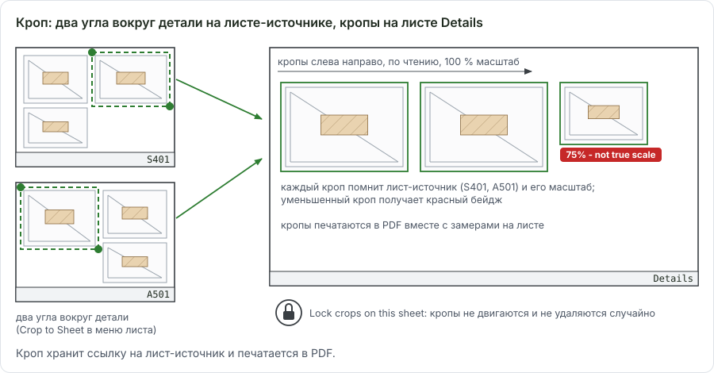
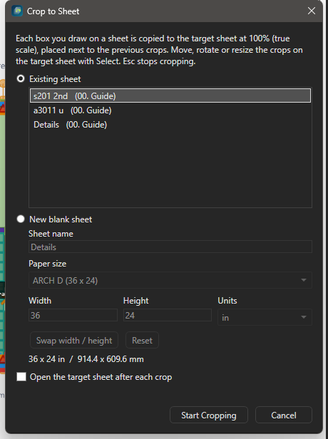
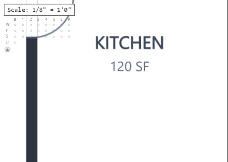
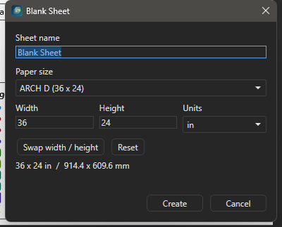
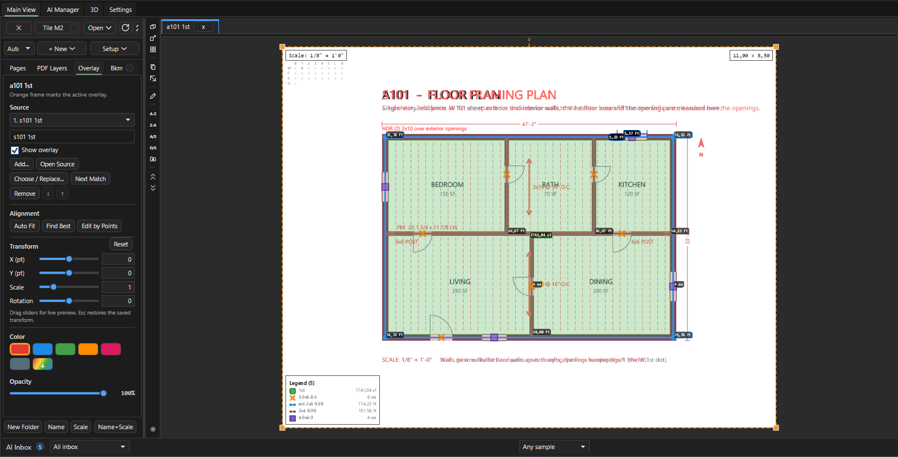
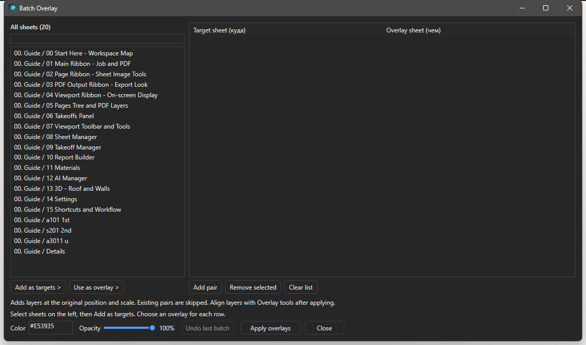
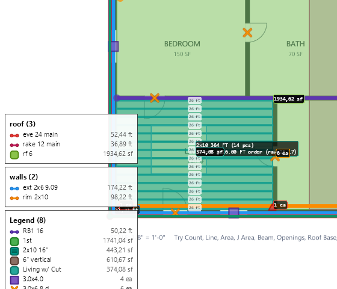
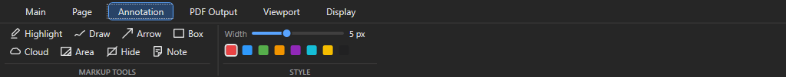
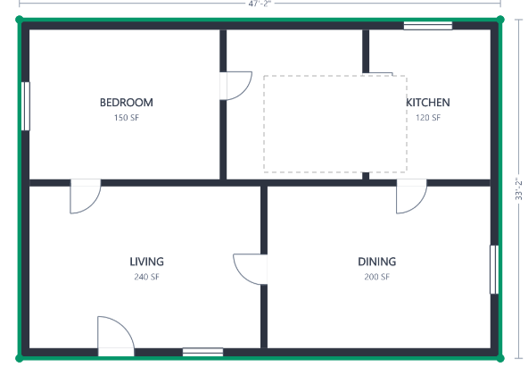

# Sheets: Crop to Sheet, blank sheets, Overlay, legend, Hide

This page covers advanced sheet work in OurPlanCore 3.0: collect details from several sheets onto one, overlay one plan on another, tidy up the legend, add notes with markup and hide clutter before the PDF goes out. You need it when preparing a PDF delivery, when checking Arch plans against Struct plans, and on jobs with dozens of details.

## Crop to Sheet: details from different sheets on one {#crop}

<figure markdown>
  
  <figcaption markdown="span">Source: two corners around a detail. Target: the crop at 100 % scale, placed in reading order. The crop keeps a link to the source sheet and prints in the PDF.</figcaption>
</figure>

<figure markdown>
  
  <figcaption markdown="span">Target dialog: an existing sheet or a new blank one with a name and a size from the presets.</figcaption>
</figure>

### How to collect details onto one sheet { #crop-steps }

<figure markdown>
  <video class="kb-demo" loop muted playsinline preload="none" poster="../../assets/images/ourplancore/demo/d-crop-to-sheet.png"><source src="../../assets/images/ourplancore/demo/d-crop-to-sheet.mp4" type="video/mp4"></video>
  <figcaption markdown="span">Demo: `Page > Crop to Sheet`, target `Details`, two crops from different sheets land side by side on one sheet.</figcaption>
</figure>

Why: all the job's details on one clean sheet at true scale for the client PDF.
You need: the sheets with details open; a blank target sheet can be created in the dialog itself.

1. Open the sheet with details and click **Page > IMAGE > Crop to Sheet**.
2. Pick the target in the dialog: **Existing sheet** (the list shows blank sheets and sheets that already have crops) or **New blank sheet** with a name and a size from the Blank Sheet presets. The **Open the target sheet after each crop** checkbox opens the target after each crop. Click **Start Cropping**.
3. Click two opposite corners around a detail (Snap and PDF snap work). The piece is copied to the target at 100 % scale. The first crop goes to the top left with a margin, the next ones go to the right with a gap; at the right edge a new row starts below. Occupied spots are skipped. Status bar: `Crop to Sheet > <target>: click two opposite corners of each detail. Esc stops.`
4. Switch to other source sheets and keep going: the target stays the same until you start the tool again.
5. Press ++esc++ to drop a half-drawn box, a second ++esc++ exits to Select.

Result: the crops run across the sheet left to right, then below, without overlapping each other. Default edge margin 36 pt, gap 18 pt. If there is no free space for a whole crop, it is not added: the status suggests a larger sheet or a new sheet. Each crop keeps a link to its source sheet. An unscaled target takes the scale of the first source; a crop whose source has a different scale is flagged in the status bar.

### On the target sheet

<figure markdown>
  
  <figcaption markdown="span">The Details sheet with crops, the `75% - not true scale` badge on a reduced crop and the round lock button under the Scale label.</figcaption>
</figure>

| Action | How |
| --- | --- |
| Select, move | Select, click the crop, drag |
| Rotate | orange handle; ++shift++ gives 15° steps; right-click `Rotate Crop 90° Clockwise` / `Rotate Crop 90° Counterclockwise` |
| Size | corner and side handles, proportional only |
| Mirror | right-click `Mirror Crop Horizontal` / `Mirror Crop Vertical` |
| Restore scale | right-click `Reset Crop to 100% (true scale)`; a crop not at 100 % shows a red `75% - not true scale` badge (on screen only) |
| Opacity | right-click `Opacity...`: slider 0-100 with live preview, one Undo step |
| Order | right-click `Bring to Front`, `Send to Back`, `Bring Forward`, `Send Backward` |
| Where it came from | right-click `Open Source Sheet (<name>)` |
| Lock | round button under the Scale label (only on sheets with crops): `Lock crops on this sheet` / `Crops locked - click to unlock`. Locked crops cannot be selected, clicks go to the takeoffs under them |

Undo works on the target sheet (move, rotate, size, Reset, delete). Placing a crop from the source sheet is not undone: delete an extra crop on the target.

??? note "How a crop is stored and printed"
    A crop is an entry in the target sheet's `annotations.json` with a link to the source sheet and a rectangle. Only that rectangle is drawn, with the source's PDF layer visibility: at 3x on screen, at 4x in the PDF. It is always exported when the Annotations module is on, even if Markups are not output. When the source is renamed or moved, the link is rebased; a deleted source gives a red cross and the line `Crop skipped on '<sheet>'` on export. Rotating or mirroring the source sheet does not move the crop. An old EXE (a rollback to a `.bak` older than 2.2.34) reads the crop as line markup and loses its fields on save.

### How to cut the visible part of a sheet into a new sheet: Crop New Page { #crop-new-page }

Why: a separate standalone sheet from a piece of a big sheet (one building, one plan out of several on a sheet), with its own measurements and its own PDF.
You need: the sheet open; the sheet has a scale if there will be measurements on the new sheet.

1. Open the sheet and set the zoom and pan so that only the part you need is on screen.
2. Click **Page > IMAGE > Crop New Page**.

Result: a sheet `<name> Crop` made from the visible area appears in the same Pages folder with the source sheet's scale, and it opens right away; status `Crop New Page: created <name> Crop.` Measurements from the source sheet are not carried over to the new sheet.

The difference from Crop to Sheet: `Crop to Sheet` puts crops with a link to the source onto a target sheet, `Crop New Page` makes a new PDF sheet that you measure on like any other.

## Blank sheets {#blank}

<figure markdown>
  
  <figcaption markdown="span">Blank Sheet: name, width and height, in or mm units, presets, Swap width / height.</figcaption>
</figure>

### How to create a blank sheet { #blank-steps }

<figure markdown>
  <video class="kb-demo" loop muted playsinline preload="none" poster="../../assets/images/ourplancore/demo/d-blank-sheet.png"><source src="../../assets/images/ourplancore/demo/d-blank-sheet.mp4" type="video/mp4"></video>
  <figcaption markdown="span">Demo: `Page > Blank Sheet`, name `Details`, size `Tabloid (17 x 11)`, `Create`.</figcaption>
</figure>

Why: a clean sheet for detail crops or for a diagram.

1. Click **Page > ADD > Blank Sheet** (or **+ New > Blank Sheet** in Pages, right-click a folder **New Blank Sheet**).
2. Type the **Sheet name**, pick a paper preset or type a size, use **Swap width / height** if needed.
3. Click **Create**.

Result: a sheet next to the open one, with the scale from the first crop or set with `S`.

| Field | What it does |
| --- | --- |
| Sheet name | sheet name in Pages |
| Paper size | width and height, in / mm toggle |
| Presets | ARCH D (36 x 24), ARCH E (48 x 36), Letter (11 x 8.5), Tabloid (17 x 11), A4, A3 |
| Swap width / height | portrait instead of landscape |
| Reset | size from `Settings > Blank Sheets` |
| Create | creates the sheet next to the open one |

Default 36 x 24 in. The size and the preset list are edited in `Settings > Blank Sheets` (Apply, Save global default, Save as this job, Clear job override).

**Change Sheet Size...**: right-click a blank sheet in Pages. The sheet gets a new blank PDF, the scale, legend and overlays are kept; takeoffs, markup and crops keep their coordinates from the top left corner; points that fall outside the new size are listed in a warning.

Large blank sheets (for example 11520 x 3600 pt for a whole building) zoom smoothly in 3.0: these are the 2.2.39-2.2.42 fixes.

## Overlay: one sheet over another { #overlay }

<figure markdown>
  
  <figcaption markdown="span">The S plan in red over the A plan of the same floor; on the left the `Overlay` tab with the Source, Alignment, Transform groups, under the sheet in Pages the overlay layer node.</figcaption>
</figure>

The `Overlay` sub-tab in the Pages panel works with the open sheet:

| Group | Buttons |
| --- | --- |
| Source | `Add...`, `Open Source`, `Choose / Replace...`, `Next Match`, `Remove`; the up and down arrows change the layer order; `Show overlay` |
| Alignment | `Auto Fit`, `Find Best`, `Edit by Points`, `Reset` |
| Transform | `X (pt)`, `Y (pt)`, `Scale` (0.05-20), `Rotation`; the sliders give a live preview, ++esc++ restores the saved values |
| Color, Opacity | tint color (Red, Blue, Green, Orange, Magenta, Gray, custom) and opacity |

The overlay is drawn above the `Crop to Sheet` crops of this sheet, on screen and in PDF; the Hide mask, measurements and markups stay above the overlay (since 3.0.33). If you overlay a sheet that holds crops, it shows its crops in their frames and with their opacity, with the tint and offset of the layer (since 3.0.34). A blank sheet with crops cannot be the source for `Auto Fit` or for picking a sheet by geometry.

### How to overlay one sheet on another and align them { #overlay-steps }

Why: check whether the walls and framing of the A plan and the S plan of the same floor line up.
You need: both sheets in the job; the Sheet Overlay module (on by default).

1. Open the sheet you are overlaying onto (for example the architectural floor plan).
2. Right-click the overlay sheet in Pages (the structural plan of the same floor) and pick **Sheet Overlay > Use This Sheet as Current Overlay**.
3. Right-click an empty spot on the sheet and pick **Auto Fit Overlay**: the app fits the overlay by the plan geometry (status `Overlay auto fit: ...`). If there is no overlay yet, it looks for a suitable sheet in the job by itself.
4. If the fit is off, pick **Fit by 2 Points** in the same menu and click a point on the overlay (a wall corner), then the spot on the sheet where it should go: the overlay shifts.
5. Click a second overlay point far from the first one and its spot on the sheet: the overlay scales and rotates by the two pairs. ++esc++ after the first pair keeps only the shift.
6. Set the color and opacity in the `Overlay` tab (right-click `Overlay Properties...` opens it on the right sheet).

Result: the S plan in color over the A plan, an overlay layer node appeared under the sheet in Pages; status `Overlay fit by two points: <scale>x, rotation <angle> deg`.

<figure markdown>
  <video class="kb-demo" loop muted playsinline preload="none" poster="../../assets/images/ourplancore/demo/d-overlay.png"><source src="../../assets/images/ourplancore/demo/d-overlay.mp4" type="video/mp4"></video>
  <figcaption markdown="span">Demo: right-click the S sheet in Pages, `Sheet Overlay > Use This Sheet as Current Overlay`, right-click the sheet `Auto Fit Overlay`, then the `Overlay` tab and the `Show overlay` checkbox.</figcaption>
</figure>

!!! tip "Tips"
    - Point alignment is started by three identical commands: `Fit by 2 Points` in the sheet menu, the `Edit by Points` button in the `Overlay` tab and `Move Overlay by Points` (command palette and the icon on the left strip).
    - A click snaps to the nearest PDF point within 14 px (`snapped to ...` in the status bar), so click on wall corners and grid line intersections.

??? note "All overlay menu items"
    | Where | Item | What it does |
    | --- | --- | --- |
    | Right-click a sheet in Pages, **Sheet Overlay** submenu | `Use This Sheet as Current Overlay` | replaces the open sheet's active overlay layer with this sheet |
    | | `Add This Sheet as New Overlay` | adds the sheet as one more layer, the previous layers stay |
    | | `Overlay Properties...` | opens the `Overlay` tab for the sheet |
    | | `Clear Current Sheet Overlay` | removes the active overlay layer from the open sheet |
    | Right-click an overlay layer under a sheet in Pages | `Overlay Properties...` | the `Overlay` tab with this layer |
    | | `Hide Overlay` / `Show Overlay` | hide or show the layer without deleting it |
    | | `Open Overlay Sheet` | open the sheet that is overlaid |
    | | `Move Layer Up`, `Move Layer Down` | layer order: the top one is drawn on top |
    | | `Remove Overlay Layer` | delete this overlay layer |
    | Right-click the sheet in the window when there is an overlay | `Overlay Properties...`, `Auto Fit Overlay`, `Fit by 2 Points` | as in the steps above |

??? note "Overlay keys"
    | Keys (there must be an overlay on the sheet) | Command | What it does |
    | --- | --- | --- |
    | `Ctrl+Alt` and drag | `Move the overlay` | moves the overlay with the mouse |
    | ++ctrl+alt+left++ and the other arrows | `Nudge the overlay` | shift by one step |
    | ++ctrl+alt+plus++ / ++ctrl+alt+minus++ | `Scale the overlay` | scale |
    | `Ctrl+Alt+[` / `]` | `Rotate the overlay` | rotate |
    | ++ctrl+alt+0++ | `Reset overlay transform` | resets shift, scale and rotation |
    | the same keys with ++shift++ | `Fine nudge the overlay left` and others, `Fine rotate the overlay left` / `Fine rotate the overlay right` (`Ctrl+Alt+Shift+[` / `]`) | fine step |

    The keys are remapped in `Settings > Keyboard Shortcuts` ([hotkeys](ourplancore-shortcuts.md#remap)).

### How to overlay S plans on A plans for all floors: Batch Overlay { #batch-overlay }

<figure markdown>
  <video class="kb-demo" loop muted playsinline preload="none" poster="../../assets/images/ourplancore/demo/d-batch-overlay.png"><source src="../../assets/images/ourplancore/demo/d-batch-overlay.mp4" type="video/mp4"></video>
  <figcaption markdown="span">Demo: `Page > Batch Overlay`, an S sheet as an overlay on an A sheet at opacity 60, `Apply overlays`; an `Overlay` node appeared in Pages.</figcaption>
</figure>

<figure markdown>
  
  <figcaption markdown="span">Three columns: all sheets, target sheets, the overlay sheet for each row.</figcaption>
</figure>

Why: check walls and framing floor by floor without setting up the overlay on each sheet.
You need: architectural and structural plans named by floor.

1. Click **Page > PAGE > Batch Overlay** or right-click a Pages folder **Batch Overlay...**.
2. Select the target sheets (architectural plans) on the left and click **Add as targets**.
3. For each row on the right pick the overlay sheet (the structural plan of the same floor) and click **Use as overlay**. The filter by name or folder is at the top.
4. Set the color and opacity, shared by the whole batch, and click **Apply overlays**.

Result: an overlay sits on each target sheet at its original position and scale; existing pairs are skipped. Align afterwards with the regular Overlay tools. Undoing the last batch is a button in the same window (`Last batch restored.`).

## Sheet legend { #legend }

<figure markdown>
  
  <figcaption markdown="span">An example of manual groups in the legend; automatic blocks take their names from the rules for Takeoffs folders.</figcaption>
</figure>

The legend is the list of takeoffs measured on the sheet; in Pages these are the nodes under the sheet. Where to set it up:

By default the takeoffs on each sheet are automatically collected into blocks by Takeoffs folder: `walls` goes into `Walls`, `openings` into `Openings`, `sqfts` into `SQFTs`; framing has separate blocks `Posts`, `Beams`, `Details`, `Stairs`. The block order is set in **Settings > Sheet Legend**: on framing `Posts` comes first, then `Beams`, `Details` and the rest; `SQFTs` comes after the other measurements. A takeoff with no matching rule goes into `Other`. When a takeoff moves to another folder, its automatic block changes too.

| What | Where |
| --- | --- |
| Display, size, position | Display ribbon, Legend group: `Show`, `Size`, `Pos`, `w/page` |
| Automatic blocks of this sheet | the round button with three lines next to the crop lock under Scale, or right-click the sheet: `Disable Automatic Legend Blocks on This Sheet` / `Enable Automatic Legend Blocks on This Sheet` |
| Order | right-click the sheet (Organize submenu) or a takeoff node under the sheet: `Sort Sheet Legend Auto`, `Sort Sheet Legend A-Z`, `Sort Sheet Legend by Key (before space)`, `Reset Sheet Legend Order`; with several sheets selected the command applies to all (`Sort N Selected Sheet Legends A-Z`) |
| Order for a folder | right-click a Pages folder, Organize: `Sort Sheet Legends Auto in Folder`, `Sort Sheet Legends A-Z in Folder`, `Sort Sheet Legends by Key (before space) in Folder`, `Reset Sheet Legend Orders in Folder`: for all sheets in the folder at once |
| Groups | right-click a takeoff node under the sheet: `Legend Group > New Group...`, a group name or `Main Legend` (multi-select) |
| Managing groups | right-click the sheet, `Organize > Legend Groups...`: rename, `Move Up`, `Move Down`, `Delete` (the takeoffs return to the main legend), copy the set to other selected sheets |
| The same groups on other sheets | in Pages select the sheet with groups and the target sheets, right-click the sheet with groups, `Organize > Copy Legend Groups to Selected Sheets` (in the menu `Copy Legend Groups to N Selected Sheets`) |

Automatic blocks are on for a sheet by default. The button turns them off only on this sheet: the takeoffs go back to one common legend, as before. After that you can create manual groups with `Legend Group > New Group...` or keep one common legend. Manual groups are kept when the mode is switched.

`Auto` is a live order by the configured blocks; inside a block the previous takeoff sorting applies. When automatic blocks are off, the old order goes by type: Line, then Area, then Count. `A-Z`, `by Key` and the manual `Move Up in Legend` / `Move Down in Legend` write the sheet's own order; `Sort Sheet Legend Auto` and `Reset Sheet Legend Order` remove it and bring back the live order.

`Sort Sheet Legend by Key (before space)` sorts by the part of the name before the first space, numbers by value: `A1 2x4, A1 2x6, A2 2x4, A10 2x4, B1 2x4, B1A 2x4`. Handy for units and marks.

Manual groups are stored in the sheet's `source.json` (`legend_groups`), are not undone by Undo, and look the same on screen, in a detached window and in the PDF. Automatic blocks are built from the current Takeoffs folders; their names and order are edited globally or per job in `Settings > Sheet Legend`.

### Takeoff menu under a sheet in Pages { #legend-node-menu }

Right-click a takeoff node under the sheet; with several nodes selected the item shows the number, for example `Hide 3 Selected on This Sheet`. Hiding a takeoff from a sheet is faster with the ++h++ key: [Takeoffs tree](ourplancore-takeoffs.md#hide).

??? note "All items of the takeoff menu under a sheet"
    | Item | What it does |
    | --- | --- |
    | `Select Linked Takeoff` | opens the sheet, selects the takeoff in Takeoffs and its measurements on the sheet |
    | `Rename Linked Takeoff...` | renames the takeoff in the Takeoffs tree: the name changes on all sheets |
    | `Hide on This Sheet` / `Show on This Sheet` | hides or shows the takeoff only on this sheet; a hidden one is not drawn and not printed in the PDF |
    | `Hide Selected on This Sheet`, `Show Selected on This Sheet` | the same for all selected nodes under the sheet |
    | `Move Backward`, `Move Forward` | drawing order on the sheet: which takeoff lies on top of its neighbor; does not change the legend |
    | `Move Up in Legend`, `Move Down in Legend` | row up or down in the sheet legend |
    | `Legend Group > ...` | legend groups, table above |
    | `Sort Sheet Legend Auto`, `Sort Sheet Legend A-Z`, `Sort Sheet Legend by Key (before space)`, `Reset Sheet Legend Order` | legend order of the whole sheet |

### On-screen size of the legend, header and labels { #legend-size }

Right-clicking the legend or the scale header on the sheet opens a view menu:

| Item | What it does |
| --- | --- |
| `Legend` | show or hide the legend (same as `Display > Legend Show`) |
| `Legend Position` | corner or edge of the sheet, 8 positions |
| `Legend Size`, `Scale / Sheet Size Label Size` | presets Tiny (0.25), XS (0.5), Small (0.75), Normal (1), Large (1.35), XL (1.75), XXL (2.25); `Custom...` is your own multiplier from 0.25 to 3.0 |
| `Scale Legend With Sheet` | the legend grows and shrinks with the sheet zoom (like the `w/page` checkbox on the Display ribbon) |
| `Scale Measurement Labels With Sheet` | the number labels on measurements grow with the zoom; off by default, labels are screen-sized |
| `Scale Sheet Header With Sheet` | the scale and sheet size header at the top grows with the zoom; off by default |

This is the on-screen view; the legend size in the PDF is set in `PDF Output > OVERLAYS` ([PDF](ourplancore-pdf.md#output)). The `Fast pan/zoom` checkbox on the Display ribbon (OVERLAYS / RENDER group) draws measurements and labels simplified while panning and zooming, and the full frame after you stop: motion is smoother on heavy sheets. Off by default.

## Markup: the Annotation ribbon { #markup }

<figure markdown>
  
  <figcaption markdown="span">The MARKUP TOOLS group (markup tools) and the STYLE group: the `Width` slider and color swatches for the next marks.</figcaption>
</figure>

Markup is notes on the sheet with no quantity: it does not go into Takeoffs or Excel, and it prints in the PDF if `Markups` is on in the export dialog ([PDF](ourplancore-pdf.md#export)). The Annotations module is on by default.

| Button | What it draws | How |
| --- | --- | --- |
| Highlighter (++shift+h++) | a semi-transparent highlighter rectangle | two corners |
| Draw Line (++d++) | a markup line | clicks on points; ++c++, ++esc++ or a double click finish |
| `Arrow` | an arrow | click the tail, click the tip |
| Box (`Draw Box Tool` in the palette) | a rectangular frame | two corners |
| `Cloud` | a revision cloud | two corners |
| `Area fill` | a polygon with a semi-transparent fill in the markup color | clicks on the corners, ++c++ or a double click; with Box (++f9++) two corners |
| Hide | a white mask | [below](#hide-mask) |
| Note (++n++) | a text note | click on the sheet, type the text |

The color and width of the next marks are set by the STYLE group: the `Width` slider (tooltip `Annotation line thickness`, 1-12 px) and color swatches. They do not change marks that are already drawn.

??? note "Right-click a mark: copy, paste, edit, delete"
    | Item | What it does |
    | --- | --- |
    | `Copy Markup` (in the menu with the type: `Copy Box Markup`, `Copy Arrow Markup`; with several selected `Copy N Selected Markups`) | copies the mark; same as ++ctrl+c++ on the selection |
    | `Paste Markups Here` (`Paste N Markup(s) Here`) | pastes what was copied: the top left corner of the copy lands at the click point; works on another sheet too |
    | `Edit Note...` | only for a Note: the `Edit Sheet Note` window with the note text |
    | `Delete Markup` (`Delete Box Markup`, `Delete N Selected Markups`) | deletes the mark; locked crops are not deleted this way |

## How to cover part of a sheet with a mask: Hide { #hide-mask }

<figure markdown>
  <video class="kb-demo" loop muted playsinline preload="none" poster="../../assets/images/ourplancore/demo/d-hide-mask.png"><source src="../../assets/images/ourplancore/demo/d-hide-mask.mp4" type="video/mp4"></video>
  <figcaption markdown="span">Demo: `Annotation > Hide`, four clicks around a label and ++c++ give a white mask; ++ctrl+z++ removes it.</figcaption>
</figure>

<figure markdown>
  
  <figcaption markdown="span">A white rectangle covers the neighboring plan; a thin dashed outline is visible on screen so the mask can be selected.</figcaption>
</figure>

Why: remove a neighboring plan or clutter from the sheet before the PDF, without touching the measurements.

1. Click **Annotation > MARKUP TOOLS > Hide** (`Hide Area` in the status bar).
2. Outline the area with clicks and press ++c++ (or double-click), or press ++f9++ and click two corners of a box.
3. To move or delete the mask, select it with the Select tool on its dashed outline.

Result: part of the sheet is painted white; the mask sits above the sheet and the overlays but below the takeoffs and the other markup, so it does not hide measurements. It always prints in the PDF when the Annotations module is on, even without Markups.

Next to it, `Annotation > Area` now follows Box: two corners give a rectangular fill.

!!! tip "If a whole PDF layer is in the way"
    Furniture, dimensions or text of a vector PDF are easier to turn off as a layer than to cover with a mask: the `PDF Layers` tab, right-click the layer `Hide Layer`. `Highlight Layer` in the same menu highlights the layer in color so you can see what is on it; `Clear Highlight` or the `Clear Hi` button removes the highlight ([PDF layers](ourplancore-snap-trace.md#layers)).

## Line opacity in the PDF

`PDF Output > LINES & AREA > Opac` (0-100 %, default 100) is the opacity of Line takeoffs and Draw line / Arrow markup in the exported PDF and in the live `Preview`. A line with all its joints fades as one group. The export pipeline uses the same setting. It does not change the on-screen view: that is on the Viewport ribbon.

## Detached sheet windows

Sheets can be opened as separate windows and laid out on a second monitor (`Open > Detach to windows`, `Tile M2`): [Other, detached windows](ourplancore-extras-other.md#detached).

## Scenario: a Details sheet for the PDF delivery

1. `Page > Blank Sheet`, name `Details`, ARCH D.
2. Open the sheet with details, `Crop to Sheet`, target `Details`, `Start Cropping`, two corners around each detail; go to the next sheets and continue; ++esc++.
3. On `Details` arrange the crops, rotate, `Reset Crop to 100%` where they were shrunk, lock.
4. On the plans use `Hide` to cover neighboring plans and clutter, `PDF Output > Opac` 60 % if the lines cover the drawing.
5. `Organize > Legend Groups...` on plans with SW: a `Shear` group.
6. `PDF Output > Preview`, then export per the [PDF instructions](ourplancore-pdf.md).

## See also

- [Pages sheets](ourplancore-pages.md) - names, scale, sorting, PDF Layers
- [PDF export](ourplancore-pdf.md)
- [Settings: Blank Sheets and other categories](ourplancore-settings.md)
- [Hotkeys](ourplancore-shortcuts.md) - Sheet Overlay from the keyboard
