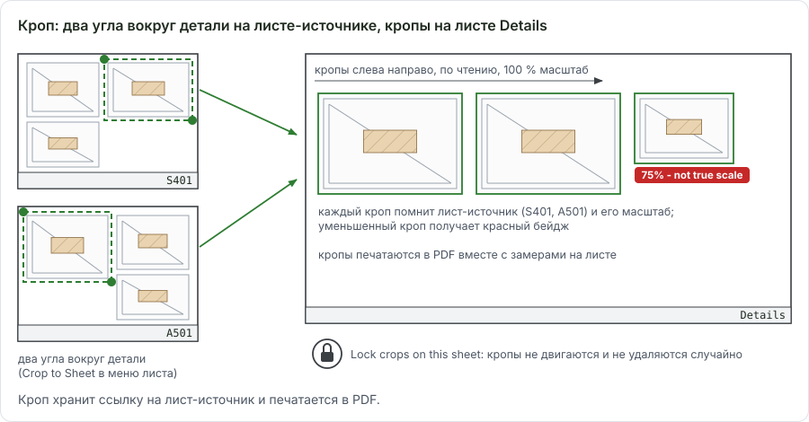
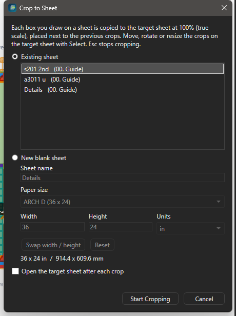
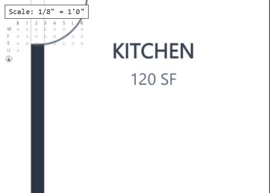
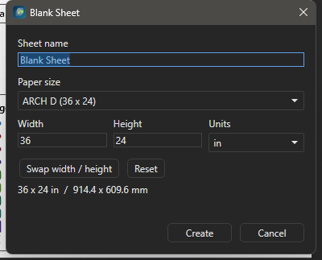
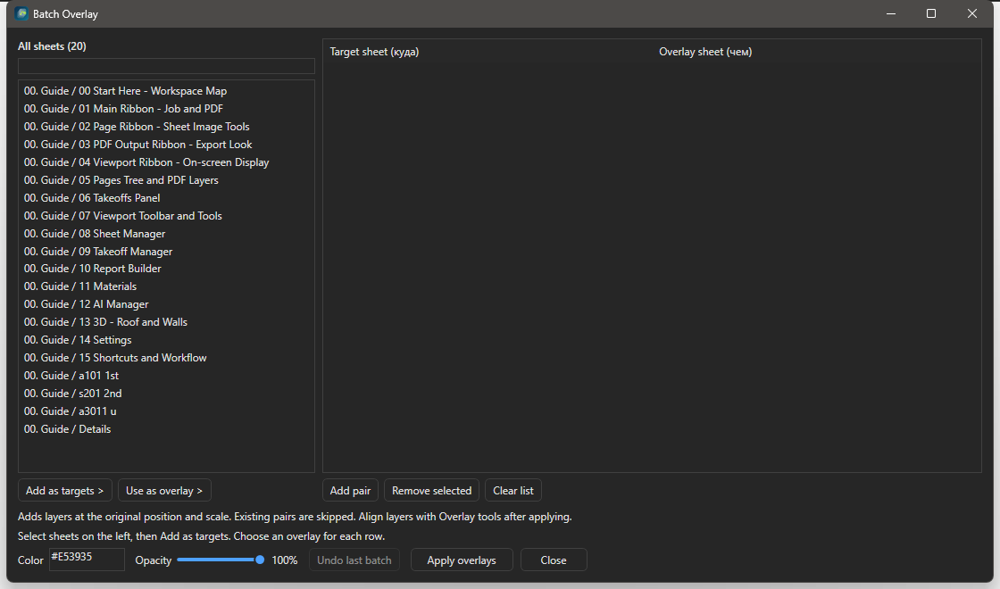
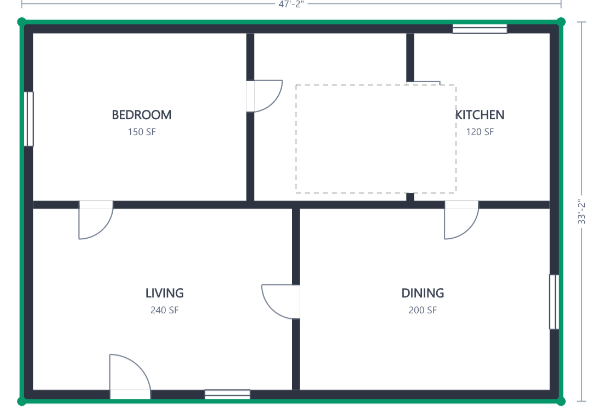

# Листы: Crop to Sheet, пустые листы, Overlay, легенда, Hide

Здесь - продвинутая работа с листами в OurPlanCore 3.0: собрать узлы с нескольких листов на один, наложить план на план, навести порядок в легенде и спрятать лишнее перед выдачей PDF. Нужно при подготовке PDF-выдачи, при сверке Arch и Struct планов и на проектах с десятками деталей.

## Crop to Sheet: детали с разных листов на одном {#crop}

<figure markdown>
  
  <figcaption markdown="span">Источник: два угла вокруг детали. Цель: кроп в 100 % масштабе, расставлен по чтению. Кроп хранит ссылку на лист-источник и печатается в PDF.</figcaption>
</figure>

<figure markdown>
  
  <figcaption markdown="span">Диалог выбора цели: существующий лист или новый пустой с именем и размером из пресетов.</figcaption>
</figure>

### Как собрать детали на один лист { #crop-steps }

<!-- DEMO: d-crop-to-sheet -->

Зачем: все узлы проекта на одном чистом листе в истинном масштабе для PDF клиенту.
Нужно: листы с деталями открываются; пустой лист-цель можно создать в самом диалоге.

1. Откройте лист с деталями и нажмите **Page > IMAGE > Crop to Sheet**.
2. Выберите в диалоге цель: **Existing sheet** (в списке пустые листы и листы, где уже есть кропы) или **New blank sheet** с именем и размером из пресетов Blank Sheet. Галка **Open the target sheet after each crop** открывает цель после каждого кропа. Нажмите **Start Cropping**.
3. Щёлкните два противоположных угла вокруг детали (Snap и PDF snap работают). Кусок копируется на цель в 100 % масштабе и ставится справа от предыдущего, потом следующим рядом. Строка состояния: `Crop to Sheet > <цель>: click two opposite corners of each detail. Esc stops.`
4. Переключайтесь на другие листы-источники и продолжайте: цель остаётся той же, пока не запустить инструмент заново.
5. Нажмите ++esc++, чтобы сбросить недорисованный бокс, второй ++esc++ выходит в Select.

Результат: на листе-цели кропы в ряд, каждый со ссылкой на лист-источник. Незамасштабированная цель берёт масштаб первого источника; кроп с другим масштабом источника отмечается в строке состояния.

### На целевом листе

<figure markdown>
  
  <figcaption markdown="span">Лист Details с кропами, бейдж `75% - not true scale` на уменьшенном кропе и круглая кнопка замка под заголовком Scale.</figcaption>
</figure>

| Действие | Как |
| --- | --- |
| Выбрать, подвинуть | Select, клик по кропу, перетаскивание |
| Повернуть | оранжевая ручка; ++shift++ - шаг 15°; ПКМ `Rotate Crop 90° Clockwise` / `Counterclockwise` |
| Размер | угловые и боковые ручки, только пропорционально |
| Зеркало | ПКМ `Mirror Crop Horizontal` / `Mirror Crop Vertical` |
| Вернуть масштаб | ПКМ `Reset Crop to 100% (true scale)`; кроп не в 100 % показывает красный бейдж `75% - not true scale` (только на экране) |
| Прозрачность | ПКМ `Opacity...`: ползунок 0-100 с живым просмотром, один шаг Undo |
| Порядок | ПКМ `Bring to Front`, `Send to Back`, `Bring Forward`, `Send Backward` |
| Откуда взято | ПКМ `Open Source Sheet (<имя>)` |
| Замок | круглая кнопка под заголовком Scale (только на листах с кропами): `Lock crops on this sheet` / `Crops locked - click to unlock`. Запертые кропы не выбираются, клики идут к takeoff под ними |

Undo работает на целевом листе (перенос, поворот, размер, Reset, удаление). Размещение кропа с листа-источника не отменяется: лишний кроп удаляют на цели.

??? note "Как кроп хранится и печатается"
    Кроп - запись в `annotations.json` целевого листа со ссылкой на лист-источник и прямоугольник. Рисуется только этот прямоугольник с видимостью PDF-слоёв источника: на экране в 3x, в PDF в 4x. Экспортируется всегда, когда включён модуль Annotations, даже если Markups не выводятся. При переименовании или переносе источника ссылка перебазируется; удалённый источник даёт красный крест и строку `Crop skipped on '<лист>'` при экспорте. Поворот или зеркало листа-источника кроп не двигает. Старый EXE (откат на `.bak` до 2.2.34) читает кроп как линейную разметку и теряет его поля при сохранении.

## Пустые листы {#blank}

<figure markdown>
  
  <figcaption markdown="span">Blank Sheet: имя, ширина и высота, единицы in или mm, пресеты, Swap width / height.</figcaption>
</figure>

### Как создать пустой лист { #blank-steps }

<!-- DEMO: d-blank-sheet -->

Зачем: чистый лист под кропы деталей или под схему.

1. Нажмите **Page > ADD > Blank Sheet** (или **+ New > Blank Sheet** в Pages, ПКМ по папке **New Blank Sheet**).
2. Впишите **Sheet name**, выберите пресет бумаги или впишите размер, при необходимости **Swap width / height**.
3. Нажмите **Create**.

Результат: лист рядом с открытым, с масштабом из первого кропа или заданным через `S`.

| Поле | Что делает |
| --- | --- |
| Sheet name | имя листа в Pages |
| Paper size | ширина и высота, переключатель in / mm |
| Пресеты | ARCH D (36 x 24), ARCH E (48 x 36), Letter (11 x 8.5), Tabloid (17 x 11), A4, A3 |
| Swap width / height | книжная вместо альбомной |
| Reset | размер из `Settings > Blank Sheets` |
| Create | создаёт лист рядом с открытым |

По умолчанию 36 x 24 in. Размер и список пресетов правятся в `Settings > Blank Sheets` (Apply, Save global default, Save as this job, Clear job override).

**Change Sheet Size...** - ПКМ по пустому листу в Pages. Лист получает новый пустой PDF, масштаб, легенда и наложения сохраняются; takeoff, разметка и кропы держат координаты от левого верхнего угла; точки, выпавшие за новый размер, перечисляются в предупреждении.

Большие пустые листы (например 11520 x 3600 pt под целый корпус) в 3.0 зумятся без рывков: это исправления 2.2.39-2.2.42.

## Overlay: наложить лист на лист

Под-таб `Overlay` в панели Pages работает с открытым листом:

| Группа | Кнопки |
| --- | --- |
| Source | `Add...`, `Open Source`, `Choose / Replace...`, `Next Match`, `Remove`; стрелки вверх и вниз меняют порядок слоёв; `Show overlay` |
| Alignment | `Auto Fit`, `Find Best`, `Edit by Points`, `Reset` |
| Transform | `X (pt)`, `Y (pt)`, `Scale` (0.05-20), `Rotation`; ползунки дают живой просмотр, ++esc++ возвращает сохранённое |
| Color, Opacity | цвет тонировки (Red, Blue, Green, Orange, Magenta, Gray, свой) и прозрачность |

С клавиатуры: ++ctrl+alt+left++ и другие стрелки - сдвиг, ++ctrl+alt+plus++ / ++ctrl+alt+minus++ - масштаб, `Ctrl+Alt+[` / `]` - поворот, ++ctrl+alt+0++ - сброс; с ++shift++ - точный шаг.

### Как наложить S-планы на A-планы для всех этажей: Batch Overlay { #batch-overlay }

<!-- DEMO: d-batch-overlay -->

<figure markdown>
  
  <figcaption markdown="span">Три колонки: все листы, целевые листы, лист-наложение для каждой строки.</figcaption>
</figure>

Зачем: сверить стены и framing по этажам, не настраивая наложение на каждом листе.
Нужно: архитектурные и структурные планы названы по этажам.

1. Нажмите **Page > PAGE > Batch Overlay** или ПКМ по папке Pages **Batch Overlay...**.
2. Выделите слева целевые листы (архитектурные планы) и нажмите **Add as targets**.
3. Выберите для каждой строки справа лист-наложение (структурный план того же этажа) и нажмите **Use as overlay**. Фильтр по имени или папке сверху.
4. Задайте цвет и прозрачность, общие на пакет, и нажмите **Apply overlays**.

Результат: наложение стоит на каждом целевом листе в исходной позиции и масштабе; существующие пары пропущены. Выравнивание потом обычными инструментами Overlay. Отмена последнего пакета - кнопка в том же окне (`Last batch restored.`).

## Легенда листа { #legend }

<figure markdown>
  
  <figcaption markdown="span">Главная легенда у якоря и отдельные озаглавленные блоки групп.</figcaption>
</figure>

Легенда - список takeoff, измеренных на листе; в Pages это узлы под листом. Где её настраивать:

| Что | Где |
| --- | --- |
| Показ, размер, положение | лента Display, группа Legend: `Show`, `Size`, `Pos`, `w/page` |
| Порядок | ПКМ по листу или по узлу takeoff под листом: `Sort Sheet Legend Auto`, `A-Z`, `by Key (before space)`, `Reset Sheet Legend Order` |
| Порядок для папки | ПКМ по папке Pages, Organize: те же команды `... in Folder` |
| Группы | ПКМ по узлу takeoff под листом: `Legend Group > New Group...`, имя группы или `Main Legend` (мультивыбор) |
| Управление группами | ПКМ по листу, `Organize > Legend Groups...`: переименовать, `Move Up`, `Move Down`, `Delete` (takeoff возвращаются в главную легенду), копирование набора на другие выделенные листы |

`Sort Sheet Legend by Key (before space)` сортирует по части имени до первого пробела, числа по значению: `A1 2x4, A1 2x6, A2 2x4, A10 2x4, B1 2x4, B1A 2x4`. Удобно для units и марок.

Группы хранятся в `source.json` листа (`legend_groups`), не откатываются Undo, одинаково показываются на экране, в откреплённом окне и в PDF. Без групп легенда рисуется как раньше.

## Как закрыть часть листа маской: Hide { #hide-mask }

<!-- DEMO: d-hide-mask -->

<figure markdown>
  
  <figcaption markdown="span">Белый прямоугольник закрывает соседний план; на экране виден тонкий пунктир, чтобы маску можно было выбрать.</figcaption>
</figure>

Зачем: убрать с листа соседний план или мусор перед PDF, не трогая замеры.

1. Нажмите **Annotation > MARKUP TOOLS > Hide** (в строке состояния `Hide Area`).
2. Обведите область кликами и нажмите ++c++ (или двойной клик), либо нажмите ++f9++ и щёлкните два угла бокса.
3. Чтобы подвинуть или удалить маску, выберите её инструментом Select по пунктиру.

Результат: часть листа закрашена белым; маска лежит над листом и наложениями, но под takeoff и остальной разметкой, поэтому замеры не прячет. В PDF печатается всегда при включённом модуле Annotations, даже без Markups.

Рядом `Annotation > Area` теперь слушает Box: два угла дают прямоугольную заливку.

## Прозрачность линий в PDF

`PDF Output > LINES & AREA > Opac` (0-100 %, по умолчанию 100) - прозрачность Line-takeoff и разметок Draw line / Arrow в экспортном PDF и в живом `Preview`. Линия со всеми стыками гаснет как одна группа. Конвейер экспорта использует ту же настройку. Экранный вид это не меняет: он в ленте Viewport.

## Открепленные окна листов

Листы можно открыть отдельными окнами и разложить по второму монитору (`Open > Detach to windows`, `Tile M2`): [Прочее, открепленные окна](ourplancore-extras-other.md#detached).

## Сценарий: лист Details под PDF-выдачу

1. `Page > Blank Sheet`, имя `Details`, ARCH D.
2. Открыть лист с узлами, `Crop to Sheet`, цель `Details`, `Start Cropping`, два угла вокруг каждого узла; перейти на следующие листы и продолжить; ++esc++.
3. На `Details` расставить кропы, повернуть, `Reset Crop to 100%` где сжимали, замок.
4. На планах `Hide` закрыть соседние планы и мусор, `PDF Output > Opac` 60 % если линии закрывают чертёж.
5. `Organize > Legend Groups...` на планах с SW: группа `Shear`.
6. `PDF Output > Preview`, затем экспорт по [инструкции PDF](ourplancore-pdf.md).

## См. также

- [Листы Pages](ourplancore-pages.md) - имена, масштаб, сортировка, PDF Layers
- [Экспорт PDF](ourplancore-pdf.md)
- [Settings: Blank Sheets и другие категории](ourplancore-settings.md)
- [Горячие клавиши](ourplancore-shortcuts.md) - Sheet Overlay с клавиатуры
