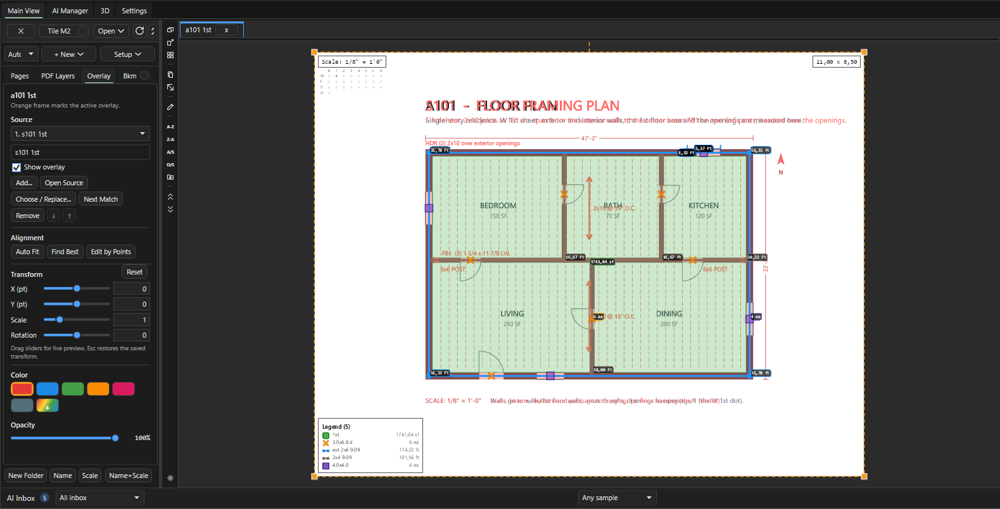
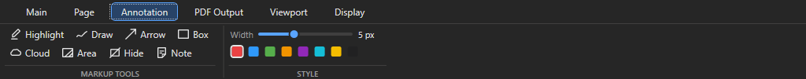

# Листы: Crop to Sheet, пустые листы, Overlay, легенда, Hide

Здесь - продвинутая работа с листами в OurPlanCore 3.0: собрать узлы с нескольких листов на один, наложить план на план, навести порядок в легенде, поставить пометки разметкой и спрятать лишнее перед выдачей PDF. Нужно при подготовке PDF-выдачи, при сверке Arch и Struct планов и на проектах с десятками деталей.

## Crop to Sheet: детали с разных листов на одном {#crop}

<figure markdown>
  
  <figcaption markdown="span">Источник: два угла вокруг детали. Цель: кроп в 100 % масштабе, расставлен по чтению. Кроп хранит ссылку на лист-источник и печатается в PDF.</figcaption>
</figure>

<figure markdown>
  
  <figcaption markdown="span">Диалог выбора цели: существующий лист или новый пустой с именем и размером из пресетов.</figcaption>
</figure>

### Как собрать детали на один лист { #crop-steps }

<figure markdown>
  <video class="kb-demo" loop muted playsinline preload="none" poster="../../assets/images/ourplancore/demo/d-crop-to-sheet.png"><source src="../../assets/images/ourplancore/demo/d-crop-to-sheet.mp4" type="video/mp4"></video>
  <figcaption markdown="span">Демонстрация: `Page > Crop to Sheet`, цель `Details`, два кропа с разных листов ложатся рядом на один лист.</figcaption>
</figure>

Зачем: все узлы проекта на одном чистом листе в истинном масштабе для PDF клиенту.
Нужно: листы с деталями открываются; пустой лист-цель можно создать в самом диалоге.

1. Откройте лист с деталями и нажмите **Page > IMAGE > Crop to Sheet**.
2. Выберите в диалоге цель: **Existing sheet** (в списке пустые листы и листы, где уже есть кропы) или **New blank sheet** с именем и размером из пресетов Blank Sheet. Галка **Open the target sheet after each crop** открывает цель после каждого кропа. Нажмите **Start Cropping**.
3. Щёлкните два противоположных угла вокруг детали (Snap и PDF snap работают). Кусок копируется на цель в 100 % масштабе и ставится справа от предыдущего, потом следующим рядом. Строка состояния: `Crop to Sheet > <цель>: click two opposite corners of each detail. Esc stops.`
4. Переключайтесь на другие листы-источники и продолжайте: цель остаётся той же, пока не запустить инструмент заново.
5. Нажмите ++esc++, чтобы сбросить недорисованный бокс, второй ++esc++ выходит в Select.

Результат: на листе-цели кропы в ряд, каждый со ссылкой на лист-источник. Незамасштабированная цель берёт масштаб первого источника; кроп с другим масштабом источника отмечается в строке состояния.

### На целевом листе

<figure markdown>
  
  <figcaption markdown="span">Лист Details с кропами, бейдж `75% - not true scale` на уменьшенном кропе и круглая кнопка замка под заголовком Scale.</figcaption>
</figure>

| Действие | Как |
| --- | --- |
| Выбрать, подвинуть | Select, клик по кропу, перетаскивание |
| Повернуть | оранжевая ручка; ++shift++ - шаг 15°; ПКМ `Rotate Crop 90° Clockwise` / `Rotate Crop 90° Counterclockwise` |
| Размер | угловые и боковые ручки, только пропорционально |
| Зеркало | ПКМ `Mirror Crop Horizontal` / `Mirror Crop Vertical` |
| Вернуть масштаб | ПКМ `Reset Crop to 100% (true scale)`; кроп не в 100 % показывает красный бейдж `75% - not true scale` (только на экране) |
| Прозрачность | ПКМ `Opacity...`: ползунок 0-100 с живым просмотром, один шаг Undo |
| Порядок | ПКМ `Bring to Front`, `Send to Back`, `Bring Forward`, `Send Backward` |
| Откуда взято | ПКМ `Open Source Sheet (<имя>)` |
| Замок | круглая кнопка под заголовком Scale (только на листах с кропами): `Lock crops on this sheet` / `Crops locked - click to unlock`. Запертые кропы не выбираются, клики идут к takeoff под ними |

Undo работает на целевом листе (перенос, поворот, размер, Reset, удаление). Размещение кропа с листа-источника не отменяется: лишний кроп удаляют на цели.

??? note "Как кроп хранится и печатается"
    Кроп - запись в `annotations.json` целевого листа со ссылкой на лист-источник и прямоугольник. Рисуется только этот прямоугольник с видимостью PDF-слоёв источника: на экране в 3x, в PDF в 4x. Экспортируется всегда, когда включён модуль Annotations, даже если Markups не выводятся. При переименовании или переносе источника ссылка перебазируется; удалённый источник даёт красный крест и строку `Crop skipped on '<лист>'` при экспорте. Поворот или зеркало листа-источника кроп не двигает. Старый EXE (откат на `.bak` до 2.2.34) читает кроп как линейную разметку и теряет его поля при сохранении.

### Как вырезать видимую часть листа в новый лист: Crop New Page { #crop-new-page }

Зачем: отдельный самостоятельный лист из куска большого листа (один корпус, один план из нескольких на листе), со своими замерами и своим PDF.
Нужно: лист открыт; у листа стоит масштаб, если на новом листе будут замеры.

1. Откройте лист и подгоните зум и сдвиг так, чтобы на экране осталась только нужная часть.
2. Нажмите **Page > IMAGE > Crop New Page**.

Результат: в той же папке Pages появляется лист `<имя> Crop` из видимой области с масштабом исходного листа, он сразу открывается; статус `Crop New Page: created <имя> Crop.` Замеры исходного листа на новый лист не переносятся.

Разница с Crop to Sheet: `Crop to Sheet` кладёт на лист-цель кропы со ссылкой на источник, `Crop New Page` делает новый PDF-лист, на котором мерят как на обычном.

## Пустые листы {#blank}

<figure markdown>
  
  <figcaption markdown="span">Blank Sheet: имя, ширина и высота, единицы in или mm, пресеты, Swap width / height.</figcaption>
</figure>

### Как создать пустой лист { #blank-steps }

<figure markdown>
  <video class="kb-demo" loop muted playsinline preload="none" poster="../../assets/images/ourplancore/demo/d-blank-sheet.png"><source src="../../assets/images/ourplancore/demo/d-blank-sheet.mp4" type="video/mp4"></video>
  <figcaption markdown="span">Демонстрация: `Page > Blank Sheet`, имя `Details`, размер `Tabloid (17 x 11)`, `Create`.</figcaption>
</figure>

Зачем: чистый лист под кропы деталей или под схему.

1. Нажмите **Page > ADD > Blank Sheet** (или **+ New > Blank Sheet** в Pages, ПКМ по папке **New Blank Sheet**).
2. Впишите **Sheet name**, выберите пресет бумаги или впишите размер, при необходимости **Swap width / height**.
3. Нажмите **Create**.

Результат: лист рядом с открытым, с масштабом из первого кропа или заданным через `S`.

| Поле | Что делает |
| --- | --- |
| Sheet name | имя листа в Pages |
| Paper size | ширина и высота, переключатель in / mm |
| Пресеты | ARCH D (36 x 24), ARCH E (48 x 36), Letter (11 x 8.5), Tabloid (17 x 11), A4, A3 |
| Swap width / height | книжная вместо альбомной |
| Reset | размер из `Settings > Blank Sheets` |
| Create | создаёт лист рядом с открытым |

По умолчанию 36 x 24 in. Размер и список пресетов правятся в `Settings > Blank Sheets` (Apply, Save global default, Save as this job, Clear job override).

**Change Sheet Size...** - ПКМ по пустому листу в Pages. Лист получает новый пустой PDF, масштаб, легенда и наложения сохраняются; takeoff, разметка и кропы держат координаты от левого верхнего угла; точки, выпавшие за новый размер, перечисляются в предупреждении.

Большие пустые листы (например 11520 x 3600 pt под целый корпус) в 3.0 зумятся без рывков: это исправления 2.2.39-2.2.42.

## Overlay: наложить лист на лист { #overlay }

<figure markdown>
  
  <figcaption markdown="span">S-план красным поверх A-плана того же этажа; слева вкладка `Overlay` с группами Source, Alignment, Transform, под листом в Pages узел слоя наложения.</figcaption>
</figure>

Под-таб `Overlay` в панели Pages работает с открытым листом:

| Группа | Кнопки |
| --- | --- |
| Source | `Add...`, `Open Source`, `Choose / Replace...`, `Next Match`, `Remove`; стрелки вверх и вниз меняют порядок слоёв; `Show overlay` |
| Alignment | `Auto Fit`, `Find Best`, `Edit by Points`, `Reset` |
| Transform | `X (pt)`, `Y (pt)`, `Scale` (0.05-20), `Rotation`; ползунки дают живой просмотр, ++esc++ возвращает сохранённое |
| Color, Opacity | цвет тонировки (Red, Blue, Green, Orange, Magenta, Gray, свой) и прозрачность |

### Как наложить один лист на другой и совместить { #overlay-steps }

Зачем: проверить, совпадают ли стены и framing A-плана и S-плана того же этажа.
Нужно: оба листа в проекте; модуль Sheet Overlay (включён по умолчанию).

1. Откройте лист, на который накладываете (например архитектурный план этажа).
2. Щёлкните ПКМ по листу-наложению в Pages (структурный план того же этажа) и выберите **Sheet Overlay > Use This Sheet as Current Overlay**.
3. Щёлкните ПКМ по пустому месту листа и выберите **Auto Fit Overlay**: программа подгоняет наложение по геометрии плана (статус `Overlay auto fit: ...`). Если наложения ещё нет, она сама ищет подходящий лист в проекте.
4. Если совпало неточно, выберите в том же меню **Fit by 2 Points** и щёлкните точку на наложении (угол стены), потом место на листе, куда она должна встать: наложение сдвигается.
5. Щёлкните вторую точку наложения подальше от первой и её место на листе: наложение масштабируется и поворачивается по двум парам. ++esc++ после первой пары оставляет только сдвиг.
6. Задайте цвет и прозрачность во вкладке `Overlay` (ПКМ `Overlay Properties...` открывает её на нужном листе).

Результат: S-план в цвете поверх A-плана, под листом в Pages появился узел слоя наложения; статус `Overlay fit by two points: <масштаб>x, rotation <угол> deg`.

<figure markdown>
  <video class="kb-demo" loop muted playsinline preload="none" poster="../../assets/images/ourplancore/demo/d-overlay.png"><source src="../../assets/images/ourplancore/demo/d-overlay.mp4" type="video/mp4"></video>
  <figcaption markdown="span">Демонстрация: ПКМ по S-листу в Pages, `Sheet Overlay > Use This Sheet as Current Overlay`, ПКМ по листу `Auto Fit Overlay`, затем вкладка `Overlay` и галка `Show overlay`.</figcaption>
</figure>

!!! tip "Советы"
    - Совмещение по точкам запускают три одинаковые команды: `Fit by 2 Points` в меню листа, кнопка `Edit by Points` во вкладке `Overlay` и `Move Overlay by Points` (палитра команд и значок на левой полосе).
    - Клик цепляется к ближайшей точке PDF в пределах 14 px (в статусе `snapped to ...`), поэтому щёлкайте по углам стен и пересечениям осей.

??? note "Все пункты меню наложения"
    | Где | Пункт | Что делает |
    | --- | --- | --- |
    | ПКМ по листу в Pages, подменю **Sheet Overlay** | `Use This Sheet as Current Overlay` | заменяет активный слой наложения открытого листа этим листом |
    | | `Add This Sheet as New Overlay` | добавляет лист ещё одним слоем, прежние слои остаются |
    | | `Overlay Properties...` | открывает вкладку `Overlay` для листа |
    | | `Clear Current Sheet Overlay` | убирает активный слой наложения с открытого листа |
    | ПКМ по слою наложения под листом в Pages | `Overlay Properties...` | вкладка `Overlay` с этим слоем |
    | | `Hide Overlay` / `Show Overlay` | спрятать или показать слой, не удаляя |
    | | `Open Overlay Sheet` | открыть лист, который наложен |
    | | `Move Layer Up`, `Move Layer Down` | порядок слоёв: верхний рисуется поверх |
    | | `Remove Overlay Layer` | удалить этот слой наложения |
    | ПКМ по листу в окне, когда есть наложение | `Overlay Properties...`, `Auto Fit Overlay`, `Fit by 2 Points` | как в шагах выше |

??? note "Клавиши наложения"
    | Клавиши (наложение должно быть на листе) | Команда | Что делает |
    | --- | --- | --- |
    | `Ctrl+Alt` и перетаскивание | `Move the overlay` | двигает наложение мышью |
    | ++ctrl+alt+left++ и другие стрелки | `Nudge the overlay` | сдвиг на шаг |
    | ++ctrl+alt+plus++ / ++ctrl+alt+minus++ | `Scale the overlay` | масштаб |
    | `Ctrl+Alt+[` / `]` | `Rotate the overlay` | поворот |
    | ++ctrl+alt+0++ | `Reset overlay transform` | сброс сдвига, масштаба и поворота |
    | те же клавиши с ++shift++ | `Fine nudge the overlay left` и другие, `Fine rotate the overlay left` / `Fine rotate the overlay right` (`Ctrl+Alt+Shift+[` / `]`) | точный шаг |

    Клавиши переназначаются в `Settings > Keyboard Shortcuts` ([горячие клавиши](ourplancore-shortcuts.md#remap)).

### Как наложить S-планы на A-планы для всех этажей: Batch Overlay { #batch-overlay }

<figure markdown>
  <video class="kb-demo" loop muted playsinline preload="none" poster="../../assets/images/ourplancore/demo/d-batch-overlay.png"><source src="../../assets/images/ourplancore/demo/d-batch-overlay.mp4" type="video/mp4"></video>
  <figcaption markdown="span">Демонстрация: `Page > Batch Overlay`, S-лист наложением на A-лист с прозрачностью 60, `Apply overlays`; в Pages появился узел `Overlay`.</figcaption>
</figure>

<figure markdown>
  
  <figcaption markdown="span">Три колонки: все листы, целевые листы, лист-наложение для каждой строки.</figcaption>
</figure>

Зачем: сверить стены и framing по этажам, не настраивая наложение на каждом листе.
Нужно: архитектурные и структурные планы названы по этажам.

1. Нажмите **Page > PAGE > Batch Overlay** или ПКМ по папке Pages **Batch Overlay...**.
2. Выделите слева целевые листы (архитектурные планы) и нажмите **Add as targets**.
3. Выберите для каждой строки справа лист-наложение (структурный план того же этажа) и нажмите **Use as overlay**. Фильтр по имени или папке сверху.
4. Задайте цвет и прозрачность, общие на пакет, и нажмите **Apply overlays**.

Результат: наложение стоит на каждом целевом листе в исходной позиции и масштабе; существующие пары пропущены. Выравнивание потом обычными инструментами Overlay. Отмена последнего пакета - кнопка в том же окне (`Last batch restored.`).

## Легенда листа { #legend }

<figure markdown>
  
  <figcaption markdown="span">Главная легенда у якоря и отдельные озаглавленные блоки групп.</figcaption>
</figure>

Легенда - список takeoff, измеренных на листе; в Pages это узлы под листом. Где её настраивать:

| Что | Где |
| --- | --- |
| Показ, размер, положение | лента Display, группа Legend: `Show`, `Size`, `Pos`, `w/page` |
| Порядок | ПКМ по листу (подменю Organize) или по узлу takeoff под листом: `Sort Sheet Legend Auto`, `Sort Sheet Legend A-Z`, `Sort Sheet Legend by Key (before space)`, `Reset Sheet Legend Order`; при нескольких выделенных листах команда идёт на все (`Sort N Selected Sheet Legends A-Z`) |
| Порядок для папки | ПКМ по папке Pages, Organize: `Sort Sheet Legends Auto in Folder`, `Sort Sheet Legends A-Z in Folder`, `Sort Sheet Legends by Key (before space) in Folder`, `Reset Sheet Legend Orders in Folder`: для всех листов папки сразу |
| Группы | ПКМ по узлу takeoff под листом: `Legend Group > New Group...`, имя группы или `Main Legend` (мультивыбор) |
| Управление группами | ПКМ по листу, `Organize > Legend Groups...`: переименовать, `Move Up`, `Move Down`, `Delete` (takeoff возвращаются в главную легенду), копирование набора на другие выделенные листы |
| Те же группы на других листах | выделите в Pages лист с группами и листы-цели, ПКМ по листу с группами, `Organize > Copy Legend Groups to Selected Sheets` (в меню `Copy Legend Groups to N Selected Sheets`) |

`Auto` - живой порядок: сначала Line (стены: corners, ext по высоте, коридоры и дальше), потом Area, потом Count; новая позиция сама встаёт на своё место. `A-Z`, `by Key` и ручные `Move Up in Legend` / `Move Down in Legend` записывают свой порядок листа; `Sort Sheet Legend Auto` и `Reset Sheet Legend Order` его снимают и возвращают живой.

`Sort Sheet Legend by Key (before space)` сортирует по части имени до первого пробела, числа по значению: `A1 2x4, A1 2x6, A2 2x4, A10 2x4, B1 2x4, B1A 2x4`. Удобно для units и марок.

Группы хранятся в `source.json` листа (`legend_groups`), не откатываются Undo, одинаково показываются на экране, в откреплённом окне и в PDF. Без групп легенда рисуется как раньше.

### Меню позиции под листом в Pages { #legend-node-menu }

ПКМ по узлу takeoff под листом; при нескольких выделенных узлах пункт пишет число, например `Hide 3 Selected on This Sheet`. Спрятать позицию с листа быстрее клавишей ++h++: [дерево Takeoffs](ourplancore-takeoffs.md#hide).

??? note "Все пункты меню позиции под листом"
    | Пункт | Что делает |
    | --- | --- |
    | `Select Linked Takeoff` | открывает лист, выделяет позицию в Takeoffs и её замеры на листе |
    | `Rename Linked Takeoff...` | переименовывает позицию в дереве Takeoffs: имя меняется на всех листах |
    | `Hide on This Sheet` / `Show on This Sheet` | прячет или показывает позицию только на этом листе; спрятанная не рисуется и не печатается в PDF |
    | `Hide Selected on This Sheet`, `Show Selected on This Sheet` | то же для всех выделенных узлов под листом |
    | `Move Backward`, `Move Forward` | порядок рисования на листе: какая позиция лежит поверх соседней; легенду не меняет |
    | `Move Up in Legend`, `Move Down in Legend` | строка выше или ниже в легенде листа |
    | `Legend Group > ...` | группы легенды, таблица выше |
    | `Sort Sheet Legend Auto`, `Sort Sheet Legend A-Z`, `Sort Sheet Legend by Key (before space)`, `Reset Sheet Legend Order` | порядок легенды всего листа |

### Размер легенды, шапки и подписей на экране { #legend-size }

ПКМ по легенде или по шапке масштаба на листе открывает меню вида:

| Пункт | Что делает |
| --- | --- |
| `Legend` | показать или спрятать легенду (то же, что `Display > Legend Show`) |
| `Legend Position` | угол или край листа, 8 положений |
| `Legend Size`, `Scale / Sheet Size Label Size` | пресеты Tiny (0.25), XS (0.5), Small (0.75), Normal (1), Large (1.35), XL (1.75), XXL (2.25); `Custom...` - свой множитель от 0.25 до 3.0 |
| `Scale Legend With Sheet` | легенда растёт и уменьшается вместе с зумом листа (как галка `w/page` на ленте Display) |
| `Scale Measurement Labels With Sheet` | подписи чисел у замеров растут вместе с зумом; по умолчанию выключено, подписи экранного размера |
| `Scale Sheet Header With Sheet` | шапка масштаба и размера листа сверху растёт вместе с зумом; по умолчанию выключено |

Это вид на экране; размер легенды в PDF задаётся в `PDF Output > OVERLAYS` ([PDF](ourplancore-pdf.md#output)). Галка `Fast pan/zoom` на ленте Display (группа OVERLAYS / RENDER) во время панорамы и зума рисует замеры и подписи упрощённо, после остановки кадр полный: на тяжёлых листах движение плавнее. По умолчанию выключена.

## Разметка: лента Annotation { #markup }

<figure markdown>
  
  <figcaption markdown="span">Группа MARKUP TOOLS (инструменты разметки) и группа STYLE: ползунок `Width` и образцы цвета для следующих пометок.</figcaption>
</figure>

Разметка - пометки на листе без количества: в Takeoffs и Excel не попадает, в PDF печатается, если в диалоге экспорта включены `Markups` ([PDF](ourplancore-pdf.md#export)). Модуль Annotations включён по умолчанию.

| Кнопка | Что рисует | Как |
| --- | --- | --- |
| Highlighter (++shift+h++) | полупрозрачный прямоугольник-маркер | два угла |
| Draw Line (++d++) | линию разметки | клики по точкам; ++c++, ++esc++ или двойной клик заканчивают |
| `Arrow` | стрелку | клик в хвост, клик в острие |
| Box (в палитре `Draw Box Tool`) | прямоугольную рамку | два угла |
| `Cloud` | облако ревизии | два угла |
| `Area fill` | многоугольник с полупрозрачной заливкой цвета разметки | клики по углам, ++c++ или двойной клик; с Box (++f9++) два угла |
| Hide | белую маску | [ниже](#hide-mask) |
| Note (++n++) | текстовую заметку | клик по листу, ввести текст |

Цвет и толщину следующих пометок задаёт группа STYLE: ползунок `Width` (подсказка `Annotation line thickness`, 1-12 px) и образцы цвета. Уже нарисованные пометки они не меняют.

??? note "ПКМ по пометке: копировать, вставить, править, удалить"
    | Пункт | Что делает |
    | --- | --- |
    | `Copy Markup` (в меню с типом: `Copy Box Markup`, `Copy Arrow Markup`; при выделении нескольких `Copy N Selected Markups`) | копирует пометку; то же ++ctrl+c++ на выделенных |
    | `Paste Markups Here` (`Paste N Markup(s) Here`) | вставляет скопированное: левый верхний угол копии встаёт в точку щелчка; работает и на другом листе |
    | `Edit Note...` | только у Note: окно `Edit Sheet Note` с текстом заметки |
    | `Delete Markup` (`Delete Box Markup`, `Delete N Selected Markups`) | удаляет пометку; запертые кропы так не удаляются |

## Как закрыть часть листа маской: Hide { #hide-mask }

<figure markdown>
  <video class="kb-demo" loop muted playsinline preload="none" poster="../../assets/images/ourplancore/demo/d-hide-mask.png"><source src="../../assets/images/ourplancore/demo/d-hide-mask.mp4" type="video/mp4"></video>
  <figcaption markdown="span">Демонстрация: `Annotation > Hide`, четыре щелчка вокруг подписи и ++c++ дают белую маску; ++ctrl+z++ убирает её.</figcaption>
</figure>

<figure markdown>
  
  <figcaption markdown="span">Белый прямоугольник закрывает соседний план; на экране виден тонкий пунктир, чтобы маску можно было выбрать.</figcaption>
</figure>

Зачем: убрать с листа соседний план или мусор перед PDF, не трогая замеры.

1. Нажмите **Annotation > MARKUP TOOLS > Hide** (в строке состояния `Hide Area`).
2. Обведите область кликами и нажмите ++c++ (или двойной клик), либо нажмите ++f9++ и щёлкните два угла бокса.
3. Чтобы подвинуть или удалить маску, выберите её инструментом Select по пунктиру.

Результат: часть листа закрашена белым; маска лежит над листом и наложениями, но под takeoff и остальной разметкой, поэтому замеры не прячет. В PDF печатается всегда при включённом модуле Annotations, даже без Markups.

Рядом `Annotation > Area` теперь слушает Box: два угла дают прямоугольную заливку.

!!! tip "Если мешает целый слой PDF"
    Мебель, размеры или текст векторного PDF проще выключить слоем, чем закрывать маской: вкладка `PDF Layers`, ПКМ по слою `Hide Layer`. `Highlight Layer` в том же меню подсвечивает слой цветом, чтобы понять, что в нём лежит; `Clear Highlight` или кнопка `Clear Hi` снимают подсветку ([слои PDF](ourplancore-snap-trace.md#layers)).

## Прозрачность линий в PDF

`PDF Output > LINES & AREA > Opac` (0-100 %, по умолчанию 100) - прозрачность Line-takeoff и разметок Draw line / Arrow в экспортном PDF и в живом `Preview`. Линия со всеми стыками гаснет как одна группа. Конвейер экспорта использует ту же настройку. Экранный вид это не меняет: он в ленте Viewport.

## Открепленные окна листов

Листы можно открыть отдельными окнами и разложить по второму монитору (`Open > Detach to windows`, `Tile M2`): [Прочее, открепленные окна](ourplancore-extras-other.md#detached).

## Сценарий: лист Details под PDF-выдачу

1. `Page > Blank Sheet`, имя `Details`, ARCH D.
2. Открыть лист с узлами, `Crop to Sheet`, цель `Details`, `Start Cropping`, два угла вокруг каждого узла; перейти на следующие листы и продолжить; ++esc++.
3. На `Details` расставить кропы, повернуть, `Reset Crop to 100%` где сжимали, замок.
4. На планах `Hide` закрыть соседние планы и мусор, `PDF Output > Opac` 60 % если линии закрывают чертёж.
5. `Organize > Legend Groups...` на планах с SW: группа `Shear`.
6. `PDF Output > Preview`, затем экспорт по [инструкции PDF](ourplancore-pdf.md).

## См. также

- [Листы Pages](ourplancore-pages.md) - имена, масштаб, сортировка, PDF Layers
- [Экспорт PDF](ourplancore-pdf.md)
- [Settings: Blank Sheets и другие категории](ourplancore-settings.md)
- [Горячие клавиши](ourplancore-shortcuts.md) - Sheet Overlay с клавиатуры
