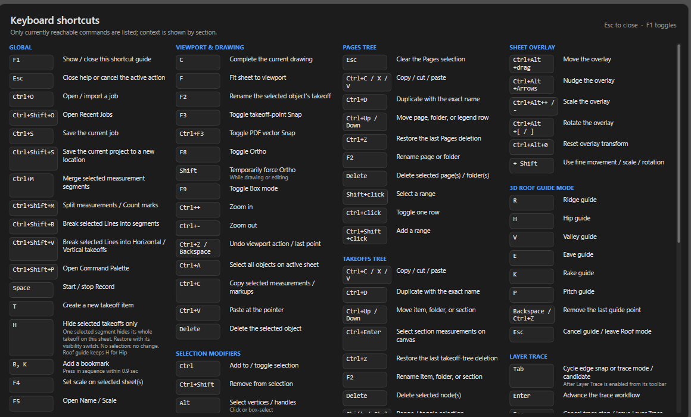
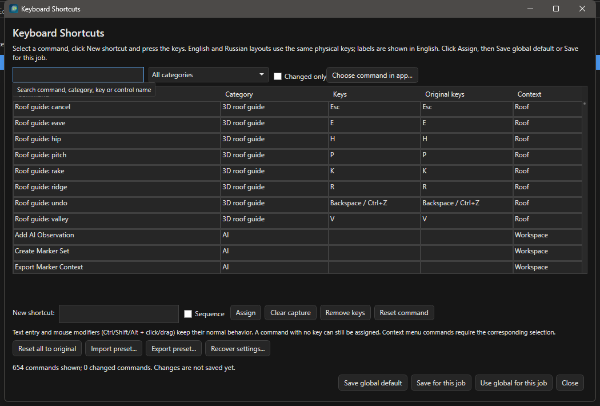

# OurPlanCore hotkeys

This is the only OurPlanCore 3.0 key table on the site: default bindings by group, what to do with a Russian keyboard layout, and how to remap. You need it when your hand reaches for a key instead of a button. The in-app cheat sheet is ++f1++.

<figure markdown>
  
  <figcaption markdown="span">F1 shows the current bindings, including remapped ones. A second F1 or Esc closes it.</figcaption>
</figure>

Below are the default bindings. If the profile was changed, ++f1++ and the key editor show the current values. A key fires only where the command applies: tools and editing in the viewport, tree commands in Pages or Takeoffs. When the focus is in a text field, the letter is typed instead of running a command.

## File, help, view

| Key | Action |
| --- | --- |
| ++ctrl+o++ / ++ctrl+shift+o++ | Open / Import, pick a job / recent list |
| ++ctrl+s++ / ++ctrl+shift+s++ | Save / Save As |
| ++f1++ | key cheat sheet |
| ++ctrl+shift+p++ | Command Palette: any command by name |
| ++f++ | Fit: the whole sheet |
| ++ctrl+plus++ / ++ctrl+minus++ | zoom; mouse wheel with the step from `Settings > Defaults` |
| ++b++ then ++k++ | Add Bookmark (a sequence, up to 0.9 s between presses) |
| ++minus++ | collapse the Pages and Takeoffs trees |
| ++h++ | Hide Selected Takeoffs Only: hide on the sheet the takeoff of the selected segment or row |

The right mouse button always pans, in any tool.

## Tools

| Key | Tool | What it does |
| --- | --- | --- |
| ++e++ | Select | select and edit; ++ctrl++ add to the selection, ++ctrl+shift++ remove, ++alt++ vertices |
| ++v++ | Pan | move the view |
| ++s++ | Scale | scale from a known dimension |
| ++r++ | Ruler | a dimension with no quantity |
| ++p++ | Count | marks, pieces |
| ++l++ | Line | polyline, linear feet |
| ++a++ | Area | area; ++f9++ box |
| ++j++ | J Area | Joist Area |
| ++b++ | Beam | a beam by two points |
| ++o++ | Openings | an opening by box |
| ++x++ | Cut | cutout in an Area, erasing a Line |
| ++space++ | Record | continue the active takeoff / stop |
| ++shift+h++ | Highlight | highlighter (markup) |
| ++d++ | Draw Line / Extra Joists | markup line; in a selected Joist Area, extra joists |
| ++n++ | Note | a text note on the sheet |
| ++f3++ / ++ctrl+f3++ | Snap / PDF Snap | snap to your own points / to PDF vectors |
| ++f8++ | Ortho | 90° and 45°; ++shift++ while drawing turns it on temporarily |
| ++f9++ | Box | two-corner mode for Area, Cut, Hide |

In 3.0 ++h++ is no longer the Highlighter: ++h++ hides a takeoff, the highlighter is on ++shift+h++. In Roof guide mode ++h++ stays Hip.

## Drawing and editing in the viewport

| Key | Action |
| --- | --- |
| ++c++ | finish drawing (a double click works too) |
| ++esc++ | cancel drawing, exit the tool |
| ++backspace++ / ++ctrl+z++ | remove the last point / undo an action |
| ++tab++ | cycle Layer Trace options, toggle edge-snap |
| ++enter++ | next Layer Trace step |
| ++ctrl+c++ / ++ctrl+v++ | copy measurements / Paste Measurements (Same or New takeoffs) |
| ++ctrl+a++ / ++delete++ | select everything on the sheet / delete the selection |
| ++f2++ | rename the takeoff of the selected object |
| ++ctrl+m++ / ++ctrl+shift+m++ | Merge / Split: whole takeoffs from the tree or segments from the sheet |
| ++ctrl+shift+b++ | Break: a Line into separate segments |
| ++ctrl+shift+v++ | Break H/V: segments into `- Horizontal` and `- Vertical` takeoffs |
| ++shift++ while rotating | 15° step (rotate handle of markup and crops) |

More on Merge, Split, Break: [Editing takeoffs](ourplancore-edit-takeoffs.md).

The app has no redo of an undone action (Redo, ++ctrl+y++): ++ctrl+z++ undoes a step for good, so before a series of undos check what you are rolling back.

## Pages and Takeoffs trees

| Key | Pages | Takeoffs |
| --- | --- | --- |
| ++ctrl+c++ / ++ctrl+x++ / ++ctrl+v++ | copy, cut, paste a sheet | the same for takeoffs and folders |
| ++ctrl+d++ | Duplicate Page | duplicate a takeoff |
| ++ctrl+up++ / ++ctrl+down++ | move the node | move the node |
| ++ctrl+z++ | bring back what was deleted | bring back what was deleted; undo Merge / Split |
| ++f2++ / ++delete++ | Rename Page / delete | Rename / delete |
| ++esc++ | clear the selection | |
| ++ctrl+enter++ | | select the section's measurements on the sheet |
| ++h++ | | hide the takeoffs of the selected rows on the current sheet |
| ++f4++ | Set Scale on the selected sheets | |
| ++f5++ | Name / Scale Setup | |
| ++t++ | | New takeoff item (in the work window) |
| ++ctrl+shift+v++ | | Break H/V (not Paste) |

Bookmarks and AI Inbox: ++enter++ opens, ++delete++ deletes.

## Roof guide and Sheet Overlay

| Context | Keys |
| --- | --- |
| Roof guide (3D) | ++r++ Ridge, ++h++ Hip, ++v++ Valley, ++e++ Eave, ++k++ Rake, ++p++ Pitch; ++backspace++ / ++ctrl+z++ back, ++esc++ cancels the line or exits |
| Sheet Overlay | ++ctrl+alt+left++ / ++right++ / ++up++ / ++down++ shift; ++ctrl+alt+plus++ / ++ctrl+alt+minus++ scale; `Ctrl+Alt+[` / `Ctrl+Alt+]` rotate; ++ctrl+alt+0++ reset; with ++shift++ a fine step |

## No key by default

Assigned in the editor: Mirror selected objects horizontally / vertically, Hide / Show All Takeoffs, Pitch, Similar, P Line, Ends, Repeat Line, Repeat Beam, Combine Areas (five operations), Undo Last Page Sort, Undo Last Page Operation, Toggle Dark Theme, Codex / Claude Terminal and all menu and ribbon items (the catalog has more than 600 commands).

## Russian keyboard layout

Keys work by the physical key: ++l++ draws a Line in both the EN and the RU layout, and the labels stay English. There is no need to switch layouts for the keys: you can type notes in Russian and press ++p++ right away.

## Assign or change a key {#remap}

<figure markdown>
  
  <figcaption markdown="span">Search, the command table, the New shortcut field and the save buttons.</figcaption>
</figure>

1. `Settings > Keyboard Shortcuts > Open Keyboard Shortcuts...`.
2. Find the command: search by name, category, key or button name (`Search command, category, key or control name`); the `Changed only` checkbox shows only changed ones.
3. Click the `New shortcut:` field, press the combination, `Assign`. For a sequence of up to three presses turn on `Sequence`.
4. The editor shows a conflict in the same context and offers to move the binding; check which command loses its binding.
5. `Save global default` for all jobs or `Save for this job` for the open one. The job copy wins; `Use global for this job` removes it.

| Button | What it does |
| --- | --- |
| `Remove keys` | remove the bindings of the selected command |
| `Reset command` / `Reset all to original` | bring back the defaults into the draft; then Save |
| `Import preset...` / `Export preset...` | load or save a set as JSON |
| `Choose command in app...` | the editor hides: ++ctrl++ and click moves through tabs and menus, a plain click picks the command, ++esc++ finishes |
| `Recover settings...` | if the bindings file cannot be read: `Retry reading`, `Restore / import...`, `Reset to original keys` |

Until Save the old keys keep working. A binding on an input field moves the focus into it, on a list it opens the choice; it is not a macro. A disabled module and a read-only job still limit what the key can do, even when it is bound.

## See also

- [Editing takeoffs](ourplancore-edit-takeoffs.md)
- [Measuring tools](ourplancore-tools.md)
- [Settings: all categories](ourplancore-settings.md)
- [Troubleshooting](ourplancore-troubleshooting.md)
- [Excel macro hotkeys](excel-hotkeys.md) - VBA shortcuts in the Excel workbook, not the app
