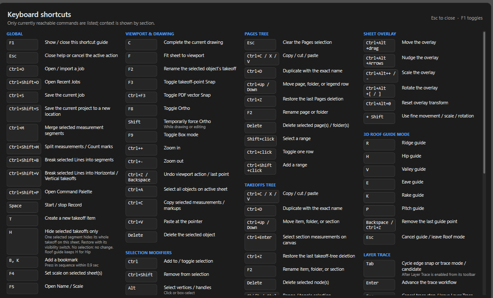
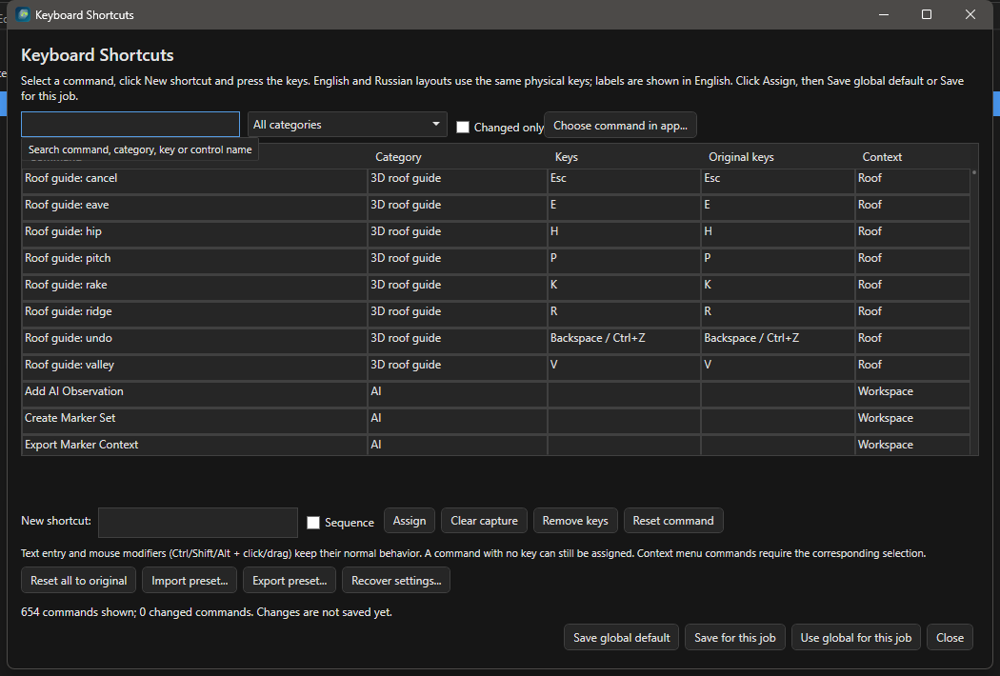

# Горячие клавиши OurPlanCore

Здесь - единственная на сайте таблица клавиш OurPlanCore 3.0: исходные назначения по группам, что делать с русской раскладкой и как переназначить. Нужно, когда рука тянется к клавише, а не к кнопке. Шпаргалка внутри программы - ++f1++.

<figure markdown>
  
  <figcaption markdown="span">F1 показывает текущие назначения, в том числе переназначенные. Второй F1 или Esc закрывает.</figcaption>
</figure>

Ниже исходные назначения (defaults). Если профиль менялся, актуальные значения показывает ++f1++ и редактор клавиш. Клавиша срабатывает только там, где команда применима: инструменты и правка - во вьюпорте, команды деревьев - в Pages или Takeoffs. Когда фокус в текстовом поле, буква печатается, а не запускает команду.

## Файл, помощь, вид

| Клавиша | Действие |
| --- | --- |
| ++ctrl+o++ / ++ctrl+shift+o++ | Open / Import, выбор проекта / список недавних |
| ++ctrl+s++ / ++ctrl+shift+s++ | Save / Save As |
| ++f1++ | шпаргалка клавиш |
| ++ctrl+shift+p++ | Command Palette: любая команда по имени |
| ++f++ | Fit: лист целиком |
| ++ctrl+plus++ / ++ctrl+minus++ | зум; колесо мыши с шагом из `Settings > Defaults` |
| ++b++ потом ++k++ | Add Bookmark (последовательность, до 0.9 с между нажатиями) |
| ++minus++ | свернуть деревья Pages и Takeoffs |
| ++h++ | Hide Selected Takeoffs Only: спрятать на листе takeoff выделенного сегмента или строки |

Правая кнопка мыши всегда панорамирует, в любом инструменте.

## Инструменты

| Клавиша | Инструмент | Что делает |
| --- | --- | --- |
| ++e++ | Select | выбор и правка; ++ctrl++ добавить к выбору, ++ctrl+shift++ убрать, ++alt++ вершины |
| ++v++ | Pan | двигать вид |
| ++s++ | Scale | масштаб по известному размеру |
| ++r++ | Ruler | размер без количества |
| ++p++ | Count | метки, штуки |
| ++l++ | Line | ломаная, погонные футы |
| ++a++ | Area | площадь; ++f9++ бокс |
| ++j++ | J Area | Joist Area |
| ++b++ | Beam | балка по двум точкам |
| ++o++ | Openings | проём боксом |
| ++x++ | Cut | вырез в Area, стирание Line |
| ++space++ | Record | продолжить активный takeoff / остановить |
| ++shift+h++ | Highlight | маркер (разметка) |
| ++d++ | Draw Line / Extra Joists | линия разметки; в выделенной Joist Area - дополнительные joists |
| ++n++ | Note | текстовая заметка на листе |
| ++f3++ / ++ctrl+f3++ | Snap / PDF Snap | привязка к своим точкам / к векторам PDF |
| ++f8++ | Ortho | 90° и 45°; ++shift++ при рисовании включает временно |
| ++f9++ | Box | режим двух углов для Area, Cut, Hide |

В 3.0 ++h++ больше не Highlighter: ++h++ прячет takeoff, маркер на ++shift+h++. В режиме Roof guide ++h++ остаётся Hip.

## Рисование и правка во вьюпорте

| Клавиша | Действие |
| --- | --- |
| ++c++ | завершить рисование (двойной клик тоже) |
| ++esc++ | отменить рисование, выйти из инструмента |
| ++backspace++ / ++ctrl+z++ | убрать последнюю точку / отменить действие |
| ++tab++ | цикл вариантов Layer Trace, переключение edge-snap |
| ++enter++ | следующий шаг Layer Trace |
| ++ctrl+c++ / ++ctrl+v++ | копировать замеры / Paste Measurements (Same или New takeoffs) |
| ++ctrl+a++ / ++delete++ | выбрать всё на листе / удалить выбранное |
| ++f2++ | переименовать takeoff выбранного объекта |
| ++ctrl+m++ / ++ctrl+shift+m++ | Merge / Split: целые takeoff из дерева или сегменты с листа |
| ++ctrl+shift+b++ | Break: Line на отдельные сегменты |
| ++ctrl+shift+v++ | Break H/V: сегменты в takeoff `- Horizontal` и `- Vertical` |
| ++shift++ при повороте | шаг 15° (ручка поворота разметки и кропов) |

Подробно о Merge, Split, Break - [Правка takeoff](ourplancore-edit-takeoffs.md).

## Деревья Pages и Takeoffs

| Клавиша | Pages | Takeoffs |
| --- | --- | --- |
| ++ctrl+c++ / ++ctrl+x++ / ++ctrl+v++ | копировать, вырезать, вставить лист | то же для позиций и папок |
| ++ctrl+d++ | Duplicate Page | дублировать позицию |
| ++ctrl+up++ / ++ctrl+down++ | переместить узел | переместить узел |
| ++ctrl+z++ | вернуть удалённое | вернуть удалённое; откат Merge / Split |
| ++f2++ / ++delete++ | Rename Page / удалить | Rename / удалить |
| ++esc++ | снять выделение | |
| ++ctrl+enter++ | | выделить замеры секции на листе |
| ++h++ | | спрятать takeoff выбранных строк на текущем листе |
| ++f4++ | Set Scale на выделенных листах | |
| ++f5++ | Name / Scale Setup | |
| ++t++ | | New takeoff item (в рабочем окне) |
| ++ctrl+shift+v++ | | Break H/V (не Paste) |

Закладки и AI Inbox: ++enter++ открыть, ++delete++ удалить.

## Roof guide и Sheet Overlay

| Контекст | Клавиши |
| --- | --- |
| Roof guide (3D) | ++r++ Ridge, ++h++ Hip, ++v++ Valley, ++e++ Eave, ++k++ Rake, ++p++ Pitch; ++backspace++ / ++ctrl+z++ назад, ++esc++ отмена линии или выход |
| Sheet Overlay | ++ctrl+alt+left++ / ++right++ / ++up++ / ++down++ сдвиг; ++ctrl+alt+plus++ / ++ctrl+alt+minus++ масштаб; `Ctrl+Alt+[` / `Ctrl+Alt+]` поворот; ++ctrl+alt+0++ сброс; с ++shift++ точный шаг |

## Без клавиши по умолчанию

Назначаются в редакторе: Mirror selected objects horizontally / vertically, Hide / Show All Takeoffs, Pitch, Similar, P Line, Ends, Repeat Line, Repeat Beam, Combine Areas (пять операций), Undo Last Page Sort, Undo Last Page Operation, Toggle Dark Theme, Codex / Claude Terminal и все пункты меню и лент (в каталоге больше 600 команд).

## Русская раскладка

Клавиши работают по физической кнопке: ++l++ рисует Line и в EN, и в RU раскладке, подписи остаются английскими. Переключать раскладку ради клавиш не нужно: можно писать заметки по-русски и сразу жать ++p++.

## Назначить или поменять клавишу {#remap}

<figure markdown>
  
  <figcaption markdown="span">Поиск, таблица команд, поле New shortcut и кнопки сохранения.</figcaption>
</figure>

1. `Settings > Keyboard Shortcuts > Open Keyboard Shortcuts...`.
2. Найдите команду: поиск по имени, категории, клавише или имени кнопки (`Search command, category, key or control name`); галка `Changed only` показывает только изменённые.
3. Кликните поле `New shortcut:`, нажмите сочетание, `Assign`. Для последовательности до трёх нажатий включите `Sequence`.
4. Конфликт в том же контексте редактор покажет и предложит перенос; проверьте, у какой команды снимается назначение.
5. `Save global default` для всех проектов или `Save for this job` для открытого. Проектная копия сильнее; `Use global for this job` её снимает.

| Кнопка | Что делает |
| --- | --- |
| `Remove keys` | убрать назначения выбранной команды |
| `Reset command` / `Reset all to original` | вернуть исходные в черновик; потом Save |
| `Import preset...` / `Export preset...` | загрузить или сохранить набор как JSON |
| `Choose command in app...` | редактор прячется: ++ctrl++ и клик переходит по вкладкам и меню, обычный клик выбирает команду, ++esc++ заканчивает |
| `Recover settings...` | если файл назначений не читается: `Retry reading`, `Restore / import...`, `Reset to original keys` |

До Save старые клавиши продолжают работать. Назначение на поле ввода переводит в него фокус, на список - открывает выбор; это не макрос. Выключенный модуль и read-only проект остаются ограничением и при назначенной клавише.

## См. также

- [Правка takeoff](ourplancore-edit-takeoffs.md)
- [Инструменты замера](ourplancore-tools.md)
- [Settings: все категории](ourplancore-settings.md)
- [Решение проблем](ourplancore-troubleshooting.md)
- [Excel macro hotkeys](excel-hotkeys.md) - сочетания VBA в книге Excel, не программы
