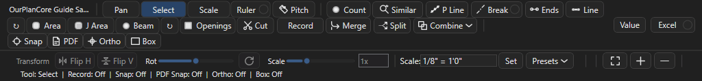
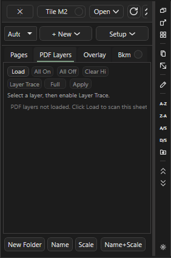

# Snap and tracing

This page covers the toggles on the bottom strip (`Snap`, `PDF`, `Ortho`, `Box`), the PDF Layers tab and Layer Trace, wall tracing inside an area, and tracing requests through the AI Inbox. In everyday measuring an outline is traced with clicks using `Ortho` and `Snap`; tracing is needed rarely, when the drawing is vector and there are many walls. How these techniques combine with editing: [Editing measurements and snaps](ourplancore-editing.md).

## Snaps on the tool strip { #snap }

<figure markdown>
  
  <figcaption markdown="span">Right end of row 1: four toggles `Snap`, `PDF`, `Ortho`, `Box`. An active toggle is highlighted and applies to all drawing tools and to dragging vertices.</figcaption>
</figure>

| Button | Key | What it does | When to turn it on |
| --- | --- | --- | --- |
| `Snap` | ++f3++ | the cursor catches on points of your own measurements and markup on the sheet: ends and corners (`end`), segment midpoints (`mid`), intersections (`intersection`), Count marks, points of the drawing in progress; radius 14 screen px | continue a wall exactly from the end of the neighboring one, close an outline at the same vertex, bring two lines together at a corner |
| `PDF` | ++ctrl+f3++ | snap to corners and lines of a vector PDF; see the [warning](#pdf-snap) | almost never |
| `Ortho` | ++f8++ | the next point only horizontal or vertical from the previous one; ++shift++ while drawing or dragging turns it on temporarily | rectangular plans, so the line does not drift by a fraction of a degree |
| `Box` | ++f9++ | Line and Area by two opposite corners instead of point by point; works for `Cut`, the `Area` annotation and the `Hide` mask | rectangular room, shaft cutout, mask box |

Snaps do not change finished measurements and do not affect quantities: a wall traced with clicks along the centerline without `Snap` gives the same length. Turn them on for clean geometry and a clean PDF, turn them off when the cursor starts sticking to the wrong things.

### How to trace an outline with Snap and Ortho { #snap-ortho }

Why: a polyline with clean corners, closed exactly at the starting point.
You need: a sheet with a scale.

1. Turn on `Ortho` (++f8++) and `Snap` (++f3++).
2. Click `Line` (++l++) or `Area` (++a++), give it a name, **OK**.
3. Zoom in on the first corner and click.
4. Move to the next corner: `Ortho` holds the axis. On a skewed run release `Ortho` with one ++f8++ and turn it back on afterwards.
5. To continue from someone else's end, hover over the end of another line: the `Snap` highlight shows `end`, click.
6. Close it: bring the cursor to the first point (`end` highlight) and click; for an Area a click near the first point closes it by itself. Finish with ++c++ or a double click.

Result: an outline with no gaps at the corners; `Total` shows the length or area.

<figure markdown>
  <video class="kb-demo" loop muted playsinline preload="none" poster="../../assets/images/ourplancore/demo/d-snap.png"><source src="../../assets/images/ourplancore/demo/d-snap.mp4" type="video/mp4"></video>
  <figcaption markdown="span">Demo: ++f3++ (`Snap`) and ++f8++ (`Ortho`) run a line from the ends of the neighboring one; ++f9++ (`Box`) draws a rectangular area with two clicks.</figcaption>
</figure>

!!! tip "Tips"
    - ++shift++ holds the axis also when dragging a handle or a whole measurement (`Shift = ortho` in the status bar).
    - `Snap` also works when dragging a vertex: the corner of one wall sticks to the end of another.
    - An extra point while drawing is removed with ++backspace++.

### How to draw a rectangle with two clicks { #box }

Why: a rectangular room, shaft or mask box without four clicks.
You need: a sheet with a scale.

1. Turn on `Box` (++f9++).
2. Pick `Area`, `Line` or `Cut`.
3. Click one corner, then the opposite one.

Result: a finished rectangle; for a Line, a closed outline of four sides. The status `Cut: box is too small` or `cancelled: the box has no size` means the corners are too close.

### Why PDF Snap is almost never used { #pdf-snap }

!!! warning "Works unreliably"
    The owner's words: "PDF snap works very badly, I almost never use it." `PDF` (++ctrl+f3++) catches on corners and lines of the PDF vector and on black lines of a raster; on real plans it sticks to borders, leaders and dimension lines just as readily as to walls, and needs a black-line index for scans. The recipes in this knowledge base do not use it: accuracy comes from `Ortho`, `Box`, `Snap` to your own points, zoom and editing vertices afterwards.

If you do turn it on: the status reads `PDF Snap on: current sheet and sheet overlay vector points/lines`; ++tab++ cycles the modes for continuing along the drawing (`vertices / edge / edges / contour / polyline`), **Viewport > PDF SNAP > Bridge** sets the continuation radius (slider `PDF Snap Tab continuation radius`, 4-96 screen px, default 36). It is turned off with the same ++ctrl+f3++.

## PDF Layers { #layers }

<figure markdown>
  
  <figcaption markdown="span">The sheet's layer list with visibility checkboxes and the `Load`, `All On`, `All Off`, `Clear Hi`, `Layer Trace`, `Full`, `Apply` buttons.</figcaption>
</figure>

The `PDF Layers` sub-tab in the Pages panel (PDF Layers module, on by default) works with a vector PDF in which the drafter left layers: walls, dimensions, furniture, text. A scan has no layers.

### How to hide unneeded drawing layers { #layers-hide }

Why: remove dimensions and furniture so you see only the walls while tracing.
You need: a vector PDF; the `PDF layers` checkbox on the **Display** ribbon turned on (by default the sheet is shown as one `Static image` picture).

1. Open the `PDF Layers` tab under Pages and click `Load`: layers are read on demand.
2. Untick the layers you do not need: the sheet redraws right away, status `Layer off: <layer>`. `All Off` and `All On` toggle all of them.
3. To find a layer on the sheet, tick `Hi` on its row: the layer is highlighted; `Clear Hi` removes the highlight.

Result: the sheet shows only the layers that are on. The `Apply` button in this panel belongs to Layer Trace, it is not needed for visibility. Hidden layers also stay out of Crop to Sheet crops: a crop takes the visibility of the source sheet ([crops](ourplancore-sheets-advanced.md#crop)).

## Layer Trace { #layer-trace }

Tracing by layer: the app takes the geometry of one PDF layer (for example the walls layer) and turns it into a measurement without clicking it out. Vector PDFs only.

### How to take a takeoff from a PDF layer { #layer-trace-how }

Why: the outline or walls are on a separate layer, and it can be taken as a whole.
You need: layers loaded (`Load`), a sheet with a scale, an active takeoff of the type the mode produces (table below): Area for `Full`, Line for `Edge` and `All Edges`, Count for `Point`.

1. Make the right takeoff active: select it in Takeoffs and press ++space++, or create a new one with a tool button.
2. Click `Layer Trace` in the PDF Layers panel. A trace bar appears above the sheet; its toggle shows `Layer Trace` instead of `Manual`.
3. Pick the layer: click its row in the list, or hover over the drawing geometry (status `Layer Trace hover: <layer>. Click/Enter locks layer; Tab cycles candidates`) and click or press ++enter++ to lock the layer.
4. Pick the mode: ++tab++ or the button with the mode name (on the bar above the sheet and in the panel) cycles `Full`, `Edge`, `Point`, `All Edges`; the status shows the current one.
5. Hover over the line of the layer you need and click or press ++enter++ (the `Apply` button in the panel does the same): status `Layer Trace added <type> from '<layer>'`.
6. Check the result in the tree and on the sheet: delete extra segments (dimension lines, borders) with the `Select` tool; ++ctrl+z++ undoes the creation.

| Mode | What it creates |
| --- | --- |
| `Full` | one Area: a rectangle around the extents of the whole layer geometry, not along its outline |
| `Edge` | one Line: the layer segment nearest to the cursor |
| `Point` | one Count mark at the cursor point |
| `All Edges` | up to 48 of the longest layer segments, each as a separate Line |

Result: the measurement goes into the active takeoff. If there is no active takeoff of the right type, the app removes what it created with the status `No Line takeoff item is active...` (or `Area`, `Count`). If there is nothing under the cursor: `Layer Trace: no PDF layer found under this point`.

### Layer menu in the PDF Layers list { #layer-menu }

A right-click on a layer row opens a menu with the layer name in the header. The `Trace ... to Takeoff` items turn on Layer Trace right away, set the mode and create a measurement in the active takeoff; they take the point where the cursor last was on the sheet. So first hover over the line you need, then move the cursor into the list and open the menu.

| Item | What it does |
| --- | --- |
| `Use for Layer Trace` | makes the layer the trace layer without hovering over the drawing; with `Layer Trace` on it is ready to create a measurement right away |
| `Trace Full Layer to Takeoff` | `Full` mode: an Area around the layer extents |
| `Trace Nearest Edge to Takeoff` | `Edge` mode: the segment at the last cursor point |
| `Trace Point to Takeoff` | `Point` mode: a Count mark at the last cursor point |
| `Trace All Edges to Takeoff` | `All Edges` mode: up to 48 of the longest segments |
| `Show Layer` / `Hide Layer` | turn the layer on or off, like the checkbox in the row |
| `Highlight Layer` / `Clear Highlight` | highlight the layer on the sheet or remove the highlight, like the `Hi` checkbox |

With the AI module on there are two more items at the top, `Save Layer Info for AI` and `Queue AI Request for This Layer`: they write the layer details into the AI Inbox ([AI in the app](ourplancore-ai.md)).

## Trace Walls Inside Area { #wall-trace }

Deterministic wall tracing inside an area that is already drawn: from the PDF vector lines the app builds wall centerlines and puts them into a new Line takeoff. Requires the Advanced Takeoff Tools module (on).

### How to take off the walls inside an area { #wall-trace-how }

Why: dozens of partitions of a unit or a floor in one action, then just a check.
You need: a vector PDF, a sheet with a scale, an Area along the zone outline (a finished `1st` works).

1. Right-click the area on the sheet or its row in Takeoffs: **Trace Walls Inside Area...**.
2. In the `Trace Walls Inside Area` dialog set `New Line takeoff` (name per the canon, for example `int 2x4 9.09`).
3. Check `Wall thickness (distance between the two face lines)`: 3 and 13 inches by default; `Ignore walls shorter than` 1 ft.
4. On sheets with dark fill on bearing and rated walls, tick `Only solid (dark) filled walls - demising / corridor / rated`: the light gray unit partitions are dropped. Leave `Dark cutoff` at `auto`.
5. The `Include perimeter walls on the area edge` checkbox adds lines along the area boundary (off by default: exterior walls are measured separately); `Edge offset` 1 ft sets the width of that zone.
6. Click **Trace**. Status `Tracing walls: reading sheet vector/raster lines...`.
7. Check the length against a hand-traced run on at least one segment, delete extra lines, draw the missing ones with `Record`.

Result: a Line takeoff with centerlines. Short fragments, text and leaders are filtered out, collinear pieces are joined. If the vector did not work, the status reads `PDF lines did not match; trying raster image`; the `Allow rough image-only trace (may catch text)` checkbox allows a rough trace from the image.

!!! tip "Tips"
    - Without a sheet scale the trace does not start: `Set the sheet scale first: wall thickness is measured in real inches`.
    - The trace does not tell ext from int and does not know the height: sorting into takeoffs stays with the estimator.
    - Where walls are drawn with a single line and no fill, the fill filter turns itself off; check the result more carefully.

## Tracing requests through the AI Inbox { #ai-trace }

With the AI module on, the sheet context menu has the items `Trace wall from this point`, `Trace closed area` and `Check missed takeoffs on this page`. They do not draw right away: they create an AI Inbox entry with the text `Pending SmartTrace request` or `Pending SmartCheck request`, which is then run and checked through AI Manager or the AI terminal ([AI console](ourplancore-ai-console.md), [AI Manager](ourplancore-managers.md#ai-manager)). The result reaches the tree only after confirmation.

## Traps { #traps }

- `Snap` on a dense drawing catches on a neighboring measurement or markup: turn off ++f3++ or zoom in.
- `Ortho` gets in the way on plans with diagonal walls: hold ++shift++ only on the run that needs it.
- `Box` stays on for all tools: after a rectangle turn off ++f9++, otherwise the next polyline closes after the second click.
- `PDF` is silent on a scan without a black-line index; on a vector it catches on borders as readily as on walls.
- Layer Trace and Trace Walls give candidates, not a finished measurement: check the total length against a hand trace.

## See also

- [Editing measurements and snaps](ourplancore-editing.md): selection, vertices, recipes
- [Merge, Split, Break, Ends, Combine, Similar](ourplancore-edit-takeoffs.md)
- [Measuring tools](ourplancore-tools.md), [Sheets (Pages)](ourplancore-pages.md)
- [Extra features](ourplancore-extras.md), [Ideas and plans](ourplancore-ideas.md): AI Auto Trace
