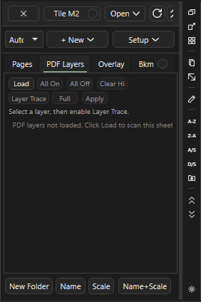

# Snap и трассировка

Здесь: переключатели на нижней полосе (`Snap`, `PDF`, `Ortho`, `Box`), вкладка PDF Layers и Layer Trace, трасса стен внутри площади и запросы трассы через AI Inbox. В повседневном замере контур обводится кликами с `Ortho` и `Snap`; трассировка нужна редко, когда чертёж векторный и стен много. Как эти приёмы сочетаются с правкой: [Правка замеров и привязки](ourplancore-editing.md).

## Привязки на полосе инструментов { #snap }

<figure markdown>
  
  <figcaption markdown="span">Правый край строки 1: четыре переключателя `Snap`, `PDF`, `Ortho`, `Box`. Включённый подсвечен и действует для всех инструментов рисования и для перетаскивания вершин.</figcaption>
</figure>

| Кнопка | Клавиша | Что делает | Когда включать |
| --- | --- | --- | --- |
| `Snap` | ++f3++ | курсор цепляется к точкам своих замеров и разметки на листе: концам и углам (`end`), серединам сегментов (`mid`), пересечениям (`intersection`), меткам Count, точкам текущего рисования; радиус 14 px экрана | продолжить стену точно от конца соседней, замкнуть контур в ту же вершину, свести угол двух линий |
| `PDF` | ++ctrl+f3++ | привязка к углам и линиям векторного PDF; см. [предупреждение](#pdf-snap) | почти никогда |
| `Ortho` | ++f8++ | следующая точка только по горизонтали или вертикали от предыдущей; ++shift++ во время рисования или перетаскивания включает временно | прямоугольные планы, чтобы линия не уезжала на долю градуса |
| `Box` | ++f9++ | Line и Area двумя противоположными углами вместо обвода по точкам; работает для `Cut`, аннотации `Area` и маски `Hide` | прямоугольная комната, вырез шахты, бокс маски |

Привязки не меняют готовые замеры и не влияют на количество: стена, обведённая кликами по оси без `Snap`, даёт ту же длину. Включайте их ради аккуратной геометрии и чистого PDF, выключайте, когда курсор начинает прилипать не туда.

### Как обвести контур с Snap и Ortho { #snap-ortho }

Зачем: ломаная с ровными углами, замкнутая точно в начальную точку.
Нужно: лист с масштабом.

1. Включите `Ortho` (++f8++) и `Snap` (++f3++).
2. Нажмите `Line` (++l++) или `Area` (++a++), задайте имя, **OK**.
3. Приблизьте зум к первому углу и кликните.
4. Ведите к следующему углу: `Ortho` держит ось. На косом участке отпустите `Ortho` одним ++f8++ и верните после.
5. Для продолжения от чужого конца наведите курсор на конец другой линии: подсветка `Snap` показывает `end`, кликните.
6. Замкните: подведите курсор к первой точке (подсветка `end`) и кликните; у Area клик рядом с первой точкой замыкает сам. Закончите ++c++ или двойным кликом.

Результат: контур без щелей в углах; `Total` показывает длину или площадь.

<!-- DEMO: d-snap -->

!!! tip "Советы"
    - ++shift++ держит ось и при перетаскивании ручки или всего замера (`Shift = ortho` в статусе).
    - `Snap` работает и при перетаскивании вершины: угол одной стены прилипает к концу другой.
    - Лишняя точка во время рисования снимается ++backspace++.

### Как нарисовать прямоугольник двумя кликами { #box }

Зачем: прямоугольная комната, шахта или бокс маски без четырёх кликов.
Нужно: лист с масштабом.

1. Включите `Box` (++f9++).
2. Выберите `Area`, `Line` или `Cut`.
3. Кликните один угол, затем противоположный.

Результат: готовый прямоугольник; для Line замкнутый контур из четырёх сторон. Статус `Cut: box is too small` или `cancelled: the box has no size` означает, что углы слишком близко.

### Почему PDF Snap почти не используют { #pdf-snap }

!!! warning "Работает ненадёжно"
    Слова владельца: "привязка к PDF очень плохо работает, я её не использую почти". `PDF` (++ctrl+f3++) цепляется к углам и линиям вектора PDF и к чёрным линиям растра; на реальных планах она так же охотно прилипает к рамкам, выноскам и размерным линиям, как к стенам, и требует индекс чёрных линий для сканов. В рецептах этой базы она не используется: точность дают `Ortho`, `Box`, `Snap` к своим точкам, зум и правка вершин после.

Если всё же включить: статус `PDF Snap on: current sheet and sheet overlay vector points/lines`; ++tab++ перебирает режимы продолжения по чертежу (`vertices / edge / edges / contour / polyline`), **Viewport > PDF SNAP > Bridge** задаёт радиус продолжения (4-96 px экрана, по умолчанию 36). Выключается тем же ++ctrl+f3++.

## PDF Layers { #layers }

<figure markdown>
  
  <figcaption markdown="span">Список слоёв листа с галками видимости и кнопками `Load`, `All On`, `All Off`, `Clear Hi`, `Layer Trace`, `Full`, `Apply`.</figcaption>
</figure>

Под-вкладка `PDF Layers` в панели Pages (модуль PDF Layers, включён по умолчанию) работает с векторным PDF, в котором автор чертежа оставил слои: стены, размеры, мебель, текст. Скан слоёв не имеет.

### Как скрыть лишние слои чертежа { #layers-hide }

Зачем: убрать размеры и мебель, чтобы видеть только стены при обводке.
Нужно: векторный PDF; на ленте **Display** включена галка `PDF layers` (по умолчанию лист показан одной картинкой `Static image`).

1. Откройте вкладку `PDF Layers` под Pages и нажмите `Load`: слои читаются по запросу.
2. Снимите галки у ненужных слоёв; `All Off` и `All On` переключают все. Кнопка `Hi` у строки подсвечивает слой на листе, `Clear Hi` снимает подсветку.
3. Нажмите `Apply`.

Результат: лист показывает только включённые слои. Скрытые слои не попадают и в кропы Crop to Sheet: кроп берёт видимость листа-источника ([кропы](ourplancore-sheets-advanced.md#crop)).

## Layer Trace { #layer-trace }

Трасса по слою: программа берёт геометрию одного слоя PDF (например слоя стен) и превращает её в замер без обвода кликами. Только векторные PDF.

### Как снять позицию со слоя PDF { #layer-trace-how }

Зачем: контур или стены лежат отдельным слоем, и его можно взять целиком.
Нужно: слои загружены (`Load`), лист с масштабом.

1. Выберите слой в списке (клик по строке) и нажмите `Layer Trace`. Над листом появляется полоса трассы; переключатель на ней показывает `Layer Trace` вместо `Manual`.
2. Наведите курсор на геометрию чертежа: статус `Layer Trace hover: <слой>. Click/Enter locks layer; Tab cycles candidates`.
3. Кликните или нажмите ++enter++, чтобы зафиксировать слой.
4. ++tab++ меняет режим трассы (`Full`, `Edge`, `Point`), статус показывает текущий.
5. Кликните или нажмите ++enter++: статус `Layer Trace added <тип> from '<слой>'`.
6. Проверьте результат в дереве и на листе: лишние сегменты (размерные линии, рамки) удалите инструментом `Select`; ++ctrl+z++ откатывает создание.

Результат: новая позиция из геометрии слоя. Кнопка `Full` в панели затемняет остальной чертёж во время трассы. Если под курсором ничего нет: `Layer Trace: no PDF layer found under this point`.

## Trace Walls Inside Area { #wall-trace }

Детерминированная трасса стен внутри уже нарисованной площади: из векторных линий PDF программа строит центрлинии стен и складывает их в новую позицию Line. Нужен модуль Advanced Takeoff Tools (включён).

### Как снять стены внутри площади { #wall-trace-how }

Зачем: десятки перегородок юнита или этажа одним действием, потом только проверка.
Нужно: векторный PDF, лист с масштабом, Area по контуру зоны (годится готовая `1st`).

1. ПКМ по площади на листе или по её строке в Takeoffs: **Trace Walls Inside Area...**.
2. В диалоге `Trace Walls Inside Area` задайте `New Line takeoff` (имя по канону, например `int 2x4 9.09`).
3. Проверьте `Wall thickness (distance between the two face lines)`: по умолчанию 3 и 13 дюймов; `Ignore walls shorter than` 1 ft.
4. На листах с тёмной заливкой несущих и rated-стен поставьте `Only solid (dark) filled walls - demising / corridor / rated`: светло-серые перегородки юнитов отбрасываются. `Dark cutoff` оставьте `auto`.
5. Галка `Include perimeter walls on the area edge` добавляет линии вдоль границы площади (по умолчанию выключена: наружные стены меряют отдельно); `Edge offset` 1 ft задаёт ширину этой зоны.
6. Нажмите **Trace**. Статус `Tracing walls: reading sheet vector/raster lines...`.
7. Проверьте длину против ручного обвода хотя бы одного участка, лишние линии удалите, недостающие дорисуйте через `Record`.

Результат: позиция Line с центрлиниями. Короткие обрывки, текст и выноски отфильтрованы, коллинеарные куски склеены. Если вектор не подошёл, статус `PDF lines did not match; trying raster image`; галка `Allow rough image-only trace (may catch text)` разрешает грубую трассу по картинке.

!!! tip "Советы"
    - Без масштаба листа трасса не стартует: `Set the sheet scale first: wall thickness is measured in real inches`.
    - Трасса не отличает ext от int и не знает высоту: раскладка по позициям остаётся на эстиматоре.
    - Там, где стены нарисованы одной линией без заливки, фильтр заливки отключается сам; результат проверяйте внимательнее.

## Запросы трассы через AI Inbox { #ai-trace }

При включённом модуле AI в контекстном меню листа есть пункты `Trace wall from this point`, `Trace closed area` и `Check missed takeoffs on this page`. Они не рисуют сразу: создаётся запись в AI Inbox с текстом `Pending SmartTrace request` или `Pending SmartCheck request`, которую потом выполняют и проверяют через AI Manager или терминал ИИ ([консоль ИИ](ourplancore-ai-console.md), [AI Manager](ourplancore-managers.md#ai-manager)). В дерево результат попадает только после подтверждения.

## Ловушки { #traps }

- `Snap` на плотном чертеже цепляется к соседнему замеру или разметке: выключите ++f3++ или приблизьте зум.
- `Ortho` мешает на планах с диагональными стенами: держите ++shift++ только на нужном отрезке.
- `Box` остаётся включённым для всех инструментов: после прямоугольника выключите ++f9++, иначе следующая ломаная замкнётся после второго клика.
- `PDF` на скане без индекса чёрных линий молчит; на векторе цепляется к рамкам так же охотно, как к стенам.
- Layer Trace и Trace Walls дают кандидатов, не готовый замер: сумма длин проверяется против ручного обвода.

## См. также

- [Правка замеров и привязки](ourplancore-editing.md): выделение, вершины, рецепты
- [Merge, Split, Break, Ends, Combine, Similar](ourplancore-edit-takeoffs.md)
- [Инструменты замера](ourplancore-tools.md), [Листы (Pages)](ourplancore-pages.md)
- [Дополнительные возможности](ourplancore-extras.md), [Идеи и планы](ourplancore-ideas.md): AI Auto Trace
