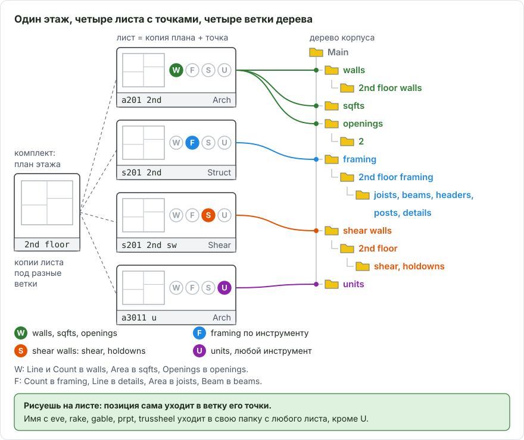

# Split by sheets and routing

Here: how a drawing set is split into working sheets for each kind of work, which sheet carries which W/F/S/U dot, what is drawn on it, and why a new takeoff goes into the right branch of the tree by itself. Needed at the start of every job and when the tree "sorted itself" the wrong way. How the rules work: [Names and auto-routing](takeoff-naming.md), settings: [Routing: settings](ourplancore-routing.md), folder and name canon: [Takeoff tree and sheet names](../start/takeoff-structure.md).

<figure markdown>
  <video class="kb-demo" loop muted playsinline preload="none" poster="../../assets/images/ourplancore/demo/d-routing.png"><source src="../../assets/images/ourplancore/demo/d-routing.mp4" type="video/mp4"></video>
  <figcaption markdown="span">Demo on a real job: a wall on a W sheet goes to `walls/3rd floor walls`, a beam on an F sheet to `framing/3rd floor framing/beams`, a shear wall on a sheet copy with the S dot to `shear walls`.</figcaption>
</figure>

<figure markdown>
  
  <figcaption markdown="span">One floor gives several working sheets: an architectural plan with the W dot, a structural plan with the F dot, a plan copy for shear walls with the S dot, a unit plan with the U dot. Each dot leads to its own branch of one building's tree.</figcaption>
</figure>

## Why split

The demo job shows all takeoffs on one sheet: area, walls, beam, joists, openings, roof together. That is handy for seeing what the app can do, but it is not how real work is done:

- The sheet legend lists only the takeoffs measured on that sheet. A sheet with everything on it gives a legend half a sheet long that the client will not read.
- The PDF sent to the client has one kind of work per sheet: walls read on the architectural plan, framing on the structural plan, shear walls on their own copy.
- The sheet dot sorts new takeoffs by itself: on a W sheet a Line goes to walls, on an F sheet to framing, on an S sheet to shear walls. Without splitting, every takeoff would have to be moved by hand.
- Checking is easier: open `s201 2nd` and you see only the 2nd floor framing and its legend.

## Which sheet carries what

Rule: one dot per sheet, one kind of work per sheet. Example for the 2nd floor, paths from the building root.

| Sheet | Dot | What we draw | Tool | Where it goes by itself |
| --- | --- | --- | --- | --- |
| `a201 2nd`, architectural plan | W 2 | walls `ext 2x6 9.09`, `corr 2x6 11.7`, `2x4 9.09`; floor area `2nd` | Line; Area | `walls/2nd floor walls`; `sqfts` |
| `s201 2nd`, structural plan | F 2 | joists, beams, posts, headers, details by number, stairs | J Area; Beam; Count; Line | `framing/2nd floor framing/joists`, `.../beams`, the floor root for Count (posts and headers later go to `posts` and `headers/ext` or `int`), `.../details` |
| plan copy in `Struct/Shear` | S 2 | shear walls per schedule `SW1-1`; holdowns `HDU11 SB1x30 S2.2` | Line; Count | `shear walls/2nd floor/shear`; `shear walls/2nd floor/holdowns` |
| `a3011 u`, unit plan | U | partitions of a typical unit `A 2x4` | Line | `units` with any tool |
| `a105 rf`, roof plan | W R | roof planes `rf 6`; eaves `eve 24 main`, `rake 12 main`; `trussheel 0.66` | Area; Line | `sqfts`; `eves rakes/eves` and `rakes`; `trussheel` (by name, the dot does not matter) |
| `a201 el` elevations, `s501 d` details | no dot | openings `4.3x7.8`; gables `gable`; parapets `prpt 6.4 5.3 0.5`; detail items | Openings; Area; Line | `openings`, `gables/...`, `parapets` by tool and name; a detail item without a rule word stays in the selected folder |

What matters here:

- Elevations and details get no dot (the tags `el`, `d`, `sec`, `rcp` are on the skip list), and that is fine: openings are routed by the Openings tool, and `gable`, `prpt`, `eve`, `rake`, `trussheel` by the name. For anything else on a sheet without a dot, first select the right folder in Takeoffs (for example `framing/2nd floor framing/details`), then draw, or continue an existing takeoff with `Record`.
- Posts and headers on an F sheet go into the floor root `framing/2nd floor framing`; they are moved into `posts` and `headers/ext|int` after the takeoff, or created right in the right folder (`New Item` with the folder selected). A post is counted on the framing floor it supports.
- Holdowns are counted on the S sheet together with the shear walls, not on the framing plan: a Count on an S sheet goes to `holdowns` by itself.
- Sheet copies are needed only for shear walls, for a second level on one sheet, for another building and for a new sheet set. Do not make a copy for each takeoff type: walls and areas are drawn on one W sheet and split by tool.

## The sheet legend shows only its own takeoffs { #legend }

The legend is built from takeoffs that have measurements on this sheet; the same takeoffs are visible in Pages under the sheet. So on `a201 2nd` the legend has only the 2nd floor walls and area, and on the shear copy only the SW marks and holdowns. A takeoff drawn on two sheets appears in both legends. Legend order, groups and size: [PDF and delivery, legend](ourplancore-pdf.md#legend), [legend groups](ourplancore-sheets-advanced.md#legend).

## Example: one building after splitting

2nd floor sheets of a three-story building, folders per the canon:

```text
00. imported/
  Arch/
    a201 2nd          W 2   walls, floor area
    a105 rf           W R   roof, eaves, truss heel
    a3011 u           U     unit A
  Struct/
    s201 2nd          F 2   framing: joists, beams, posts, headers, details
    Shear/
      s201 2nd sw     S 2   copy for shear walls and holdowns
  sections/  details arch/  details struct/  units/
```

The Takeoffs tree of the same building after the takeoff:

```text
sqfts/                        2nd, rf 6
walls/2nd floor walls/        ext 2x6 9.09, corr 2x6 11.7, 2x4 9.09
units/                        A 2x4, B1A 2x4
openings/2/                   4.3x7.8, 3.3x6.5 d
framing/2nd floor framing/
  joists/                     2x10 16"
  beams/                      FB1 8, (2) 1 3/4 x 18 LVL 22
  headers/ext/                ext H228 4
  posts/                      C4 20
  details/                    12/S401, ribbon
shear walls/2nd floor/
  shear/                      SW1-1, WSW-C 7-16 OSB DTT2Z
  holdowns/                   HDU11 SB1x30 S2.2
eves rakes/eves/  rakes/      eve 24 main, rake 12 main
trussheel/                    trussheel 0.66
```

Several buildings: the same picture inside the building folder (`Main/...`, `Grge/...`); the building for new takeoffs is set by the green dot ([building root](ourplancore-takeoffs.md#root)).

## How to make a sheet copy for shear walls { #copy-dot }

<figure markdown>
  <video class="kb-demo" loop muted playsinline preload="none" poster="../../assets/images/ourplancore/demo/d-sheet-rename-dot.png"><source src="../../assets/images/ourplancore/demo/d-sheet-rename-dot.mp4" type="video/mp4"></video>
  <figcaption markdown="span">Demo: ++ctrl+d++ makes a copy of the sheet, ++f2++ names it `a101 1st sw`, a click on the S/1 dot under `Scale` sets the route `S 1st floor`.</figcaption>
</figure>

Why: 2nd floor shear walls and holdowns on a separate copy of the structural plan, with their own legend and their own place in the tree.
You need: the structural plan `s201 2nd` named and scaled; a `Struct/Shear` folder in Pages.

1. In Pages, right-click `s201 2nd` > `Duplicate Page` (`Ctrl+D`). The copy appears next to it with the same name and inherits the original's dot (F 2).
2. `F2`, name `s201 2nd sw`; right-click `Move to Folder...` into `Struct/Shear`. The `sw` tag is on the auto-dot skip list, so renaming will not move the dot; the app never replaces a dot set by hand.
3. Open the copy, click the S dot in column 2 under the Scale header. Status: `Route: S 2nd`.
4. `L`, name `SW1-1`, trace the shear wall run, `C`. In the New Item dialog the destination line shows `shear walls/2nd floor/shear`; after creation the takeoff is there.
5. `P`, name `HDU11 SB1x30 S2.2`, a point at the end of the wall: the takeoff went to `shear walls/2nd floor/holdowns`.
6. The next run of the same mark: select the takeoff, `Space` (Record), keep drawing; Record continues the takeoff and ignores the dot.

Result: in Pages the copy `s201 2nd sw` in `Struct/Shear` with the status `Route: S 2nd`; in Takeoffs `shear walls/2nd floor/shear/SW1-1` and `shear walls/2nd floor/holdowns/HDU11 SB1x30 S2.2`; the copy's legend shows only those.

!!! tip "Tips"
    - A plan copy for a second building on a shared sheet is made the same way (rename, check the dot, green dot on the building): [Multiple buildings](ourplancore-buildings.md).
    - The unit sheet `a3011 u` gets the U dot by itself on renaming; copies for each takeoff type are not needed.

## How to fix a takeoff that went to the wrong place { #fix }

1. Read the status after creation: `Route:` and `Auto routed to ...` tell you which sheet and which row worked; the green dot in Takeoffs shows the building.
2. Move the takeoff by dragging or with `Ctrl+X` and `Paste Into Folder`: measurements, color and legend order are kept.
3. Remove the cause: set the copy's dot, clear the wrong green dot, rename the takeoff without a trap word (`level 2` gets caught by the `eve` rule).
4. If it repeats in every job, change the rule in `Settings` (Sheet Takeoff Routing or Takeoff Name Routing) instead of moving by hand.

Full breakdown: [Names and auto-routing, a takeoff landed in the wrong place](takeoff-naming.md#fix), [Troubleshooting](ourplancore-troubleshooting.md#routing).

## Common mistakes

- Everything drawn on one sheet: the legend is unreadable, the client PDF cannot be assembled by kind of work.
- The shear copy kept the F dot: shear walls landed in `framing/.../details`.
- Sheet copies for each takeoff type: duplicate sheets, empty legends.
- The tag is not last (`a3011 u el`) or two floor tags (`a1.7 1st 2nd`): the dot is not set, takeoffs go into the selected folder.
- `Record` on the wrong takeoff: the measurement goes into it regardless of the sheet.

All sheet and tree mistakes: [Common mistakes](../start/common-mistakes.md#pages).

## See also

- [Sheets (Pages)](ourplancore-pages.md): names, copies, W/F/S/U dots
- [Names and auto-routing](takeoff-naming.md): rule order, the `Route:` status
- [Routing: settings](ourplancore-routing.md): rows, floors, folders by tool
- [Takeoff tree and sheet names](../start/takeoff-structure.md): canon, [Workflow](../start/workflow.md)
