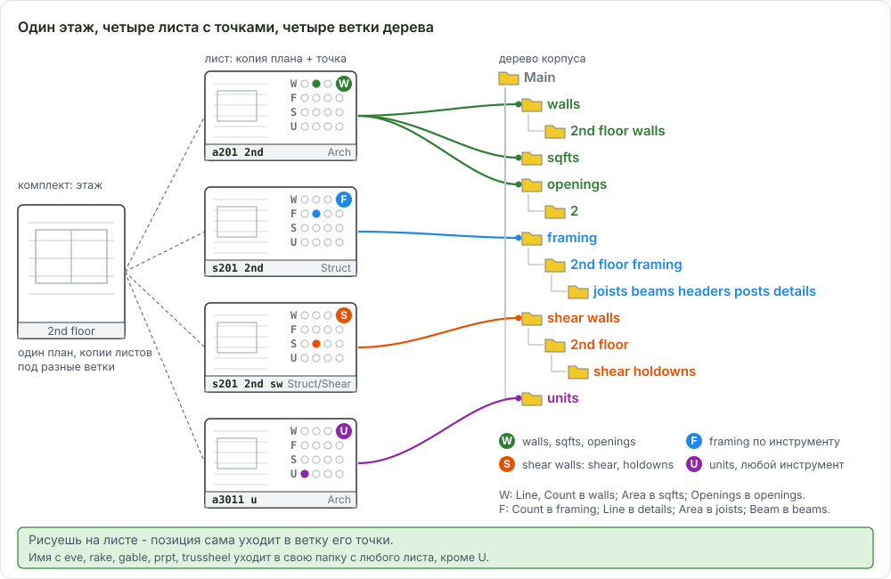

# Раскладка по листам и роутинг

Здесь: как комплект чертежей раскладывается на рабочие листы под виды работ, какой лист несёт какую точку W/F/S/U, что на нём рисуется и почему новая позиция сама уходит в нужную ветку дерева. Нужно в начале каждого проекта и когда дерево "само" разложилось не так. Механика правил - [Имена и автомаршрут](takeoff-naming.md), настройки - [Маршрутизация: настройки](ourplancore-routing.md), канон папок и имён - [Дерево takeoff и имена листов](../start/takeoff-structure.md).

<!-- DEMO: d-routing -->

<figure markdown>
  
  <figcaption markdown="span">Один этаж даёт несколько рабочих листов: архитектурный план с точкой W, структурный с точкой F, копия плана под shear walls с точкой S, план юнита с точкой U. Каждая точка ведёт в свою ветку дерева одного корпуса.</figcaption>
</figure>

## Зачем раскладывать

Демо-проект показывает все позиции на одном листе: площадь, стены, балка, joists, проёмы, кровля вместе. Так удобно смотреть, что умеет программа, но в работе так не делают:

- Легенда листа перечисляет только позиции, измеренные на этом листе. Лист со всем подряд даёт легенду в половину листа, которую клиент не прочитает.
- В PDF клиенту идёт лист с одним видом работ: стены читаются на архитектурном плане, framing на структурном, shear walls на своей копии.
- Точка листа раскладывает новые позиции сама: на W-листе Line уходит в стены, на F-листе в framing, на S-листе в shear walls. Без раскладки каждую позицию пришлось бы переносить руками.
- Проверять проще: открыл `s201 2nd`, видишь только framing второго этажа и его легенду.

## Какой лист что несёт

Правило: одна точка на лист, один вид работ на лист. Пример для второго этажа, пути от корня корпуса.

| Лист | Точка | Что рисуем | Инструмент | Куда ложится само |
| --- | --- | --- | --- | --- |
| `a201 2nd`, архитектурный план | W 2 | стены `ext 2x6 9.09`, `corr 2x6 11.7`, `2x4 9.09`; площадь этажа `2nd` | Line; Area | `walls/2nd floor walls`; `sqfts` |
| `s201 2nd`, структурный план | F 2 | joists, балки, посты, headers, узлы по номерам, лестницы | J Area; Beam; Count; Line | `framing/2nd floor framing/joists`, `.../beams`, корень этажа для Count (посты и headers потом в `posts` и `headers/ext` или `int`), `.../details` |
| копия плана в `Struct/Shear` | S 2 | shear walls по schedule `SW1-1`; holdowns `HDU11 SB1x30 S2.2` | Line; Count | `shear walls/2nd floor/shear`; `shear walls/2nd floor/holdowns` |
| `a3011 u`, план юнита | U | перегородки типового юнита `A 2x4` | Line | `units` любым инструментом |
| `a105 rf`, план кровли | W R | скаты `rf 6`; карнизы `eve 24 main`, `rake 12 main`; `trussheel 0.66` | Area; Line | `sqfts`; `eves rakes/eves` и `rakes`; `trussheel` (по имени, точка не важна) |
| `a201 el` фасады, `s501 d` детали | без точки | проёмы `4.3x7.8`; фронтоны `gable`; парапеты `prpt 6.4 5.3 0.5`; узлы деталей | Openings; Area; Line | `openings`, `gables/...`, `parapets` по инструменту и имени; узел без слова-правила остаётся в выделенной папке |

Что здесь важно:

- Фасады и детали точку не получают (теги `el`, `d`, `sec`, `rcp` в списке пропуска), и это нормально: проёмы ведёт инструмент Openings, а `gable`, `prpt`, `eve`, `rake`, `trussheel` ведёт имя. Для остального на листе без точки сначала выдели нужную папку в Takeoffs (например `framing/2nd floor framing/details`), потом рисуй, или продолжай готовую позицию через `Record`.
- Посты и headers на F-листе ложатся в корень этажа `framing/2nd floor framing`; в `posts` и `headers/ext|int` их переносят после замера или создают сразу в нужной папке (`New Item` при выделенной папке). Пост считается на том этаже framing, который он держит.
- Holdowns считаются на S-листе вместе с shear walls, не на framing-плане: Count на S-листе уходит в `holdowns` сам.
- Копии листов нужны только под shear walls, под второй уровень на одном листе, под другой корпус и под новый комплект. Копия под каждый тип замера не делается: стены и площади рисуются на одном W-листе и расходятся по инструменту.

## Легенда листа показывает только своё { #legend }

Легенда строится из позиций, у которых есть замеры на этом листе; те же позиции видны в Pages под листом. Поэтому на `a201 2nd` в легенде только стены и площадь второго этажа, а на копии под shear только марки SW и holdowns. Позиция, нарисованная на двух листах, появляется в легенде обоих. Порядок, группы и размер легенды: [PDF и сдача, легенда](ourplancore-pdf.md#legend), [группы легенды](ourplancore-sheets-advanced.md#legend).

## Пример: один корпус после раскладки

Листы второго этажа трёхэтажного корпуса, папки по канону:

```text
00. imported/
  Arch/
    a201 2nd          W 2   стены, площадь этажа
    a105 rf           W R   кровля, карнизы, truss heel
    a3011 u           U     юнит A
  Struct/
    s201 2nd          F 2   framing: joists, beams, posts, headers, details
    Shear/
      s201 2nd sw     S 2   копия под shear walls и holdowns
  sections/  details arch/  details struct/  units/
```

Дерево Takeoffs того же корпуса после замеров:

```text
sqfts/                        2nd, rf 6
walls/2nd floor walls/        ext 2x6 9.09, corr 2x6 11.7, 2x4 9.09
units/                        A 2x4, B1A 2x4
openings/2/                   4.3x7.8, 3.3x6.5 d
framing/2nd floor framing/
  joists/                     2x10 16"
  beams/                      FB1 8, (2) 1 3/4 x 18 LVL 22
  headers/ext/                ext H228 4
  posts/                      C4 20
  details/                    12/S401, ribbon
shear walls/2nd floor/
  shear/                      SW1-1, WSW-C 7-16 OSB DTT2Z
  holdowns/                   HDU11 SB1x30 S2.2
eves rakes/eves/  rakes/      eve 24 main, rake 12 main
trussheel/                    trussheel 0.66
```

Несколько корпусов: та же картина внутри папки корпуса (`Main/...`, `Grge/...`); корпус для новых позиций задаёт зелёная точка ([корень корпуса](ourplancore-takeoffs.md#root)).

## Как сделать копию листа под shear walls { #copy-dot }

<!-- DEMO: d-sheet-rename-dot -->

Зачем: shear walls и holdowns второго этажа на отдельной копии структурного плана, со своей легендой и своим местом в дереве.
Нужно: структурный план `s201 2nd` назван и с масштабом; папка `Struct/Shear` в Pages.

1. В Pages ПКМ по `s201 2nd` > `Duplicate Page` (`Ctrl+D`). Копия появляется рядом с тем же именем и наследует точку оригинала (F 2).
2. `F2`, имя `s201 2nd sw`; ПКМ `Move to Folder...` в `Struct/Shear`. Тег `sw` стоит в списке пропуска автоточки, так что переименование точку не переставит; точку, поставленную руками, программа никогда не заменяет.
3. Открыть копию, щёлкнуть точку S в столбце 2 под заголовком Scale. Статус: `Route: S 2nd`.
4. `L`, имя `SW1-1`, обвести участок shear wall, `C`. В диалоге New Item строка назначения показывает `shear walls/2nd floor/shear`; после создания позиция стоит там.
5. `P`, имя `HDU11 SB1x30 S2.2`, точка на конце стены: позиция ушла в `shear walls/2nd floor/holdowns`.
6. Следующий участок той же марки: выделить позицию, `Space` (Record), рисовать дальше; Record продолжает позицию и точку не слушает.

Результат: в Pages копия `s201 2nd sw` в `Struct/Shear` со статусом `Route: S 2nd`; в Takeoffs `shear walls/2nd floor/shear/SW1-1` и `shear walls/2nd floor/holdowns/HDU11 SB1x30 S2.2`; легенда копии показывает только их.

!!! tip "Советы"
    - Так же делается копия плана под второй корпус на общем листе (переименовать, проверить точку, зелёную точку на корпус): [Несколько зданий](ourplancore-buildings.md).
    - Лист юнита `a3011 u` получает точку U сам при переименовании; копии под каждый тип замера не нужны.

## Как исправить позицию, которая ушла не туда { #fix }

1. Прочитать статус после создания: `Route:` и `Auto routed to ...` говорят, какой лист и какая строка сработали; зелёная точка в Takeoffs показывает корпус.
2. Перенести позицию перетаскиванием или `Ctrl+X` и `Paste Into Folder`: замеры, цвет и порядок легенды сохраняются.
3. Устранить причину: поставить точку копии, снять чужую зелёную точку, переименовать позицию без слова-ловушки (`level 2` ловится правилом `eve`).
4. Повторяется в каждом проекте - менять правило в `Settings` (Sheet Takeoff Routing или Takeoff Name Routing), а не переносить руками.

Полный разбор: [Имена и автомаршрут, позиция легла не туда](takeoff-naming.md#fix), [Решение проблем](ourplancore-troubleshooting.md#routing).

## Частые ошибки

- Всё нарисовано на одном листе: легенда нечитаема, PDF клиенту по видам работ не собрать.
- Копия под shear осталась с точкой F: shear walls легли в `framing/.../details`.
- Копии листов под каждый тип замера: дубли листов, в легендах пусто.
- Тег не последний (`a3011 u el`) или два тега этажа (`a1.7 1st 2nd`): точка не ставится, позиции идут в выделенную папку.
- `Record` на чужой позиции: замер уходит в неё независимо от листа.

Все ошибки по листам и дереву: [Частые ошибки](../start/common-mistakes.md#pages).

## См. также

- [Листы (Pages)](ourplancore-pages.md): имена, копии, точки W/F/S/U
- [Имена и автомаршрут](takeoff-naming.md): порядок правил, статус `Route:`
- [Маршрутизация: настройки](ourplancore-routing.md): строки, этажи, папки по инструментам
- [Дерево takeoff и имена листов](../start/takeoff-structure.md): канон, [Процесс работы](../start/workflow.md)
