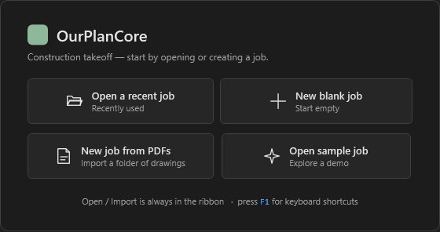
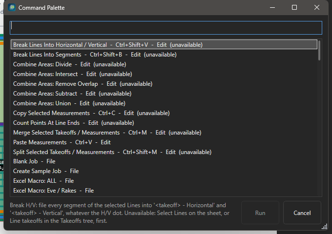
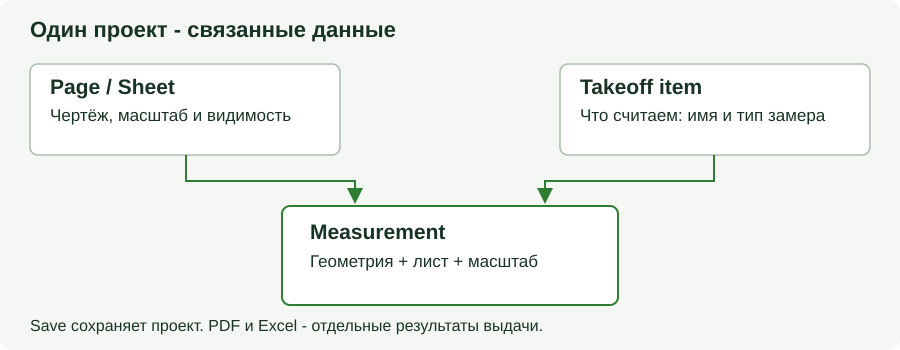

# Getting started

Here: where the app is and how it updates, what you see on first launch, how to open the demo job and what to try in it, where to find commands (F1, palette) and where settings live. Needed on day one and after every update. To learn step by step: [First steps: 10 lessons](ourplancore-course.md).

## Where the app is and how it updates

| What | Where |
| --- | --- |
| Launch | the OurPlanCore shortcut on the desktop |
| The app itself | a single file `ourplancore.exe` in the `Desktop\updates\OurPlanCore` folder |
| Update | a new `ourplancore.exe` goes into the same folder; the previous one stays next to it as `.bak` for rollback |
| Excel templates | in the same folder: `TemplateCom.xlsm`, `TemplateResidential.xlsm` |
| Version | in the window title: `OurPlanCore 3.0.0 - <job>`; the same in the file properties and in the first `Version ...` line of the log `%APPDATA%\OurPlanCore\logs\app-<date>.log`; what changed: [What's new](ourplancore-changelog.md) |

Jobs, settings and templates do not depend on the update: they are stored separately (see [Where settings live](#settings)).

!!! warning "Rolling back to .bak"
    An older build reads crops (Crop to Sheet) and Hide masks as regular markup and loses their fields on save. If you rolled back, do not save a job with crops until you are back on a fresh build.

## First launch and the start screen

<figure markdown>
  
  <figcaption markdown="span">Four tiles. `Open / Import` on the Main ribbon is always available, `F1` shows the shortcuts.</figcaption>
</figure>

| Tile | What it does |
| --- | --- |
| `Open a recent job` | list of recent jobs and job folders |
| `New blank job` | an empty job, sheets are added later |
| `New job from PDFs` | a job from a folder of PDF drawings |
| `Open sample job` | a demo job to get acquainted |

After that, work happens in `Main View`: Pages on the left, the sheet in the center, Takeoffs on the right, the tool strip at the bottom. Window map: on the [section hub](ourplanecore.md#window-map).

## Demo job: a tour { #demo }

<figure markdown>
  <video class="kb-demo" loop muted playsinline preload="none" poster="../../assets/images/ourplancore/demo/d-open-sample.png"><source src="../../assets/images/ourplancore/demo/d-open-sample.mp4" type="video/mp4"></video>
  <figcaption markdown="span">Demo: `Open sample job` on the start card creates the demo job; then the W, F, S and U sheets with their legends and the 3D tab.</figcaption>
</figure>

The demo job is a training job with no client data. Try every button on it without worrying about breaking anything: it can be created again at any time. The [First steps: 10 lessons](ourplancore-course.md) course uses it too.

### How to open the demo job

Why: to get a job with sheets, dots and a canonical tree where you can learn.
You need: the app running; no job has to be open.

1. Press the **Open sample job** tile on the start screen or open **Main > Open / Import > Sample job (demo to explore)**; the same item is available as the `Sample` link at the bottom of the **Open project...** dialog.
2. Wait for the status `Sample project created: OurPlanCore Guide Sample.`: the app creates the job in the jobs folder and opens it right away.
3. In Pages, expand the `00. Guide` folder and click a plan sheet.

Result: the window title shows `OurPlanCore 3.0.x - OurPlanCore Guide Sample`, sheets on the left, the Takeoffs tree with ready-made takeoffs on the right, `Scale:` and `Route:` in the status bar.

### What is inside

<!-- CHECK-DEMO -->

| What | Where to look | Why |
| --- | --- | --- |
| `00. Guide` hint cards | image sheets at the top of the Pages folder | a map of the window, ribbons and panels right in the app |
| A plan with the W dot, a structural plan with the F dot, a copy for shear walls with the S dot, a unit plan with the U dot | sheets in `00. Guide`, dots under the Scale header | how a sheet set is split up ([split by sheets](ourplancore-split-by-sheets.md)) |
| A canonical tree: `sqfts`, `walls/1st floor walls`, `framing/1st floor framing/...`, `openings`, `shear walls`, `eves rakes` | Takeoffs panel | takeoff names with numbers for Excel, folders by floor |
| Roof outline `rf 6` with eaves | roof plan and `sqfts`, `eves rakes` | a starting point for the 3D roof ([3D roof](ourplancore-3d-roof.md)) |
| A `Start here...` note and observations in the AI Inbox | plan sheet, Inbox panel with the AI module | an example of markup and AI entries |

The exact contents of the demo after the 3.0.1 release should be checked against the job itself: takeoff and sheet names in the table are approximate.

### What to try, step by step

1. **Sheets and dots.** Open a plan, read `Route: W 1st` in the status bar; press `F2` and enter the same name again: the dot does not change. Make a copy of the sheet (`Ctrl+D`), rename it to `... sw`, click the S dot. [Split by sheets](ourplancore-split-by-sheets.md#copy-dot)
2. **Routing.** Press `L`, type the name `ext 2x6 9.09`, look at the destination line in the New Item dialog, make two clicks and `C`: the takeoff sits in `walls/1st floor walls`. [Names and auto-routing](takeoff-naming.md)
3. **Tools.** On the same plan `O` on a door, `A` on a room, `X` to cut an area; on a structural sheet `J` for a joist area and `B` for a beam from support to support. [Tools](ourplancore-tools.md)
4. **Legend.** `Display > Legend Show`, then right-click the sheet, `Organize > Sort Sheet Legend by Key`; `H` on a takeoff hides it from the sheet, the dot next to the takeoff under the sheet in Pages brings it back. [Takeoffs tree](ourplancore-takeoffs.md#hide)
5. **Crops and mask.** `Page > Blank Sheet`, then `Page > Crop to Sheet` from the plan onto the blank sheet; `Annotation > Hide` with a box over what is not needed. [Sheets: advanced](ourplancore-sheets-advanced.md)
6. **3D.** Turn on the 3D module, select `rf 6`, the 3D tab, `Roof Base`, `Auto`, `Iso`. [3D roof](ourplancore-3d-roof.md)
7. **Export.** `PDF Output > Preview`, `Main > Export` of one sheet; with a copy of `TemplateCom.xlsm` open, the XL strip, the `WL` button. [PDF and delivery](ourplancore-pdf.md), [Export to Excel](ourplancore-excel.md)

### Broke the demo, what next

Anything goes: delete takeoffs, move sheets, change dots, clean the tree with `Delete Empty`. To start fresh, press **Open sample job** again: the app creates a new copy with a unique name (`OurPlanCore Guide Sample (2)`), the old one stays in the jobs folder; you can delete it in File Explorer via `Open in Explorer` or keep it as your sandbox. The demo does not touch the app settings (`Settings`); your global rules stay yours.

## F1 and the command palette

<figure markdown>
  
  <figcaption markdown="span">`Ctrl+Shift+P`: any command by name, with its current shortcut next to it.</figcaption>
</figure>

| Key | What it opens |
| --- | --- |
| `F1` | a shortcut cheat sheet over the window; closes with `Esc` |
| `Ctrl+Shift+P` | command palette: categories File, View, Workspace, Tools, Edit, Pages, Sheets, Takeoffs, AI; type part of the name and `Enter` |
| `Ctrl+O` | `Open / Import`; `Ctrl+Shift+O` - recent jobs |

A command without a shortcut (for example `Ends`, `Toggle Dark Theme`, `Hide / Show All Takeoffs`) is run from the palette or gets a shortcut in `Settings > Keyboard Shortcuts`. Shortcuts work by physical keys in both the English and the Russian keyboard layout. Full list: [Keyboard shortcuts](ourplancore-shortcuts.md).

<figure markdown>
  <video class="kb-demo" loop muted playsinline preload="none" poster="../../assets/images/ourplancore/demo/d-command-palette.png"><source src="../../assets/images/ourplancore/demo/d-command-palette.mp4" type="video/mp4"></video>
  <figcaption markdown="span">Demo: ++ctrl+shift+p++, type `show all`, ++enter++: the `Hide / Show All Takeoffs` command hides all measurements on the sheet, running it again shows them.</figcaption>
</figure>

## Theme and sheet look

The `Display` ribbon:

| Button | What it does |
| --- | --- |
| `Dark` | dark window theme |
| `Paper` | sheet paper tone: White, Soft gray, Medium gray, Dark gray, Warm, Soft green, Black |
| `Edge` | background around the sheet: White, Gray, Dark |
| `Static image`, `DPI` | the sheet as a single raster (on by default, 150 DPI); `Black vector` draws vectors in black |
| `Legend Show / Size / Pos` | measurement legend on the sheet |
| `Zoom` | mouse wheel step |

The dark theme is easier on the eyes in long sessions, but check takeoff colors before the PDF on white paper: the PDF prints on white.

## How to make your first measurement { #first-run }

Why: to go from an open job to a saved takeoff in five minutes.
You need: a job with named sheets (from intake or the demo).

1. Press `Ctrl+O` and choose **Open project...** ([jobs](job-creation-storage.md)).
2. In Pages expand `00. imported/Arch`, open a floor plan, read `Scale:` in the status bar and the dot under the Scale header ([sheets](ourplancore-pages.md)).
3. Press `L`, name the takeoff `ext 2x6 9.09`, trace the exterior walls, press `C` ([tools](ourplancore-tools.md)).
4. Find in Takeoffs where the takeoff went: `walls/1st floor walls` with the W 1 dot ([names and auto-routing](takeoff-naming.md)).
5. Select the takeoff, press `Space`, draw another run: Record continues the takeoff instead of creating a new one ([tree](ourplancore-takeoffs.md)).
6. Press `Ctrl+S` and wait for `Save: Saved hh:mm:ss`.

Result: a takeoff with two sections in `walls/1st floor walls`, `Total` in LFT, the job saved. Next, step by step: [First steps: 10 lessons](ourplancore-course.md).

## What the entities mean

<figure markdown>
  
  <figcaption markdown="span">The sheet sets the drawing and scale, the takeoff (takeoff item) is what we count, the measurement connects them. This is a data diagram, not a screenshot of the window.</figcaption>
</figure>

| Entity | Role |
| --- | --- |
| Project / Job | the whole job: sheets, Takeoffs tree, job settings, source PDFs; one `.ourplan` file |
| Page / Sheet | a sheet with a scale, a W/F/S/U dot, a legend and overlays |
| Takeoff item | a named container for measurements of one type: Line, Area, Count, Joist Area |
| Measurement | geometry on a specific sheet; one takeoff can collect measurements from several sheets |
| Annotation (markup) | marks with no quantity: Highlight, Draw Line, Arrow, Box, Cloud, Note, Hide |

## Where settings live { #settings }

| What | Where |
| --- | --- |
| General settings, shortcuts, logs | `%APPDATA%\OurPlanCore` (`settings.json`, `logs` folder) |
| Rule presets (routing, shortcuts), caches, terminals | `%LOCALAPPDATA%\OurPlanCore` |
| Settings of a specific job | inside the job in `AI_Context/settings` |
| Jobs | the jobs folder shown by `Open project...` (`Manage job folders...` adds folders) |

Each `Settings` section has `Reset`, `Save global default` and `Save as this job`: a rule can be overridden for one job without touching the global one. Which sections exist: [Settings and modules](ourplancore-settings.md). Some tabs (Sheet Manager, Takeoff Manager, Report Builder, Materials, AI, 3D, Job Tracker) are off by default and are turned on in `Settings > Modules`; what they do and when they are needed: [Extra features](ourplancore-extras.md).

## See also

- [OurPlanCore 3.0: section hub](ourplanecore.md)
- [Workflow](../start/workflow.md)
- [Troubleshooting](ourplancore-troubleshooting.md)
