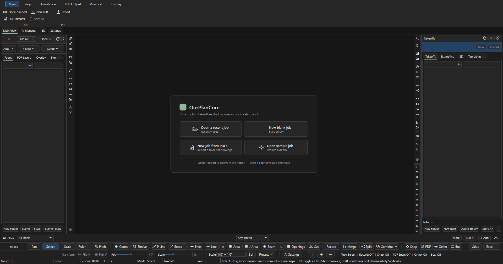
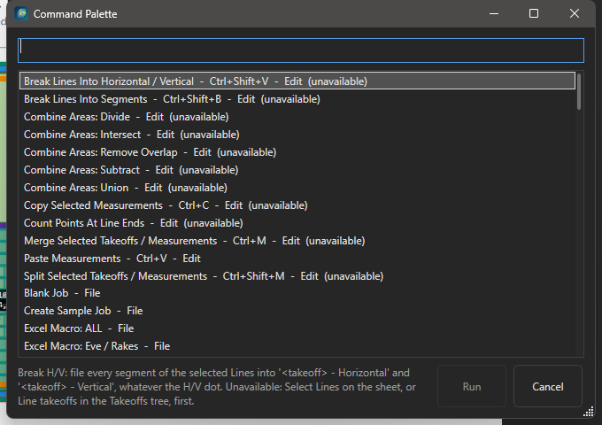

# Начало работы

Здесь: где лежит программа и как обновляется, что видно при первом запуске, как открыть демо-проект, где искать команды (F1, палитра) и где живут настройки. Нужно в первый день и после каждого обновления.

## Где программа и как обновляется

| Что | Где |
| --- | --- |
| Запуск | ярлык OurPlanCore на рабочем столе |
| Сама программа | один файл `ourplancore.exe` в папке `Desktop\updates\OurPlanCore` |
| Обновление | в ту же папку кладётся новый `ourplancore.exe`; прежний остаётся рядом как `.bak` для отката |
| Шаблоны Excel | в той же папке: `TemplateCom.xlsm`, `TemplateResidential.xlsm` |
| Версия | в заголовке окна: `OurPlanCore 3.0.0 - <проект>`; то же в свойствах файла и в первой строке `Version ...` лога `%APPDATA%\OurPlanCore\logs\app-<дата>.log`; что изменилось - [Что нового](ourplancore-changelog.md) |

Проекты, настройки и шаблоны от обновления не зависят: они лежат отдельно (см. [Где лежат настройки](#settings)).

!!! warning "Откат на .bak"
    Старая сборка читает кропы (Crop to Sheet) и маски Hide как обычную разметку и при сохранении теряет их поля. Откатился - не сохраняй проект с кропами, пока не вернулся на свежую сборку.

## Первый запуск и стартовый экран

<figure markdown>
  
  <figcaption markdown="span">Четыре плитки. `Open / Import` на ленте Main доступен всегда, `F1` показывает клавиши.</figcaption>
</figure>

| Плитка | Что делает |
| --- | --- |
| `Open a recent job` | список недавних проектов и папок с работами |
| `New blank job` | пустой проект, листы добавляются потом |
| `New job from PDFs` | проект из папки с PDF-чертежами |
| `Open sample job` | демо-проект для знакомства |

Дальше работа идёт в `Main View`: слева Pages, в центре лист, справа Takeoffs, внизу полоса инструментов. Карта окна - на [хабе раздела](ourplanecore.md#window-map).

## Демо-проект { #demo }

1. `Main > Open / Import > Sample job (demo to explore)` или плитка `Open sample job`.
2. Программа создаёт проект `OurPlanCore Guide Sample` в папке работ. Внутри: папка листов `00. Guide` с карточками-подсказками и лист `A101 Sample Plan`.
3. В дереве Takeoffs уже есть позиции `sqfts/1st/Floor Area`, `walls/1st/Exterior Walls`, `framing/Ridge Beam`, `framing/Floor Joists 2x10 @16`, `openings/Doors`, `openings/Windows`, `rf/Roof Area` и готовая 3D-модель.
4. На этом проекте безопасно пробовать инструменты, Record, копирование, экспорт PDF и полосу XL. Клиентских данных в нём нет.

## F1 и палитра команд

<figure markdown>
  
  <figcaption markdown="span">`Ctrl+Shift+P`: любая команда по имени, с текущей клавишей рядом.</figcaption>
</figure>

| Клавиша | Что открывает |
| --- | --- |
| `F1` | шпаргалка клавиш поверх окна; закрывается `Esc` |
| `Ctrl+Shift+P` | палитра команд: категории File, View, Workspace, Tools, Edit, Pages, Sheets, Takeoffs, AI; набери часть названия и `Enter` |
| `Ctrl+O` | `Open / Import`; `Ctrl+Shift+O` - недавние проекты |

Команда без клавиши (например `Ends`, `Toggle Dark Theme`, `Hide / Show All Takeoffs`) запускается из палитры или получает клавишу в `Settings > Keyboard Shortcuts`. Клавиши работают по физическим кнопкам в английской и русской раскладке. Полный список - [Горячие клавиши](ourplancore-shortcuts.md).

## Тема и вид листа

Лента `Display`:

| Кнопка | Что делает |
| --- | --- |
| `Dark` | тёмная тема окна |
| `Paper` | тон бумаги листа: White, Soft gray, Medium gray, Dark gray, Warm, Soft green, Black |
| `Edge` | фон вокруг листа: White, Gray, Dark |
| `Static image`, `DPI` | лист как один растр (по умолчанию включено, 150 DPI); `Black vector` рисует вектор чёрным |
| `Legend Show / Size / Pos` | легенда замеров на листе |
| `Zoom` | шаг колеса мыши |

Тёмная тема удобна на длинных сессиях, но проверять цвета позиций перед PDF лучше на белой бумаге: PDF печатается на белом.

## Первый рабочий проход

1. Открой проект: `Ctrl+O > Open project...` ([проекты](job-creation-storage.md)).
2. В Pages раскрой `00. imported/Arch`, открой план этажа, проверь в статусе `Scale:` и точку под заголовком Scale ([листы](ourplancore-pages.md)).
3. Нажми `L`, назови позицию `ext 2x6 9.09`, обведи наружные стены, `C` завершает ([инструменты](ourplancore-tools.md)).
4. Посмотри в Takeoffs, куда легла позиция: `walls/1st floor walls` при точке W 1 ([имена и автомаршрут](takeoff-naming.md)).
5. Выдели позицию, `Space`, дорисуй ещё участок: Record продолжает позицию, а не создаёт новую ([дерево](ourplancore-takeoffs.md)).
6. `Ctrl+S`, дождись `Save: Saved hh:mm:ss`.

## Что означают сущности

<figure markdown>
  
  <figcaption markdown="span">Лист задаёт чертёж и масштаб, позиция (takeoff item) - что считаем, замер связывает их. Это схема данных, не снимок окна.</figcaption>
</figure>

| Сущность | Роль |
| --- | --- |
| Project / Job | весь проект: листы, дерево Takeoffs, настройки проекта, исходные PDF; один файл `.ourplan` |
| Page / Sheet | лист с масштабом, точкой W/F/S/U, легендой и наложениями |
| Takeoff item (позиция) | именованный контейнер замеров одного типа: Line, Area, Count, Joist Area |
| Measurement (замер) | геометрия на конкретном листе; одна позиция может собирать замеры с нескольких листов |
| Annotation (разметка) | пометки без количества: Highlight, Draw Line, Arrow, Box, Cloud, Note, Hide |

## Где лежат настройки { #settings }

| Что | Где |
| --- | --- |
| Общие настройки, клавиши, логи | `%APPDATA%\OurPlanCore` (`settings.json`, папка `logs`) |
| Пресеты правил (маршрутизация, клавиши), кеши, терминалы | `%LOCALAPPDATA%\OurPlanCore` |
| Настройки конкретного проекта | внутри проекта в `AI_Context/settings` |
| Проекты | папка работ, которую показывает `Open project...` (`Manage job folders...` добавляет папки) |

Каждый раздел `Settings` имеет `Reset`, `Save global default` и `Save as this job`: правило можно переопределить для одного проекта, не трогая общее. Какие разделы есть - [Settings и модули](ourplancore-settings.md). Часть вкладок (Sheet Manager, Takeoff Manager, Report Builder, Materials, AI, 3D, Job Tracker) по умолчанию выключена и включается в `Settings > Modules`.

## См. также

- [OurPlanCore 3.0: хаб раздела](ourplanecore.md)
- [Процесс работы](../start/workflow.md)
- [Решение проблем](ourplancore-troubleshooting.md)
