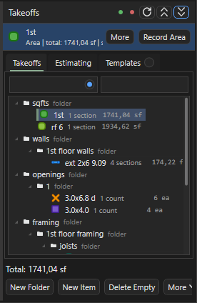
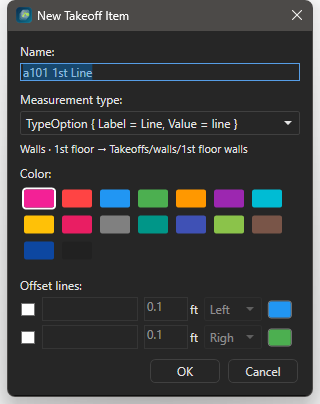
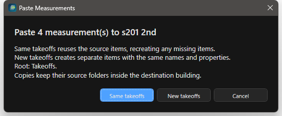
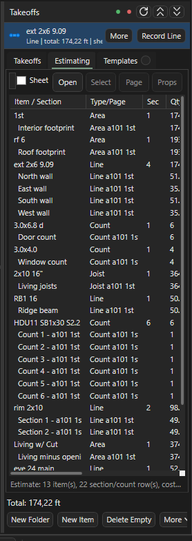
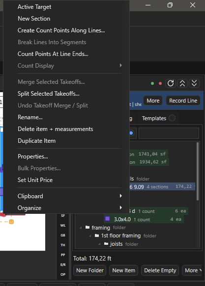

# Takeoffs tree

This page covers the Takeoffs panel, a new takeoff and Record, copying between sheets and buildings, hiding, search, Estimating. You need it every day; the canonical folders and names are on [Takeoff tree and sheet names](../start/takeoff-structure.md), several buildings and the green dot on [Multiple buildings](ourplancore-buildings.md).

<figure markdown>
  
  <figcaption markdown="span">At the top, the green and red root dots, the active takeoff line with `Record`, `Total`; below, the buttons and the tree. Tabs `Takeoffs`, `Estimating`, `Templates`.</figcaption>
</figure>

## Panel: reference

| Element | What it does |
| --- | --- |
| Green and red dots | root for new takeoffs: the selected building or all of Takeoffs ([multiple buildings](ourplancore-buildings.md#root)) |
| `Record` (`Space`), `More`, `Props`, `Find`, `Sheet`, `>`, `<` | the active takeoff line: continue recording, properties, show in the tree, pick a takeoff from this sheet, next and previous |
| `>` (`Switch to next takeoff item`), `<` (`Switch to previous takeoff item`) | make the next or previous takeoff from the list of all job takeoffs active, wrapping around; status `Active takeoff target 3/12: <name>`. They do not switch during Record |
| `More` on the active takeoff line | `Properties...`, `Find in Tree`, `Sheet Targets...` (same as `Sheet`), `Previous Target`, `Next Target` (same as `<` and `>`) |
| `Sheet` | list of takeoffs measured on the open sheet, with quantities; the active one is marked `*`; at the top `Next Sheet Target` - the next takeoff of this sheet |
| `Total` | total of the active takeoff in its units |
| `New Folder`, `New Item` (`T`) | folder and takeoff under the selected folder |
| `Delete Empty` | delete takeoffs with no measurements; `Ctrl+Z` brings them back as a batch |
| `More` | `Roof Base from area`, `Auto Tree` (COM template roots), `From Pages` (folders by sheet structure) |
| `Export` | `Save`, `Save As...`, `Export CSV`, `Export TXT`, `Export Excel`, `Export to Current Excel` |
| Icons in the panel header | `Refresh Takeoffs tree` - reread the tree from the job folder, status `Takeoffs tree refreshed.`; `Collapse all Takeoffs nodes` and `Expand all Takeoffs nodes` - collapse or expand all folders. The same commands are on the right icon strip: `Collapse Takeoffs Tree`, `Expand Takeoffs Tree` |
| Search | left field by folder name, right field by takeoff or measurement name; the button in the left field `Match takeoff folder case exactly` (on) tells `A` from `a`, off searches case-insensitive |
| Tabs on the right | `Takeoffs`, `Estimating`, `3D` (module), `Templates` |

Under each takeoff in the tree you see sections: measurements by sheet; `Ctrl+Enter` selects the section's measurements on the sheet.

| Key | What it does |
| --- | --- |
| `F2` | rename a takeoff or folder (`Rename...`) |
| `Delete` | delete; `Ctrl+Z` with focus in the tree brings it back |
| `Ctrl+Up` / `Ctrl+Down` | order in the folder |
| `Ctrl+Enter` | select the section's measurements on the sheet |
| `Ctrl+M` / `Ctrl+Shift+M` | Merge and Split the selected takeoffs ([editing](ourplancore-editing.md)) |
| `Shift` / `Ctrl` + click | select a range of rows or add one row |
| drag the mouse from an empty spot in the tree | row selection box; with `Ctrl` adds to the selection |
| `Alt` + drag from a row | a box started right from a row (in F1: `Start marquee selection from a row`); without `Alt`, dragging a row moves it |
| Right-click on a takeoff | `Rename...`, `Properties...`, `Set Unit Price`, `Cut`, `Copy`, `Paste Into Parent Folder`, `Delete`; on an Area `Create Line Grid...`; on a Joist Area `Set / Reset Joist Direction`; all items: [tree menus](#menus) |

## Building and root { #root }

One building: the roots `walls`, `sqfts`, `framing`... sit right in Takeoffs; do not create a `Main` folder. Several buildings: a folder for each (`A`, `B`, `Grge`); the green dot (`Use selected folder as root`) makes the selected folder the root for new takeoffs, the red dot (`Use Takeoffs root`) returns to the shared root. How to run a job with several buildings, copy identical buildings and deliver them as separate workbooks and PDFs: [Multiple buildings](ourplancore-buildings.md).

## How to build the job tree { #tree }

Why: the COM template roots with the right names in one click.
You need: the job open; for several buildings, the building folders created.

1. Select the Takeoffs root (or a building folder).
2. Press **More > Auto Tree**: `units`, `sqfts`, `walls`, `gables`, `parapets`, `trussheel`, `openings`, `eves rakes`, `roof misc`, `framing`, `shear walls`, `trims`, `siding` appear with floor subfolders.
3. Add whatever is missing with the **New Folder** button under the selected folder (for example `BW/1st`).

Result: a canonical tree; the template content is edited in `Settings > Auto Tree` ([Settings](ourplancore-settings.md)).

## How to create a takeoff: New Item { #new-item }

<figure markdown>
  <video class="kb-demo" loop muted playsinline preload="none" poster="../../assets/images/ourplancore/demo/d-new-item.png"><source src="../../assets/images/ourplancore/demo/d-new-item.mp4" type="video/mp4"></video>
  <figcaption markdown="span">Demo: ++t++, name `C4 20`, type `Count`, marker style `Diamond`, routed to `framing/1st floor framing`.</figcaption>
</figure>

<figure markdown>
  
  <figcaption markdown="span">Name, measurement type, point symbol, color and a preview of the target folder before creation.</figcaption>
</figure>

Why: a takeoff with the right name, type and color before the first click on the sheet.

1. Press `T` or the **New Item** button (any measuring tool opens the same dialog).
2. Type the **Name**: Excel reads the numbers in the name ([formats](../start/takeoff-structure.md)).
3. Pick the **Measurement type**: Count, Line, Area, Joist Area; for Count, the symbol in **Count display** (circle, cross, square, star, triangle, diamond, ring).
4. Leave **Color** random or pick your own; the name `bft` gets a fixed gray (`Fixed by Takeoff Colors settings`).
5. Read the target line at the bottom: where the takeoff will land by sheet dot and name. If needed, tick **Review similar on this sheet** (search for similar symbols right away) or set up **Beam annotation line** and **Offset lines** (up to two parallel companion lines).
6. Press **OK**.

Result: the takeoff sits in the target folder, status `Takeoff: <name> (Route: ...)`, drawing goes into it. **New Folder** creates a folder under the selected one; right-click on a folder gives `Rename Folder...`, `Folder Properties...`, `Organize > Auto Create Tree / Create Folders From Pages / Sort Children A-Z`.

## How to continue a takeoff: Record { #record }

<figure markdown>
  <video class="kb-demo" loop muted playsinline preload="none" poster="../../assets/images/ourplancore/demo/d-record.png"><source src="../../assets/images/ourplancore/demo/d-record.mp4" type="video/mp4"></video>
  <figcaption markdown="span">Demo: select a takeoff, ++space++ (`Record`), draw one more partition and ++c++; `Total` grows in the same takeoff.</figcaption>
</figure>

Why: add a run to an existing takeoff without creating a duplicate.

1. Select the takeoff in the tree (or press `Sheet` to pick from those measured on this sheet; `>` and `<` step through the neighbors).
2. Press `Space`: the status shows `Mode: Record <name>`.
3. Draw with the tool you need: all measurements go into this takeoff; the sheet dot does not apply.
4. Press `Space` again to stop. A tool button instead of Record creates a new takeoff.

Result: a new section under the takeoff in the tree, `Total` went up. `Props` opens the properties of the active takeoff (name, color, symbol; for a Joist Area, spacing and direction), `Find` shows it in the tree.

!!! tip "Tips"
    - Right-click on a takeoff > `Set Active Target` makes it active without starting a recording: the color and symbol for drawing, `Total`, and its measurements are highlighted on the sheet. On a takeoff that is already active the item is called `Active Target`. While another takeoff is in Record you cannot switch: status `Record stays on <name>`.
    - Right-click on a measurement on the sheet > `Takeoff Properties...` opens the properties of its takeoff without hunting for it in the tree; the next item, `Section Properties...` (`Count Properties...` for a Count), edits the name and note of just this section.

## How to copy measurements to another sheet or building { #copy }

<figure markdown>
  <video class="kb-demo" loop muted playsinline preload="none" poster="../../assets/images/ourplancore/demo/d-copy-paste.png"><source src="../../assets/images/ourplancore/demo/d-copy-paste.mp4" type="video/mp4"></video>
  <figcaption markdown="span">Demo: ++ctrl+c++ on one sheet, ++ctrl+v++ on another, `New takeoffs` picked in the `Paste Measurements` window.</figcaption>
</figure>

<figure markdown>
  
  <figcaption markdown="span">`Same takeoffs` adds the measurements to the same takeoffs, `New takeoffs` creates copies of the takeoffs. The `Root:` line shows the target building.</figcaption>
</figure>

Why: do not draw identical floors or buildings a second time.

1. Press `E`, select the measurements on the sheet (with a box or `Ctrl+A`), `Ctrl+C`.
2. Open the target sheet (another floor or another building) and press `Ctrl+V`.
3. In the **Paste Measurements** dialog pick: **Same takeoffs** - the measurements are added to the source takeoffs (usually not what you want for another building); **New takeoffs** - copies of the takeoffs are created with the same names and properties.
4. Read the `Root:` line (green dot or root) and check the tree.

Result: with **New takeoffs** the copies sit in the same folder as the source, but in the target building (`A/sqfts` to `B/sqfts`, `A/framing/2nd floor framing/details` to `B/framing/2nd floor framing/details`). On a sheet with a different dot of the same row only the floor changes: `framing/2nd floor framing/posts` becomes `framing/3rd floor framing/posts`. The target building is taken in this order: the green dot, otherwise the root, otherwise the sheet's building by its dot. Folder mirroring is turned off with the `Copies keep their source folders` checkbox in `Settings > Sheet Takeoff Routing`. Copying a whole building: [Multiple buildings](ourplancore-buildings.md#copy).

!!! tip "Tips"
    - In the tree `Ctrl+C` / `Ctrl+X` / `Ctrl+V` copy and move takeoffs and folders, `Ctrl+D` duplicates, dragging moves. A move keeps the measurements, color, symbol and legend order; deleting and creating again loses them.

## How to hide a takeoff on a sheet { #hide }

<figure markdown>
  <video class="kb-demo" loop muted playsinline preload="none" poster="../../assets/images/ourplancore/demo/d-hide.png"><source src="../../assets/images/ourplancore/demo/d-hide.mp4" type="video/mp4"></video>
  <figcaption markdown="span">Demo: ++h++ hides the selected takeoff on the sheet, the visibility dot under the sheet in Pages brings it back.</figcaption>
</figure>

Why: get finished work out of the way while checking, hide another building before the PDF.

1. Select a segment on the sheet or a row (rows, a folder) in Takeoffs.
2. Press `H`: status `Hidden N whole takeoff(s)`; the takeoff is hidden only on the current sheet, a folder hides all its takeoffs on it.
3. To bring it back, click the visibility dot on the takeoff under the sheet in the Pages tree (`Visible on <sheet>: <takeoff>`): `H` only hides, it does not toggle.

Result: hidden items are not drawn and not printed in the PDF: this is how a separate PDF per building is prepared ([PDF and delivery](ourplancore-pdf.md#buildings)).

| Key | What it does |
| --- | --- |
| `H` | hide on the current sheet the takeoffs of the selected segments or tree rows |
| `Shift+H` | Highlighter tool (marker markup) |
| Dot on the sheet in Pages | hide or show all measurements on the sheet |
| `Hide / Show All Takeoffs` | a palette command with no default key |

## How to check totals: Total, Estimating, search { #check }

<figure markdown>
  
  <figcaption markdown="span">All takeoffs in one table: checking totals before Excel.</figcaption>
</figure>

Why: make sure the numbers and names are ready for Excel.

1. Select a takeoff: `Total` in the active takeoff line and `Takeoff:` in the status show the quantity.
2. Open the **Estimating** tab: a table of all takeoffs with totals, units and price (`Set Unit Price` in the takeoff right-click menu); the **Open** button pops it out into a separate window.
3. Press **Delete Empty**: takeoffs with no measurements are deleted (`Ctrl+Z` brings them back as a batch).
4. Find a building or branch with the folder search, a takeoff or measurement with the takeoff search: what is found expands in the tree.

Result: no empty rows in Estimating, totals match what you expect; you can move on to [export to Excel](ourplancore-excel.md). The `Templates` tab (tree and takeoff presets) is hardly needed in E-Wood work: [Other](ourplancore-extras-other.md#templates).

In the Estimating header: a filter field (by takeoff, section, sheet, note), the `Sheet` checkbox (only measurements of the open sheet), `Open` (table in a separate window), `Select`, `Page`, `Props` (same as the menu items below). Rows come in two kinds: the whole takeoff and its section.

| Right-click on an Estimating row | What it does |
| --- | --- |
| `Go to Page` (`Go to First Page` with several rows) | open the measurement's sheet and select the rows' measurements |
| `Select on Canvas` (`Select N on Canvas`) | select the measurements of the chosen rows on the sheet; the sheet of the first row opens by itself |
| `Section Properties...` (`Count Properties...` for a Count) | on a section row, the section name and note; on a takeoff row, the takeoff properties window; with several rows the item is called `Measurement Properties...` and is disabled |
| `Rename Section`, `Delete Section` | rename or delete a section, only on a section row; with several rows `Rename Measurement` and `Delete Measurement` are disabled |

## Merge, Split, Break in brief

`Merge` (`Ctrl+M`) combines several takeoffs into one with all their sections, `Split` (`Ctrl+Shift+M`) divides a takeoff by sections or by sheets, `Break` (`Ctrl+Shift+B`) cuts a Line into segments, `Ends` places a Count at the ends. Undo: `Ctrl+Z` in the tree or right-click `Undo Takeoff Merge / Split`. Details: [Editing and snaps](ourplancore-editing.md).

## How to change color, price or note for many takeoffs at once { #bulk }

Why: one color per branch (for example all `BW`) or a shared note without editing each takeoff.

1. Select takeoffs in the tree (`Shift` or `Ctrl` + click, a box) and right-click > **Bulk Properties (N Items)...**. For a whole folder with subfolders: right-click on the folder > **Bulk Item Properties...**.
2. Tick what you are changing: `Apply color` (palette swatch or color code), `Apply unit price per <unit>` (only if all takeoffs are of one type and the Estimating module is on), `Replace notes`.
3. Press **OK**: fields without a tick do not change.

Result: status `Updated bulk properties for N takeoff item(s)`; all measurements of these takeoffs get the new color too.

## Folder properties: defaults for new takeoffs { #folder-props }

Right-click on a folder > `Folder Properties...` opens the `Takeoff Folder Properties` window:

| Field | What it does |
| --- | --- |
| `Display name` | folder name (rename) |
| `Notes` | folder note, shown in the tooltip over the folder |
| `Default measurement type` | the type preselected in New Item for a takeoff in this folder |
| `Default name prefix` | default prefix for a new takeoff name |
| `Default unit price` | price of a new takeoff (only with the Estimating module) |
| `Default notes for new items` | the note a new takeoff gets |
| `Default color` | remembered and shown in the folder tooltip; the new takeoff color is still random |

The values apply in subfolders too: the nearest folder up the tree with the field filled in wins. The tooltip over the folder shows them as a `Default: ...` line.

## Takeoff colors { #colors }

A new takeoff gets a random color without gray, black and white; `Split` gives the split-off part a new color; the name `bft` is always gray (`Settings > Takeoff Colors`). Identical colors on neighboring takeoffs make the legend unreadable: change them in `Props` or right-click `Properties...`, many at once through [Bulk Properties](#bulk). Right-click on a folder > `Random Colors for Items` gives all takeoffs of the folder and subfolders different palette colors in one click.

The size of Count symbols and the line weight on screen are set on the **Viewport** ribbon, LINES & AREA group: `Point` (tooltip `Count marker size`, 0.25-4, default 1) and `Line` (0.25-4); you can type a number in the field next to it and press ++enter++. This is only the look on screen and in separate sheet windows; the PDF has its own values: `PDF Output > LINES & AREA` ([PDF](ourplancore-pdf.md)).

## Tree menus: reference { #menus }

<figure markdown>
  
  <figcaption markdown="span">Right-click on a takeoff: at the top `Set Active Target` and recording, below that editing, properties, `Clipboard` and `Organize`. Some items are visible only with the Advanced Takeoff Tools module.</figcaption>
</figure>

Items marked "module" are visible while Advanced Takeoff Tools (or the named module) is on in `Settings > Modules`; Advanced Takeoff Tools, Takeoff Automation and Estimating are on by default ([Settings](ourplancore-settings.md)). With several rows selected the labels show the count: `Delete selected takeoffs`, `Move 3 Up`.

??? note "Takeoff menu"

    | Item | What it does |
    | --- | --- |
    | `Set Active Target` (`Active Target`) | make the takeoff active without recording ([Record](#record)) |
    | `New Section`, for a Count `Add Count` | start recording a new section into this takeoff on the open sheet |
    | `Create Line Grid...`, `Trace Walls Inside Area...` | on an Area, module: a line grid over the area; walls along PDF lines inside the area ([tracing](ourplancore-snap-trace.md)) |
    | `Joist` > `Use Area As Joists...` (`Joist Properties...`), `Refresh Regular Joists in All Area Segments`, `Start Extra Joists Mode (D)`, `Set / Reset Joist Direction`, `Set Direction for All Areas` | on an Area, module: make the area a joist zone and its properties, recalculate regular joists in all sections, add extra joists, set the direction for one zone or for all zones of the takeoff at once ([J Area](ourplancore-tools.md#jarea)) |
    | `Create Count Points Along Lines...`, `Break Lines Into Segments`, `Count Points At Line Ends...` | on a Line, module ([editing](ourplancore-edit-takeoffs.md)) |
    | `Find Similar...` | on a Count, module: find the same symbols on the sheet |
    | `Count Display` | Count point symbol |
    | `3D` > `Wall`, `Roof Base from Area` | 3D module ([3D](ourplancore-3d.md)) |
    | `Merge Selected Takeoffs...`, `Split Selected Takeoffs...`, `Undo Takeoff Merge / Split` | module ([Merge and Split](ourplancore-edit-takeoffs.md)) |
    | `Rename...`, `Delete item + measurements`, `Duplicate Item` | rename, delete with measurements (`Ctrl+Z` brings it back), a copy next to it with the same name |
    | `Properties...`, `Bulk Properties...`, `Set Unit Price` | properties of one takeoff, of several at once ([above](#bulk)), price (Estimating module) |
    | `Clipboard` > `Copy Item`, `Cut Item`, `Paste Into Parent Folder` | copy, cut, paste into this takeoff's folder |
    | `Organize` > `Move Up`, `Move Down` | order in the folder (`Ctrl+Up` / `Ctrl+Down`) |

??? note "Folder menu"

    | Item | What it does |
    | --- | --- |
    | `New Folder`, `New Item` | new folder or takeoff inside |
    | `Rename Folder...`, `Delete folder + children` | rename; delete with all contents (`Ctrl+Z` brings it back) |
    | `Folder Properties...` | the `Takeoff Folder Properties` window ([above](#folder-props)) |
    | `Bulk Item Properties...`, `Random Colors for Items` | properties or different colors for all takeoffs of the folder and subfolders |
    | `Count Display`, `3D` | Count symbol and 3D for the folder's takeoffs |
    | `Clipboard` > `Copy Folder`, `Cut Folder`, `Paste Into Folder`, `Duplicate Folder` | copying and moving a branch |
    | `Organize` > `Auto Create Tree`, `Create Folders From Pages` | Takeoff Automation module: template roots and folders by sheets ([tree](#tree)) |
    | `Organize` > `Move Up`, `Move Down`, `Sort Children A-Z`, `Sort Children Z-A` | folder order and sorting its contents |
    | `Open in Explorer` | the folder on disk |

??? note "Section menu (a measurement under a takeoff)"

    | Item | What it does |
    | --- | --- |
    | `Section Properties...` (`Count Properties...` for a Count) | section name and note |
    | `Set Notes...` (`Set Notes for N Rows...`) | one note for several sections at once |
    | `Count Display`, `Rename Section` | the section's Count symbol; section name |
    | `Go to Page`, `Select on Canvas` | open the section's sheet; select its measurements on the sheet (`Ctrl+Enter`) |
    | `Merge Segment...`, `Split Segment...` (`Split Count Section...`) | module: move the section to another takeoff or a new one |
    | `Create Count Points Along Line...`, `Break Line Into Segments`, `Count Points At Line Ends...` | on a Line, module |
    | `Create Line Grid...`, `Refresh Regular Joists in All Area Segments`, `Start Extra Joists Mode (D)`, `Set / Reset Joist Direction`, `Set Direction for All Areas` | on an Area, module; `Set Direction for All Areas` takes this zone as the sample, you draw two points along the joists, and all zones of the takeoff get the direction |
    | `Move Up`, `Move Down`, `Delete Section` | section order; delete the section |

??? note "Takeoffs root menu (empty spot in the tree)"

    `Auto Create Tree` and `Create Folders From Pages` (Takeoff Automation module), `Paste Into Root`, `Sort Root A-Z`, `Sort Root Z-A`, `Open Takeoffs in Explorer`.

## Palette commands for the tree { #palette }

The `Ctrl+Shift+P` palette finds commands with no default key by name:

| Command | What it does |
| --- | --- |
| `Show Takeoffs Tab`, `Show Estimating Tab` | open the Takeoffs or Estimating tab on the right |
| `Show Takeoff Manager` | the Takeoff Manager tab in the mode bar ([Managers](ourplancore-managers.md#takeoff-manager)) |
| `Refresh Takeoffs Tree` | reread the tree from the job folder |
| `Previous Takeoff Target`, `Next Takeoff Target` | like `<` and `>` (at least two takeoffs needed) |
| `Next Sheet Takeoff Target` | the next takeoff measured on the open sheet |

## See also

- [Measuring tools](ourplancore-tools.md), [Names and auto-routing](takeoff-naming.md), [Split by sheets](ourplancore-split-by-sheets.md)
- [Multiple buildings](ourplancore-buildings.md), [Editing and snaps](ourplancore-editing.md)
- [Takeoff tree and sheet names](../start/takeoff-structure.md)
- [Common mistakes: sheets and tree](../start/common-mistakes.md#pages)
