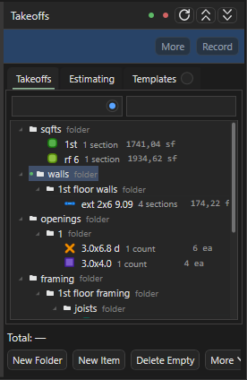
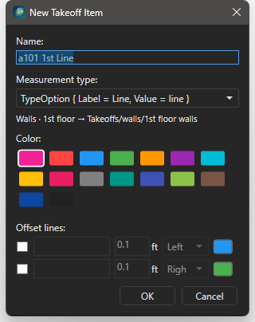
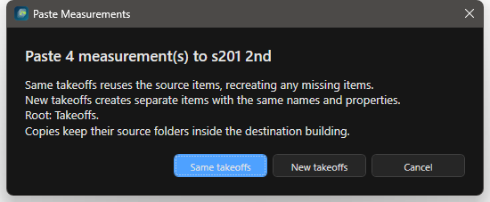
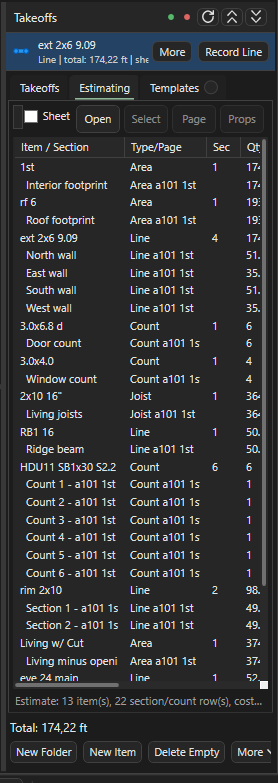

# Дерево Takeoffs

Здесь: панель Takeoffs, корень корпуса, новая позиция и Record, копирование между листами и корпусами, скрытие, поиск, Estimating. Нужно каждый день; канон папок и имён - на [Дерево takeoff и имена листов](../start/takeoff-structure.md).

<figure markdown>
  
  <figcaption markdown="span">Сверху зелёная и красная точки корня, строка активной позиции с `Record`, `Total`; ниже кнопки и дерево. Вкладки `Takeoffs`, `Estimating`, `Templates`.</figcaption>
</figure>

## Панель

| Элемент | Что делает |
| --- | --- |
| Зелёная и красная точки | корень для новых позиций: выбранный корпус или весь Takeoffs ([ниже](#root)) |
| `Record` (`Space`), `More`, `Props`, `Find`, `Sheet`, `>`, `<` | строка активной позиции: продолжить запись, свойства, показать в дереве, выбрать позицию с этого листа, следующая и предыдущая |
| `Total` | итог активной позиции в её единицах |
| `New Folder`, `New Item` (`T`) | папка и позиция под выделенной папкой |
| `Delete Empty` | удалить позиции без замеров; `Ctrl+Z` возвращает пакетом |
| `More` | `Roof Base from area`, `Auto Tree` (корни COM-шаблона), `From Pages` (папки по структуре листов) |
| `Export` | `Save`, `Save As...`, `Export CSV`, `Export TXT`, `Export Excel`, `Export to Current Excel` |
| Поиск | по имени папки (переключатель регистра) и по имени позиции или замера |
| Вкладки справа | `Takeoffs`, `Estimating`, `3D` (модуль), `Templates` |

Под каждой позицией в дереве видны секции: замеры по листам; `Ctrl+Enter` выделяет замеры секции на листе.

## Корпус и корень { #root }

<figure markdown>
  
  <figcaption markdown="span">Папка корпуса с зелёным маркером: все новые позиции идут внутрь неё по правилам точки листа.</figcaption>
</figure>

Один корпус: корни `walls`, `sqfts`, `framing`... лежат прямо в Takeoffs, папку `Main` не создавать. Несколько корпусов: папка на каждый (`Main`, `Grge`, `D4`).

1. Выделить папку корпуса в дереве.
2. Нажать зелёную точку (`Use selected folder as root`). У папки появляется зелёный маркер, статус пишет `New takeoffs` и имя корня.
3. Мерить: рисование, `New Item`, Beam, Openings, вставка `New takeoffs` идут внутрь этого корпуса, этаж берётся из точки листа.
4. Вернуться к общему корню: красная точка (`Use Takeoffs root`).

Выбор хранится в проекте и следует за переименованием папки. Существующие позиции при смене корня не переезжают. Если корень указывает на удалённую папку, создание блокируется с сообщением: выбрать корень заново.

## New Item и New Folder { #new-item }

<figure markdown>
  
  <figcaption markdown="span">Имя, тип замера, значок точек, цвет и предпросмотр папки назначения до создания.</figcaption>
</figure>

| Поле | Что задаёт |
| --- | --- |
| `Name` | имя позиции; числа из имени читает Excel ([форматы](../start/takeoff-structure.md)) |
| `Measurement type` | Count, Line, Area, Joist Area |
| `Count display` | значок точек: circle, cross, square, star, triangle, diamond, ring |
| `Color` | цвет позиции; имя `bft` получает фиксированный серый (`Fixed by Takeoff Colors settings`) |
| `Review similar on this sheet` | сразу запустить поиск похожих символов |
| `Beam annotation line`, `Offset lines` | линия вдоль балки; до двух параллельных линий-компаньонов со смещением |
| Строка назначения | куда ляжет позиция по точке листа и имени |

Диалог открывает `T`, кнопка `New Item` или любой инструмент замера. `New Folder` создаёт папку под выделенной; ПКМ по папке даёт `Rename Folder...`, `Folder Properties...`, `Organize > Auto Create Tree / Create Folders From Pages / Sort Children A-Z`.

## Активная позиция и Record { #record }

1. Выделить позицию в дереве (или `Sheet`, чтобы выбрать из измеренных на этом листе, `>` и `<` для соседних).
2. `Space`: статус показывает `Mode: Record <имя>`.
3. Рисовать нужным инструментом; все замеры идут в эту позицию, точка листа не действует.
4. `Space` ещё раз останавливает. Кнопка инструмента вместо Record создаёт новую позицию.

`Props` открывает свойства активной позиции (имя, цвет, значок, у Joist Area шаг и направление), `Find` показывает её в дереве.

## Копирование и вставка { #copy }

<figure markdown>
  
  <figcaption markdown="span">`Same takeoffs` добавляет замеры в те же позиции, `New takeoffs` создаёт копии позиций. Строка `Root:` показывает корпус назначения.</figcaption>
</figure>

1. `E`, выделить замеры на листе, `Ctrl+C`.
2. Открыть лист назначения (другой этаж или другой корпус), `Ctrl+V`.
3. В диалоге `Paste Measurements`: `Same takeoffs` - замеры добавляются в исходные позиции (на другом корпусе это обычно не нужно); `New takeoffs` - создаются копии позиций с теми же именами и свойствами.
4. Проверить строку `Root:` (зелёная точка или корень) и дерево.

Куда ложатся копии при `New takeoffs`: в ту же папку, что исходник, но в корпусе назначения (`D3/sqfts` в `D4/sqfts`, `D3/framing/2nd floor framing/details` в `D4/framing/2nd floor framing/details`). На листе с другой точкой того же ряда меняется только этаж: `framing/2nd floor framing/posts` станет `framing/3rd floor framing/posts`. Корпус назначения берётся по порядку: зелёная точка, иначе корень, иначе корпус листа по точке. Зеркало папок выключается галкой `Copies keep their source folders` в `Settings > Sheet Takeoff Routing`.

В дереве: `Ctrl+C` / `Ctrl+X` / `Ctrl+V` копируют и переносят позиции и папки, `Ctrl+D` дублирует, перетаскивание переносит. Перенос сохраняет замеры, цвет, значок и порядок легенды; удалить и создать заново - теряет.

## Скрыть и подсветить { #hide }

| Клавиша | Что делает |
| --- | --- |
| `H` | скрыть на текущем листе позиции выделенных сегментов или выделенных строк дерева (папка - все её позиции на этом листе); статус `Hidden N whole takeoff(s)`; `H` только прячет, не переключает; вернуть - точка видимости у позиции под листом в дереве Pages (`Visible on <лист>: <позиция>`) |
| `Shift+H` | инструмент Highlighter (разметка-маркер) |
| Точка у листа в Pages | спрятать или показать все замеры листа |
| `Hide / Show All Takeoffs` | команда палитры без клавиши по умолчанию |

Скрытое не печатается в PDF: так готовится отдельный PDF на корпус ([PDF и сдача](ourplancore-pdf.md#buildings)).

## Поиск, Total, Estimating, Templates

- Поиск по папкам находит корпус или ветку, поиск по позициям - имя позиции или замера; найденное раскрывается в дереве.
- `Total` у активной позиции и строка `Takeoff:` в статусе - быстрая проверка количества.
- `Estimating`: таблица всех позиций с итогами, единицами и ценой (`Set Unit Price` в ПКМ позиции); кнопка `Open` выносит её в отдельное окно. Удобно для сверки с Excel после экспорта.
- `Templates`: сохранённые заготовки деревьев для новых проектов (модуль Takeoff Templates); вкладка стыкуется и под Pages.

<figure markdown>
  
  <figcaption markdown="span">Все позиции одной таблицей: проверка итогов перед Excel.</figcaption>
</figure>

## Клавиши дерева и отмена

| Клавиша | Что делает |
| --- | --- |
| `F2` | переименовать позицию или папку (`Rename...`) |
| `Delete` | удалить; `Ctrl+Z` с фокусом в дереве возвращает |
| `Ctrl+Up` / `Ctrl+Down` | порядок в папке |
| `Ctrl+Enter` | выделить замеры секции на листе |
| `Ctrl+M` / `Ctrl+Shift+M` | Merge и Split выделенных позиций |
| ПКМ по позиции | `Rename...`, `Properties...`, `Set Unit Price`, `Cut`, `Copy`, `Paste Into Parent Folder`, `Delete`; у Area `Create Line Grid...`; у Joist Area `Set / Reset Joist Direction` |

## Merge, Split, Break коротко

`Merge` (`Ctrl+M`) собирает несколько позиций в одну со всеми секциями, `Split` (`Ctrl+Shift+M`) делит позицию по секциям или по листам, `Break` (`Ctrl+Shift+B`) режет Line на сегменты, `Ends` ставит Count на концах. Откат - `Ctrl+Z` в дереве или ПКМ `Undo Takeoff Merge / Split`. Подробно: [Правка takeoffs](ourplancore-edit-takeoffs.md).

## Цвета позиций { #colors }

Новая позиция получает случайный цвет без серого, чёрного и белого; `Split` даёт отделённой части новый цвет; имя `bft` всегда серое (`Settings > Takeoff Colors`). Одинаковые цвета соседних позиций делают легенду нечитаемой: менять в `Props` или ПКМ `Properties...`.

## См. также

- [Инструменты замера](ourplancore-tools.md), [Имена и автомаршрут](takeoff-naming.md)
- [Дерево takeoff и имена листов](../start/takeoff-structure.md)
- [Частые ошибки: листы и дерево](../start/common-mistakes.md#pages)
