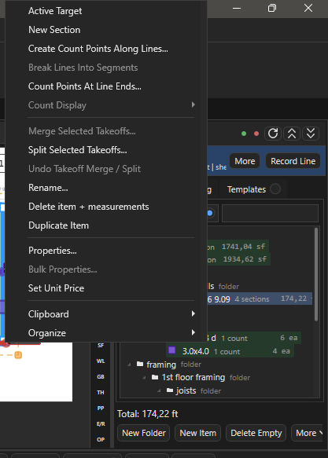

# Дерево Takeoffs

Здесь: панель Takeoffs, новая позиция и Record, копирование между листами и корпусами, скрытие, поиск, Estimating. Нужно каждый день; канон папок и имён - на [Дерево takeoff и имена листов](../start/takeoff-structure.md), несколько корпусов и зелёная точка - [Несколько зданий](ourplancore-buildings.md).

<figure markdown>
  
  <figcaption markdown="span">Сверху зелёная и красная точки корня, строка активной позиции с `Record`, `Total`; ниже кнопки и дерево. Вкладки `Takeoffs`, `Estimating`, `Templates`.</figcaption>
</figure>

## Панель: справка

| Элемент | Что делает |
| --- | --- |
| Зелёная и красная точки | корень для новых позиций: выбранный корпус или весь Takeoffs ([несколько зданий](ourplancore-buildings.md#root)) |
| `Record` (`Space`), `More`, `Props`, `Find`, `Sheet`, `>`, `<` | строка активной позиции: продолжить запись, свойства, показать в дереве, выбрать позицию с этого листа, следующая и предыдущая |
| `>` (`Switch to next takeoff item`), `<` (`Switch to previous takeoff item`) | сделать активной следующую или предыдущую позицию из списка всех позиций проекта, по кругу; статус `Active takeoff target 3/12: <имя>`. Во время Record не переключают |
| `More` строки активной позиции | `Properties...`, `Find in Tree`, `Sheet Targets...` (то же, что `Sheet`), `Previous Target`, `Next Target` (то же, что `<` и `>`) |
| `Sheet` | список позиций, измеренных на открытом листе, с количеством; активная помечена `*`; сверху `Next Sheet Target` - следующая позиция этого листа |
| `Total` | итог активной позиции в её единицах |
| `New Folder`, `New Item` (`T`) | папка и позиция под выделенной папкой |
| `Delete Empty` | удалить позиции без замеров; `Ctrl+Z` возвращает пакетом |
| `More` | `Roof Base from area`, `Auto Tree` (корни COM-шаблона), `From Pages` (папки по структуре листов) |
| `Export` | `Save`, `Save As...`, `Export CSV`, `Export TXT`, `Export Excel`, `Export to Current Excel` |
| Значки в шапке панели | `Refresh Takeoffs tree` - перечитать дерево из папки проекта, статус `Takeoffs tree refreshed.`; `Collapse all Takeoffs nodes` и `Expand all Takeoffs nodes` - свернуть или раскрыть все папки. Те же команды на правой полосе значков: `Collapse Takeoffs Tree`, `Expand Takeoffs Tree` |
| Поиск | левое поле по имени папки, правое по имени позиции или замера; кнопка в левом поле `Match takeoff folder case exactly` (включена) различает `A` и `a`, выключенная ищет без учёта регистра |
| Вкладки справа | `Takeoffs`, `Estimating`, `3D` (модуль), `Templates` |

Под каждой позицией в дереве видны секции: замеры по листам; `Ctrl+Enter` выделяет замеры секции на листе.

| Клавиша | Что делает |
| --- | --- |
| `F2` | переименовать позицию или папку (`Rename...`) |
| `Delete` | удалить; `Ctrl+Z` с фокусом в дереве возвращает |
| `Ctrl+Up` / `Ctrl+Down` | порядок в папке |
| `Ctrl+Enter` | выделить замеры секции на листе |
| `Ctrl+M` / `Ctrl+Shift+M` | Merge и Split выделенных позиций ([правка](ourplancore-editing.md)) |
| `Shift` / `Ctrl` + щелчок | выделить диапазон строк или добавить одну строку |
| протянуть мышь с пустого места дерева | рамка выделения строк; с `Ctrl` добавляет к выделенному |
| `Alt` + протянуть со строки | рамка, начатая прямо со строки (в F1: `Start marquee selection from a row`); без `Alt` протягивание строки переносит её |
| ПКМ по позиции | `Rename...`, `Properties...`, `Set Unit Price`, `Cut`, `Copy`, `Paste Into Parent Folder`, `Delete`; у Area `Create Line Grid...`; у Joist Area `Set / Reset Joist Direction`; все пункты: [меню дерева](#menus) |

## Корпус и корень { #root }

Один корпус: корни `walls`, `sqfts`, `framing`... лежат прямо в Takeoffs, папку `Main` не создавать. Несколько корпусов: папка на каждый (`A`, `B`, `Grge`), зелёная точка (`Use selected folder as root`) делает выделенную папку корнем для новых позиций, красная (`Use Takeoffs root`) возвращает общий корень. Как вести проект с несколькими корпусами, копировать одинаковые корпуса и сдавать их отдельными книгами и PDF: [Несколько зданий](ourplancore-buildings.md).

## Как построить дерево проекта { #tree }

Зачем: корни COM-шаблона с правильными именами за одно нажатие.
Нужно: проект открыт; для нескольких корпусов - папки корпусов созданы.

1. Выделите корень Takeoffs (или папку корпуса).
2. Нажмите **More > Auto Tree**: появились `units`, `sqfts`, `walls`, `gables`, `parapets`, `trussheel`, `openings`, `eves rakes`, `roof misc`, `framing`, `shear walls`, `trims`, `siding` с подпапками этажей.
3. Добавьте недостающее кнопкой **New Folder** под выделенной папкой (например `BW/1st`).

Результат: дерево по канону; состав шаблона правится в `Settings > Auto Tree` ([Settings](ourplancore-settings.md)).

## Как создать позицию: New Item { #new-item }

<figure markdown>
  <video class="kb-demo" loop muted playsinline preload="none" poster="../../assets/images/ourplancore/demo/d-new-item.png"><source src="../../assets/images/ourplancore/demo/d-new-item.mp4" type="video/mp4"></video>
  <figcaption markdown="span">Демонстрация: ++t++, имя `C4 20`, тип `Count`, вид метки `Diamond`, маршрут в `framing/1st floor framing`.</figcaption>
</figure>

<figure markdown>
  
  <figcaption markdown="span">Имя, тип замера, значок точек, цвет и предпросмотр папки назначения до создания.</figcaption>
</figure>

Зачем: позиция с правильным именем, типом и цветом ещё до первого клика на листе.

1. Нажмите `T` или кнопку **New Item** (любой инструмент замера открывает тот же диалог).
2. Впишите **Name**: числа из имени читает Excel ([форматы](../start/takeoff-structure.md)).
3. Выберите **Measurement type**: Count, Line, Area, Joist Area; для Count - значок в **Count display** (circle, cross, square, star, triangle, diamond, ring).
4. Оставьте **Color** случайным или выберите свой; имя `bft` получает фиксированный серый (`Fixed by Takeoff Colors settings`).
5. Прочитайте строку назначения внизу: куда ляжет позиция по точке листа и имени. При необходимости поставьте галку **Review similar on this sheet** (сразу поиск похожих символов) или настройте **Beam annotation line** и **Offset lines** (до двух параллельных линий-компаньонов).
6. Нажмите **OK**.

Результат: позиция стоит в папке назначения, статус `Takeoff: <имя> (Route: ...)`, рисование идёт в неё. **New Folder** создаёт папку под выделенной; ПКМ по папке даёт `Rename Folder...`, `Folder Properties...`, `Organize > Auto Create Tree / Create Folders From Pages / Sort Children A-Z`.

## Как продолжить позицию: Record { #record }

<figure markdown>
  <video class="kb-demo" loop muted playsinline preload="none" poster="../../assets/images/ourplancore/demo/d-record.png"><source src="../../assets/images/ourplancore/demo/d-record.mp4" type="video/mp4"></video>
  <figcaption markdown="span">Демонстрация: выделить позицию, ++space++ (`Record`), дорисовать перегородку и ++c++; `Total` растёт в той же позиции.</figcaption>
</figure>

Зачем: дорисовать участок в существующую позицию, не создавая дубль.

1. Выделите позицию в дереве (или нажмите `Sheet`, чтобы выбрать из измеренных на этом листе; `>` и `<` листают соседние).
2. Нажмите `Space`: статус показывает `Mode: Record <имя>`.
3. Рисуйте нужным инструментом: все замеры идут в эту позицию, точка листа не действует.
4. Нажмите `Space` ещё раз, чтобы остановить. Кнопка инструмента вместо Record создаёт новую позицию.

Результат: под позицией в дереве новая секция, `Total` вырос. `Props` открывает свойства активной позиции (имя, цвет, значок, у Joist Area шаг и направление), `Find` показывает её в дереве.

!!! tip "Советы"
    - ПКМ по позиции > `Set Active Target` делает её активной без начала записи: цвет и значок для рисования, `Total`, её замеры выделяются на листе. У уже активной позиции пункт называется `Active Target`. Пока идёт Record другой позиции, переключиться нельзя: статус `Record stays on <имя>`.
    - ПКМ по замеру на листе > `Takeoff Properties...` открывает свойства его позиции, не ища её в дереве; соседний пункт `Section Properties...` (у Count `Count Properties...`) правит имя и заметку только этой секции.

## Как скопировать замеры на другой лист или корпус { #copy }

<figure markdown>
  <video class="kb-demo" loop muted playsinline preload="none" poster="../../assets/images/ourplancore/demo/d-copy-paste.png"><source src="../../assets/images/ourplancore/demo/d-copy-paste.mp4" type="video/mp4"></video>
  <figcaption markdown="span">Демонстрация: ++ctrl+c++ на одном листе, ++ctrl+v++ на другом, в окне `Paste Measurements` выбор `New takeoffs`.</figcaption>
</figure>

<figure markdown>
  
  <figcaption markdown="span">`Same takeoffs` добавляет замеры в те же позиции, `New takeoffs` создаёт копии позиций. Строка `Root:` показывает корпус назначения.</figcaption>
</figure>

Зачем: одинаковые этажи или корпуса не рисовать второй раз.

1. Нажмите `E`, выделите замеры на листе (рамкой или `Ctrl+A`), `Ctrl+C`.
2. Откройте лист назначения (другой этаж или другой корпус) и нажмите `Ctrl+V`.
3. Выберите в диалоге **Paste Measurements**: **Same takeoffs** - замеры добавляются в исходные позиции (на другом корпусе это обычно не нужно); **New takeoffs** - создаются копии позиций с теми же именами и свойствами.
4. Прочитайте строку `Root:` (зелёная точка или корень) и проверьте дерево.

Результат: при **New takeoffs** копии лежат в той же папке, что исходник, но в корпусе назначения (`A/sqfts` в `B/sqfts`, `A/framing/2nd floor framing/details` в `B/framing/2nd floor framing/details`). На листе с другой точкой того же ряда меняется только этаж: `framing/2nd floor framing/posts` станет `framing/3rd floor framing/posts`. Корпус назначения берётся по порядку: зелёная точка, иначе корень, иначе корпус листа по точке. Зеркало папок выключается галкой `Copies keep their source folders` в `Settings > Sheet Takeoff Routing`. Копирование целого корпуса: [Несколько зданий](ourplancore-buildings.md#copy).

!!! tip "Советы"
    - В дереве `Ctrl+C` / `Ctrl+X` / `Ctrl+V` копируют и переносят позиции и папки, `Ctrl+D` дублирует, перетаскивание переносит. Перенос сохраняет замеры, цвет, значок и порядок легенды; удалить и создать заново - теряет.

## Как спрятать позицию на листе { #hide }

<figure markdown>
  <video class="kb-demo" loop muted playsinline preload="none" poster="../../assets/images/ourplancore/demo/d-hide.png"><source src="../../assets/images/ourplancore/demo/d-hide.mp4" type="video/mp4"></video>
  <figcaption markdown="span">Демонстрация: ++h++ прячет выделенную позицию на листе, точка видимости под листом в Pages возвращает её.</figcaption>
</figure>

Зачем: убрать готовое с глаз при проверке, спрятать чужой корпус перед PDF.

1. Выделите сегмент на листе или строку (строки, папку) в Takeoffs.
2. Нажмите `H`: статус `Hidden N whole takeoff(s)`; позиция спрятана только на текущем листе, папка прячет все свои позиции на нём.
3. Чтобы вернуть, щёлкните точку видимости у позиции под листом в дереве Pages (`Visible on <лист>: <позиция>`): `H` только прячет, не переключает.

Результат: скрытое не рисуется и не печатается в PDF: так готовится отдельный PDF на корпус ([PDF и сдача](ourplancore-pdf.md#buildings)).

| Клавиша | Что делает |
| --- | --- |
| `H` | скрыть на текущем листе позиции выделенных сегментов или строк дерева |
| `Shift+H` | инструмент Highlighter (разметка-маркер) |
| Точка у листа в Pages | спрятать или показать все замеры листа |
| `Hide / Show All Takeoffs` | команда палитры без клавиши по умолчанию |

## Как проверить итоги: Total, Estimating, поиск { #check }

<figure markdown>
  
  <figcaption markdown="span">Все позиции одной таблицей: проверка итогов перед Excel.</figcaption>
</figure>

Зачем: убедиться, что числа и имена готовы к Excel.

1. Выделите позицию: `Total` в строке активной позиции и `Takeoff:` в статусе показывают количество.
2. Откройте вкладку **Estimating**: таблица всех позиций с итогами, единицами и ценой (`Set Unit Price` в ПКМ позиции); кнопка **Open** выносит её в отдельное окно.
3. Нажмите **Delete Empty**: позиции без замеров удалены (`Ctrl+Z` вернёт пакетом).
4. Найдите корпус или ветку поиском по папкам, позицию или замер поиском по позициям: найденное раскрывается в дереве.

Результат: в Estimating нет пустых строк, итоги сходятся с ожиданием; можно переходить к [экспорту в Excel](ourplancore-excel.md). Вкладка `Templates` (заготовки деревьев и позиций) в работе E-Wood почти не нужна: [Прочее](ourplancore-extras-other.md#templates).

В шапке Estimating: поле фильтра (по позиции, секции, листу, заметке), галка `Sheet` (только замеры открытого листа), `Open` (таблица в отдельном окне), `Select`, `Page`, `Props` (то же, что пункты меню ниже). Строки бывают двух видов: позиция целиком и её секция.

| ПКМ по строке Estimating | Что делает |
| --- | --- |
| `Go to Page` (`Go to First Page` при нескольких строках) | открыть лист замера и выделить замеры строк |
| `Select on Canvas` (`Select N on Canvas`) | выделить замеры выбранных строк на листе, лист первой строки откроется сам |
| `Section Properties...` (у Count `Count Properties...`) | у строки секции имя и заметка секции, у строки позиции окно свойств позиции; при нескольких строках пункт называется `Measurement Properties...` и неактивен |
| `Rename Section`, `Delete Section` | переименовать или удалить секцию, только у строки секции; при нескольких строках `Rename Measurement` и `Delete Measurement` неактивны |

## Merge, Split, Break коротко

`Merge` (`Ctrl+M`) собирает несколько позиций в одну со всеми секциями, `Split` (`Ctrl+Shift+M`) делит позицию по секциям или по листам, `Break` (`Ctrl+Shift+B`) режет Line на сегменты, `Ends` ставит Count на концах. Откат - `Ctrl+Z` в дереве или ПКМ `Undo Takeoff Merge / Split`. Подробно: [Правка и привязки](ourplancore-editing.md).

## Как поменять цвет, цену или заметку сразу у многих позиций { #bulk }

Зачем: один цвет на ветку (например все `BW`) или общая заметка без правки каждой позиции.

1. Выделите позиции в дереве (`Shift` или `Ctrl` + щелчок, рамка) и щёлкните ПКМ > **Bulk Properties (N Items)...**. Для всей папки с подпапками: ПКМ по папке > **Bulk Item Properties...**.
2. Поставьте галку у того, что меняете: `Apply color` (образец палитры или код цвета), `Apply unit price per <unit>` (только если все позиции одного типа и включён модуль Estimating), `Replace notes`.
3. Нажмите **OK**: поля без галки не меняются.

Результат: статус `Updated bulk properties for N takeoff item(s)`; новый цвет получают и все замеры этих позиций.

## Свойства папки: значения для новых позиций { #folder-props }

ПКМ по папке > `Folder Properties...` открывает окно `Takeoff Folder Properties`:

| Поле | Что делает |
| --- | --- |
| `Display name` | имя папки (переименование) |
| `Notes` | заметка папки, видна в подсказке над папкой |
| `Default measurement type` | тип, который сразу выбран в New Item для позиции в этой папке |
| `Default name prefix` | приставка к имени новой позиции по умолчанию |
| `Default unit price` | цена новой позиции (только с модулем Estimating) |
| `Default notes for new items` | заметка, которую получает новая позиция |
| `Default color` | запоминается и видна в подсказке папки; цвет новой позиции всё равно случайный |

Значения действуют и в подпапках: берётся ближайшая папка вверх по дереву, где поле заполнено. Подсказка над папкой показывает их строкой `Default: ...`.

## Цвета позиций { #colors }

Новая позиция получает случайный цвет без серого, чёрного и белого; `Split` даёт отделённой части новый цвет; имя `bft` всегда серое (`Settings > Takeoff Colors`). Одинаковые цвета соседних позиций делают легенду нечитаемой: менять в `Props` или ПКМ `Properties...`, у многих сразу через [Bulk Properties](#bulk). ПКМ по папке > `Random Colors for Items` даёт всем позициям папки и подпапок разные цвета из палитры за одно нажатие.

Размер значков Count и толщину линий на экране задаёт лента **Viewport**, группа LINES & AREA: `Point` (подсказка `Count marker size`, 0.25-4, по умолчанию 1) и `Line` (0.25-4); число можно вписать в поле рядом и нажать ++enter++. Это только вид на экране и в отдельных окнах листов, в PDF свои значения: `PDF Output > LINES & AREA` ([PDF](ourplancore-pdf.md)).

## Меню дерева: справка { #menus }

<figure markdown>
  
  <figcaption markdown="span">ПКМ по позиции: сверху `Set Active Target` и запись, ниже правка, свойства, `Clipboard` и `Organize`. Часть пунктов видна только с модулем Advanced Takeoff Tools.</figcaption>
</figure>

Пункты с пометкой "модуль" видны, пока в `Settings > Modules` включён Advanced Takeoff Tools (или названный модуль); Advanced Takeoff Tools, Takeoff Automation и Estimating включены по умолчанию ([Settings](ourplancore-settings.md)). При нескольких выделенных строках подписи показывают число: `Delete selected takeoffs`, `Move 3 Up`.

??? note "Меню позиции"

    | Пункт | Что делает |
    | --- | --- |
    | `Set Active Target` (`Active Target`) | сделать позицию активной без записи ([Record](#record)) |
    | `New Section`, у Count `Add Count` | начать запись новой секции в эту позицию на открытом листе |
    | `Create Line Grid...`, `Trace Walls Inside Area...` | у Area, модуль: сетка линий по площади; стены по линиям PDF внутри площади ([трассировка](ourplancore-snap-trace.md)) |
    | `Joist` > `Use Area As Joists...` (`Joist Properties...`), `Refresh Regular Joists in All Area Segments`, `Start Extra Joists Mode (D)`, `Set / Reset Joist Direction`, `Set Direction for All Areas` | у Area, модуль: сделать площадь зоной joists и её свойства, пересчитать обычные joists во всех секциях, добавить extra joists, задать направление по одной зоне или сразу всем зонам позиции ([J Area](ourplancore-tools.md#jarea)) |
    | `Create Count Points Along Lines...`, `Break Lines Into Segments`, `Count Points At Line Ends...` | у Line, модуль ([правка](ourplancore-edit-takeoffs.md)) |
    | `Find Similar...` | у Count, модуль: найти такие же символы на листе |
    | `Count Display` | значок точек Count |
    | `3D` > `Wall`, `Roof Base from Area` | модуль 3D ([3D](ourplancore-3d.md)) |
    | `Merge Selected Takeoffs...`, `Split Selected Takeoffs...`, `Undo Takeoff Merge / Split` | модуль ([Merge и Split](ourplancore-edit-takeoffs.md)) |
    | `Rename...`, `Delete item + measurements`, `Duplicate Item` | переименовать, удалить с замерами (`Ctrl+Z` вернёт), копия рядом с тем же именем |
    | `Properties...`, `Bulk Properties...`, `Set Unit Price` | свойства одной позиции, нескольких сразу ([выше](#bulk)), цена (модуль Estimating) |
    | `Clipboard` > `Copy Item`, `Cut Item`, `Paste Into Parent Folder` | копировать, вырезать, вставить в папку этой позиции |
    | `Organize` > `Move Up`, `Move Down` | порядок в папке (`Ctrl+Up` / `Ctrl+Down`) |

??? note "Меню папки"

    | Пункт | Что делает |
    | --- | --- |
    | `New Folder`, `New Item` | новая папка или позиция внутри |
    | `Rename Folder...`, `Delete folder + children` | переименовать; удалить со всем содержимым (`Ctrl+Z` вернёт) |
    | `Folder Properties...` | окно `Takeoff Folder Properties` ([выше](#folder-props)) |
    | `Bulk Item Properties...`, `Random Colors for Items` | свойства или разные цвета всем позициям папки и подпапок |
    | `Count Display`, `3D` | значок Count и 3D для позиций папки |
    | `Clipboard` > `Copy Folder`, `Cut Folder`, `Paste Into Folder`, `Duplicate Folder` | копирование и перенос ветки |
    | `Organize` > `Auto Create Tree`, `Create Folders From Pages` | модуль Takeoff Automation: корни шаблона и папки по листам ([дерево](#tree)) |
    | `Organize` > `Move Up`, `Move Down`, `Sort Children A-Z`, `Sort Children Z-A` | порядок папки и сортировка её содержимого |
    | `Open in Explorer` | папка на диске |

??? note "Меню секции (замера под позицией)"

    | Пункт | Что делает |
    | --- | --- |
    | `Section Properties...` (у Count `Count Properties...`) | имя и заметка секции |
    | `Set Notes...` (`Set Notes for N Rows...`) | одна заметка сразу нескольким секциям |
    | `Count Display`, `Rename Section` | значок Count секции; имя секции |
    | `Go to Page`, `Select on Canvas` | открыть лист секции; выделить её замеры на листе (`Ctrl+Enter`) |
    | `Merge Segment...`, `Split Segment...` (`Split Count Section...`) | модуль: перенести секцию в другую позицию или в новую |
    | `Create Count Points Along Line...`, `Break Line Into Segments`, `Count Points At Line Ends...` | у Line, модуль |
    | `Create Line Grid...`, `Refresh Regular Joists in All Area Segments`, `Start Extra Joists Mode (D)`, `Set / Reset Joist Direction`, `Set Direction for All Areas` | у Area, модуль; `Set Direction for All Areas` берёт эту зону как образец, вы проводите две точки вдоль joists, и направление получают все зоны позиции |
    | `Move Up`, `Move Down`, `Delete Section` | порядок секций; удалить секцию |

??? note "Меню корня Takeoffs (пустое место дерева)"

    `Auto Create Tree` и `Create Folders From Pages` (модуль Takeoff Automation), `Paste Into Root`, `Sort Root A-Z`, `Sort Root Z-A`, `Open Takeoffs in Explorer`.

## Команды палитры для дерева { #palette }

Палитра `Ctrl+Shift+P` находит по имени команды без клавиши по умолчанию:

| Команда | Что делает |
| --- | --- |
| `Show Takeoffs Tab`, `Show Estimating Tab` | открыть вкладку Takeoffs или Estimating справа |
| `Show Takeoff Manager` | вкладка Takeoff Manager в строке режимов ([Менеджеры](ourplancore-managers.md#takeoff-manager)) |
| `Refresh Takeoffs Tree` | перечитать дерево из папки проекта |
| `Previous Takeoff Target`, `Next Takeoff Target` | как `<` и `>` (нужны хотя бы две позиции) |
| `Next Sheet Takeoff Target` | следующая позиция, измеренная на открытом листе |

## См. также

- [Инструменты замера](ourplancore-tools.md), [Имена и автомаршрут](takeoff-naming.md), [Раскладка по листам](ourplancore-split-by-sheets.md)
- [Несколько зданий](ourplancore-buildings.md), [Правка и привязки](ourplancore-editing.md)
- [Дерево takeoff и имена листов](../start/takeoff-structure.md)
- [Частые ошибки: листы и дерево](../start/common-mistakes.md#pages)
