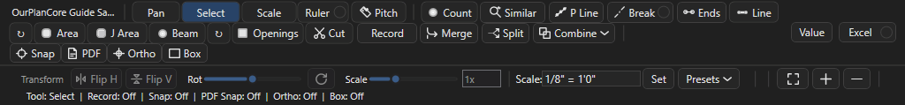
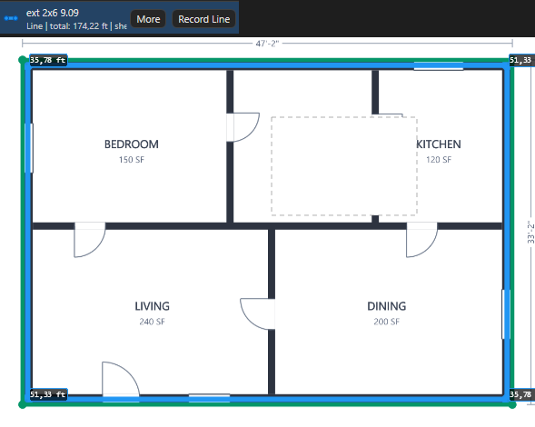
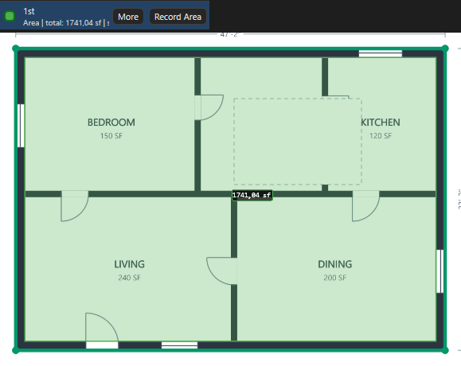
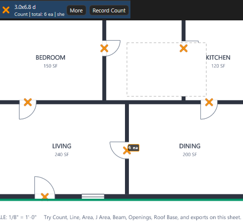
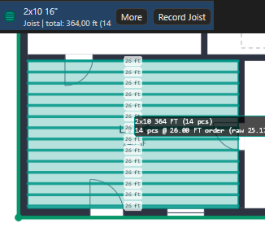
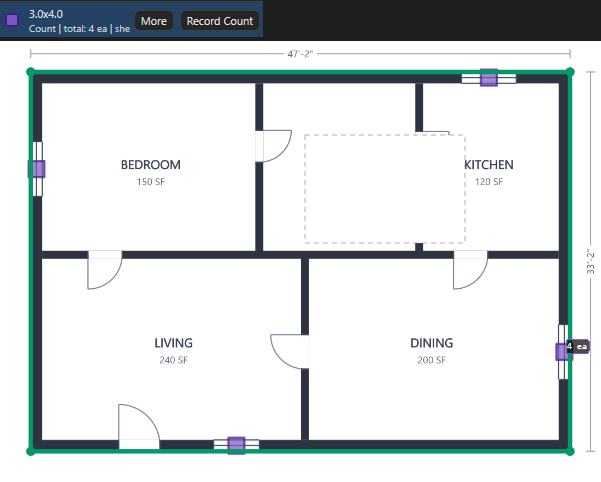

# Measuring tools

Here: the bottom strip tools in order of how often they are used, their keys, step-by-step tasks, and what appears in the tree. Needed every day; topic rules (what exactly to trace) live on the pages of the "Work" section. Editing finished measurements, Cut, Merge, Split, Similar and the Snap, Ortho, Box snaps: [Editing and snaps](ourplancore-editing.md).

<figure markdown>
  
  <figcaption markdown="span">Row 1: tools and snap toggles. Row 2: Transform, sheet scale, Fit and zoom. On the right, the `Value` and `Excel` buttons.</figcaption>
</figure>

## General rules

- A tool button (`L`, `A`, `P`, `J`, `B`, `O`) creates a **new** takeoff: the `New Takeoff Item` dialog opens with the name, color and a preview of the destination folder. To continue an **existing** takeoff: select it and press `Space` (Record).
- Drawing: a click places a point, `C` finishes, `Esc` cancels an unfinished shape, `Ctrl+Z` or `Backspace` removes the last point. Snaps to the drawing and to the axes (`F3`, `Ctrl+F3`, `F8`, `F9`) are off in a regular measurement: [Editing and snaps](ourplancore-editing.md).
- The status bar shows `Mode: Record <takeoff>` and `Takeoff: <takeoff>` and `Route: W 1st floor`: what you are drawing and where it will go.
- Without a sheet scale, Line and Area are not created ([scale](ourplancore-pages.md#scale)).
- The right mouse button always pans the sheet, the wheel zooms, `F` fits the sheet to the window.

## Tool table

| Button | Key | What it does | What appears in the tree |
| --- | --- | --- | --- |
| `Line` | `L` | a polyline along a wall or detail centerline, linear feet | a Line takeoff, LFT |
| `Area` | `A` | a closed outline, square feet; `F9` box by two corners | an Area takeoff, SF |
| `Count` | `P` | a point per symbol, pieces | a Count takeoff, ea |
| `J Area` | `J` | a joist area with direction and spacing | a Joist Area takeoff: pieces and LFT |
| `Beam` | `B` | beam length between supports, one point per beam | a Count takeoff with the length in the name |
| `Open` | `O` | a box around an opening, a point in the center | a Count takeoff `WxH` |
| `Scale` | `S` | sheet scale from a known dimension | - |
| `Ruler` | `R` | a tape dimension on the sheet with no quantity; the dot on the button (`Ruler Sheet Visibility`) hides the sheet's rulers | markup |
| `Pitch` | - | roof pitch `rise:12` from two points; in the palette, the `Pitch Tool` command | markup |
| `Select` | `E` | select and edit measurements; `Ctrl+C` / `Ctrl+V` | - |
| `Pan` | `V` | pan the sheet | - |
| `Cut`, `P Line`, `Similar`, `Repeat`, `Merge`, `Split`, `Break`, `Ends`, `Combine`, `Transform` | `X`, `Ctrl+M`, `Ctrl+Shift+M`, `Ctrl+Shift+B` | editing finished measurements and takeoffs, finding similar symbols, segment series | [Editing and snaps](ourplancore-editing.md) |
| `Snap`, `PDF`, `Ortho`, `Box` | `F3`, `Ctrl+F3`, `F8`, `F9` | snaps: to your own points, to the drawing, to the axes, by two corners | [Editing and snaps](ourplancore-editing.md) |

The `Value` and `Excel` buttons on the right write the selected takeoff into the open Excel workbook: [Export to Excel](ourplancore-excel.md#value). The `Link to Excel` button next to them keeps the takeoff's number in a cell and updates it by itself: [Link to Excel](ourplancore-excel.md#link). The `Auto Link` button on the DFL links all takeoffs at once whose numbers are already in the `J:L` list: [Auto Link](ourplancore-excel.md#auto-link).

## How to draw a wall: Line { #line }

<figure markdown>
  <video class="kb-demo" loop muted playsinline preload="none" poster="../../assets/images/ourplancore/demo/d-line-walls.png"><source src="../../assets/images/ourplancore/demo/d-line-walls.mp4" type="video/mp4"></video>
  <figcaption markdown="span">Demo: ++l++, name `ext 2x6 9.09`, route line `walls/1st floor walls`, clicks along the exterior wall centerline and ++c++.</figcaption>
</figure>

<figure markdown>
  
  <figcaption markdown="span">The takeoff `ext 2x6 9.09`: purpose, size, height in feet. Disconnected runs are separate measurements of one takeoff.</figcaption>
</figure>

Why: linear feet of everything counted by length: walls, BW, shear walls, eve and rake, truss heel, parapets, ledger and rim in details.
You need: a sheet with a scale and a W, F or S dot.

1. Press `L` (the `Line` button).
2. Type the name following the pattern `<purpose> <size> <height>`: `ext 2x6 9.09`, `corr 2x6 11.7`, `eve 24 main`, `prpt 6.4 5.3 0.5 par`. Read the destination line and press **OK**.
3. Click along the wall centerline corner by corner.
4. Press `C`: the run is closed, Record is on.
5. Draw the next run of the same takeoff; `Space` stops Record.
6. For a new height or size press `L` again: that is a new takeoff, not a continuation.

Result: with the W dot the takeoff is in `walls/<floor> floor walls`, with F in `framing/<floor> framing/details`, with S in `shear walls/<floor>/shear`; names with `eve`, `rake`, `prpt`, `trussheel`, `gable` go to their own roots from any sheet. `Total` shows LFT.

Rules: [Exterior](../work/vertical/walls/exterior.md), [Bearing Walls](../work/vertical/walls/bearing-walls.md), [Shear Wall](../work/vertical/sheathing/shear-wall.md), [Eve](../work/sheathing-and-misc/eve.md), [Parapet](../work/vertical/walls/parapet.md), [Truss Heel](../work/vertical/sheathing/truss-heel.md).

## How to take off an area: Area { #area }

<figure markdown>
  <video class="kb-demo" loop muted playsinline preload="none" poster="../../assets/images/ourplancore/demo/d-area.png"><source src="../../assets/images/ourplancore/demo/d-area.mp4" type="video/mp4"></video>
  <figcaption markdown="span">Demo: ++a++, the `1st` floor outline and ++c++; then ++x++ (`Cut`) with ++f9++ (`Box`) cuts a bathroom out of the area.</figcaption>
</figure>

<figure markdown>
  
  <figcaption markdown="span">The outline follows the real floor boundary. Shafts are cut out with `Cut`, not with a second outline.</figcaption>
</figure>

Why: SQFT of floors, balconies and porches, roof planes, gables, facade sheathing.
You need: a sheet with a scale.

1. Press `A` (the `Area` button), type the name `1st`, `blcny`, `rf 6`, `gable` or `siding/6" vertical`, **OK**.
2. Trace the outline corner by corner; `C` closes it. For a rectangle press `F9` and click two corners.
3. For a hole inside (shaft, open to below) press `X` and trace the cutout inside the area.
4. For two overlapping areas, select both with the Select tool and choose **Combine > Remove Overlap** ([editing](ourplancore-editing.md)).

Result: with the W dot the takeoff is in `sqfts`, with F in `framing/<floor> framing/joists` (for joists use `J Area`, not Area), with S in shear; `Total` in SF.

Rules: [SQFT 1st, 2nd](../work/sqfts/1st2nd.md), [Roof](../work/sqfts/roof.md), [Gable](../work/vertical/walls/gable.md), [Wall Sheathing](../work/vertical/sheathing/wall-sheathing.md).

## How to count pieces: Count { #count }

<figure markdown>
  <video class="kb-demo" loop muted playsinline preload="none" poster="../../assets/images/ourplancore/demo/d-count.png"><source src="../../assets/images/ourplancore/demo/d-count.mp4" type="video/mp4"></video>
  <figcaption markdown="span">Demo: ++p++, name `HDU5 SB5x24`, four points at the ends of shear walls; total 4 ea.</figcaption>
</figure>

<figure markdown>
  
  <figcaption markdown="span">One point per physical symbol. The takeoff's icon and color set it apart from its neighbors in the legend.</figcaption>
</figure>

Why: posts, holdowns, hardware, anything counted in pieces.

1. Press `P` (the `Count` button), type a name by mark or model: `C4 20`, `HDU11 SB1x30 S2.2`, `MPB88Z S2.1`, `int H228 4`.
2. Pick the point icon in the `Count display` field (circle, cross, square, star, triangle, diamond, ring) and press **OK**. The app remembers the chosen icon and offers it for the next new Count.
3. Click the center of each symbol; for a holdown, at the end of the shear wall.
4. Missed: press `E`, drag the point, or `Delete`.
5. To add points to a finished takeoff later, right-click it in Takeoffs and choose `Add Count` (for Line and Area this item is called `New Section`), or select it and press `Space`.

Result: with the W dot the takeoff is in `walls/<floor> floor walls`, with F in the root of `framing/<floor> framing` (posts and headers are later moved into `posts` and `headers/ext|int`), with S in `shear walls/<floor>/holdowns`; `Total` in pieces. In the Templates panel the same `Add Count` item creates not a takeoff but a Count preset in the template tree ([Templates](ourplancore-extras-other.md#templates)).

Rules: [Post](../work/horizontal/floor-framing/post.md), [Holdowns](../work/vertical/sheathing/holdowns.md), [Headers](../work/vertical/openings/headers.md).

## How to count joists: J Area { #jarea }

<figure markdown>
  <video class="kb-demo" loop muted playsinline preload="none" poster="../../assets/images/ourplancore/demo/d-jarea.png"><source src="../../assets/images/ourplancore/demo/d-jarea.mp4" type="video/mp4"></video>
  <figcaption markdown="span">Demo: ++j++, name `2x10 16"`, floor framing outline and the joist direction line; the app counts pieces and linear feet.</figcaption>
</figure>

<figure markdown>
  
  <figcaption markdown="span">Joist area: outline, direction, spacing. The app counts pieces and lengths by itself.</figcaption>
</figure>

Why: joist or rafter pieces and lengths by area without counting by hand.
You need: a structural plan with the F dot and a scale.

1. Press `J` (the `J Area` button), type the name `<size or series> <spacing>`: `2x8 16"`, `11 7/8 TJI 16"`, **OK**.
2. Trace the area, `C`.
3. Draw the direction line along the joists when the app asks; `Shift` keeps the direction orthogonal.
4. Open `Props` and check the spacing, end joists, doubled joists. A hole in the area: `X`.
5. For extra joists under walls, select the area and press `D` (Extra Joists).
6. If needed, turn on the `Detailed area label` checkbox in `Props` (order and net lengths in a table on the sheet) and `Move joist note` (the table can be dragged with the Select tool, `Ctrl+Z` undoes the move; the position is saved and printed in the PDF).

Result: with the F dot the takeoff is in `framing/<floor> framing/joists`; `Total` shows pieces and LFT. A change of direction, spacing or material means a new area. A plain Area named `2x8 16"` will not give joists in Excel.

### J Area right-click menu { #jarea-menu }

These items are in the menu of the area on the sheet (some of them also in a separate sheet window), in the menu of a section under the takeoff, and in the `Joist` submenu of the takeoff in Takeoffs. Needs the Advanced Takeoff Tools module (on).

| Item | What it does | When you need it |
| --- | --- | --- |
| `Use Area As Joists...` | on a plain Area opens `Takeoff Item Properties`: the `Joist layout` checkbox turns the takeoff into a J Area (`Joist type`, `O.C. spacing (in)`, pitch, length rounding). On a J Area the same item is called `Joist Properties...` | the area was drawn with a plain `Area`, but joists need to be counted |
| `Set / Reset Joist Direction` | sets the direction of one area again: draw a two-point line along the joists | the direction came out crosswise |
| `Set Direction for All Areas` | one direction line on the selected area sets the same direction for all areas of the takeoff on all sheets; status `Joist direction ... applied to N areas` | all areas of the takeoff run the same way |
| `Refresh Regular Joists in All Area Segments` | carries the takeoff's common properties (type, spacing, `Default far-edge joist`) over to all areas and recalculates the regular joists; for areas without their own direction the app asks you to draw a line, one by one. End joists set on the sheet are kept | after changing the spacing or type in `Props` |
| `Start Extra Joists Mode (D)` | the same as `D`: clicks inside the area place Extra Joists, `D` or `Esc` exits; available when the area's direction is set | extra joists under walls |
| `Delete Nearest Extra Joist` | deletes the extra joist under the cursor (right-click exactly on its line); a miss gives the status `Right-click directly on an Extra Joist to delete it.`, `Ctrl+Z` brings it back | an unneeded Extra Joist |

Rules: [Joist](../work/horizontal/floor-framing/joist.md).

## How to measure a beam: Beam { #beam }

<figure markdown>
  <video class="kb-demo" loop muted playsinline preload="none" poster="../../assets/images/ourplancore/demo/d-beam.png"><source src="../../assets/images/ourplancore/demo/d-beam.mp4" type="video/mp4"></video>
  <figcaption markdown="span">Demo: ++b++, two beam ends, name `FB1`; the app adds the length to the name: `FB1 52`.</figcaption>
</figure>

<figure markdown>
  
  <figcaption markdown="span">Drawn from post to post, mark `FB1` typed over `Beam`: the 49,11 ft from the ruler went into the name already rounded, Count takeoff `FB1 50`, the first mark above the beam.</figcaption>
</figure>

Why: beams and headers with the order length in the name, which Excel reads.

1. Press `B` (the `Beam` button) and draw from support to support.
2. Type the mark or size in the dialog: `FB1`, `(2) 1 3/4 x 18 LVL`, `ext H228`; the app adds the order length in feet. Press **OK**.
3. For a second identical beam, select the takeoff, press `Space` and place another point.
4. For a series of beams in a row, press the `Repeat` arrow next to the Beam button: each beam is drawn with two points until `Esc`.

Result: a Count takeoff with a point on the beam and the length in the name (`FB1 14`), with the F dot in `framing/<floor> framing/beams`. The tool does the rounding: up to 8' it rounds up to a whole foot, over 8' up to an even number (`8.3` gives `10`, `13.2` gives `14`). Do not add feet by hand, and do not put `(n)` together with n points.

Rules: [Beam](../work/horizontal/floor-framing/beam.md), [Headers](../work/vertical/openings/headers.md).

## How to count openings: Openings { #openings }

<figure markdown>
  <video class="kb-demo" loop muted playsinline preload="none" poster="../../assets/images/ourplancore/demo/d-openings.png"><source src="../../assets/images/ourplancore/demo/d-openings.mp4" type="video/mp4"></video>
  <figcaption markdown="span">Demo: ++o++, a box around a window, name `4.0x4.0`, the other windows with one click each; total 4 ea.</figcaption>
</figure>

<figure markdown>
  
  <figcaption markdown="span">Takeoff `3.0x4.0` on the demo plan: a point on every window, 4 ea. Openings makes such a takeoff from a box around the opening on an elevation: the size name, a point in the center.</figcaption>
</figure>

Why: windows, doors, garage doors with the size in the name, one point per opening.

1. Press `O` (the `Open` button) and click two corners of a box around the opening.
2. Type the name `<width>x<height>` in decimal feet with one decimal place: `4.3x7.8`; suffix ` d` door, ` gd` garage door, ` lv` louver. Different marks of the same size = one takeoff. Press **OK**.
3. Repeat for each opening; showing up on both the plan and the elevation does not double it: one point per opening.

Result: a Count takeoff in `openings` from any sheet except U; the floor is the folder `openings/<0|1|2|roof>`, takeoffs are moved into it by hand.

Rules: [Windows and Doors](../work/vertical/openings/windows-doors.md).

## Other tools and buttons { #other }

| Tool | When and how |
| --- | --- |
| `Pitch` | roof pitch from a section: two points along the roof plane, the result `rise:12` for the name `rf 6`. The `Pitch` button is in row 1 next to `Ruler`; in the `Ctrl+Shift+P` palette the same command is called `Pitch Tool`, it has no shortcut |
| `Ruler` (`R`) | checking the scale and dimensions; gives no quantity |
| `Ruler Sheet Visibility` | the small dot on the `Ruler` button: hides the rulers already on this sheet (new rulers stay visible); pressing again shows them all. Handy when rulers were placed only to check the scale and get in the way of reading the sheet |
| `Ruler screen thickness` | the `Ruler` slider on the **Viewport** ribbon, RULER / EXTRA group: on-screen thickness of ruler and `Pitch` lines, 0.5-6 px (default 1); a field next to it for an exact number |
| `Scale:` and `Set` | the scale field in row 2 of the strip: type `1/8" = 1'0"` or `1:96` and press `Set` (or `Enter`). The scale is written to the current sheet, its measurements are recalculated; `Presets` gives typical values ([scale](ourplancore-pages.md#scale)) |
| `Reset Rotate Selection` | the button with a circular arrow to the right of the `Rot` slider: returns the slider to zero, the selection stays rotated; the next rotation counts from the new position ([Transform](ourplancore-edit-takeoffs.md#transform)) |
| `Expand all Pages nodes`, `Expand all Takeoffs nodes` | icons above the Pages and Takeoffs trees expand all folders, the icon next to them collapses. The same commands are on the icon strips at the edges of the sheet: `Expand Pages Tree` on the left, `Expand Takeoffs Tree` on the right |
| `Record` (`Space`) | continue the selected takeoff; `Space` again stops it ([Record](ourplancore-takeoffs.md#record)) |
| `Cut`, `P Line`, `Similar`, `Repeat`, `Combine`, snaps `Snap` / `PDF` / `Ortho` / `Box` | cutouts, points along a line, similar symbols, segment series, overlapping areas, snaps to the drawing: [Editing and snaps](ourplancore-editing.md) |

## Editing measurements in brief { #editing }

- `E`: a click selects a measurement, a box selects several; `Delete` deletes; `Ctrl+Z` undoes.
- `Ctrl+C` / `Ctrl+V` move measurements to another sheet: [copying](ourplancore-takeoffs.md#copy).
- Vertices, `Transform` (mirror, rotate, scale the selection), `Merge`, `Split`, `Break`, `Ends`, `Combine`: [Editing and snaps](ourplancore-editing.md).

## See also

- [Takeoffs tree](ourplancore-takeoffs.md): Record, building root, copying
- [Editing and snaps](ourplancore-editing.md): Cut, Merge, Split, Break, Similar, Snap
- [Names and auto-routing](takeoff-naming.md): why a takeoff landed in this folder; [split by sheets](ourplancore-split-by-sheets.md)
- [Workflow: takeoffs in order](../start/workflow.md), [Common mistakes](../start/common-mistakes.md)
