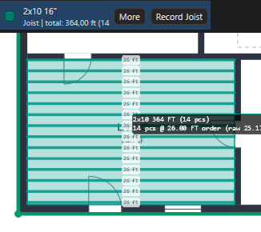
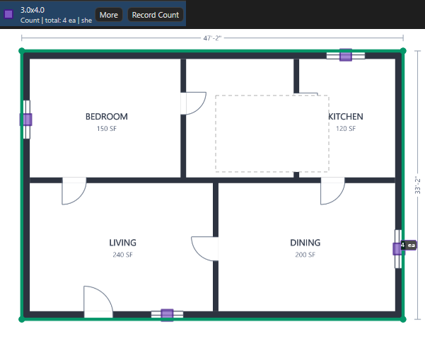

# Инструменты замера

Здесь: инструменты нижней полосы по частоте использования, клавиши, задачи по шагам и что появляется в дереве. Нужно каждый день; предметные правила (что именно обводить) живут на страницах раздела "Работа". Правка готовых замеров, Cut, Merge, Split, Similar и привязки Snap, Ortho, Box - [Правка и привязки](ourplancore-editing.md).

<figure markdown>
  
  <figcaption markdown="span">Строка 1: инструменты и переключатели привязок. Строка 2: Transform, масштаб листа, Fit и zoom. Справа кнопки `Value` и `Excel`.</figcaption>
</figure>

## Общие правила

- Кнопка инструмента (`L`, `A`, `P`, `J`, `B`, `O`) создаёт **новую** позицию: открывается диалог `New Takeoff Item` с именем, цветом и предпросмотром папки назначения. Продолжить **существующую** позицию: выделить её и `Space` (Record).
- Рисование: клик ставит точку, `C` завершает, `Esc` отменяет недорисованное, `Ctrl+Z` или `Backspace` убирает последнюю точку. Привязки к чертежу и осям (`F3`, `Ctrl+F3`, `F8`, `F9`) в обычном замере выключены: [Правка и привязки](ourplancore-editing.md).
- Строка статуса показывает `Mode: Record <позиция>` и `Takeoff: <позиция> (Route: W 1st)`: что рисуешь и куда ляжет.
- Без масштаба листа Line и Area не создаются ([масштаб](ourplancore-pages.md#scale)).
- Правая кнопка мыши всегда двигает лист, колесо меняет zoom, `F` вписывает лист в окно.

## Таблица инструментов

| Кнопка | Клавиша | Что делает | Что в дереве |
| --- | --- | --- | --- |
| `Line` | `L` | ломаная по оси стены или узла, погонные футы | позиция Line, LFT |
| `Area` | `A` | замкнутый контур, квадратные футы; `F9` бокс двумя углами | позиция Area, SF |
| `Count` | `P` | точка на символ, штуки | позиция Count, ea |
| `J Area` | `J` | зона joists с направлением и шагом | позиция Joist Area: штуки и LFT |
| `Beam` | `B` | длина балки между опорами, одна точка на балку | позиция Count с длиной в имени |
| `Open` | `O` | бокс по проёму, точка в центре | позиция Count `ШxВ` |
| `Scale` | `S` | масштаб листа по известному размеру | - |
| `Ruler` | `R` | рулетка-размер на листе без количества; точка на кнопке (`Ruler Sheet Visibility`) прячет рулетки листа | разметка |
| `Pitch` | - | уклон крыши `rise:12` по двум точкам; в палитре команда `Pitch Tool` | разметка |
| `Select` | `E` | выбор и правка замеров; `Ctrl+C` / `Ctrl+V` | - |
| `Pan` | `V` | двигать лист | - |
| `Cut`, `P Line`, `Similar`, `Repeat`, `Merge`, `Split`, `Break`, `Ends`, `Combine`, `Transform` | `X`, `Ctrl+M`, `Ctrl+Shift+M`, `Ctrl+Shift+B` | правка готовых замеров и позиций, поиск похожих символов, серии отрезков | [Правка и привязки](ourplancore-editing.md) |
| `Snap`, `PDF`, `Ortho`, `Box` | `F3`, `Ctrl+F3`, `F8`, `F9` | привязки: к своим точкам, к чертежу, к осям, двумя углами | [Правка и привязки](ourplancore-editing.md) |

Кнопки `Value` и `Excel` справа пишут выбранную позицию в открытую книгу Excel: [Экспорт в Excel](ourplancore-excel.md#value).

## Как нарисовать стену: Line { #line }

<figure markdown>
  <video class="kb-demo" loop muted playsinline preload="none" poster="../../assets/images/ourplancore/demo/d-line-walls.png"><source src="../../assets/images/ourplancore/demo/d-line-walls.mp4" type="video/mp4"></video>
  <figcaption markdown="span">Демонстрация: ++l++, имя `ext 2x6 9.09`, строка маршрута `walls/1st floor walls`, щелчки по оси наружной стены и ++c++.</figcaption>
</figure>

<figure markdown>
  
  <figcaption markdown="span">Позиция `ext 2x6 9.09`: назначение, сечение, высота в футах. Несвязанные участки - отдельные замеры одной позиции.</figcaption>
</figure>

Зачем: погонные футы всего, что считается длиной: стены, BW, shear walls, eve и rake, truss heel, parapets, ledger и rim в деталях.
Нужно: лист с масштабом и точкой W, F или S.

1. Нажмите `L` (кнопка `Line`).
2. Впишите имя по схеме `<назначение> <сечение> <высота>`: `ext 2x6 9.09`, `corr 2x6 11.7`, `eve 24 main`, `prpt 6.4 5.3 0.5 par`. Прочитайте строку назначения и нажмите **OK**.
3. Щёлкайте по оси стены угол за углом.
4. Нажмите `C`: участок закрыт, Record включён.
5. Рисуйте следующий участок той же позиции; `Space` останавливает Record.
6. Для новой высоты или сечения нажмите `L` снова: это новая позиция, не продолжение.

Результат: при точке W позиция в `walls/<этаж> floor walls`, при F в `framing/<этаж> framing/details`, при S в `shear walls/<этаж>/shear`; имена с `eve`, `rake`, `prpt`, `trussheel`, `gable` уходят в свои корни с любого листа. `Total` показывает LFT.

Правила: [Exterior](../work/vertical/walls/exterior.md), [Bearing Walls](../work/vertical/walls/bearing-walls.md), [Shear Wall](../work/vertical/sheathing/shear-wall.md), [Eve](../work/sheathing-and-misc/eve.md), [Parapet](../work/vertical/walls/parapet.md), [Truss Heel](../work/vertical/sheathing/truss-heel.md).

## Как снять площадь: Area { #area }

<figure markdown>
  <video class="kb-demo" loop muted playsinline preload="none" poster="../../assets/images/ourplancore/demo/d-area.png"><source src="../../assets/images/ourplancore/demo/d-area.mp4" type="video/mp4"></video>
  <figcaption markdown="span">Демонстрация: ++a++, контур этажа `1st` и ++c++; затем ++x++ (`Cut`) с ++f9++ (`Box`) вырезает ванную из площади.</figcaption>
</figure>

<figure markdown>
  
  <figcaption markdown="span">Контур по реальной границе этажа. Шахты вырезаются `Cut`, не вторым контуром.</figcaption>
</figure>

Зачем: SQFT этажей, балконов и porch, скаты кровли, фронтоны, обшивка фасадов.
Нужно: лист с масштабом.

1. Нажмите `A` (кнопка `Area`), впишите имя `1st`, `blcny`, `rf 6`, `gable` или `siding/6" vertical`, **OK**.
2. Обведите контур по углам; `C` замыкает. Для прямоугольника нажмите `F9` и щёлкните два угла.
3. Для отверстия внутри (шахта, open to below) нажмите `X` и обведите вырез внутри площади.
4. Для двух пересёкшихся площадей выделите обе инструментом Select и выберите **Combine > Remove Overlap** ([правка](ourplancore-editing.md)).

Результат: при точке W позиция в `sqfts`, при F в `framing/<этаж> framing/joists` (для joists используйте `J Area`, не Area), при S в shear; `Total` в SF.

Правила: [SQFT 1st, 2nd](../work/sqfts/1st2nd.md), [Roof](../work/sqfts/roof.md), [Gable](../work/vertical/walls/gable.md), [Wall Sheathing](../work/vertical/sheathing/wall-sheathing.md).

## Как посчитать штуки: Count { #count }

<figure markdown>
  <video class="kb-demo" loop muted playsinline preload="none" poster="../../assets/images/ourplancore/demo/d-count.png"><source src="../../assets/images/ourplancore/demo/d-count.mp4" type="video/mp4"></video>
  <figcaption markdown="span">Демонстрация: ++p++, имя `HDU5 SB5x24`, четыре точки по концам shear walls; итог 4 ea.</figcaption>
</figure>

<figure markdown>
  
  <figcaption markdown="span">Одна точка на физический символ. Значок и цвет позиции отличают её от соседей в легенде.</figcaption>
</figure>

Зачем: посты, holdowns, крепёж, всё, что считается в штуках.

1. Нажмите `P` (кнопка `Count`), впишите имя по марке или модели: `C4 20`, `HDU11 SB1x30 S2.2`, `MPB88Z S2.1`, `int H228 4`.
2. Выберите значок точки в поле `Count display` (circle, cross, square, star, triangle, diamond, ring) и нажмите **OK**. Выбранный значок программа запоминает и предлагает для следующего нового Count.
3. Щёлкайте по центру каждого символа; у holdown - на конце shear wall.
4. Промахнулись: нажмите `E`, перетащите точку или `Delete`.
5. Чтобы позже добавить точки в готовую позицию, нажмите ПКМ по ней в Takeoffs и выберите `Add Count` (у Line и Area этот пункт называется `New Section`) или выделите её и нажмите `Space`.

Результат: при точке W позиция в `walls/<этаж> floor walls`, при F в корне `framing/<этаж> framing` (посты и headers потом переносятся в `posts` и `headers/ext|int`), при S в `shear walls/<этаж>/holdowns`; `Total` в штуках. В панели Templates тот же пункт `Add Count` заводит не позицию, а пресет Count в дереве заготовок ([Templates](ourplancore-extras-other.md#templates)).

Правила: [Post](../work/horizontal/floor-framing/post.md), [Holdowns](../work/vertical/sheathing/holdowns.md), [Headers](../work/vertical/openings/headers.md).

## Как посчитать joists: J Area { #jarea }

<figure markdown>
  <video class="kb-demo" loop muted playsinline preload="none" poster="../../assets/images/ourplancore/demo/d-jarea.png"><source src="../../assets/images/ourplancore/demo/d-jarea.mp4" type="video/mp4"></video>
  <figcaption markdown="span">Демонстрация: ++j++, имя `2x10 16"`, контур перекрытия и линия направления joists; программа считает штуки и погонаж.</figcaption>
</figure>

<figure markdown>
  
  <figcaption markdown="span">Зона joists: контур, направление, шаг. Программа считает штуки и длины сама.</figcaption>
</figure>

Зачем: штуки и длины joists или rafters по зоне без пересчёта руками.
Нужно: структурный план с точкой F и масштабом.

1. Нажмите `J` (кнопка `J Area`), впишите имя `<сечение или серия> <шаг>`: `2x8 16"`, `11 7/8 TJI 16"`, **OK**.
2. Обведите зону, `C`.
3. Проведите линию направления вдоль joists, когда программа спросит; `Shift` держит направление ортогонально.
4. Откройте `Props` и проверьте шаг, крайние joists (end joists), сдвоенные. Отверстие в зоне - `X`.
5. Для дополнительных joists под стенами выделите зону и нажмите `D` (Extra Joists).
6. При необходимости включите в `Props` галку `Detailed area label` (заказные и чистые длины в таблице на листе) и `Move joist note` (таблицу можно перетащить инструментом Select, `Ctrl+Z` отменяет перенос; положение сохраняется и печатается в PDF).

Результат: при точке F позиция в `framing/<этаж> framing/joists`; `Total` показывает штуки и LFT. Смена направления, шага или материала - новая зона. Обычная Area с именем `2x8 16"` в Excel joists не даст.

### Меню ПКМ у J Area { #jarea-menu }

Пункты есть в меню зоны на листе (часть из них и в отдельном окне листа), в меню секции под позицией и в подменю `Joist` у позиции в Takeoffs. Нужен модуль Advanced Takeoff Tools (включён).

| Пункт | Что делает | Когда нужно |
| --- | --- | --- |
| `Use Area As Joists...` | у обычной Area открывает `Takeoff Item Properties`: галка `Joist layout` превращает позицию в J Area (`Joist type`, `O.C. spacing (in)`, уклон, округление длин). У J Area тот же пункт называется `Joist Properties...` | зону нарисовали обычной `Area`, а считать надо joists |
| `Set / Reset Joist Direction` | заново задаёт направление одной зоны: проведите двухточечную линию вдоль joists | направление легло поперёк |
| `Set Direction for All Areas` | одна линия направления на выбранной зоне ставит то же направление всем зонам позиции на всех листах; статус `Joist direction ... applied to N areas` | все зоны позиции идут в одну сторону |
| `Refresh Regular Joists in All Area Segments` | переносит общие свойства позиции (тип, шаг, `Default far-edge joist`) на все зоны и пересчитывает обычные joists; зоны без своего направления программа по очереди просит провести линию. Свои крайние joists, заданные на листе, сохраняются | после смены шага или типа в `Props` |
| `Start Extra Joists Mode (D)` | то же, что `D`: клики внутри зоны ставят Extra Joists, `D` или `Esc` выходят; доступно, когда направление зоны задано | дополнительные joists под стенами |
| `Delete Nearest Extra Joist` | удаляет дополнительный joist под курсором (ПКМ точно по его линии); промах даёт статус `Right-click directly on an Extra Joist to delete it.`, `Ctrl+Z` возвращает | лишний Extra Joist |

Правила: [Joist](../work/horizontal/floor-framing/joist.md).

## Как замерить балку: Beam { #beam }

<figure markdown>
  <video class="kb-demo" loop muted playsinline preload="none" poster="../../assets/images/ourplancore/demo/d-beam.png"><source src="../../assets/images/ourplancore/demo/d-beam.mp4" type="video/mp4"></video>
  <figcaption markdown="span">Демонстрация: ++b++, два конца балки, имя `FB1`; программа дописывает длину в имя: `FB1 52`.</figcaption>
</figure>

<figure markdown>
  
  <figcaption markdown="span">Провёл от опоры до опоры, назвал марку: длина добавилась в имя уже округлённой.</figcaption>
</figure>

Зачем: балки и перемычки с заказной длиной в имени, которую читает Excel.

1. Нажмите `B` (кнопка `Beam`) и проведите от опоры до опоры.
2. Впишите в диалоге марку или сечение: `FB1`, `(2) 1 3/4 x 18 LVL`, `ext H228`; программа дописывает заказную длину в футах. Нажмите **OK**.
3. Для второй такой же балки выделите позицию, нажмите `Space` и поставьте ещё одну точку.
4. Для серии балок подряд нажмите стрелку `Repeat` у кнопки Beam: каждая балка рисуется двумя точками до `Esc`.

Результат: позиция Count с точкой на балке и длиной в имени (`FB1 14`), при точке F в `framing/<этаж> framing/beams`. Округление делает инструмент: до 8' вверх до целого фута, длиннее 8' вверх до чётного (`8.3` даёт `10`, `13.2` даёт `14`). Футы руками не прибавлять и `(n)` вместе с n точками не ставить.

Правила: [Beam](../work/horizontal/floor-framing/beam.md), [Headers](../work/vertical/openings/headers.md).

## Как посчитать проёмы: Openings { #openings }

<figure markdown>
  <video class="kb-demo" loop muted playsinline preload="none" poster="../../assets/images/ourplancore/demo/d-openings.png"><source src="../../assets/images/ourplancore/demo/d-openings.mp4" type="video/mp4"></video>
  <figcaption markdown="span">Демонстрация: ++o++, рамка по окну, имя `4.0x4.0`, остальные окна по одному щелчку; итог 4 ea.</figcaption>
</figure>

<figure markdown>
  
  <figcaption markdown="span">Бокс по проёму на фасаде, точка в центре, имя-размер `4.3x7.8`.</figcaption>
</figure>

Зачем: окна, двери, ворота с размером в имени, одна точка на проём.

1. Нажмите `O` (кнопка `Open`) и щёлкните два угла бокса по проёму.
2. Впишите имя `<ширина>x<высота>` в десятичных футах с одной цифрой после точки: `4.3x7.8`; суффикс ` d` дверь, ` gd` ворота, ` lv` решётка. Разные марки одного размера - одна позиция. Нажмите **OK**.
3. Повторите для каждого проёма; повтор на плане и фасаде не удваивает: одна точка на проём.

Результат: позиция Count в `openings` с любого листа, кроме U; этаж - папка `openings/<0|1|2|roof>`, в неё позиции переносят руками.

Правила: [Windows and Doors](../work/vertical/openings/windows-doors.md).

## Остальные инструменты и кнопки { #other }

| Инструмент | Когда и как |
| --- | --- |
| `Pitch` | уклон крыши по разрезу: две точки по скату, результат `rise:12` для имени `rf 6`. Кнопка `Pitch` стоит в строке 1 рядом с `Ruler`; в палитре `Ctrl+Shift+P` та же команда называется `Pitch Tool`, клавиши у неё нет |
| `Ruler` (`R`) | проверка масштаба и размеров; количества не даёт |
| `Ruler Sheet Visibility` | маленькая точка на кнопке `Ruler`: прячет рулетки, уже стоящие на этом листе (новые рулетки остаются видны); повторное нажатие снова показывает все. Удобно, когда рулетки ставили только для проверки масштаба и они мешают смотреть лист |
| `Ruler screen thickness` | ползунок `Ruler` на ленте **Viewport**, группа RULER / EXTRA: толщина линий рулетки и `Pitch` на экране, 0.5-6 px (по умолчанию 1); рядом поле для точного числа |
| `Scale:` и `Set` | поле масштаба в строке 2 полосы: впишите `1/8" = 1'0"` или `1:96` и нажмите `Set` (или `Enter`). Масштаб пишется в текущий лист, его замеры пересчитываются; `Presets` даёт типовые значения ([масштаб](ourplancore-pages.md#scale)) |
| `Reset Rotate Selection` | кнопка с круговой стрелкой справа от ползунка `Rot`: возвращает ползунок в ноль, выделение остаётся повёрнутым; следующий поворот считается от нового положения ([Transform](ourplancore-edit-takeoffs.md#transform)) |
| `Expand all Pages nodes`, `Expand all Takeoffs nodes` | значки над деревьями Pages и Takeoffs раскрывают все папки, соседний значок сворачивает. Те же команды на полосах значков у краёв листа: `Expand Pages Tree` слева, `Expand Takeoffs Tree` справа |
| `Record` (`Space`) | продолжить выбранную позицию; ещё раз `Space` останавливает ([Record](ourplancore-takeoffs.md#record)) |
| `Cut`, `P Line`, `Similar`, `Repeat`, `Combine`, привязки `Snap` / `PDF` / `Ortho` / `Box` | вырезы, точки вдоль линии, похожие символы, серии отрезков, площади внахлёст, привязки к чертежу: [Правка и привязки](ourplancore-editing.md) |

## Правка замеров коротко { #editing }

- `E`: клик выбирает замер, рамка выбирает несколько; `Delete` удаляет; `Ctrl+Z` отменяет.
- `Ctrl+C` / `Ctrl+V` переносят замеры на другой лист: [копирование](ourplancore-takeoffs.md#copy).
- Вершины, `Transform` (зеркало, поворот, масштаб выбранного), `Merge`, `Split`, `Break`, `Ends`, `Combine`: [Правка и привязки](ourplancore-editing.md).

## См. также

- [Дерево Takeoffs](ourplancore-takeoffs.md): Record, корень корпуса, копирование
- [Правка и привязки](ourplancore-editing.md): Cut, Merge, Split, Break, Similar, Snap
- [Имена и автомаршрут](takeoff-naming.md): почему позиция легла в эту папку; [раскладка по листам](ourplancore-split-by-sheets.md)
- [Процесс работы: замеры по порядку](../start/workflow.md), [Частые ошибки](../start/common-mistakes.md)
