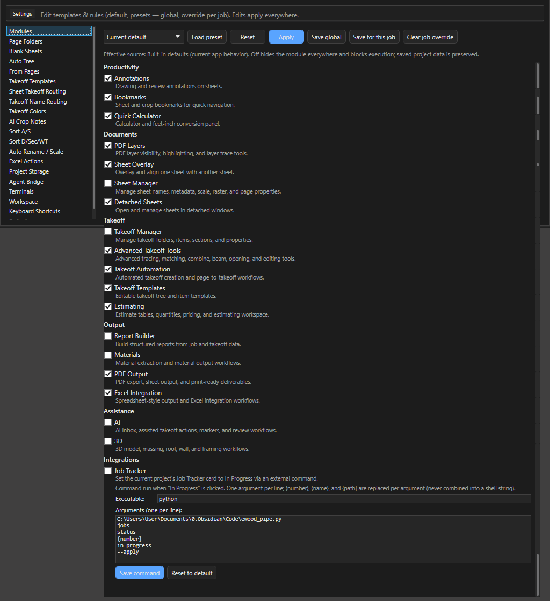

# Workspace, job import, CLI and modules

Here: what connects OurPlanCore 3.0 to the rest of the workflow: a shared workspace for a second computer, importing one job into another, the console `OurPlanCoreCli` of the intake pipeline and the module list. You need it when working from a laptop, on revisions, and when a button or tab is missing. The Job Tracker button: [Managers](ourplancore-managers.md#job-tracker).

## Workspace: a shared workspace {#workspace}

There is no screenshot of this section on purpose: it always shows the server address, the computer name and the names of current jobs.

**What it is.** A private server keeps shared rules and notes, agent skills, settings presets, selected saved jobs and archives of Claude and Codex conversations. The app works locally and syncs in the background; plan editing and the terminal do not wait for the server. The local folder by default is `Documents\OurPlanCore Workspace`; inside are `knowledge`, `skills`, `profile`, `projects`, `conversations` and `runtime` (a working projection for the assistants).

| Group in `Settings > Workspace` | Buttons and fields |
| --- | --- |
| This computer | `Use shared workspace`, device name, `Local workspace folder`, `Automatic synchronization` with an interval, categories (`Claude / Codex skills and supporting scripts`, `Shared conversation archives`), `Save`, `Sync now`, `Import this setup`, `Open local folder`, `Server status` |
| Workspace server | server address (stored on each device separately) |
| Connect another computer | `Create code for another computer` (a one-time code valid for 10 minutes), `Connect this computer` |
| Projects | `Share current saved project`, `Open selected`, `Review conflicts`, `Apply shared presets` |
| Conversations | `Continue selected`, `Setup on this computer`, `Import a Claude / Codex conversation` |

### How to connect a second computer { #second-pc }

What for: continue the same job from a laptop with the same rules and assistant conversations.
Needed: the app is installed on both computers; the server address is known.

1. On the main one, open **Settings > Workspace**, check **Use shared workspace**, connect the device and press **Import this setup** (the source folders do not change).
2. Press **Share current saved project** for the `.ourplan` you need: the package goes to the server, later saves sync by themselves.
3. On the second one, enter the server address and the code from **Create code for another computer** in **Settings > Workspace**, press **Connect this computer**. Rules and skills download; jobs and conversations on request.
4. Press **Projects > Open selected**: the shared job is open. The terminals on the new computer need Git Bash and a one-time login to the assistant CLI ([AI console](ourplancore-ai-console.md)).
5. Before switching computers, press ++ctrl+s++, then **Sync now** and wait for the Synced status.

Result: both computers see one job, presets and conversations; status `Synced` in Settings > Workspace.

### Conflicts and limits

- A conflict keeps both versions: `Review conflicts`, then `Keep this computer`, `Use server version` or `Open preserved files`.
- An open job is not replaced by the server version; a modified local file is not overwritten on download.
- Deletion does not spread between devices. Cached jobs and knowledge are available offline.
- Shared presets are applied only with the `Apply shared presets` button; job copies of settings still win; local presets are backed up first.
- A conversation over 256 MB is skipped with a warning, the rest sync (3.0).
- Keys, assistant logins and personal folders are not imported or synced.

## Job Tracker: the In Progress button

The `Job Tracker` module (off by default) adds an `In Progress` button to the Main ribbon, which moves the job card in the tracker by the number from the name `NN. Name`. Turning it on, the command and the messages: [Managers, Job Tracker](ourplancore-managers.md#job-tracker).

## Importing an OurPlanCore job into the open one

`Main > Open / Import > Import into the current job > OurPlanCore project...`

1. `Choose .ourplan file...` or `Choose project folder...` (a folder with `Data.xml`, `Pages`, `Takeoffs`).
2. The dialog prepares a private copy and shows the number of sheets, takeoffs and measurements; the `Folder name in Pages and Takeoffs` field is the name of the new branches.
3. `Import`: everything is added as separate folders in Pages and Takeoffs, existing content and job settings are not touched. A repeated import creates another branch.
4. To roll back: `Open / Import > Undo Last Page Operation`.

What for: put together buildings from different jobs or pull old work into a revision. Crop links to sheets of the other job are not remapped on import.

## OurPlanCoreCli: the pipeline console { #cli }

A separate app with no window, used by the intake and delivery pipeline; the estimator does not run it but sees the result: the job arrives with sheet names, folders and W/F/S/U dots already set, and the delivery PDF is built per building.

| Command | What it does | Options |
| --- | --- | --- |
| `create` | a new `.ourplan` from PDF; with `--base-project`, a revision package on top of the original job | `--name`, `--package`, `--pdf` (several), `--raster-dpi` (150), `--no-raster`, `--base-project`, `--import-folder REV`, `--report` |
| `inspect` | a report on the package's sheets, folders and measurements | `--package`, `--report` |
| `apply-sheets` | apply sheet names, folders, scale and dots from JSON; backs up the package | `--package`, `--sheets`, `--dry-run`, `--report` |
| `export-pdf` | a PDF with only the sheets that have measurements; `--grouping auto` splits by buildings from the green dot, `--grouping single` - one file | `--package`, `--out`, `--grouping`, `--dry-run`, `--overwrite`, `--report` |
| `excel-plan` | an Excel export plan from the tree | `--package`, `--scope <path under Takeoffs>`, `--report` |

Each command prints one JSON; exit codes: 0 success, 1 command error, 2 invocation error. Commands that change the package refuse to run while the app is open: `Refused to ...: OurPlanCore is running. Close it first.` The export takes the PDF Output settings from the job: Opac, the legend and its groups, overlays, crops and masks.

## Modules {#modules}

<figure markdown>
  
  <figcaption markdown="span">Module checkboxes by group, presets and the Job Tracker command at the bottom.</figcaption>
</figure>

`Settings > Modules`, presets `Current default`, `All modules on`, `Takeoff Only`, `Minimal`; Apply, Save global, Save for this job, Clear job override, Reset.

| Module | Group | Default | What it turns on |
| --- | --- | --- | --- |
| Annotations | Productivity | on | Annotation ribbon: Highlight, Draw Line, Arrow, Box, Cloud, Area, Hide, Note; crops and masks in the PDF |
| PDF Layers | Documents | on | the PDF Layers sub-tab, layer highlight, Layer Trace |
| Sheet Overlay | Documents | on | the Overlay sub-tab, Batch Overlay |
| Sheet Manager | Documents | off | the Sheet Manager tab; the Name, Scale, Name+Scale buttons on the Main ribbon |
| Takeoff Manager | Takeoff | off | the Takeoff Manager tab |
| Advanced Takeoff Tools | Takeoff | on | Similar, P Line, Combine, Beam, Openings, Break, Ends |
| Takeoff Automation | Takeoff | on | Auto Tree, From Pages, auto-creation |
| Takeoff Templates | Takeoff | on | the Templates tab |
| Estimating | Takeoff | on | the Estimating tab and the Estimating window |
| Report Builder | Output | off | the Report Builder tab |
| Materials | Output | off | the Materials tab |
| AI | Assistance | off | AI Inbox, AI Manager, AI crop, markers, AI from the title block |
| 3D | Assistance | off | the 3D tab and the 3D sub-tab in Takeoffs |
| Bookmarks | Productivity | on | the Bkm sub-tab, bookmarks and bookmark crops |
| Quick Calculator | Productivity | on | feet and inches calculator |
| PDF Output | Output | on | the PDF Output ribbon, Preview, export |
| Detached Sheets | Documents | on | detached sheet windows, Tile M2 |
| Excel Integration | Output | on | XL strip, Value, Excel, Link to Excel, Auto Link |
| Job Tracker | Integrations | off | the In Progress button |

A disabled module hides its buttons and tab; a key for its command does not fire. The job copy of modules beats the global one. What the modules that are off by default do and when to turn them on: [Extra features](ourplancore-extras.md).

## See also

- [Jobs and saving](job-creation-storage.md)
- [AI in the app](ourplancore-ai.md) - terminals and Agent Bridge
- [Settings: all categories](ourplancore-settings.md)
- [PDF export](ourplancore-pdf.md) - manual export from the window
- [Workflow](../start/workflow.md) - intake and delivery
