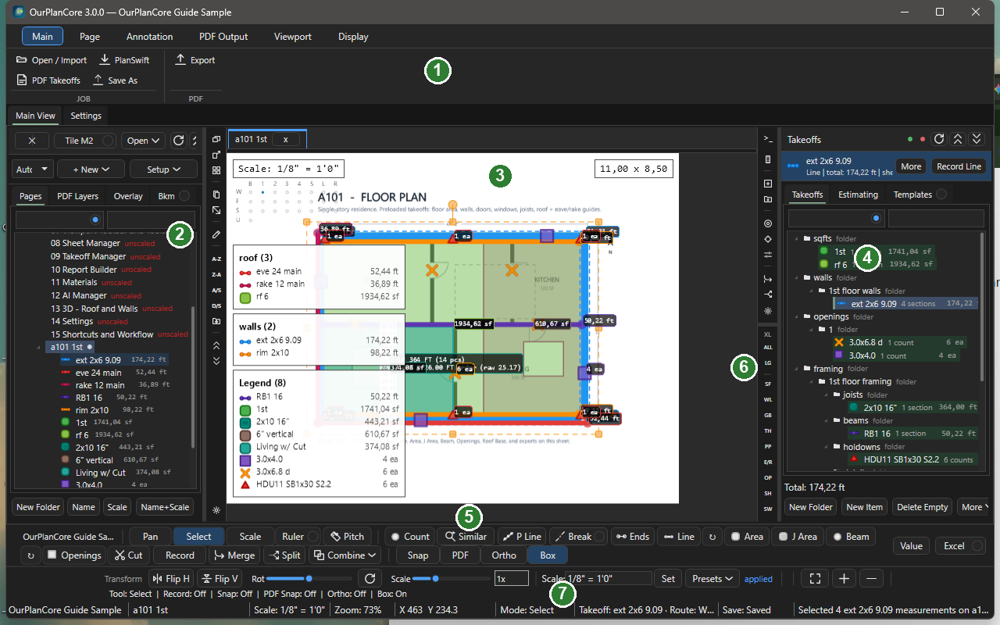

# OurPlanCore 3.0

OurPlanCore is an app for taking off quantities from PDF drawings: sheet, scale, measurement, Takeoffs tree, then export to the Excel DFL and PDF. Here: the window map, how this section is organized, and the path from an open job to delivery.

This section describes **OurPlanCore Lite**, the build estimators have: no AI models and no terminal, simpler and lighter. AI models, the terminal and 3D exist only in the full version; they are grouped in a separate menu block "AI, terminal and 3D (full version)" or marked on the page. Lite has the XL strip too: the `Excel Strip (XL)` checkbox in `Settings > Modules` turns it on. Item-by-item differences: [Lite vs full version](ourplancore-lite.md).

-   **Start with the course**

    ---

    [First steps: 10 lessons](ourplancore-course.md) on the demo job: open it, name a sheet, draw walls and openings, check, export to Excel and PDF. An hour of work; after that the rest of the section reads as a reference.

-   **Try it on the demo job**

    ---

    `Main > Open / Import > Sample job (demo to explore)` or the `Open sample job` tile on the start screen: a job with no client data that you can break and create again. [Demo tour](ourplancore-start.md#demo).

-   **Lite or full version**

    ---

    [Lite vs full version](ourplancore-lite.md): where to get Lite, how big it is, what it lacks and how to tell which version is open.

<figure markdown>
  
  <figcaption markdown="span">The whole window, areas numbered: 1 ribbons, 2 Pages, 3 sheet, 4 Takeoffs, 5 tool strip, 6 XL strip, 7 status bar. Captured in the full version: in Lite area 6 appears after checking `Excel Strip (XL)` in `Settings > Modules`. Details in the table below.</figcaption>
</figure>

## Window map { #window-map }

| # | Area | What is there | Details |
| --- | --- | --- | --- |
| 1 | Command ribbons | `Main`, `Page`, `Annotation`, `PDF Output`, `Viewport`, `Display`; below them the mode row `Main View`, `Settings` and the manager tabs (visible when their modules are on) | [Getting started](ourplancore-start.md) |
| 2 | Pages panel | tree of folders and sheets, buttons `+ New`, `Setup`, `Name`, `Scale`, `Name+Scale`, search; sub-tabs `PDF Layers`, `Overlay`, `Bookmarks` | [Sheets](ourplancore-pages.md) |
| 3 | Sheet | tabs of open sheets and the drawing itself; under the Scale header the W/F/S/U dots and the crop lock | [Sheets](ourplancore-pages.md), [Tools](ourplancore-tools.md) |
| 4 | Takeoffs panel | green and red root dots, the active takeoff row with `Record`, `Total`, `New Item`, tabs `Takeoffs`, `Estimating`, `Templates` | [Takeoffs tree](ourplancore-takeoffs.md), [Multiple buildings](ourplancore-buildings.md) |
| 5 | Bottom tool strip | row 1: `Pan`, `Select`, `Scale`, `Ruler`, `Count`, `Line`, `Area`, `J Area`, `Beam`, `Open`, `Cut`, `Snap`, `Ortho`, `Box`; row 2: `Transform`, `Scale: 1:N`, `Presets`, `Fit` | [Tools](ourplancore-tools.md), [Editing and snaps](ourplancore-editing.md) |
| 6 | XL strip | Excel export buttons: `ALL`, `LG`, `SF`, `WL` ... `ST`; next to them the `>_` button of the AI console (full version only). In Lite the strip is off until `Excel Strip (XL)` is checked in `Settings > Modules`; without it Excel goes through the buttons at the bottom (`Excel`, `Value`, `Link to Excel`) | [Export to Excel](ourplancore-excel.md#lite), [XL strip](ourplancore-excel.md#xl), [AI console](ourplancore-ai-console.md) |
| 7 | Status bar | `<sheet>`, `Scale:`, `Zoom:`, `Mode:`, `Takeoff: ... (Route: W 1st)`, `Save: Saved hh:mm:ss`, the last command's message | [Jobs and saving](job-creation-storage.md) |

The `Takeoff:` field shows where the next measurement will go, `Save:` shows whether the job is saved. These two are worth checking more often than the rest.

## How this section is organized

Four levels: what you need every day, what speeds up work, what is there just in case, and where the app is heading. Plus help and a separate full-version block: AI models, terminal and 3D.

Pages in this section have short clips, 10-20 seconds each, recorded in the app. A clip plays when it is visible on screen; a click pauses it, a double click opens it full screen, where the labels and the status bar are readable.

-   **Every day**

    ---

    - [Getting started](ourplancore-start.md): where the app is, updating, start screen, demo job, F1
    - [Jobs and saving](job-creation-storage.md): new job, import, the `.ourplan` file, autosave
    - [Sheets (Pages)](ourplancore-pages.md): folders, names, scale, W/F/S/U dots
    - [Split by sheets and routing](ourplancore-split-by-sheets.md): which sheet for walls, framing, shear, units; sheet copy and dot
    - [Measuring tools](ourplancore-tools.md): Line, Area, Count, J Area, Beam, Openings
    - [Takeoffs tree](ourplancore-takeoffs.md): new takeoff, Record, copying, search
    - [Multiple buildings](ourplancore-buildings.md): a folder per building, green and red dots, a workbook and PDF per building
    - [Names and auto-routing](takeoff-naming.md): why a takeoff landed in this folder
    - [Export to Excel](ourplancore-excel.md): Excel and Value, Link to Excel, Auto Link, TemplateCom template; the XL strip (turned on in Settings in Lite)
    - [PDF and delivery](ourplancore-pdf.md): Export PDF, PDF Output, Preview, editing in Adobe

-   **Advanced**

    ---

    - [Routing: settings](ourplancore-routing.md)
    - [Editing and snaps](ourplancore-editing.md): Cut, Merge, Split, Break, Ends, Combine, Similar, Snap, Ortho
    - [Sheets: crops, mask, overlays, legend](ourplancore-sheets-advanced.md)
    - [Settings and modules](ourplancore-settings.md)

-   **Extra features**

    ---

    - [What is included and why](ourplancore-extras.md): table of rare features and modules
    - [Snaps and tracing](ourplancore-snap-trace.md): PDF Layers, Layer Trace, Wall Trace
    - [Managers](ourplancore-managers.md): Sheet, Takeoff, Report Builder, Job Tracker; Materials and AI Manager in the full version
    - [Other](ourplancore-extras-other.md): bookmarks, calculator, sheet windows, templates, PlanSwift import

-   **AI, terminal and 3D (full version)**

    ---

    Lite does not have these: [Lite vs full version](ourplancore-lite.md).

    - [AI in the app](ourplancore-ai.md): AI Inbox, AI crop, title blocks, Agent Bridge
    - [AI console and terminal](ourplancore-ai-console.md): Claude, Codex and DeepSeek terminals in the window
    - [Workspace, a second computer](ourplancore-workspace.md)
    - [3D roof](ourplancore-3d-roof.md): base, hip and valley pitches, rafters, Roof Takeoff
    - [3D and Massing](ourplancore-3d.md): walls in 3D, what is turned off

-   **Ideas and plans**

    ---

    - [Where the app is heading](ourplancore-ideas.md): web version, AI takeoff, parity with PlanSwift, what was rejected

-   **Help**

    ---

    - [Keyboard shortcuts](ourplancore-shortcuts.md)
    - [Troubleshooting](ourplancore-troubleshooting.md)
    - [What's new](ourplancore-changelog.md): two months of changes, 08/15-10/17

## Path: open a job, deliver the work

1. **Open the job.** `Main > Open / Import > Open project...` or the `Open a recent job` tile on the start screen. The job already comes with sheet names and W/F/S/U dots. [Jobs](job-creation-storage.md)
2. **Check the sheets.** Expand `00. imported/Arch`, open a floor plan, check `Scale:` in the status bar and the dot under the Scale header (`Route: W 1st`). Name unnamed sheets (`Page N`) by hand and set the scale with `S`. Copies for shear walls get the S dot by hand. [Sheets](ourplancore-pages.md), [Split by sheets](ourplancore-split-by-sheets.md)
3. **Takeoffs tree.** `More > Auto Tree` creates the COM template roots; several buildings: a folder for each, the green dot on the current one. [Tree](ourplancore-takeoffs.md), [Multiple buildings](ourplancore-buildings.md), [tree canon](../start/takeoff-structure.md)
4. **Measurements by scope.** One scope per pass over the sheet: walls `L`, openings `O`, areas `A`, joists `J`, beams `B`, posts and holdowns `P`. `Space` continues the selected takeoff. [Tools](ourplancore-tools.md), takeoff order in the [workflow](../start/workflow.md)
5. **Takeoff names.** The name carries the numbers for Excel: `ext 2x6 9.09`, `4.3x7.8 d`, `rf 6`, `eve 24 main`. A new takeoff goes into a folder by itself, based on the sheet dot and the name. [Names and auto-routing](takeoff-naming.md), [name formats](../start/takeoff-structure.md)
6. **Check.** The `Estimating` tab, `Total` on a takeoff, the sheet legend (`Organize > Sort Sheet Legend by Key`), `H` hides finished work, `Delete Empty` removes empty takeoffs. [Tree](ourplancore-takeoffs.md)
7. **Excel.** Open the building's workbook made from `TemplateCom.xlsm` (the `templates` folder in Dropbox), click a cell, select a takeoff or folder in Takeoffs and press `Excel` or `Value` at the bottom; a number that should follow the measurement goes in with the `Link to Excel` button; run the calculation from the `J:L` list with the E-Wood tab buttons in Excel. The XL strip does the same section by section (`ALL`, the `LG` legend); in Lite turn it on first with the `Excel Strip (XL)` checkbox in `Settings > Modules`. [Export to Excel](ourplancore-excel.md#lite), [DFL workbook](dfl-overview.md), [E-Wood tab](ewood-tab.md#calculate)
8. **PDF and delivery.** `Ctrl+S`, hide what is not needed (`H`, Hide mask), `PDF Output > Preview`, then `Main > Export`: only sheets with measurements, a separate PDF per building. Then the processed xlsx and `Changes.txt` for a revision. [PDF and delivery](ourplancore-pdf.md), [delivery](../start/workflow.md)

## What appeared in two months { #whats-new }

If you worked in a version from before mid-August, here is what changed in everyday actions. Full list by build: [What's new](ourplancore-changelog.md).

| Before | Now | Where to read |
| --- | --- | --- |
| a job was a folder of files, you copied the whole thing | one `.ourplan` file, autosave, status `Save: Saved hh:mm:ss`; `Project Data Recovery` if it gets damaged | [Jobs and saving](job-creation-storage.md) |
| a new takeoff was sorted into floors by hand | the W/F/S/U dot on a sheet is set from the sheet name and sorts new takeoffs by itself; the `Route:` field in the status bar | [Split by sheets](ourplancore-split-by-sheets.md), [Names and auto-routing](takeoff-naming.md) |
| `eve`, `prpt`, `gable`, Openings landed anywhere | rules by name and tool (`Settings > Takeoff Name Routing`) | [Routing: settings](ourplancore-routing.md) |
| one Takeoffs root | green and red dots pick the building for new takeoffs; pasting copies mirrors the folders | [Multiple buildings](ourplancore-buildings.md) |
| `H` was a marker | `H` hides a takeoff on the sheet, the marker moved to `Shift+H` | [Takeoffs tree](ourplancore-takeoffs.md#hide) |
| Merge and Split for segments only | Merge and Split of whole takeoffs from the tree, Break and Ends for lines | [Editing and snaps](ourplancore-editing.md) |
| Excel by hand, piece by piece | XL strip: `ALL` and buttons by section, framing, `LG` legend (in Lite with the `Excel Strip (XL)` checkbox); the "comments" dot on the `Excel` button | [Export to Excel](ourplancore-excel.md) |
| PDF set up blind | live `PDF Output > Preview`, `Opac` for lines | [PDF and delivery](ourplancore-pdf.md#preview) |
| PDF fixed only by a new export | lines, areas and labels can be moved in Adobe Acrobat | [PDF and delivery](ourplancore-pdf.md#adobe) |
| the number in the workbook was updated with `Value` after every edit | `Link to Excel` keeps the number in the cell by itself | [Export to Excel](ourplancore-excel.md#link) |
| details were hunted down sheet by sheet | `Crop to Sheet` collects details onto a clean sheet, the `Hide` mask removes the rest | [Sheets: advanced](ourplancore-sheets-advanced.md) |
| sheet names were checked one by one | `Name+Scale` for the whole set; in the full version also OCR of scans, title block reading by an AI model, `Crop Hints` | [Sheets](ourplancore-pages.md), [Managers](ourplancore-managers.md#sheet-manager) |
| shortcuts were hard-coded | `Settings > Keyboard Shortcuts` editor, shortcuts work with the Russian keyboard layout | [Keyboard shortcuts](ourplancore-shortcuts.md) |
| AI help only through crops | in the full version, Claude and Codex terminals in the window (`>_`), Agent Bridge, a shared Workspace for two computers | [AI console](ourplancore-ai-console.md), [Workspace](ourplancore-workspace.md) |

## Where the old sections moved { #tools }

The former long page was split into new ones. Tools: [Measuring tools](ourplancore-tools.md); Snap, Ortho, Box snaps and editing (Cut, Merge, Split, Break, Similar): [Editing and snaps](ourplancore-editing.md); selecting and copying: [Takeoffs tree](ourplancore-takeoffs.md); modules and Settings: [Settings and modules](ourplancore-settings.md); shortcuts: [Keyboard shortcuts](ourplancore-shortcuts.md); creating a job and files on disk: [Jobs and saving](job-creation-storage.md); Sheet Manager, Takeoff Manager, Report Builder, Materials, AI Manager, Job Tracker: [Managers](ourplancore-managers.md); bookmarks, calculator, PlanSwift import: [Other](ourplancore-extras-other.md). Full version only: AI: [AI in the app](ourplancore-ai.md) and [AI console](ourplancore-ai-console.md); 3D: [3D roof](ourplancore-3d-roof.md) and [3D and Massing](ourplancore-3d.md).

## See also

- [Lite vs full version](ourplancore-lite.md): what Lite lacks
- [Workflow](../start/workflow.md): from the client folder to `.Finished`
- [Takeoff tree and sheet names](../start/takeoff-structure.md): canon of folders and names
- [Common mistakes: sheets and tree](../start/common-mistakes.md#pages)
