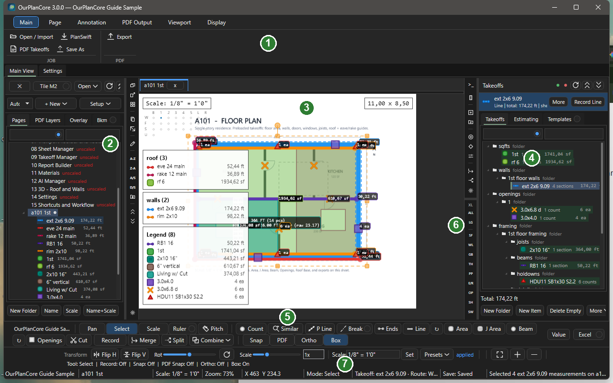

# OurPlanCore 3.0

OurPlanCore - программа для замеров по PDF-чертежам: лист, масштаб, замер, дерево Takeoffs, потом экспорт в Excel DFL и PDF. Здесь карта окна, устройство раздела и путь от открытого проекта до сдачи.

-   **Начать с курса**

    ---

    [Первые шаги: 10 уроков](ourplancore-course.md) на демо-проекте: открыть, назвать лист, нарисовать стены и проёмы, проверить, выгрузить в Excel и PDF. Час работы, после него остальной раздел читается как справочник.

-   **Попробовать на демо-проекте**

    ---

    `Main > Open / Import > Sample job (demo to explore)` или плитка `Open sample job` на стартовом экране: проект без клиентских данных, который можно портить и создавать заново. [Экскурсия по демо](ourplancore-start.md#demo).

<figure markdown>
  
  <figcaption markdown="span">Окно целиком, зоны пронумерованы: 1 ленты, 2 Pages, 3 лист, 4 Takeoffs, 5 полоса инструментов, 6 полоса XL, 7 строка статуса. Подробно в таблице ниже.</figcaption>
</figure>

## Карта окна { #window-map }

| # | Зона | Что там | Подробно |
| --- | --- | --- | --- |
| 1 | Ленты команд | `Main`, `Page`, `Annotation`, `PDF Output`, `Viewport`, `Display`; ниже строка режимов `Main View`, `Settings` и вкладки менеджеров (видны при включённых модулях) | [Начало работы](ourplancore-start.md) |
| 2 | Панель Pages | дерево папок и листов, кнопки `+ New`, `Setup`, `Name`, `Scale`, `Name+Scale`, поиск; под-вкладки `PDF Layers`, `Overlay`, `Bookmarks` | [Листы](ourplancore-pages.md) |
| 3 | Лист | вкладки открытых листов и сам чертёж; под заголовком Scale точки W/F/S/U и замок кропов | [Листы](ourplancore-pages.md), [Инструменты](ourplancore-tools.md) |
| 4 | Панель Takeoffs | зелёная и красная точки корня, строка активной позиции с `Record`, `Total`, `New Item`, вкладки `Takeoffs`, `Estimating`, `Templates` | [Дерево Takeoffs](ourplancore-takeoffs.md), [Несколько зданий](ourplancore-buildings.md) |
| 5 | Нижняя полоса инструментов | строка 1: `Pan`, `Select`, `Scale`, `Ruler`, `Count`, `Line`, `Area`, `J Area`, `Beam`, `Open`, `Cut`, `Snap`, `Ortho`, `Box`; строка 2: `Transform`, `Scale: 1:N`, `Presets`, `Fit` | [Инструменты](ourplancore-tools.md), [Правка и привязки](ourplancore-editing.md) |
| 6 | Полоса XL | кнопки экспорта в Excel: `ALL`, `LG`, `SF`, `WL` ... `ST`; рядом кнопка `>_` консоли ИИ | [Экспорт в Excel](ourplancore-excel.md), [Консоль ИИ](ourplancore-ai-console.md) |
| 7 | Строка статуса | `<лист>`, `Scale:`, `Zoom:`, `Mode:`, `Takeoff: ... (Route: W 1st)`, `Save: Saved hh:mm:ss`, сообщение последней команды | [Проекты и сохранение](job-creation-storage.md) |

Строка `Takeoff:` показывает, куда пойдёт следующий замер, `Save:` - сохранён ли проект. Эти две подписи стоит проверять чаще других.

## Как устроен раздел

Четыре уровня: что нужно каждый день, что ускоряет работу, что есть на всякий случай, и куда программа идёт дальше. Плюс справка.

-   **Каждый день**

    ---

    - [Начало работы](ourplancore-start.md): где программа, обновление, стартовый экран, демо-проект, F1
    - [Проекты и сохранение](job-creation-storage.md): новый проект, импорт, файл `.ourplan`, автосохранение
    - [Листы (Pages)](ourplancore-pages.md): папки, имена, масштаб, точки W/F/S/U
    - [Раскладка по листам и роутинг](ourplancore-split-by-sheets.md): какой лист под стены, framing, shear, units; копия листа и точка
    - [Инструменты замера](ourplancore-tools.md): Line, Area, Count, J Area, Beam, Openings
    - [Дерево Takeoffs](ourplancore-takeoffs.md): новая позиция, Record, копирование, поиск
    - [Несколько зданий](ourplancore-buildings.md): папка на корпус, зелёная и красная точки, книга и PDF на корпус
    - [Имена и автомаршрут](takeoff-naming.md): почему позиция легла в эту папку
    - [Экспорт в Excel](ourplancore-excel.md): полоса XL и шаблон TemplateCom
    - [PDF и сдача](ourplancore-pdf.md): Export PDF, PDF Output, Preview

-   **Продвинутое**

    ---

    - [Маршрутизация: настройки](ourplancore-routing.md)
    - [Правка и привязки](ourplancore-editing.md): Cut, Merge, Split, Break, Ends, Combine, Similar, Snap, Ortho
    - [Листы: кропы, маска, наложения, легенда](ourplancore-sheets-advanced.md)
    - [Settings и модули](ourplancore-settings.md)
    - [Консоль ИИ](ourplancore-ai-console.md): терминалы Claude и Codex в окне
    - [ИИ в программе](ourplancore-ai.md): AI Crop Notes, штампы, Agent Bridge
    - [Workspace: второй компьютер](ourplancore-workspace.md)
    - [3D-крыша](ourplancore-3d-roof.md): база, уклоны рёбер, стропила, Roof Takeoff

-   **Дополнительные возможности**

    ---

    - [Что сюда вошло и почему](ourplancore-extras.md): таблица редких функций и модулей
    - [Привязки и трассировка](ourplancore-snap-trace.md): PDF Layers, Layer Trace, Wall Trace
    - [Менеджеры](ourplancore-managers.md): Sheet, Takeoff, Report Builder, Materials, AI Manager, Job Tracker
    - [3D и Massing](ourplancore-3d.md): стены в 3D, что выключено
    - [Прочее](ourplancore-extras-other.md): закладки, калькулятор, окна листов, шаблоны, импорт PlanSwift

-   **Идеи и планы**

    ---

    - [Куда идёт программа](ourplancore-ideas.md): веб-версия, AI-такеофф, паритет с PlanSwift, что отклонено

-   **Справка**

    ---

    - [Горячие клавиши](ourplancore-shortcuts.md)
    - [Решение проблем](ourplancore-troubleshooting.md)
    - [Что нового](ourplancore-changelog.md): два месяца изменений, 15.08-17.10

## Путь: открыл проект, сдал работу

1. **Открыть проект.** `Main > Open / Import > Open project...` или плитка `Open a recent job` на стартовом экране. Проект приходит уже с именами листов и точками W/F/S/U. [Проекты](job-creation-storage.md)
2. **Проверить листы.** Раскрыть `00. imported/Arch`, открыть план этажа, сверить `Scale:` в статусе и точку под заголовком Scale (`Route: W 1st`). Листы без имён (`Page N`) назвать руками и поставить масштаб `S`. Копии под shear walls получают точку S руками. [Листы](ourplancore-pages.md), [Раскладка по листам](ourplancore-split-by-sheets.md)
3. **Дерево Takeoffs.** `More > Auto Tree` даёт корни COM-шаблона; несколько корпусов - папка на каждый, зелёная точка на текущем. [Дерево](ourplancore-takeoffs.md), [Несколько зданий](ourplancore-buildings.md), [канон дерева](../start/takeoff-structure.md)
4. **Замеры по scope.** Один scope на проход листа: стены `L`, проёмы `O`, площади `A`, joists `J`, балки `B`, посты и holdowns `P`. `Space` продолжает выбранную позицию. [Инструменты](ourplancore-tools.md), порядок замеров в [процессе работы](../start/workflow.md)
5. **Имена позиций.** Имя несёт числа для Excel: `ext 2x6 9.09`, `4.3x7.8 d`, `rf 6`, `eve 24 main`. Новая позиция сама ложится в папку по точке листа и имени. [Имена и автомаршрут](takeoff-naming.md), [форматы имён](../start/takeoff-structure.md)
6. **Проверка.** Вкладка `Estimating`, `Total` у позиции, легенда листа (`Organize > Sort Sheet Legend by Key`), `H` скрывает готовое, `Delete Empty` убирает пустые позиции. [Дерево](ourplancore-takeoffs.md)
7. **Excel.** Открыть книгу корпуса из `TemplateCom.xlsm`, выделить корпус в Takeoffs, нажать `ALL` на полосе XL или кнопки по шагам; `LG` заполнить до экспорта. [Экспорт в Excel](ourplancore-excel.md), [книга DFL](dfl-overview.md)
8. **PDF и сдача.** `Ctrl+S`, спрятать лишнее (`H`, маска Hide), `PDF Output > Preview`, затем `Main > Export`: только листы с замерами, отдельный PDF на корпус. Дальше processed xlsx и `Changes.txt` для ревизии. [PDF и сдача](ourplancore-pdf.md), [сдача](../start/workflow.md)

## Что появилось за два месяца { #whats-new }

Если работал в версии до середины августа, вот что изменилось в повседневных действиях. Полный список по сборкам - [Что нового](ourplancore-changelog.md).

| Было | Стало | Где читать |
| --- | --- | --- |
| проект - папка с файлами, копировать всю | один файл `.ourplan`, автосохранение, статус `Save: Saved hh:mm:ss`; `Project Data Recovery` при повреждении | [Проекты и сохранение](job-creation-storage.md) |
| новую позицию раскладывали по этажам руками | точка W/F/S/U на листе ставится по имени листа и раскладывает новые позиции сама; строка `Route:` в статусе | [Раскладка по листам](ourplancore-split-by-sheets.md), [Имена и автомаршрут](takeoff-naming.md) |
| `eve`, `prpt`, `gable`, Openings ложились куда попало | правила по имени и инструменту (`Settings > Takeoff Name Routing`) | [Маршрутизация: настройки](ourplancore-routing.md) |
| один корень Takeoffs | зелёная и красная точки выбирают корпус для новых позиций; вставка копий зеркалит папки | [Несколько зданий](ourplancore-buildings.md) |
| `H` был маркером | `H` скрывает позицию на листе, маркер на `Shift+H` | [Дерево Takeoffs](ourplancore-takeoffs.md#hide) |
| Merge и Split только сегментов | Merge и Split целых позиций из дерева, Break и Ends для линий | [Правка и привязки](ourplancore-editing.md) |
| Excel руками по кускам | полоса XL: `ALL` и кнопки по секциям, framing, легенда `LG`, точка "комментарии" | [Экспорт в Excel](ourplancore-excel.md) |
| PDF настраивали вслепую | живое `PDF Output > Preview`, `Opac` для линий | [PDF и сдача](ourplancore-pdf.md#preview) |
| детали узлов искали по листам | `Crop to Sheet` собирает узлы на чистый лист, маска `Hide` убирает лишнее | [Листы: продвинутое](ourplancore-sheets-advanced.md) |
| имена листов проверяли по одному | `Name+Scale` по всему комплекту, OCR сканов, чтение штампа моделью, `Crop Hints` | [Листы](ourplancore-pages.md), [Менеджеры](ourplancore-managers.md#sheet-manager) |
| клавиши зашиты | редактор `Settings > Keyboard Shortcuts`, клавиши работают в русской раскладке | [Горячие клавиши](ourplancore-shortcuts.md) |
| помощь ИИ только через кропы | терминалы Claude и Codex в окне (`>_`), Agent Bridge, общий Workspace на два компьютера | [Консоль ИИ](ourplancore-ai-console.md), [Workspace](ourplancore-workspace.md) |

## Куда переехали старые разделы { #tools }

Прежняя длинная страница разошлась по новым. Инструменты - [Инструменты замера](ourplancore-tools.md); привязки Snap, Ortho, Box и правка (Cut, Merge, Split, Break, Similar) - [Правка и привязки](ourplancore-editing.md); выделение и копирование - [Дерево Takeoffs](ourplancore-takeoffs.md); модули и Settings - [Settings и модули](ourplancore-settings.md); клавиши - [Горячие клавиши](ourplancore-shortcuts.md); создание job и файлы на диске - [Проекты и сохранение](job-creation-storage.md); Sheet Manager, Takeoff Manager, Report Builder, Materials, AI Manager, Job Tracker - [Менеджеры](ourplancore-managers.md); 3D - [3D-крыша](ourplancore-3d-roof.md) и [3D и Massing](ourplancore-3d.md); закладки, калькулятор, импорт PlanSwift - [Прочее](ourplancore-extras-other.md).

## См. также

- [Процесс работы](../start/workflow.md): от папки клиента до `.Finished`
- [Дерево takeoff и имена листов](../start/takeoff-structure.md): канон папок и имён
- [Частые ошибки: листы и дерево](../start/common-mistakes.md#pages)
