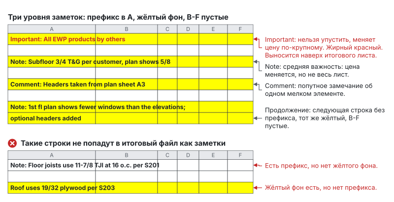

# Notes in the DFL

Here: what kinds of notes the workbook has, where they go, how to write the text and when a note is not needed. A note = a row in column A with the prefix `Important:`, `Note:` or `Comment:` on a yellow fill, explaining a decision or an assumption that is not visible from the row itself.

!!! warning "Without a prefix or without yellow, the note gets lost"
    The worksheet is read by a program. A row without one of the three prefixes or without the yellow fill will not make it into the final file as a note, and a note above a header goes into the previous block. Full rule with diagrams: [File format, notes](dfl-overview.md#notes).

<figure markdown>
  
  <figcaption markdown="span">Three note levels on a yellow fill and a continuation on a second row. At the bottom: rows that will not reach the final file.</figcaption>
</figure>

## Where a note goes

| | Main note (header) | Section or block note |
| --- | --- | --- |
| Where | in the block between `Detailed Material List` and `Description`; a new one goes first | **under** the header of its section (`Roof Frame list`, `1st Floor Walls`), after the notes already there. A note about one group of rows inside a section: right above those rows |
| Look | `Important:` red bold on yellow A:F. A regular `Note:` red bold, no fill | yellow fill A:F. `Note:` and `Comment:` black, bold in the reference books. `Important:` red bold, allowed here too |
| About | decisions for the whole building: construction type and FRT, sheathing and discrepancies between sheets, what is by others, preliminary set | everything about this block: wall type per schedule, floor elevations and height, how the stud height is split, spacing and source sheet, limits of where it applies, assumptions with the word verify |
| Order | template ones first (`Walls are panels by others`, `Roof and Floor Trusses are by others`), then project ones | as found |

Choose the level by the cost of a mistake: `Important:` for global decisions with a big price difference, `Note:` for medium importance, `Comment:` for a small thing about one element. [Table and examples](dfl-overview.md#notes).

- A note about a specific block lives in that block, not in the header. The text must read on its own without the block: when the file is assembled, notes go into a common list, duplicates are removed, similar ones are merged. Not `Note: No changes in this area`, but `Note: No changes for the 1st floor walls`.
- Text in A, columns B-F and G:H empty, only the A:H range. Do not make a separate worksheet for notes, and do not use Excel cell comments.
- A reference in a local note points to the detail of its own wall type. A similar picture on a neighboring detail (for example, a shaft wall instead of an exterior wall) does not count: check the detail title.

## How to write the text

1. A natural phrase with a verb, in full words: `joists use`, `roof uses`, `clips counted at`. Abbreviations live in B and D, not in the note.
2. One fact = one note. Two thoughts = two `Note:` rows. A long thought can continue on the next row without a prefix, with the same yellow fill.
3. Length: target 80 characters, ceiling 100 (the note must fit in A:F). If it does not fit, use a second row, not telegraph style; do not merge cells, shrink the font or widen columns.
4. The source is always a sheet or detail number: `per S201`, `per 8/S3.0`, `; see 4/A703`. Not `per page`, not a PDF page number. No source: `assumed; verify`.
5. Separator inside is `;`, a period at the end. No `=`, arrows, dashes as separators, or parentheses with opinions. Ranges in words: `levels 2 thru 6`, `S203 thru S206`. A hyphen only inside a dimension `9'-1 1/8"`.
6. Discrepancy between sheets: lead with the value that was counted, cite one authoritative sheet; the other side's sheet can be omitted: `Note: Roof sheathing differ, 19/32" per struct S612, 15/32" per arch; counted 19/32"; verify.`
7. Optional only with a reason: a note with the condition above the rows, and the rows themselves in the option color ([Options](dfl-overview.md#options)).

| Abbreviation | Written in the note as |
| --- | --- |
| `shtg`, `ply` | `sheathing`, `plywood` |
| `btm pl`, `o/`, `pre-eng` | `Btm plate`, `over`, `pre-engineered` |
| `@16"`, ` - S-203` | `at 16" o.c.`, `per S203` |
| `A-351..A-355`, `2-6` | one sheet `per A351`, `levels 2 thru 6` |

## Before and after

Pairs from a delivered job (anonymized). Left column: the draft; right column: what went to the client.

| Do not write it like this | Write it like this |
| --- | --- |
| `Floor joists 11 7/8" TJI @16" o.c. S-201/S-202, not 16" TGI on A-352` | `Note: Floor joists use 11-7/8" TJI at 16" o.c. per S201/S202.` plus `Note: Architectural sections show 16" joists; structural depth used.` |
| `Roof pre-eng trusses @24" o.c. 19/32" ply, PSCL clips @16" - S-203` | `Note: Roof uses 19/32" exterior-rated plywood per S203; PSCL size matches.` plus `Note: PSCL clips counted at 16" max per S203; 6 per 4x8 sheet allowed.` |
| `Ext shtg 15/32" exp 1 ply S-101 vs 5/8" on A-351..A-355 - took struct` | `Note: Wall ply counted as 15/32" per S101; arch calls 5/8"; verify.` |
| `Stairs are metal and concrete by others - see 4/A-703` | `Note: Metal and concrete stairs are by others; see 4/A703.` |
| `Btm pl anchor Powers wedge 7" emb @32" o.c., BPS5/8-3 - 6,10/S-301` | no note: the spec is in the row, `B = 5/8" Ø x 7" emb.`, purpose `E = for Ext Walls` |
| `Note: Assumed all walls shall have (2) btm plates per page A5; verify` | `Note: All walls assumed to have (2) btm plates per A5; verify.` |

## Fact in the row = no note

A note is needed for a decision or an assumption. If the fact is already visible in the row, the note duplicates it and goes stale at the first edit.

| Fact | Where it lives |
| --- | --- |
| Anchor size and embedment | `B`: `5/8" Ø x 7" emb.`; `E`: `for Ext Walls` |
| Stud height | `E` of the stud row: `11' 8 3/8"` |
| SW mark, detail sheet | `E`: `SW-2`, `8/S3.0` |
| A floor repeats another | section header: `4th Floor Framing List is the same as 3rd Floor` |
| Partial count | `E`: `partial count, no waste` |

A note must not argue with its row: `by others` in the note with a quantity filled in, or `assumed 6"` with 3-5/8" material in B, is a mistake.

## Spec cells and a reference without "per" { #spec-cells }

The spec cells to the right of the table are filled in from the PDF when each job is created, not before delivery ([DFL: work areas](dfl-overview.md#zones)).

| Cells | What | Where on the drawings |
| --- | --- | --- |
| `O3`, `O5` | wall sheathing (ply/OSB), Zip | wall types, typ. wall elevation, SW schedule on the S sheet |
| `O4`, `O6` | WRB, Zip Tape | wall types on A |
| `O8` | subfloor | section, floor types |
| `R3` ... `R7` | main roof, overframes, metal, flat, shingles | typ. roof sheathing on the S sheet, section |
| `P`, `S` next to them | source sheet | bare reference: `S3.0`, `8/S3.0`, `A3.0 S2.5`, `2/S9` |

- P and S hold only the reference, without `per`, without `not shown; assumed` and without a thickness.
- The item does not exist in the building (no flat roof): leave `per page`, do not make anything up.
- A discrepancy between arch and S goes into a main note right away: `Note: Roof Sheathing differ, 15/32" Ply per 3/S3.0 and 1/2" OSB per A4-03; counted 1/2" CDX Ply.` No spec: `Note: Roof sheathing thickness is not specified; assumed 1/2" Ply; verify.` The structural sheet wins on thickness and on which walls and sides are sheathed; the product (Zip, OSB, Ply) comes from the wall types on Arch ([Tips: sheathing](boss-feedback-rules.md#sheathing)).
- `7/16" Zip` on S and `Zip R-3` in the wall type are one product, not a discrepancy: `Note: Wall Sheathing 7/16" Zip R3 per 8/S3.0 A2-00.`
- E callout row by row in the `detail/sheet` format: `15/S311`, `9/13/S311`.

## Optional only with a reason

The client reviewer's comment: an item may be called optional only when it is entirely an assumption, and the reason is written next to it.

An option is defined by the row fill color, not by the word: without color the row goes into the main list as required. How to color it: [Options and color](dfl-overview.md#options).

- `Note: Optional framing for unspecified roof corridor frame; assumed 2x10; verify if truss.`
- `Note: Verify spacing of 2x10 corridor joists; not indicated; assumed 16" o.c.`
- Panel building, stick variant of the walls: under the local note `Note: Optional stick frame, if walls are not panels; verify.`
- Furring or rainscreen as an option: with a note on why it is there and which detail it comes from.

## Template notes and preliminary set

- `Walls are panels by others` is deleted if there is no panel in scope; do not touch `Roof and Floor Trusses are by others` without checking. `Floor trusses are by others; verify` goes in every Floor Framing List where the floor is framed with trusses.
- Progress set without structural: a detailed main note that beams, posts, balcony, shear walls and heights are `assumed; verify`; windows as drawn; walls under concrete as optional stick with a note.
- A library of ready-made wording. If the decision changes the price significantly, use the `Important:` prefix instead of `Note:`:

??? note "Wording library (Standarts worksheet, put in your own sheet)"
    **Headers**

    - `Note: Headers assumed (2)2x10 for short spans and (3)2x10 for long spans unless noted otherwise; verify.`
    - `Note: All headers at 2x6 walls are (3)2x10 and at 2x4 walls (2)2x10 per S0.2.`
    - `Note: Header sizes assumed per schedule S0.2; sizes may vary; verify.`

    **Plates, studs, walls**

    - `Note: All walls assumed to have (2) btm plates per A5; verify.`
    - `Note: 3rd floor exterior walls have a single bottom plate per S5.2; differs from A5.`
    - `Note: Exterior walls assumed 2x6 and interior walls 2x4; verify.`
    - `Note: All posts assumed built-up studs; verify if solid.`

    **Sheathing**

    - `Note: Roof sheathing differ, 5/8" CDX per arch A4.1, 1/2" per struct S0.1; counted 5/8"; verify.`
    - `Note: 7/16" Zip indicated on one sheet only; wall sheathing assumed 1/2" Ply; verify.`
    - `Note: 5/8" DensGlass over Zip sheathing at wall types A1 and A2 per A4.1.`

    **By others**

    - `Important: All EWP products are by others.`
    - `Important: Floor trusses are by others; verify.`
    - `Note: Metal studs are by others.`
    - `Note: Aluminum railing materials are by others; verify components.`
    - `Note: Anchor bolts are Hilti by others.`
    - `Note: Pavers deck system is by others.`

    **Framing assumed, budget only**

    - `Note: Framing plans are not provided; all framing assumed for budget only.`
    - `Note: Plans are preliminary; no sections, details or framing plans; budget only.`
    - `Note: Plans are not to scale; verify all lengths.`
    - `Important: Existing structure to remain; products listed for new construction only.`

    **Decks, balcony, stairs**

    - `Note: Balcony joists assumed 2x10 P.T. per S2.1; A5.1 shows 2x8 P.T.; verify.`
    - `Note: Porch framing is not specified; all framing assumed; verify.`
    - `Note: Stairs assumed to have (4) 2x12 stringers; verify.`
    - `Note: Railing material assumed to match rear deck; verify.`

    **Trims**

    - `Note: All exterior trim assumed primed vertical grain cedar per A6.1.`
    - `Note: No details provided; all trims assumed per elevations.`
    - `Note: Interior doors height assumed 6'8"; verify.`

    **Anchor bolts**: size, embedment and spacing live in the row (`B`, `H`, `E`); the source is the sill and sole plate anchorage schedule. A note is needed only for an assumption: `Note: Anchor bolt spacing is not indicated; assumed 36" o.c.; verify.` (36" o.c. and `1/2" Ø` are the template default, see [Anchor Bolts](../work/deck/anchor-bolts.md#default))

## Common mistakes

- Telegraph style and notes longer than A:F (130 characters and more).
- `per page` or a PDF page number instead of the sheet number.
- A note without yellow fill or without a prefix; a note above the header of its block.
- A note about a block placed in the header; `Important:` on a small thing, so the main point gets lost.
- `optional` without a reason or without color; a note contradicts its row.
- Spec cells left until delivery; P/S say `per 8/S3.0` or `not shown`.

All workbook mistakes: [Common mistakes, Excel DFL and notes](../start/common-mistakes.md#excel).

## See also

- [How the DFL workbook works](dfl-overview.md), [Row labels and format](takeoff-items.md), [Balcony, porch and holdown blocks](dfl-blocks.md)
- [Tips and key rules](boss-feedback-rules.md), [QA checklist](../start/quality-checklist.md)
