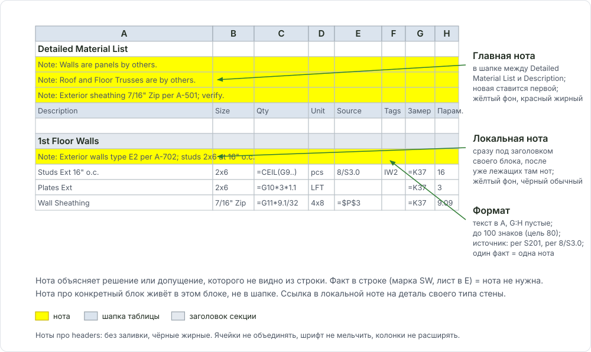

# Ноты в DFL

Здесь: какие бывают ноты в книге, где они стоят, как оформлены, как написать текст и когда нота не нужна. Нота = строка в колонке A с префиксом `Note: `, объясняющая решение или допущение, которого не видно из самой строки.

<figure markdown>
  
  <figcaption markdown="span">Главные ноты в шапке (между Detailed Material List и Description), локальные ноты сразу под заголовком своего блока.</figcaption>
</figure>

## Два вида нот

| | Главная нота (шапка) | Локальная нота (блок) |
| --- | --- | --- |
| Где | в блоке между `Detailed Material List` и `Description`, новая ставится первой | сразу под заголовком своей секции (`Roof Frame list`, `1st Floor Walls`), после уже лежащих там нот |
| Вид | жёлтый фон `FFFF00`, красный жирный текст | жёлтый фон и чёрный обычный текст, либо без заливки чёрный жирный: как соседняя нота того же блока. Ноты про headers без заливки, чёрные жирные |
| О чём | решения по всему дому: тип конструкции и FRT, обшивка и расхождения листов, что by others, preliminary set | всё про этот блок: тип стены по schedule, отметки и высота этажа, как поделена высота стойки, шаг и лист-источник, границы применимости, допущения со словом verify |
| Порядок | сначала шаблонные (`Walls are panels by others`, `Roof and Floor Trusses are by others`), потом проектные | как найдены |

- Нота про конкретный блок живёт в этом блоке, а не в шапке. Префикс раздела в тексте не нужен: внутри `Roof Frame list` пишется `Note: Typical trusses are RT-1 at 24" o.c. per note 2 on S1-5.`, а не `Note: Roof framing ...`.
- Текст в A, G:H пустые, только диапазон A:H. Отдельный лист под заметки и комментарии Excel к ячейкам не делаются.
- Ссылка в локальной ноте - на деталь своего типа стены. Похожая картинка на соседней детали (например, стена шахты вместо наружной) не подходит: проверять заголовок детали.

## Как написать текст

1. Живая фраза с глаголом, полными словами: `joists use`, `roof uses`, `clips counted at`. Сокращения живут в B и D, не в ноте.
2. Один факт = одна нота. Две мысли - две строки `Note:`.
3. Длина: цель 80 знаков, потолок 100 (нота должна влезать в A:F). Не влезло - вторая строка, а не телеграф; ячейки не объединять, шрифт не мельчить, колонки не расширять.
4. Источник всегда номером листа или детали: `per S201`, `per 8/S3.0`, `; see 4/A703`. Не `per page`, не номер страницы PDF. Источника нет - `assumed; verify`.
5. Разделитель внутри `;`, в конце точка. Без `=`, стрелок, тире-разделителей, скобок с оценками. Диапазоны словами: `levels 2 thru 6`, `S203 thru S206`. Дефис только внутри размера `9'-1 1/8"`.
6. Расхождение листов: вести с того значения, что посчитано, цитировать один авторитетный лист, у второй стороны лист можно опустить: `Note: Roof sheathing differ, 19/32" per struct S612, 15/32" per arch; counted 19/32"; verify.`
7. Optional только с причиной, в заголовке блока `(Optional)` и первой нотой условие.

| Сокращение | В ноте пишется |
| --- | --- |
| `shtg`, `ply` | `sheathing`, `plywood` |
| `btm pl`, `o/`, `pre-eng` | `Btm plate`, `over`, `pre-engineered` |
| `@16"`, ` - S-203` | `at 16" o.c.`, `per S203` |
| `A-351..A-355`, `2-6` | один лист `per A351`, `levels 2 thru 6` |

## Было и стало

Пары из сданной работы (обезличены). Левая колонка - черновик, правая - то, что ушло клиенту.

| Так не надо | Так надо |
| --- | --- |
| `Floor joists 11 7/8" TJI @16" o.c. S-201/S-202, not 16" TGI on A-352` | `Note: Floor joists use 11-7/8" TJI at 16" o.c. per S201/S202.` плюс `Note: Architectural sections show 16" joists; structural depth used.` |
| `Roof pre-eng trusses @24" o.c. 19/32" ply, PSCL clips @16" - S-203` | `Note: Roof uses 19/32" exterior-rated plywood per S203; PSCL size matches.` плюс `Note: PSCL clips counted at 16" max per S203; 6 per 4x8 sheet allowed.` |
| `Ext shtg 15/32" exp 1 ply S-101 vs 5/8" on A-351..A-355 - took struct` | `Note: Wall ply counted as 15/32" per S101; arch calls 5/8"; verify.` |
| `Stairs are metal and concrete by others - see 4/A-703` | `Note: Metal and concrete stairs are by others; see 4/A703.` |
| `Btm pl anchor Powers wedge 7" emb @32" o.c., BPS5/8-3 - 6,10/S-301` | ноты нет: спека в строке `B = 5/8" Ø x 7" emb.`, назначение `E = for Ext Walls` |
| `Note: Assumed all walls shall have (2) btm plates per page A5; verify` | `Note: All walls assumed to have (2) btm plates per A5; verify.` |

## Факт в строке = без ноты

Нота нужна для решения или допущения. Если факт уже виден в строке, нота дублирует его и устаревает при первой правке.

| Факт | Где живёт |
| --- | --- |
| Размер и заглубление анкера | `B`: `5/8" Ø x 7" emb.`; `E`: `for Ext Walls` |
| Высота стойки | `E` строки студов: `11' 8 3/8"` |
| Марка SW, лист детали | `E`: `SW-2`, `8/S3.0` |
| Этаж повторяет другой | заголовок секции: `4th Floor Framing List is the same as 3rd Floor` |
| Частичный подсчёт | `E`: `partial count, no waste` |

Нота не должна спорить со строкой: `by others` в ноте при заполненном количестве, `assumed 6"` при материале 3-5/8" в B - ошибка.

## Спек-ячейки и ссылка без "per" { #spec-cells }

Спек-ячейки справа от таблицы заполняются при создании каждого job из PDF, не перед сдачей ([DFL: рабочие зоны](dfl-overview.md#zones)).

| Ячейки | Что | Откуда на чертежах |
| --- | --- | --- |
| `O3`, `O5` | обшивка стен (ply/OSB), Zip | wall types, typ. wall elevation, SW schedule на S-листе |
| `O4`, `O6` | WRB, Zip Tape | wall types на A |
| `O8` | subfloor | разрез, floor types |
| `R3` ... `R7` | main roof, overframes, metal, flat, shingles | typ. roof sheathing на S-листе, разрез |
| `P`, `S` рядом | лист-источник | голая ссылка: `S3.0`, `8/S3.0`, `A3.0 S2.5`, `2/S9` |

- В P и S только ссылка, без `per`, без `not shown; assumed` и без толщины.
- Позиция в доме отсутствует (нет flat roof) - оставить `per page`, не выдумывать.
- Расхождение арх и S сразу главной нотой: `Note: Roof Sheathing differ, 15/32" Ply per 3/S3.0 and 1/2" OSB per A4-03; counted 1/2" CDX Ply.` Нет спеки: `Note: Roof sheathing thickness is not specified; assumed 1/2" Ply; verify.` Структурный лист главнее.
- `7/16" Zip` на S и `Zip R-3` в wall type - один продукт, не расхождение: `Note: Wall Sheathing 7/16" Zip R3 per 8/S3.0 A2-00.`
- E-callout построчно в формате `деталь/лист`: `15/S311`, `9/13/S311`.

## Optional только с причиной

Замечание ревьюера клиента: называть позицию optional можно только тогда, когда она целиком допущение, и причина написана рядом.

- `Note: Optional framing for unspecified roof corridor frame; assumed 2x10; verify if truss.`
- `Note: Verify spacing of 2x10 corridor joists; not indicated; assumed 16" o.c.`
- Панельный дом, стик-вариант стен: под локальной нотой `Note: Optional stick frame, if walls are not panels; verify.`
- Furring или rainscreen как опция - с нотой, зачем он тут и из какой детали.

## Шаблонные ноты и preliminary set

- `Walls are panels by others` удаляется, если в scope нет panel; `Roof and Floor Trusses are by others` не трогать без проверки. `Floor trusses are by others; verify` стоит в каждом Floor Framing List, где перекрытие на фермах.
- Progress set без конструктива: развёрнутая главная нота, что beams, posts, balcony, shear walls и heights `assumed; verify`; окна по рисунку; стены под бетоном опционально stick с нотой.
- Библиотека готовых формулировок:

??? note "Библиотека формулировок (лист Standarts, подставляй свой лист)"
    **Headers**

    - `Note: Headers assumed (2)2x10 for short spans and (3)2x10 for long spans unless noted otherwise; verify.`
    - `Note: All headers at 2x6 walls are (3)2x10 and at 2x4 walls (2)2x10 per S0.2.`
    - `Note: Header sizes assumed per schedule S0.2; sizes may vary; verify.`

    **Plates, studs, walls**

    - `Note: All walls assumed to have (2) btm plates per A5; verify.`
    - `Note: 3rd floor exterior walls have a single bottom plate per S5.2; differs from A5.`
    - `Note: Exterior walls assumed 2x6 and interior walls 2x4; verify.`
    - `Note: All posts assumed built-up studs; verify if solid.`

    **Sheathing**

    - `Note: Roof sheathing differ, 5/8" CDX per arch A4.1, 1/2" per struct S0.1; counted 5/8"; verify.`
    - `Note: 7/16" Zip indicated on one sheet only; wall sheathing assumed 1/2" Ply; verify.`
    - `Note: 5/8" DensGlass over Zip sheathing at wall types A1 and A2 per A4.1.`

    **By others**

    - `Note: All EWP products are by others.`
    - `Note: Floor trusses are by others; verify.`
    - `Note: Metal studs are by others.`
    - `Note: Aluminum railing materials are by others; verify components.`
    - `Note: Anchor bolts are Hilti by others.`
    - `Note: Pavers deck system is by others.`

    **Framing assumed, budget only**

    - `Note: Framing plans are not provided; all framing assumed for budget only.`
    - `Note: Plans are preliminary; no sections, details or framing plans; budget only.`
    - `Note: Plans are not to scale; verify all lengths.`
    - `Note: Existing structure to remain; products listed for new construction only.`

    **Decks, balcony, stairs**

    - `Note: Balcony joists assumed 2x10 P.T. per S2.1; A5.1 shows 2x8 P.T.; verify.`
    - `Note: Porch framing is not specified; all framing assumed; verify.`
    - `Note: Stairs assumed to have (4) 2x12 stringers; verify.`
    - `Note: Railing material assumed to match rear deck; verify.`

    **Trims**

    - `Note: All exterior trim assumed primed vertical grain cedar per A6.1.`
    - `Note: No details provided; all trims assumed per elevations.`
    - `Note: Interior doors height assumed 6'8"; verify.`

    **Anchor bolts**: размер, заглубление и шаг живут в строке (`B`, `H`, `E`), источник - sill and sole plate anchorage schedule. Нота нужна только для допущения: `Note: Anchor bolt spacing is not indicated; assumed 36" o.c.; verify.` (36" o.c. и `1/2" Ø` - дефолт шаблона, см. [Anchor Bolts](../work/deck/anchor-bolts.md#default))

## Частые ошибки

- Телеграф и ноты длиннее A:F (130 знаков и больше).
- `per page` или номер страницы PDF вместо номера листа.
- Нота про блок в шапке; красный жирный стиль на локальной ноте.
- `optional` без причины; нота противоречит строке.
- Спек-ячейки оставлены до сдачи, в P/S написано `per 8/S3.0` или `not shown`.

Все ошибки по книге: [Частые ошибки, Excel DFL и ноты](../start/common-mistakes.md#excel).

## См. также

- [DFL: как устроена книга](dfl-overview.md), [Подписи строк и формат](takeoff-items.md), [Блоки балконов, porch и holdowns](dfl-blocks.md)
- [Советы и важные вещи](boss-feedback-rules.md), [QA checklist](../start/quality-checklist.md)
