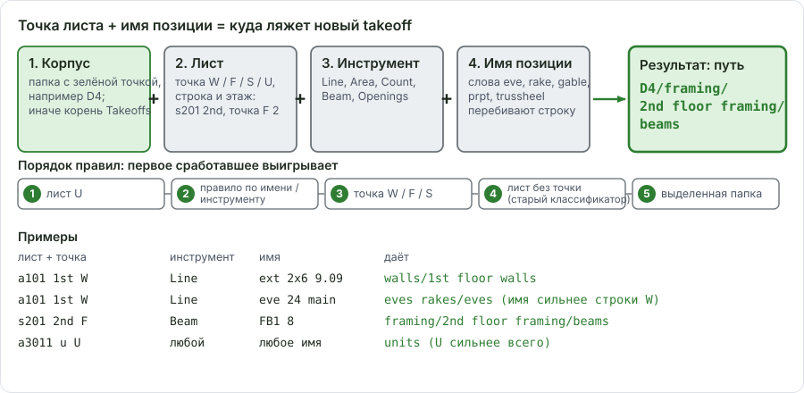
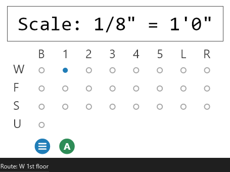

# Names and auto-routing

This page covers how the app decides which folder a new takeoff goes into, by the sheet dot and by the name; how to read the `Route:` status; what to do when a takeoff lands in the wrong place. You need it when the tree "sorted itself" in an unexpected way. Which sheet carries which scope and how a plan set is laid out: [Split by sheets and routing](ourplancore-split-by-sheets.md); name formats and the canonical folders: [Takeoff tree and sheet names](../start/takeoff-structure.md); rule settings: [Routing: settings](ourplancore-routing.md).

<figure markdown>
  
  <figcaption markdown="span">The building comes from the green dot, the floor and row come from the sheet dot, a word in the name can override the row. Example: sheet `s201 2nd` with the F dot, Beam tool, name `FB1 8`: `framing/2nd floor framing/beams`.</figcaption>
</figure>

## Rule order { #order }

A new takeoff is created by a tool, `New Item`, or by pasting `New takeoffs`. The folder is picked as follows; the first matching rule wins:

1. **Building.** The folder with the green dot; without one, the Takeoffs root ([building root](ourplancore-takeoffs.md#root)).
2. **U sheet.** If the sheet has the U dot, the takeoff goes to `<building>/units` with any tool; the name is ignored.
3. **Rule by name or tool** (Takeoff Name Routing): the Openings tool or a word in the name from the table [below](#name-rules).
4. **W/F/S sheet dot**: the sheet row and floor plus the tool give the folder ([table](#sheet-dots)).
5. **Sheet without a dot**: the old classifier by name words and the floor from the sheet name ([fallback](#tokens)).
6. Nothing matched: the takeoff stays in the folder selected in the tree.

`Record` continues the selected takeoff and does not touch the rules. Renaming a finished takeoff does not move it; a manual move always wins.

## W/F/S/U sheet dot { #sheet-dots }

<figure markdown>
  
  <figcaption markdown="span">The selected dot is shown in the status: `Route: W 2nd`, `Route: F 1st`, `Route: U all floors`.</figcaption>
</figure>

Where a new takeoff from a 2nd floor sheet goes, paths from the building root:

| Tool | W dot | F dot | S dot | U dot |
| --- | --- | --- | --- | --- |
| Line, P Line | `walls/2nd floor walls` | `framing/2nd floor framing/details` | `shear walls/2nd floor/shear` | `units` |
| Area, J Area | `sqfts` | `framing/2nd floor framing/joists` | `shear walls/2nd floor/shear` | `units` |
| Count | `walls/2nd floor walls` | `framing/2nd floor framing` | `shear walls/2nd floor/holdowns` | `units` |
| Beam | `walls/2nd floor walls` | `framing/2nd floor framing/beams` | `shear walls/2nd floor/shear` | `units` |
| Openings | `openings` (rule by tool) | `openings` | `openings` | `units` |

Floors: `B` (basement), `1`-`5`, `L` (loft), `R` (roof); the folders `basement foor walls`, `loft walls`, `roof framing` and so on are set in the settings. A Count on an F sheet usually lands in the floor root `framing/2nd floor framing`. If a Count/Points name ends with a space and `Post`, the takeoff goes to `framing/2nd floor framing/posts`. A name ending in ` Stair` on an F sheet goes to `framing/2nd floor framing/stairs` with any tool. Letter case does not matter; posts or stairs on another floor go to the matching folder of their own floor. Missing folders are created when you confirm in the dialog.

How dots are set and removed: [Sheets, W/F/S/U dots](ourplancore-pages.md#dots). In short: `a` plus a floor gives W, `s` plus a floor gives F, a trailing `u` tag gives U; by hand, click the dot; for the whole job, `Settings > Sheet Takeoff Routing > Route sheets without a dot now`.

When you paste `New takeoffs`, the copy goes into the same folder as the source, but in the target building; on a sheet with a different dot of the same row only the floor changes ([copying](ourplancore-takeoffs.md#copy)).

## Rules by name and tool { #name-rules }

These rules rank above the sheet dot (except on a U sheet): `eve 24 main` on a W sheet still goes to `eves rakes/eves`. Regular rules look for a substring, case-insensitive; ` Post` and ` Stair` need the word at the end of the name and an F sheet. The first match from the top wins.

| Match | Folder |
| --- | --- |
| Openings tool | `openings` |
| `gable stick` | `gables/gable stick` |
| `gable` | `gables/gable trusses` |
| `eve` | `eves rakes/eves` |
| `rake` | `eves rakes/rakes` |
| `prpt` | `parapets` |
| `trussheel` | `trussheel` |
| Count/Points with ` Post` at the end on an F sheet | `framing/<floor> framing/posts` |
| ` Stair` at the end on an F sheet, any tool | `framing/<floor> framing/stairs` |

`gable stick` sits above `gable`, otherwise it would also go to trusses. The folder is spelled `eves`, not `eaves`. The rules are edited in `Settings > Takeoff Name Routing` (order, `Preview name`, global and per job): [Routing: settings](ourplancore-routing.md).

!!! warning "A substring catches extra names"
    The `eve` rule also fires on the name `level 2`, the `rake` rule on `brake`. Check the target line in the New Item dialog; if it caught one, rename before creating or move it afterwards.

## Fallback: sheet without a dot { #tokens }

When the sheet has no dot and the name does not hit any rule, the old classifier works. It splits the name into words (case-insensitive, `2x6` and `1st` are whole words) and looks at the measurement type:

| Type | Words in the name | Where |
| --- | --- | --- |
| Area | `base`, `basement`, `sqft`, `sf`, `sft`, `deck`, `porch`, `blcny`, `balcony`, `cant`, `cantilevered`, `flat`, `rf`, `roof` or a floor `1st`...`8th` | `sqfts` |
| Line | `wall`, `walls`, `corner`, `corners`, `ext`, `cor`, `corr`, `dem`, `demo`, `2x4`, `2x6`, `2x8`, `half` | `walls/<floor> floor walls`; the floor comes from the sheet name or its folders (`base`, `1st`...`8th`, `floor 2`, `level 2`); no floor found - the `walls` root with the status `no sheet floor was detected` |
| Count | - | not routed, stays in the selected folder |

Status after creation: `Auto routed to Takeoffs/sqfts.` or `Auto routed to Takeoffs/walls/2nd floor walls.`

!!! warning "`dem` and `demo` are the same thing to the app: demising"
    In takeoff names `dem` and `demo` count as wall words (demising) and are sorted as one group; in sheet names `demo` is the demolition tag (`ad101 demo`), and such sheets get no dot. Demolition takeoffs in a reconstruction job will not land in a separate folder through the word `demo`: make your own folder for them and select it before measuring ([Reconstruction](../work-types/reconstruction.md)).

## How to fix a takeoff that landed in the wrong place { #fix }

Why: put the takeoff back in the right folder without losing the measurements and color.

1. Read the status after creation (`Route:`, `Auto routed to ...`) and look at the green dot: most often another building is active or the sheet has the wrong dot.
2. Drag the takeoff to the right folder, or press `Ctrl+X` on it and right-click **Paste Into Folder** on the folder: the move keeps the measurements, color and legend order. No need to delete and redraw.
3. Remove the cause: set the sheet dot, clear the green dot, rename the takeoff without the trap word.
4. If the error repeats on every job, fix the rule in **Settings** (Sheet Takeoff Routing or Takeoff Name Routing) instead of moving takeoffs by hand every time.

Result: the takeoff is in place, `Total` did not change. A sheet copy for shear walls and other typical cases: [Split by sheets](ourplancore-split-by-sheets.md#fix).

## What the Excel macros read from the name

The takeoff name is the input for the DFL workbook: a wall `ext 2x6 9.09` gives the size and height, an opening `4.3x7.8 d` the size and type, `eve 24 main` the overhang in inches, `rf 6` the pitch, `prpt 6.4 5.3 0.5` three heights, details `rim`, `ledger`, `bft` the column M flags. Numbers in their own unit and in their own place: unit table and examples in [Takeoff tree, numbers in the name](../start/takeoff-structure.md); how the XL buttons read the tree: [Export to Excel](ourplancore-excel.md).

## Colors { #colors }

A name that is exactly `bft` is always light gray: on creation, rename, random colors and copy (`Settings > Takeoff Colors`, `Exact name`, `Fixed color`). Other takeoffs get a random color without gray, black and white; `Split` gives the new part a new color.

## Sheet legend order { #legend-order }

By default the sheet legend is split into blocks by Takeoffs folders, in the order from `Settings > Sheet Legend`. For example, `walls` goes to `Walls`, `framing/<floor>/posts` to `Posts`, `sqfts` to `SQFTs`. `Pages > sheet > Organize`: `Sort Sheet Legend Auto`, `A-Z`, `by Key (before space)` (by the part of the name before the first space, numbers by value: `A1 2x4, A1 2x6, A2 2x4, A10 2x4, B1 2x4`), `Reset Sheet Legend Order`. To turn off the automatic blocks on just one sheet and keep manual groups, use the button next to the crop lock: [Sheets: legend](ourplancore-sheets-advanced.md#legend).

## See also

- [Takeoff tree and sheet names](../start/takeoff-structure.md): canonical folders, formats and units in the name
- [Split by sheets and routing](ourplancore-split-by-sheets.md): which sheet carries what, a sample tree, a sheet copy for shear
- [Sheets](ourplancore-pages.md), [Takeoffs tree](ourplancore-takeoffs.md), [Multiple buildings](ourplancore-buildings.md)
- [Routing: settings](ourplancore-routing.md), [Common mistakes: sheets and tree](../start/common-mistakes.md#pages)
