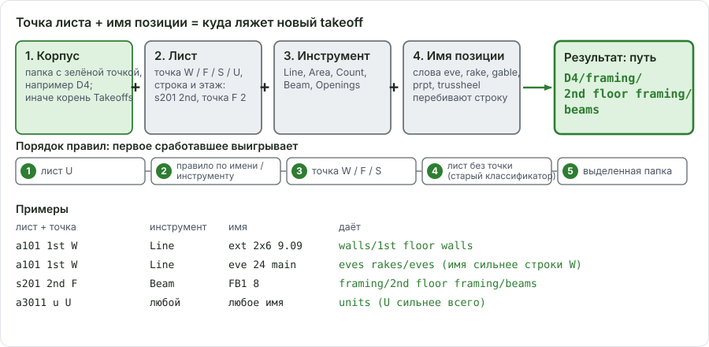

# Имена и автомаршрут

Здесь: как программа решает, в какую папку положить новую позицию, по точке листа и по имени; как читать статус `Route:`; что делать, когда позиция легла не туда. Нужно, когда дерево "само" разложилось неожиданно. Форматы имён и канон папок - [Дерево takeoff и имена листов](../start/takeoff-structure.md), настройки правил - [Маршрутизация: настройки](ourplancore-routing.md).

<figure markdown>
  
  <figcaption markdown="span">Корпус берёт зелёная точка, этаж и строку берёт точка листа, слово в имени может перебить строку. Пример: лист `s201 2nd` с точкой F, инструмент Beam, имя `FB1 8`: `framing/2nd floor framing/beams`.</figcaption>
</figure>

## Порядок правил { #order }

Новая позиция создаётся инструментом, `New Item` или вставкой `New takeoffs`. Папка выбирается так, первое подходящее правило выигрывает:

1. **Корпус.** Папка с зелёной точкой; без неё - корень Takeoffs ([корень корпуса](ourplancore-takeoffs.md#root)).
2. **Лист U.** Если у листа точка U, позиция идёт в `<корпус>/units` любым инструментом; имя не смотрится.
3. **Правило по имени или инструменту** (Takeoff Name Routing): инструмент Openings или слово в имени из таблицы [ниже](#name-rules).
4. **Точка листа W/F/S**: строка и этаж листа плюс инструмент дают папку ([таблица](#sheet-dots)).
5. **Лист без точки**: старый классификатор по словам имени и этажу из имени листа ([запасной путь](#tokens)).
6. Ничего не подошло: позиция остаётся в выделенной папке дерева.

`Record` продолжает выбранную позицию и правила не трогает. Переименование готовой позиции её не переносит; перенос руками всегда побеждает.

## Точка листа W/F/S/U { #sheet-dots }

<figure markdown>
  
  <figcaption markdown="span">Выбранная точка подписана в статусе: `Route: W 2nd`, `Route: F 1st`, `Route: U all floors`.</figcaption>
</figure>

Куда идёт новая позиция с листа 2-го этажа, пути от корня корпуса:

| Инструмент | Точка W | Точка F | Точка S | Точка U |
| --- | --- | --- | --- | --- |
| Line, P Line | `walls/2nd floor walls` | `framing/2nd floor framing/details` | `shear walls/2nd floor/shear` | `units` |
| Area, J Area | `sqfts` | `framing/2nd floor framing/joists` | `shear walls/2nd floor/shear` | `units` |
| Count | `walls/2nd floor walls` | `framing/2nd floor framing` | `shear walls/2nd floor/holdowns` | `units` |
| Beam | `walls/2nd floor walls` | `framing/2nd floor framing/beams` | `shear walls/2nd floor/shear` | `units` |
| Openings | `openings` (правило по инструменту) | `openings` | `openings` | `units` |

Этажи: `B` (basement), `1`-`5`, `L` (loft), `R` (roof); папки `basement foor walls`, `loft walls`, `roof framing` и так далее задаются в настройках. Count на F-листе ложится в корень этажа `framing/2nd floor framing`: посты и headers потом переносятся в `posts` и `headers/ext|int` руками или именем папки при создании. Недостающие папки создаются при подтверждении в диалоге.

Как точки ставятся и снимаются: [Листы, точки W/F/S/U](ourplancore-pages.md#dots). Коротко: `a` плюс этаж даёт W, `s` плюс этаж даёт F, последний тег `u` даёт U; руками - щелчок по точке; весь проект - `Settings > Sheet Takeoff Routing > Route sheets without a dot now`.

При вставке `New takeoffs` копия ложится в ту же папку, что исходник, но в корпусе назначения; на листе с другой точкой того же ряда меняется только этаж ([копирование](ourplancore-takeoffs.md#copy)).

## Правила по имени и инструменту { #name-rules }

Правила стоят выше точки листа (кроме листа U): `eve 24 main` на W-листе всё равно уйдёт в `eves rakes/eves`. Сравнение по подстроке без учёта регистра, первое совпадение сверху выигрывает.

| Совпадение | Папка |
| --- | --- |
| инструмент Openings | `openings` |
| `gable stick` | `gables/gable stick` |
| `gable` | `gables/gable trusses` |
| `eve` | `eves rakes/eves` |
| `rake` | `eves rakes/rakes` |
| `prpt` | `parapets` |
| `trussheel` | `trussheel` |

`gable stick` стоит выше `gable`, иначе он тоже уходил бы в trusses. Папка `eves` пишется так, не `eaves`. Правила редактируются в `Settings > Takeoff Name Routing` (порядок, `Preview name`, global и per job): [Маршрутизация: настройки](ourplancore-routing.md).

!!! warning "Подстрока ловит лишнее"
    Правило `eve` сработает и на имени `level 2`, правило `rake` - на `brake`. Проверяй строку назначения в диалоге New Item; попалось - переименовать до создания или перенести после.

## Запасной путь: лист без точки { #tokens }

Когда у листа нет точки и имя не попало в правила, работает старый классификатор. Он режет имя на слова (регистр не важен, `2x6` и `1st` - цельные слова) и смотрит тип замера:

| Тип | Слова в имени | Куда |
| --- | --- | --- |
| Area | `base`, `basement`, `sqft`, `sf`, `sft`, `deck`, `porch`, `blcny`, `balcony`, `cant`, `cantilevered`, `flat`, `rf`, `roof` или этаж `1st`...`8th` | `sqfts` |
| Line | `wall`, `walls`, `corner`, `corners`, `ext`, `cor`, `corr`, `dem`, `demo`, `2x4`, `2x6`, `2x8`, `half` | `walls/<этаж> floor walls`; этаж берётся из имени листа или его папок (`base`, `1st`...`8th`, `floor 2`, `level 2`); этаж не найден - корень `walls` со статусом `no sheet floor was detected` |
| Count | - | не маршрутизируется, остаётся в выделенной папке |

Статус после создания: `Auto routed to Takeoffs/sqfts.` или `Auto routed to Takeoffs/walls/2nd floor walls.`

!!! warning "`dem` и `demo` для программы одно и то же: demising"
    В именах позиций `dem` и `demo` считаются словами стены (demising) и сортируются одной группой; в именах листов `demo` - тег демонтажа (`ad101 demo`), такие листы точку не получают. Позиции сноса при реконструкции словом `demo` в отдельную папку не попадут: заводи для них свою папку и выбирай её перед замером ([Reconstruction](../work-types/reconstruction.md)).

## Позиция легла не туда { #fix }

1. Посмотреть статус после создания (`Route:`, `Auto routed to ...`) и зелёную точку: чаще всего активен чужой корпус или у листа не та точка.
2. Перенести позицию перетаскиванием или `Ctrl+X` и `Paste Into Folder`: перенос сохраняет замеры, цвет и порядок легенды. Удалять и рисовать заново не нужно.
3. Исправить причину: поставить точку листа, снять зелёную точку, переименовать позицию без слова-ловушки.
4. Ошибка повторяется на каждом проекте - править правило в `Settings` (Sheet Takeoff Routing или Takeoff Name Routing), а не переносить руками каждый раз.

## Что читают макросы Excel из имени

Имя позиции - вход для книги DFL: стена `ext 2x6 9.09` даёт сечение и высоту, проём `4.3x7.8 d` размер и тип, `eve 24 main` вынос в дюймах, `rf 6` уклон, `prpt 6.4 5.3 0.5` три высоты, детали `rim`, `ledger`, `bft` флаги колонки M. Числа в своей единице и в своём месте: таблица единиц и примеры - [Дерево takeoff, числа в имени](../start/takeoff-structure.md); как кнопки XL читают дерево - [Экспорт в Excel](ourplancore-excel.md).

## Цвета { #colors }

Имя ровно `bft` всегда светло-серое: при создании, переименовании, случайных цветах и копировании (`Settings > Takeoff Colors`, `Exact name`, `Fixed color`). Остальные позиции получают случайный цвет без серого, чёрного и белого; `Split` даёт новой части новый цвет.

## Порядок легенды листа { #legend-order }

Легенда листа строится автоматически: линии, потом площади, потом точки. `Pages > лист > Organize`: `Sort Sheet Legend Auto`, `A-Z`, `by Key (before space)` (по части имени до первого пробела, числа по значению: `A1 2x4, A1 2x6, A2 2x4, A10 2x4, B1 2x4`), `Reset Sheet Legend Order`. То же для нескольких листов, для папки (`... in Folder`) и в меню позиции под листом. Группы легенды: [Листы: продвинутое](ourplancore-sheets-advanced.md).

## См. также

- [Дерево takeoff и имена листов](../start/takeoff-structure.md): канон папок, форматы и единицы в имени
- [Листы](ourplancore-pages.md), [Дерево Takeoffs](ourplancore-takeoffs.md)
- [Маршрутизация: настройки](ourplancore-routing.md), [Частые ошибки: листы и дерево](../start/common-mistakes.md#pages)
