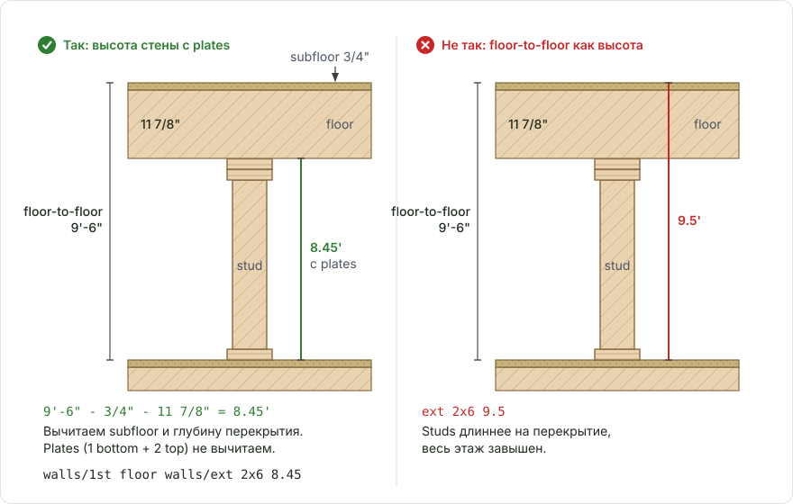
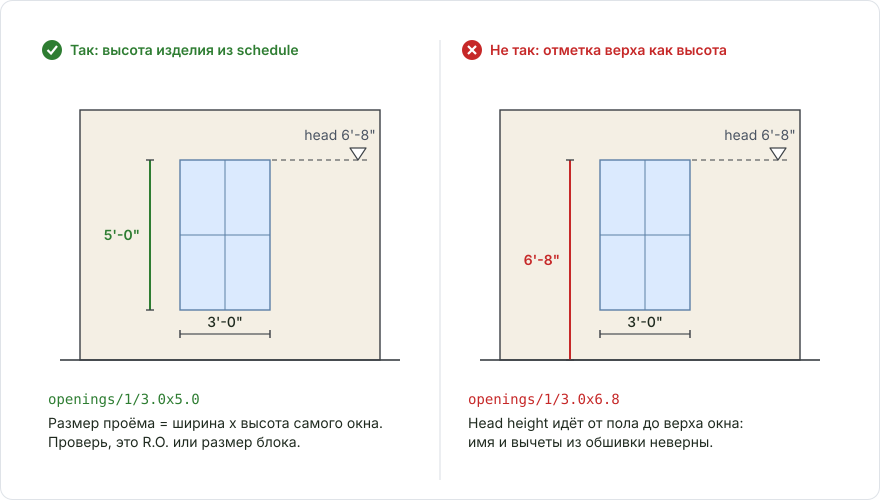
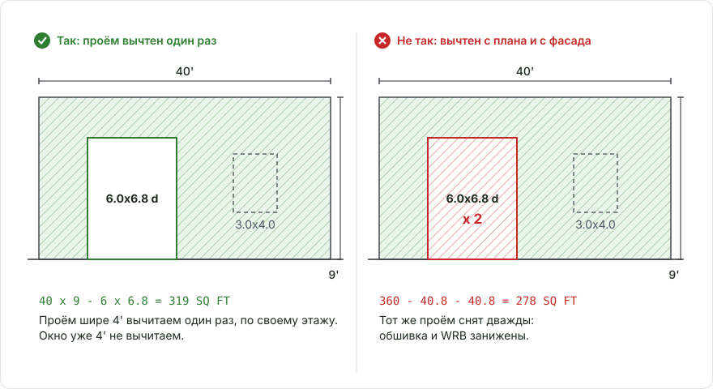
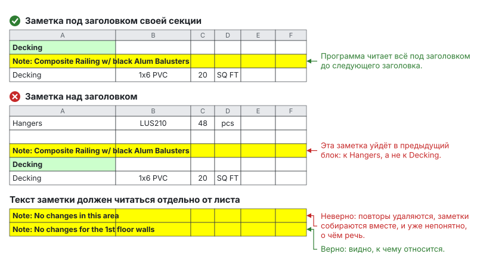
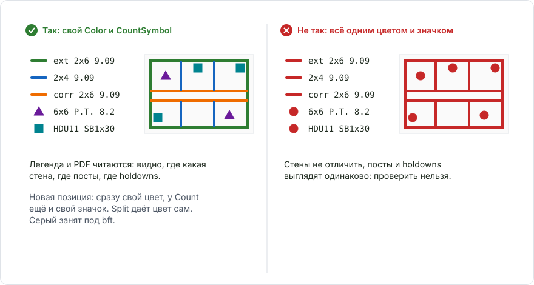

# Common mistakes and how to avoid them

Collected from reviews of delivered jobs over the last few months. No names or project
numbers. Each mistake has three columns: what it looks like in the takeoff or the DFL,
why it is bad, and how to do it right and where to read the rule. Before delivery,
go through the [checklist](quality-checklist.md): it follows the same sections.

## Walls {#walls}

| What it looks like | Why it is bad | The right way |
| --- | --- | --- |
| Wall type assigned as a group: a corridor recorded as demising, 2x6 interior as exterior. | Different walls pull different plates, sheathing, bracing and FRT; quantities drift by hundreds of LF. | Each wall run per the wall schedule of its own floor, not "looks like the one next to it". Split at a change of size, height or sheathed side. [Exterior](../work/vertical/walls/exterior.md), [Corridor](../work/vertical/walls/corridor.md), [Demising](../work/vertical/walls/demising.md) |
| Stud height taken as floor-to-floor or the ceiling elevation. | Studs are longer than real by the depth of the floor framing and plates; the whole floor is overstated. | Stud height = floor-to-floor minus subfloor minus floor framing depth minus plates; check against the section of each building. The wall name carries the height in decimal feet (`ext 2x6 9.09`). [Exterior, Wall Sizing section](../work/vertical/walls/exterior.md), [Tips: Studs](../reference/boss-feedback-rules.md#studs) |
| P.T. bottom plate on a wood floor. | Extra material and a wrong specification. | P.T. only on concrete and masonry. A double bottom plate only where a detail shows it. [Sill Plates](../work/vertical/walls/sill-plates.md) |
| Metal studs not counted and no note. | The client cannot see that metal walls were excluded on purpose. | If metal is by others, there is no row, but the `Metal Studs by others` note is required. If we count them, write the gauge (`6" 18ga mtl`). [Client rules](client-rules.md#metal-studs), [Metal Tracks](../work/vertical/walls/metal-tracks.md) |
| Shaft walls dropped as "panels by others"; a CMU elevator shaft recorded as shaftliner; trash chute missed. | Shafts are almost never part of the panels, and shaft materials vary. | Capture every shaft in the takeoff and determine the material from the plan and the wall type. [Shaft](../work/vertical/walls/shaft.md), [Wall Panels](../work/vertical/walls/wall-panels.md) |

<figure markdown>
  
  <figcaption markdown="span">Height in the wall name: floor to floor minus the subfloor and the floor depth, plates stay inside the height. Floor to floor as is overstates the studs of the whole floor.</figcaption>
</figure>

## Openings {#openings}

| What it looks like | Why it is bad | The right way |
| --- | --- | --- |
| Openings not deducted from sheathing, WRB, insulation and the anchor line; or deducted twice (from the plan and from the elevation). | Sheathing and WRB overstated by dozens of sheets, or understated. | Deduct once, on its own floor, from every row that needs it. Windows under 4' are not deducted. [Windows and Doors](../work/vertical/openings/windows-doors.md), [Wall Sheathing](../work/vertical/sheathing/wall-sheathing.md) |
| Window height taken as the head height, not the product height. | The opening size in the name (`5.8x5.9`) and the deductions are wrong. | Height = product size from the schedule; the head elevation on the elevation is not a size. Check whether it is the R.O. or the unit size. [Windows and Doors](../work/vertical/openings/windows-doors.md) |
| A full storefront counted, and its door counted again as a separate opening. | Double count. | Storefront once; a door inside a composite opening is not a second opening. [Windows and Doors](../work/vertical/openings/windows-doors.md) |

<figure markdown>
  
  <figcaption markdown="span">The opening height in the name is the size of the window itself from the schedule, not the head height mark from the floor.</figcaption>
</figure>

<figure markdown>
  
  <figcaption markdown="span">An opening wider than 4' is deducted once on its own floor; a window narrower than 4' is not deducted. Deducting from both the plan and the elevation understates the sheathing.</figcaption>
</figure>

## Floor framing and beams {#floor}

| What it looks like | Why it is bad | The right way |
| --- | --- | --- |
| A beam mark missed on one of the floors where it is shown; PSL under beam ends not per schedule. | Beams and supports in the DFL do not match the framing plan. | Every mark on every floor where it is shown; posts and PSL per schedule. [Beam](../work/horizontal/floor-framing/beam.md), [Post](../work/horizontal/floor-framing/post.md) |
| Hangers not at both ends of a joist, or counted from the purchased boards after cutting; no Zmax outside; Zmax bases but no hangers. | Hardware does not match the number of connections. | Hangers by assembly, both ends of each joist, model per detail, whole pieces only. Outside and on P.T. use Zmax; ties to trusses under sheathing without Zmax. [Hangers](../reference/hangers.md) |
| Rim recorded as `1-3/4 LVL Rim` with no such callout on the drawing; rim broken into 16' pieces. | Made-up product, wrong length. | By default `11-7/8" Rim` or `LSL Rim` per the specification, in LF with a factor. LVL rim only when a deck or a corridor attaches to it. [Rim Board](../work/horizontal/floor-framing/details/rim.md), [Tips: Rim](../reference/boss-feedback-rules.md#rim-board) |
| A stair counted once when there are eight stairs; stringers from the `(4) LVL` template when there are two 2x12 flights. | Quantity and material do not follow the project. | Multiply by the number of stairs; stringers and their material per detail; assign a flight to one confirmed level. [Stair](../work/horizontal/floor-framing/stair.md) |
| Ledger and its fasteners taken from another floor, or no fastener row. | Wrong length and screw count. | Ledger on its own floor, fasteners as a separate row per detail. [Framing details](../work/horizontal/floor-framing/details/blocking.md) |

## Roof {#roof}

| What it looks like | Why it is bad | The right way |
| --- | --- | --- |
| Roof pitch not taken from the sheet (6:12 instead of 4:12), or pitch correction applied twice. | Dozens of extra sheathing panels and clips. | The number in the name `rf 6` = pitch from the sheet; the correction `sqrt(1+(rise/12)^2)` exactly once. Garage, porch and porte cochere have their own outlines and pitches. [Roof SQFT](../work/sqfts/roof.md), [Roof Sheathing](../work/horizontal/roof-framing/roof-sheathing.md) |
| Roof-to-wall ties not along all bearing lines; tie spacing not equal to truss spacing. | Ties understated by half. | Ties along each bearing line, spacing = truss spacing, on both sides if the detail says so. [Roof Sheathing](../work/horizontal/roof-framing/roof-sheathing.md), [Hangers](../reference/hangers.md) |
| Canopy counted again in eve/rake; not all eaves counted. | Eaves and soffit doubled or understated. | Canopy is not part of eve/rake; all eave runs with the overhang in inches in the name (`eve 24 main`). [Eave](../work/sheathing-and-misc/eve.md), [Canopy](../work/horizontal/roof-framing/canopy.md) |
| Attic draft stop missed or copied from the shear wall total. | The most common miss; the area has nothing to do with shear. | Draftstops Plan sheet or roof plan, attic profile from the section, an Area triangle for each line, a separate row. [Gable](../work/vertical/walls/gable.md), [Demising](../work/vertical/walls/demising.md) |

## Sheathing {#sheathing}

| What it looks like | Why it is bad | The right way |
| --- | --- | --- |
| H-clips with T&G or with decking thicker than the spec threshold; clips "4 per sheet" instead of by support spacing. | Thousands of extra clips, or a shortage. | Clips only for square edge, by support spacing and the model from the detail (`PSCL at 16"` = 6 per 4x8 sheet); each building has its own spacing. [H-clips](../work/horizontal/roof-framing/h-clips.md) |
| "Vapor Barrier" in the DFL instead of WRB; Tyvek with a fluid-applied barrier. | Wrong product and wrong purpose of the layer. | Call the exterior barrier WRB / Weather Barrier, product from the specification. [Wall Sheathing](../work/vertical/sheathing/wall-sheathing.md), [Exterior Wall Materials](../work/vertical/sheathing/exterior-materials.md) |
| Sheathing name replaced with a template one: "LP FlameBlock 2-sided" became "7/16 OSB FRT", "5/8 EXT. SHEATHING" became Ply with no basis. | The client gets the wrong product. | Product name as in the project; resolve an arch vs S discrepancy with a note citing both sources and the value used. [Wall Sheathing](../work/vertical/sheathing/wall-sheathing.md) |
| On a panel job both sides of a shear wall counted separately, although the exterior side is already in ext walls; `P` in the mark read as "two sides". | Sheets doubled. | On a panel job one side is in the panel; the SW needs only the required second side. `P` = perforated. [Shear Wall](../work/vertical/sheathing/shear-wall.md) |

## SQFT areas {#sqft}

| What it looks like | Why it is bad | The right way |
| --- | --- | --- |
| Porch SQFT on the Front Page not filled in; balconies and porch not in their own rows. | The building total is wrong. | Balconies and porches as separate Front Page rows. [Porch](../work/sqfts/porch.md), [Balcony](../work/sqfts/balcony.md) |
| Area drawn as a rectangle "to hit a known number", or balconies joined by a bridge into one polygon. | The area cannot be checked, extra feet. | Area along the real outline; one type can be built from several polygons in one takeoff. [1st-5th Floors](../work/sqfts/1st2nd.md) |

## Deck, porch, balconies {#deck}

| What it looks like | Why it is bad | The right way |
| --- | --- | --- |
| A balcony block without its own unit multiplier (900 SF instead of 60); a formula references the header of another block. | Area and material are multiplied by the wrong thing. | Each block has its own header with the number of instances, formulas from it. Count balcony types separately from the plan. [Deck / Porch / Balcony frame](../work/deck/deck-porch-balcony-frame.md) |
| Porches "mirrored" from balconies instead of counted separately; the porch has no ceiling joists, ledger and hangers. | A porch is a different structure. | Count the porch independently; framing not shown - note `Porch framing is not specified; all framing assumed; verify`. [Deck / Porch / Balcony frame](../work/deck/deck-porch-balcony-frame.md) |

## Shear walls and holdowns {#holdowns}

| What it looks like | Why it is bad | The right way |
| --- | --- | --- |
| Holdown model not from the table of its own building and floor; straps mixed with anchors; one holdown through a wood floor instead of two. | Wrong hardware in the wrong quantity. | Model per the SW schedule of its own floor; to concrete one holdown as drawn, through a wood floor two (below and above); a holdown over a beam does not need a transfer below (client instruction). [Shear Wall](../work/vertical/sheathing/shear-wall.md) |
| Anchors at one spacing for the whole building; wedge anchor replaced with Titen HD with no basis. | Anchor spacing and type depend on the SW. | Split by spacing and by SW, type from the detail; a double-sided SW gets double anchorage; plate washers per the table. [Anchor Bolts](../work/deck/anchor-bolts.md) |
| G of a double-sided SW multiplied by 2 again. | Sheets doubled. | G = sum of the two faces, no extra x2; label double-sided SWs "both sides". [Shear Wall](../work/vertical/sheathing/shear-wall.md) |

## Excel DFL and notes {#excel}

| What it looks like | Why it is bad | The right way |
| --- | --- | --- |
| Notes in telegraph style (`shtg`, `ply`, `o/`), longer than the A:F width, "optional" with no reason, a note contradicts its row ("by others" with a quantity next to it). | The client does not understand what was assumed and why. | A natural phrase with a verb, up to 80 characters, `per <sheet>`, one fact = one note; an optional must have a reason. [Standard notes](../reference/standard-notes.md) |
| A note without yellow fill or without the `Important:`, `Note:`, `Comment:` prefix; a note above the block header. | The note does not make it into the final file or ends up in the previous block. | Prefix, yellow fill, under the header of its own section. [File format, notes](../reference/dfl-overview.md#notes) |
| A material row colored for personal use or in a revision; an option without color. | A colored row counts as an option and drops out of the main list; an option without color counts as required material. | Color only for options; orange for review; in a revision, color the changed cell or F. [Options and color](../reference/dfl-overview.md#options) |
| Section header without color or with text in B-F; deck without the word Frame; decking and railing directly under the framing. | The app mixes materials or loses the block. | Bold, colored, B-F empty. [Headers](../reference/dfl-overview.md#headers), [Groups](../reference/dfl-overview.md#groups) |
| A whole floor copied: formulas reference the header of another floor or block; detail labels left over from the old place. | Quantities are calculated from someone else's inputs. | Formulas only from the block's own inputs; after copying, check the first row of each section and the labels. [Formulas](../reference/formulas.md), [Checklist](quality-checklist.md) |
| An area measured in OurPlanCore did not make it to Excel or was not updated after an edit. | The DFL does not match the takeoff. | After every takeoff change, update the number in the DFL; before delivery, check the key G values against the tree. [Checklist](quality-checklist.md) |
| Unit `FT` instead of `LFT`; the label does not match the calculation (`Plate (2)` for a single plate, `Posts (3)` for two). | Format not per template, the client reads it wrong. | In D: `LFT` for lumber, `pcs` for hardware, SF for panels; the label = what the formula calculates. [Takeoff item labels](../reference/takeoff-items.md) |

<figure markdown>
  
  <figcaption markdown="span">A note sits under its own section header, with a prefix and a yellow fill. A note above the header falls into the previous block.</figcaption>
</figure>

## Sheets and tree in OurPlanCore {#pages}

| What it looks like | Why it is bad | The right way |
| --- | --- | --- |
| Scale taken from the sheet label (1/8") while the sheet is printed at 3/16"; a sheet with several scales left with one. | All lengths and areas on the sheet are wrong. | Check the scale against a known dimension and grid lines; calibrate a sheet with several scales by zone. [Takeoff tree](takeoff-structure.md), [OurPlanCore: getting started](../reference/ourplancore-start.md) |
| Joists drawn as a plain Area named `2x8 16"`; a beam or an opening entered as a plain Count. | The export cannot see direction, spacing and lengths. | Joists only with J Area, beams with Beam, openings with Openings. [Joist](../work/horizontal/floor-framing/joist.md), [Beam](../work/horizontal/floor-framing/beam.md) |
| All takeoffs in one color and one icon; the `f` tag added to a takeoff plan; the sheet tag not last (`1st overall`). | The legend is unreadable, the W/F/S/U point is not set. | Each new takeoff gets its own Color, point takeoffs their own CountSymbol. Sheet name `a101 1st`, tag at the end, `f` only for the foundation. [Takeoff tree](takeoff-structure.md) |

<figure markdown>
  
  <figcaption markdown="span">Every item has its own Color, count items also their own CountSymbol. With one colour the legend and the PDF cannot be read.</figcaption>
</figure>

## Delivery {#delivery}

| What it looks like | Why it is bad | The right way |
| --- | --- | --- |
| The PDF has every sheet of the set (hundreds of pages), or several buildings in one file. | The client hunts for takeoffs among empty sheets. | Export only sheets with takeoffs; each building gets its own PDF. [Workflow](workflow.md) |
| Processed xlsx older than the working xlsm; notes or rows missing in the xlsx. | The client gets the wrong version. | Make the processed file after the last edit and check it against the xlsm. [Workflow](workflow.md) |
| A revision has no `Changes.txt`, or an open comment is recorded as fixed. | The client does not know what changed. | `Changes` and `Open items` sections, in English, `per <sheet>`; anything unresolved only in Open items. [Workflow](workflow.md) |
| The project dragged on, and the owner learned about it on the delivery day. | The deadline slips without warning. | As soon as you see the deadline slipping, report it right away, not at the end. |

## What is NOT a mistake

Do not flag in a review:

- `checked` in column G.
- An empty G for a single porch.
- A cut list where there are fewer boards than pieces.
- The same structure in twin buildings.
- Template defaults on a panel job with no structural info.

## See also

- [Pre-delivery check](quality-checklist.md)
- [Tips and key rules](../reference/boss-feedback-rules.md)
- [Takeoff tree and sheet names](takeoff-structure.md)
