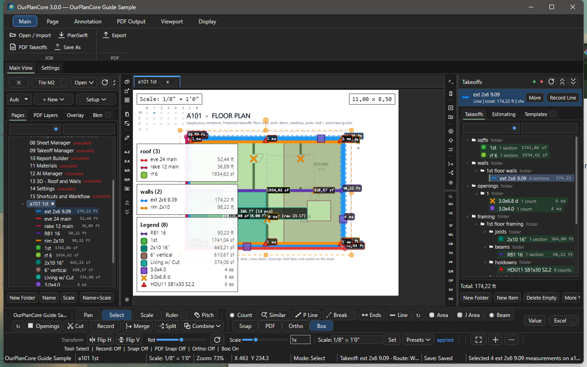

# How to use the KB

This knowledge base is the estimator's working memory: open a page, check the rule,
apply it in OurPlanCore or in the Excel DFL. This page explains briefly how the KB is
organized and how to read its pages.

<figure markdown>
  
  <figcaption markdown="span">Everything described in the KB is done in this window: sheets (Pages) on the left, the drawing in the center, the takeoff tree (Takeoffs) on the right. Panel names in the KB text match the labels on screen.</figcaption>
</figure>

## Site sections

| Tab | What is there | When to open it |
| --- | --- | --- |
| **Start** | Workflow, takeoff tree and sheet names, pre-delivery check, client rules, common mistakes | On day one and before every delivery |
| **OurPlanCore** | The app: getting started, interface and tools, takeoff names and sheet points, shortcuts, troubleshooting, what's new | When you are not sure which button or key does something |
| **Work** | Topic pages for each framing element, in the order you take them off: job types, walls, openings, floor framing, roof, sheathing, areas, deck, trim | During takeoff: open the element, check how to count it and how to name it |
| **Reference** | Tips and key rules, hangers, hardware, formulas and factors, standard notes, DFL row names | When filling the Excel workbook and when you are unsure about a rule |

The "Work" menu follows the takeoff order: go down the list top to bottom and you
skip nothing. It is a checklist, not a classification.

## Search

Ctrl+K opens search. Search by the English term from the drawing: `rim`, `truss heel`,
`holdown`, `prpt`, `draft stop`. Russian words are found too, but drawing terms in the
KB are always English, so they give more precise results.

## How to read a topic page

Pages in the "Work" section follow one template. If you need just one answer, go
straight to the right section:

| Page section | Question it answers |
| --- | --- |
| Picture at the top | What it looks like on the drawing or in the structure |
| What it is | How the element differs from its neighbor (Sill Plate is not Btm Plate) |
| Where to find it in the drawings | Which sheet gives the dimension, mark, specification |
| How to measure in OurPlanCore | Tool (Line, Area, Count, J Area, Beam, Openings), unit, what to trace, on a sheet with which point W/F/S/U |
| How to name it in the tree and the DFL row | Takeoff name in Takeoffs, row in Excel, unit, formula or factor |
| Common mistakes | What has already been found in reviews, plus a link to the [general list](common-mistakes.md) |
| Example | A piece of the tree or the DFL, 3-6 rows |
| See also | Related pages |

Drawing terms in the text are English (Joist, Rim Board, FRT). Copy takeoff names and
DFL row names exactly as written: Excel macros read them.

## Source priority

1. Drawings and specifications of the current project.
2. Structural details and schedules.
3. Arch plans, wall types, assemblies, RCP, energy notes.
4. Client and job type rules from this KB: [Client rules](client-rules.md).
5. [Tips and key rules](../reference/boss-feedback-rules.md) and topic pages.

If a KB rule contradicts the drawing, the drawing wins. Do not hide the discrepancy:
write a note in the DFL with both sources and the value you used
([how to format it](../reference/standard-notes.md)).

## If there is no rule

1. Make sure it really is missing: search by the English term and by a synonym
   (eave and eve, holdown and HDU, WRB and Tyvek).
2. Check [Tips and key rules](../reference/boss-feedback-rules.md) and
   [Common mistakes](common-mistakes.md): many decisions are written there as
   "mistake and the right way".
3. Not there either: decide from the drawing, record it with an `assumed; verify` note
   with the sheet number, and flag the question for the owner. A decision the owner
   confirms later goes onto the topic page.

How to make changes to the KB itself is described on the editor page:
[Updating the KB](maintenance.md).

## See also

- [Workflow](workflow.md)
- [Takeoff tree and sheet names](takeoff-structure.md)
- [OurPlanCore 3.0: getting started](../reference/ourplancore-start.md)
