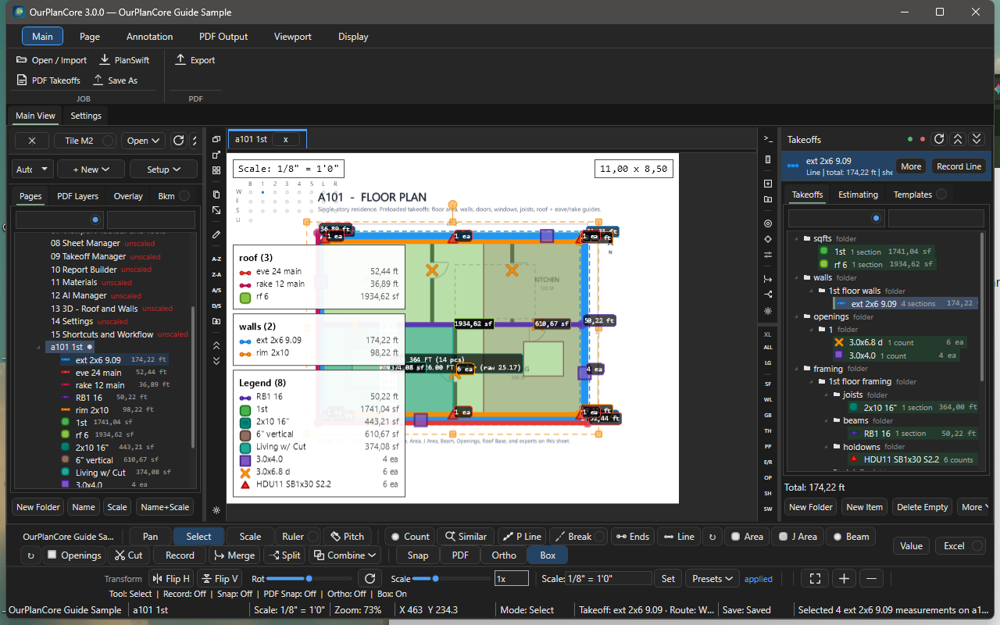

# Как пользоваться базой

База знаний - рабочая память эстиматора: открыл страницу, проверил правило,
применил в OurPlanCore или в Excel DFL. Здесь коротко, как она устроена и как
читать страницы.

<figure markdown>
  
  <figcaption markdown="span">Всё, что описано в базе, делается в этом окне: слева листы (Pages), в центре чертёж, справа дерево замеров (Takeoffs). Названия панелей в тексте базы совпадают с подписями на экране.</figcaption>
</figure>

## Разделы сайта

| Вкладка | Что там | Когда открывать |
| --- | --- | --- |
| **Старт** | Процесс работы, дерево takeoff и имена листов, проверка перед сдачей, правила клиентов, частые ошибки | В первый день и перед каждой сдачей |
| **OurPlanCore** | Программа: начало работы, интерфейс и инструменты, имена takeoffs и точки листа, клавиши, проблемы, что нового | Когда непонятно, какой кнопкой или клавишей это делается |
| **Работа** | Предметные страницы по каждому элементу каркаса в порядке, в котором их мерят: типы работ, стены, проёмы, перекрытия, крыша, обшивка, площади, deck, отделка | Во время замера: открыл элемент, проверил, как считать и как назвать |
| **Справочник** | Советы и важные вещи, hangers, крепёж, формулы и факторы, стандартные ноты, имена строк DFL | При заполнении Excel и при сомнении в правиле |

Меню "Работа" повторяет порядок замера: идёшь сверху вниз по списку, и ничего не
пропускаешь. Это не классификатор, а чек-лист.

## Поиск

Ctrl+K открывает поиск. Ищи по английскому термину с чертежа: `rim`, `truss heel`,
`holdown`, `prpt`, `draft stop`. Русские слова тоже находятся, но термины
чертежей в базе всегда английские, поэтому по ним результат точнее.

## Как читать предметную страницу

Страницы раздела "Работа" построены по одному шаблону. Если нужен только один
ответ, иди сразу в нужный раздел:

| Раздел страницы | Какой вопрос закрывает |
| --- | --- |
| Картинка сверху | Как это выглядит на чертеже или в конструкции |
| Что это | Чем элемент отличается от соседнего (Sill Plate не Btm Plate) |
| Где искать на чертежах | На каком листе брать размер, марку, спецификацию |
| Как мерить в OurPlanCore | Инструмент (Line, Area, Count, J Area, Beam, Openings), единица, что обводить, на листе с какой точкой W/F/S/U |
| Как назвать в дереве и строка DFL | Имя позиции в Takeoffs, строка в Excel, unit, формула или фактор |
| Частые ошибки | Что уже находили на проверках и ссылка на [общий список](common-mistakes.md) |
| Пример | Кусок дерева или DFL, 3-6 строк |
| См. также | Соседние страницы |

Термины чертежей в тексте английские (Joist, Rim Board, FRT), объяснения русские.
Имена позиций и строк DFL копируй как написано: их читают макросы Excel.

## Приоритет источников

1. Чертежи и спецификации текущего проекта.
2. Structural details и schedules.
3. Arch plans, wall types, assemblies, RCP, energy notes.
4. Правила клиента и типа заказа из этой базы: [Правила клиентов](client-rules.md).
5. [Советы и важные вещи](../reference/boss-feedback-rules.md) и предметные страницы.

Если правило базы противоречит чертежу, чертёж главнее. Расхождение не прячь:
пиши ноту в DFL с обоими источниками и принятым значением
([как оформить](../reference/standard-notes.md)).

## Если правила нет

1. Проверь, что его нет: поиск по английскому термину и по синониму
   (eave и eve, holdown и HDU, WRB и Tyvek).
2. Посмотри [Советы и важные вещи](../reference/boss-feedback-rules.md) и
   [Частые ошибки](common-mistakes.md): многие решения записаны там как
   "ошибка и как правильно".
3. Нет и там: прими решение по чертежу, запиши его нотой `assumed; verify` с
   номером листа и отметь вопрос для владельца. Решение, подтверждённое
   владельцем, потом попадает на предметную страницу.

Как вносить правки в саму базу, описано на странице для редактора:
[Обновление базы](maintenance.md).

## См. также

- [Процесс работы](workflow.md)
- [Дерево takeoff и имена листов](takeoff-structure.md)
- [OurPlanCore 3.0: начало работы](../reference/ourplancore-start.md)
