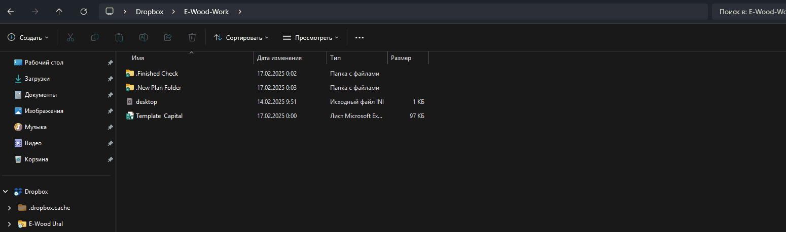
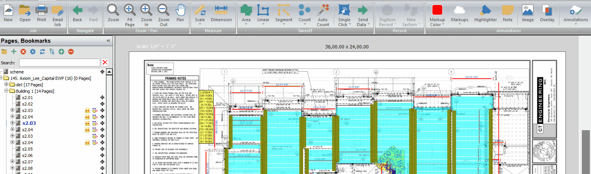
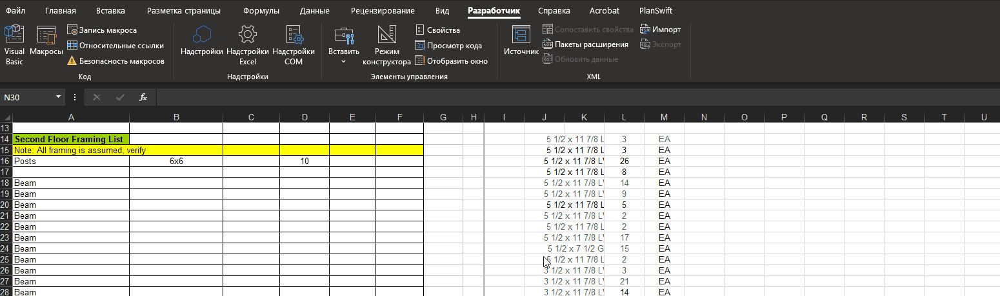
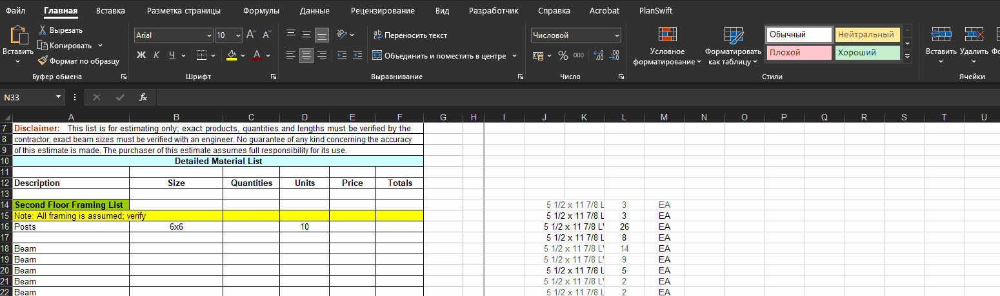
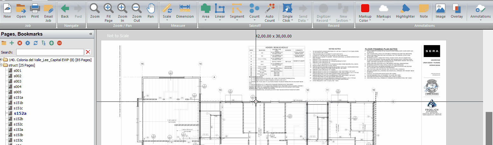
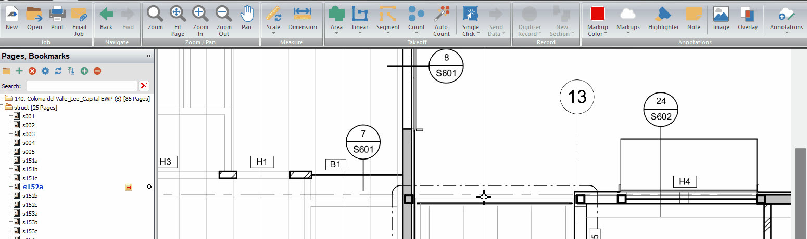
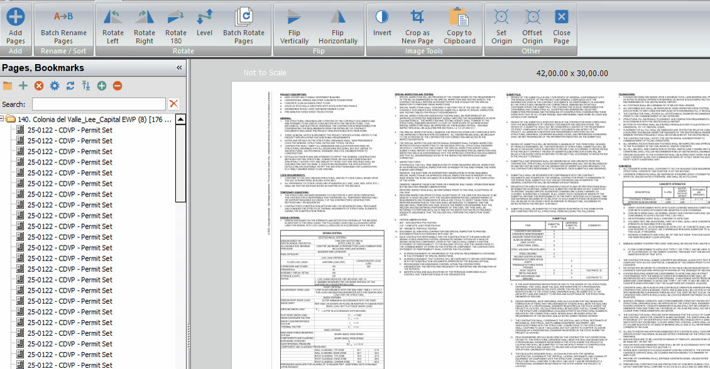

# Как пользоваться

Эта wiki должна быть быстрой рабочей памятью: открыл страницу, проверил правило,
применил в takeoff tool или Excel.

## Приоритет источников

1. Реальные drawings/specs текущего проекта.
2. Structural details и schedules.
3. Arch plans, assemblies, RCP, wall types, energy notes.
4. Client-specific rules из этой wiki.
5. [Советы и важные вещи](../reference/boss-feedback-rules.md).

Если правило из wiki конфликтует с drawings/specs, не подменяй проект. Запиши
вопрос или note в output.

## Как читать страницы

- `Старт` - процесс, структура, checklist.
- `OurPlanCore` - начало работы, интерфейс, проекты, горячие клавиши и решение
  проблем. Начни с [короткого маршрута](../reference/ourplancore-start.md).
- `Типы работ` - логика COM, EWP/Capital, Residential.
- `Работа` - предметные страницы по разделам takeoff.
- `Справочник` - правила, таблицы и формулы.

Описание функции программы проверяй по версии в начале её инструкции.
Старый скриншот показывает расположение элементов в момент съёмки; текущие
названия и действия описаны в тексте. Планы развития не являются готовыми
функциями. Для сравнения выпусков есть
[история изменений OurPlanCore](../reference/ourplancore-changelog.md).

## Найти раздел по задаче

| Задача | Маршрут |
| --- | --- |
| Выбрать процесс по типу работы | [COM](../work-types/com.md), [EWP / Capital](../work-types/ewp-capital.md), [Residential](../work-types/residential.md), [Reconstruction](../work-types/reconstruction.md) |
| Разобраться с металлическими стенами | [Metal Tracks / CFMF](../work/vertical/walls/metal-tracks.md) |
| Найти потолочный или soffit framing | [Ceiling / Soffit Framing](../work/horizontal/ceiling-soffit-framing.md) |
| Найти dormer в roof framing | [Dormer](../work/horizontal/roof-framing/dormer.md) |
| Найти loft в площадях | [Loft](../work/sqfts/loft.md) |
| Проверить весь путь от PDF до выдачи | [Workflow](workflow.md), затем [QA checklist](quality-checklist.md) |

## Обновить правило

- Добавляй подтверждённое правило в одну предметную страницу. В
  [Советы и важные вещи](../reference/boss-feedback-rules.md) оставляй краткую
  ссылку на него, если это feedback.
- Не храни приватные ссылки, emails, UIDs, salary history и credentials.
- Если правило относится к конкретному клиенту, обнови
  [Правила клиентов](client-rules.md).
- Если правило повторяется в разных местах, держи короткую версию на topic page
  и полную версию в reference page.

<!-- confluence-gallery:start -->
## Визуальная проверка

Архивные иллюстрации помогают прочитать правило. Для своего takeoff сверь его с чертежами и scope текущего проекта.

??? info "Источник картинок"
    - Excel: 5 карт. Confluence (архивный источник; ссылка не публикуется)
    - PlanSwift: 2 карт. Confluence (архивный источник; ссылка не публикуется)
    - PlanSwift - large GIF attachments: 1 карт. Confluence (архивный источник; ссылка не публикуется)

  
Показать 8 иллюстраций

  

    
    
    
    
    
    
    
    
  

<!-- confluence-gallery:end -->
