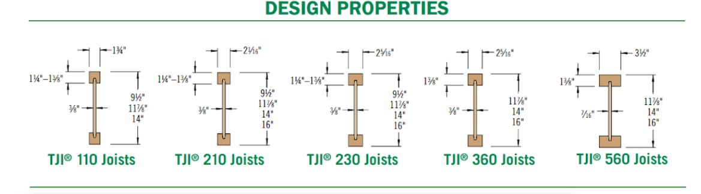
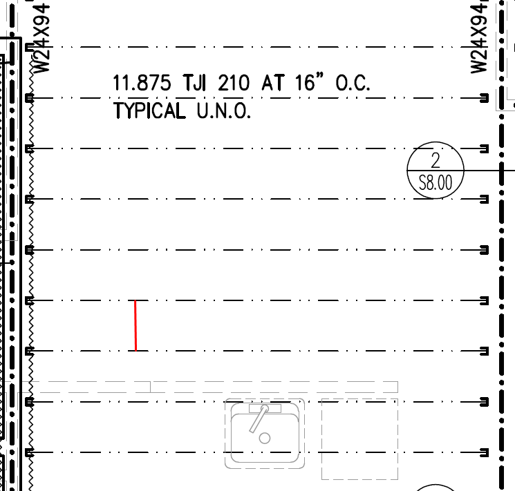

# Page preview

This page is a quick visual check: open it locally and look at
readability, image cards, tables and links between rules. It does not
replace the working sections of the wiki; it shows what a good
topic page should look like.

## Quick route

-   :material-floor-plan:{ .lg .middle } **Joist**

    ---

    Product family, spacing, hangers and EWP naming should be visible next to
    the images, not hidden in long text.

    [Open Joist](../work/horizontal/floor-framing/joist.md)

-   :material-format-paint:{ .lg .middle } **Interior Trims**

    ---

    Base, Crown, Casing and Door/Window Trim are best checked with rule cards:
    image + rule + what to do in the takeoff.

    [Open Interior Trims](../work/interior-trims/overview.md)

-   :material-wall:{ .lg .middle } **Exterior Wall**

    ---

    Wall height, bottom plate, shear/draft-stop notes and material variants
    should read like a checklist.

    [Open Exterior](../work/vertical/walls/exterior.md)

-   :material-clipboard-check-outline:{ .lg .middle } **QA**

    ---

    Before output, check scope, drawings, formulas, waste, FRT, hangers and
    client-specific rules.

    [Open QA checklist](quality-checklist.md)

## How a topic page should read

| Block | What it should contain | What it is for |
| --- | --- | --- |
| `What to count` | Specific takeoff items | So there is no argument over whether an item is in scope |
| `Rules` | Short estimating rules | To apply the rule quickly in PlanSwift/Excel |
| `Where to look` | Plan, schedule, notes, details | So the estimator does not search for the source at random |
| `Visual check` | Image + rule + action note | So the image is not a separate gallery with no purpose |
| `Check` | Final QA list | To catch mistakes before output |

!!! note "Main rule"
    An image must be tied to an action: what to check on the drawings and how
    it changes the takeoff/output.

## Shortcuts

| Where | Keys | What it does |
| --- | --- | --- |
| Wiki search | ++ctrl+k++ / ++cmd+k++ | Quickly find a rule by a Russian or English term. |

!!! tip "Where the full table is"
    The app's shortcuts and the key binding editor are described in one place:
    [OurPlanCore keyboard shortcuts](../reference/ourplancore-shortcuts.md).
    On a topic page, leave a link to the right scenario, so that an old
    copy of the table does not show up in search as a current instruction.

## Visual check

  
Hide 4 illustrated rules

  <figure class="kb-figure-row">
    <figcaption class="kb-figure-row__text">
      
Joist product family

      
Keep the exact series: <code>TJI 230</code>, <code>RED</code>, <code>LPI</code>, <code>BCI</code>.

      
The output should show which product family was specified in the schedule.

    </figcaption>
    
  </figure>
  <figure class="kb-figure-row">
    <figcaption class="kb-figure-row__text">
      
O.C. spacing

      
Spacing is measured center-to-center, not from the edge of the lumber.

      
Before the formula, check that the plan really shows 12 / 16 / 19.2 / 24 o.c.

    </figcaption>
    
  </figure>
  <figure class="kb-figure-row">
    <figcaption class="kb-figure-row__text">
      
Interior Trim perimeter

      
Base and Crown are counted by room perimeter, but exceptions have to be checked separately.

      
Kitchen cabinets, closets, garage and the room schedule can change the count.

    </figcaption>
    
  </figure>
  <figure class="kb-figure-row">
    <figcaption class="kb-figure-row__text">
      
Feedback rules

      
Corrections from the boss should go into the exact topic page, and into reference if it is a general rule.

      
That way the rule can be found later through search and does not get lost in the source map.

    </figcaption>
    
  </figure>

## Mini checklist before delivery

- [ ] The rule is short and usable.
- [ ] Technical terms kept in English: `Joist`, `Rim Board`, `FRT`,
  `Sheathing`, `Hangers`.
- [ ] Explanations in the page language (Russian on Russian pages).
- [ ] The image has an action note: what to check and what to do.
- [ ] There is a link to related pages.
- [ ] No private data: emails, UID, salary, credentials, private links.

## See also

- [How to use the KB](how-to-use.md)
- [Images and diagrams](images-and-schemas.md)
- [Tips and key rules](../reference/boss-feedback-rules.md)
