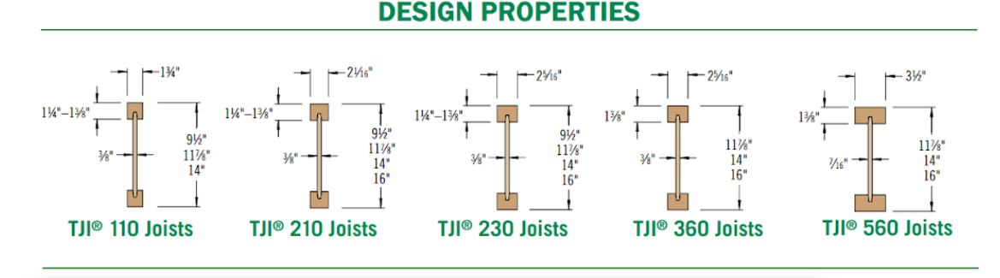
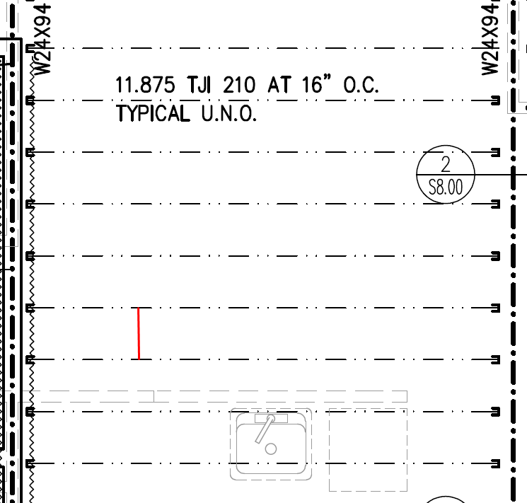
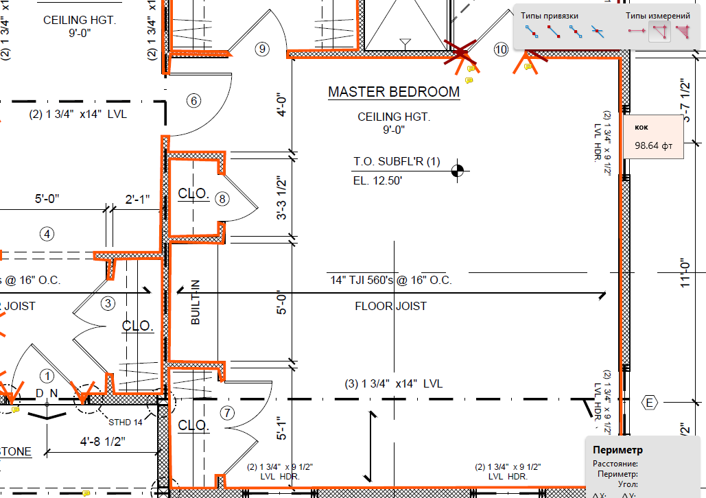
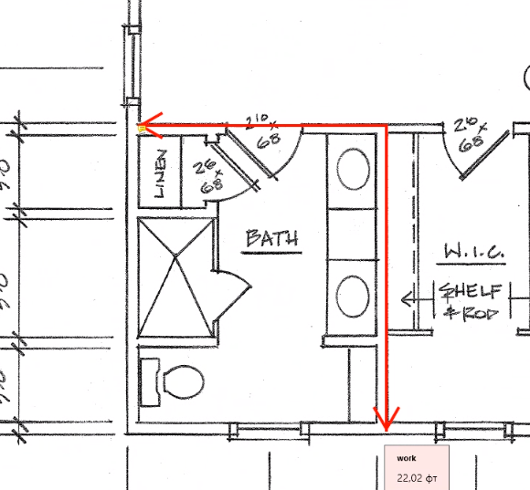

# Preview страницы

Эта страница нужна редактору как быстрый visual check: открыть локально, посмотреть
читабельность, карточки с картинками, таблицы и связи между правилами. Она не
заменяет рабочие разделы, а показывает, как должна выглядеть хорошая предметная
страница. Шаблон один для читателя и редактора: он же описан в
[Как пользоваться](how-to-use.md).

## Быстрый маршрут

-   :material-floor-plan:{ .lg .middle } **Joist**

    ---

    Product family, spacing, hangers и EWP naming должны быть видны рядом с
    картинками, а не спрятаны в длинном тексте.

    [Открыть Joist](../work/horizontal/floor-framing/joist.md)

-   :material-format-paint:{ .lg .middle } **Interior Trims**

    ---

    Base, Crown, Casing и Door/Window Trim лучше проверять по rule cards:
    картинка + правило + что делать в takeoff.

    [Открыть Interior Trims](../work/interior-trims/overview.md)

-   :material-wall:{ .lg .middle } **Exterior Wall**

    ---

    Wall height, bottom plate, shear/draft-stop notes и material variants
    должны читаться как чек-лист.

    [Открыть Exterior](../work/vertical/walls/exterior.md)

-   :material-clipboard-check-outline:{ .lg .middle } **QA**

    ---

    Перед output проверь scope, drawings, formulas, waste, FRT, hangers и
    client-specific rules.

    [Открыть QA checklist](quality-checklist.md)

## Как должна читаться topic page

Предметная страница раздела "Работа" идёт в таком порядке:

| Блок | Что в нём должно быть | Для чего |
| --- | --- | --- |
| Картинка сверху | Разрез или план самого элемента; у каждой детали номер, номер = строка DFL с единицей | Чтобы работник узнал элемент на чертеже и сразу видел, в какую строку он идёт |
| `Что это` | Чем элемент отличается от соседнего | Чтобы не спутать Sill Plate с Btm Plate |
| `Где искать на чертежах` | Лист, schedule, notes, details | Чтобы не искать источник наугад |
| `Как мерить в OurPlanCore` | Инструмент (Line, Area, Count, J Area, Beam, Openings), что обводить, на листе с какой точкой W/F/S/U; скрин замера именно этого элемента | Чтобы замер у всех был одинаковым |
| `Как назвать в дереве и строка DFL` | Имя позиции, подпись строки, колонка D, формула и фактор | Чтобы имя прочитали макросы, а число сошлось |
| `Частые ошибки` | Что находили на проверках, с реальными числами | Чтобы поймать ошибку до сдачи |
| `Пример` | 3-6 строк дерева или DFL; арифметика сходится и совпадает с соседними страницами | Чтобы было с чем сверить свою книгу |
| `См. также` | Соседние страницы | Чтобы правило не дублировалось |

Одно правило живёт на одной странице. Если число или единица нужны в другом месте, там стоит короткая версия и ссылка, а не вторая формулировка: две формулировки рано или поздно разойдутся.

!!! note "Главное правило"
    Картинка должна быть связана с действием: что проверить на drawings и как
    это меняет takeoff/output.

## Быстрые клавиши

| Где | Клавиши | Что делает |
| --- | --- | --- |
| Wiki search | ++ctrl+k++ / ++cmd+k++ | Быстро найти правило по русскому или английскому term. |

!!! tip "Где полная таблица"
    Клавиши программы и редактор назначений описаны в одном месте:
    [Горячие клавиши OurPlanCore](../reference/ourplancore-shortcuts.md).
    На предметной странице оставляй ссылку на нужный сценарий, чтобы старая
    копия таблицы не попадала в поиск как актуальная инструкция.

## Визуальная проверка

  
Скрыть 4 правил с иллюстрациями

  <figure class="kb-figure-row">
    <figcaption class="kb-figure-row__text">
      
Joist product family

      
Сохраняй точную series: <code>TJI 230</code>, <code>RED</code>, <code>LPI</code>, <code>BCI</code>.

      
В output должно быть видно, какой product family был указан в schedule.

    </figcaption>
    
  </figure>
  <figure class="kb-figure-row">
    <figcaption class="kb-figure-row__text">
      
O.C. spacing

      
Spacing считается center-to-center, не от края lumber.

      
Перед formula проверь, что plan реально показывает 12 / 16 / 19.2 / 24 o.c.

    </figcaption>
    
  </figure>
  <figure class="kb-figure-row">
    <figcaption class="kb-figure-row__text">
      
Interior Trim perimeter

      
Base и Crown считаются по room perimeter, но исключения надо проверять отдельно.

      
Kitchen cabinets, closets, garage и room schedule могут менять count.

    </figcaption>
    
  </figure>
  <figure class="kb-figure-row">
    <figcaption class="kb-figure-row__text">
      
Feedback rules

      
Правки от boss должны попадать в точную topic page и в reference, если это общий rule.

      
Так правило потом находится через search и не теряется в source map.

    </figcaption>
    
  </figure>

## Мини-чеклист перед сдачей

- [ ] Rule написан коротко и применимо; единица как в колонке D (`LFT`, `SQ FT`, `4x8`, `pcs`).
- [ ] Формула и пример пересчитаны руками; число совпадает с соседними страницами и с [Формулами](../reference/formulas.md).
- [ ] Подпись под картинкой описывает то, что на картинке на самом деле.
- [ ] Technical terms оставлены на английском: `Joist`, `Rim Board`, `FRT`,
  `Sheathing`, `Hangers`.
- [ ] Объяснения на русском.
- [ ] У картинки есть action note: что проверить и что сделать.
- [ ] Есть ссылка на смежные страницы.
- [ ] Нет private data: emails, UID, salary, credentials, private links.

## See also

- [Как пользоваться](how-to-use.md)
- [Картинки и схемы](images-and-schemas.md)
- [Советы и важные вещи](../reference/boss-feedback-rules.md)
